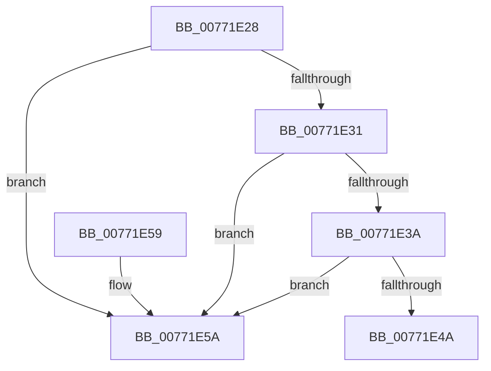

# PopDirectedDripsInsertQueueDevice

- RVA: `0x00771E28`–`0x00771E61` (길이 `57` bytes)
- VA: `0x0000000140771E28`
- 실행 섹션: `PAGE`
- PDB 이름 있음: `예`; PDB Function 태그: `아니요`
- unwind 정보 RVA: `0x000DB714`
- 디코드: `19`개 명령, `57/57` bytes 표시
- 미해석 바이트: `0` (있으면 어셈블리에 `.byte`로 보존)

> 이 문서는 커널 이미지의 기계어와 PDB 기호를 분석해 생성했습니다. 4번과 5번은 함수 원형과 자료형을 바이너리 사용 방식에서 추정한 C 해석이며 원본 소스 복구 결과는 아닙니다.

## 1. Dependencies

- 직접 호출 지점: **0**; 고유 호출 대상: **0**
- 직접 호출자로 확인된 함수: **5**
- RIP 상대 이미지 참조: **0**

### Outgoing calls
- 직접 디코드된 call 명령이 없습니다.

### Direct callers
- [PopDirectedDripsBuildBroadcastTreeFull](PopDirectedDripsBuildBroadcastTreeFull_function_00771970.md) at `0x007719DB`
- [PopDirectedDripsBuildPs4BroadcastTree](PopDirectedDripsBuildPs4BroadcastTree_function_00771C90.md) at `0x00771CCA`
- [PopDirectedDripsVisitPs4Device](PopDirectedDripsVisitPs4Device_function_00771EE0.md) at `0x00771F91`
- [PopDirectedDripsMarkDfxDevice](../AA/PopDirectedDripsMarkDfxDevice_function_00AACA44.md) at `0x00AACB2C`
- [sub_00B4A78A](../B4/Unknown_function_00B4A78A.md) at `0x00B4A7B4`

### Static image references
- 디코드된 RIP-relative 메모리 참조가 없습니다.

## 2. Other-region calls and transfers

- 다른 실행 섹션으로 향하는 call: **0**
- 별도 외부 분기/꼬리 이동을 확인하지 못했습니다.

## 3. Assembly (complete function range)

```asm
00771E28  4C 8B 02                        mov r8, qword ptr [rdx]
00771E2B  49 39 50 08                     cmp qword ptr [r8 + 8], rdx
00771E2F  75 29                           jne 0x140771e5a
00771E31  48 8B 42 08                     mov rax, qword ptr [rdx + 8]
00771E35  48 39 10                        cmp qword ptr [rax], rdx
00771E38  75 20                           jne 0x140771e5a
00771E3A  4C 89 00                        mov qword ptr [rax], r8
00771E3D  49 89 40 08                     mov qword ptr [r8 + 8], rax
00771E41  48 8B 41 08                     mov rax, qword ptr [rcx + 8]
00771E45  48 39 08                        cmp qword ptr [rax], rcx
00771E48  75 10                           jne 0x140771e5a
00771E4A  48 89 0A                        mov qword ptr [rdx], rcx
00771E4D  48 89 42 08                     mov qword ptr [rdx + 8], rax
00771E51  48 89 10                        mov qword ptr [rax], rdx
00771E54  48 89 51 08                     mov qword ptr [rcx + 8], rdx
00771E58  C3                              ret
00771E59  CC                              int3
00771E5A  B9 03 00 00 00                  mov ecx, 3
00771E5F  CD 29                           int 0x29
```

## 4. C-style interpretation (structured pseudocode)

```c
__int64 __fastcall PopDirectedDripsInsertQueueDevice(__int64 a1, __int64 a2)
{
    if ((*(unsigned __int64 *)(*(unsigned __int64 *)(a2) + 8)) != a2) goto loc_00771E5A;
    if ((*(unsigned __int64 *)(*(unsigned __int64 *)(a2 + 8))) != a2) goto loc_00771E5A;
    *(unsigned __int64 *)(*(unsigned __int64 *)(a2 + 8)) = *(unsigned __int64 *)(a2);
    *(unsigned __int64 *)(*(unsigned __int64 *)(a2) + 8) = *(unsigned __int64 *)(a2 + 8);
    if ((*(unsigned __int64 *)(*(unsigned __int64 *)(a1 + 8))) != a1) goto loc_00771E5A;
    *(unsigned __int64 *)(a2) = a1;
    *(unsigned __int64 *)(a2 + 8) = *(unsigned __int64 *)(a1 + 8);
    *(unsigned __int64 *)(*(unsigned __int64 *)(a1 + 8)) = a2;
    *(unsigned __int64 *)(a1 + 8) = a2;
    return *(unsigned __int64 *)(a1 + 8);
loc_00771E5A:
    return *(unsigned __int64 *)(a1 + 8);
}
```

## 5. (Beta) C Style

```c
int64_t PopDirectedDripsInsertQueueDevice(void *Arg1, void *Arg2)
{
    uint8_t *arg1 = (uint8_t *)Arg1;
    uint8_t *arg2 = (uint8_t *)Arg2;

    if ((*(uint64_t *)(*(uint64_t *)(arg2) + 0x8)) != Arg2) goto loc_00771E5A;
    if ((*(uint64_t *)(*(uint64_t *)(arg2 + 0x8))) != Arg2) goto loc_00771E5A;
    *(uint64_t *)(*(uint64_t *)(arg2 + 0x8)) = *(uint64_t *)(arg2);
    *(uint64_t *)(*(uint64_t *)(arg2) + 0x8) = *(uint64_t *)(arg2 + 0x8);
    if ((*(uint64_t *)(*(uint64_t *)(arg1 + 0x8))) != Arg1) goto loc_00771E5A;
    *(void **)(arg2) = Arg1;
    *(uint64_t *)(arg2 + 0x8) = *(uint64_t *)(arg1 + 0x8);
    *(void **)(*(uint64_t *)(arg1 + 0x8)) = Arg2;
    *(void **)(arg1 + 0x8) = Arg2;
    return *(uint64_t *)(arg1 + 0x8);
loc_00771E5A:
    return *(uint64_t *)(arg1 + 0x8);
}
```

### 관측된 메모리 오프셋

구조체 형식이 확인되지 않은 접근은 인자 기준의 오프셋으로만 기록했습니다.

| 기준 인자 | 오프셋 표현 | 폭 (bit) | 접근 |
|---|---:|---:|---|
| `Arg1` | `+ 0x8` | `64` | `R` |
| `Arg1` | `+ 0x8` | `64` | `W` |
| `Arg2` | `+ 0x0` | `64` | `R` |
| `Arg2` | `+ 0x0` | `64` | `W` |
| `Arg2` | `+ 0x8` | `64` | `R` |
| `Arg2` | `+ 0x8` | `64` | `W` |

## 6. Execution-region graph

[열기: 2D/3D 그래프와 함수 탐색 컨트롤 패널](../../../control-panel.html?section=page&rva=0x00771E28&view=graph)

- 2D 그래프는 위에서 아래로 흐르고, 3D 그래프는 빈 공간을 드래그해 회전합니다. Shift+드래그는 이동, 휠은 확대·축소, 함수 노드 선택은 대상 보고서 이동입니다.

### Static fallback


