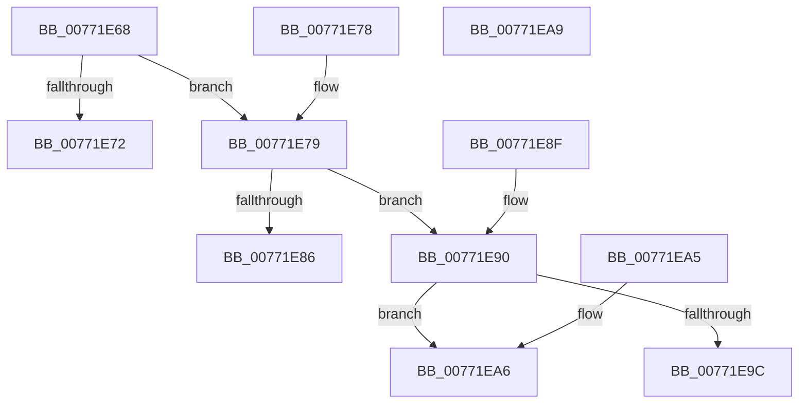

# PopDirectedDripsIsLikelySpecialDevice

- RVA: `0x00771E68`–`0x00771EAA` (길이 `66` bytes)
- VA: `0x0000000140771E68`
- 실행 섹션: `PAGE`
- PDB 이름 있음: `예`; PDB Function 태그: `아니요`
- unwind 정보 RVA: `0x000DB714`
- 디코드: `24`개 명령, `66/66` bytes 표시
- 미해석 바이트: `0` (있으면 어셈블리에 `.byte`로 보존)

> 이 문서는 커널 이미지의 기계어와 PDB 기호를 분석해 생성했습니다. 4번과 5번은 함수 원형과 자료형을 바이너리 사용 방식에서 추정한 C 해석이며 원본 소스 복구 결과는 아닙니다.

## 1. Dependencies

- 직접 호출 지점: **0**; 고유 호출 대상: **0**
- 직접 호출자로 확인된 함수: **2**
- RIP 상대 이미지 참조: **0**

### Outgoing calls
- 직접 디코드된 call 명령이 없습니다.

### Direct callers
- [PopDirectedDripsBuildBroadcastTreeFull](PopDirectedDripsBuildBroadcastTreeFull_function_00771970.md) at `0x00771A28`
- [PopDirectedDripsVisitPs4Device](PopDirectedDripsVisitPs4Device_function_00771EE0.md) at `0x00771F29`

### Static image references
- 디코드된 RIP-relative 메모리 참조가 없습니다.

## 2. Other-region calls and transfers

- 다른 실행 섹션으로 향하는 call: **0**
- 별도 외부 분기/꼬리 이동을 확인하지 못했습니다.

## 3. Assembly (complete function range)

```asm
00771E68  8B 81 F8 02 00 00               mov eax, dword ptr [rcx + 0x2f8]
00771E6E  A8 10                           test al, 0x10
00771E70  74 07                           je 0x140771e79
00771E72  83 22 00                        and dword ptr [rdx], 0
00771E75  B0 01                           mov al, 1
00771E77  C3                              ret
00771E78  CC                              int3
00771E79  48 8B 41 20                     mov rax, qword ptr [rcx + 0x20]
00771E7D  F7 40 30 00 00 00 02            test dword ptr [rax + 0x30], 0x2000000
00771E84  74 0A                           je 0x140771e90
00771E86  B0 01                           mov al, 1
00771E88  C7 02 07 00 00 00               mov dword ptr [rdx], 7
00771E8E  C3                              ret
00771E8F  CC                              int3
00771E90  8B 81 F8 02 00 00               mov eax, dword ptr [rcx + 0x2f8]
00771E96  0F BA E0 13                     bt eax, 0x13
00771E9A  73 0A                           jae 0x140771ea6
00771E9C  B0 01                           mov al, 1
00771E9E  C7 02 06 00 00 00               mov dword ptr [rdx], 6
00771EA4  C3                              ret
00771EA5  CC                              int3
00771EA6  32 C0                           xor al, al
00771EA8  C3                              ret
00771EA9  CC                              int3
```

## 4. C-style interpretation (structured pseudocode)

```c
__int64 __fastcall PopDirectedDripsIsLikelySpecialDevice(__int64 a1, __int64 a2)
{
    __int64 result;

    if ((((unsigned __int8)((unsigned int)(*(unsigned int *)(a1 + 760)))) & (16)) == 0) goto loc_00771E79;
    return 1;
loc_00771E79:
    if (((*(unsigned int *)(*(unsigned __int64 *)(a1 + 32) + 48)) & (0x2000000ULL)) == 0) goto loc_00771E90;
    *(unsigned int *)(a2) = 7;
    return 1;
loc_00771E90:
    if (condition_is_above_or_equal) goto loc_00771EA6;
    *(unsigned int *)(a2) = 6;
    return 1;
loc_00771EA6:
    result = 0;
    return result;
}
```

## 5. (Beta) C Style

```c
int64_t PopDirectedDripsIsLikelySpecialDevice(void *Arg1, void *Arg2)
{
    uint8_t *arg1 = (uint8_t *)Arg1;
    uint8_t *arg2 = (uint8_t *)Arg2;

    int64_t result;

    if ((((uint8_t)((uint32_t)(*(uint32_t *)(arg1 + 0x2F8)))) & (16)) == 0) goto loc_00771E79;
    return 1;
loc_00771E79:
    if (((*(uint32_t *)(*(uint64_t *)(arg1 + 0x20) + 0x30)) & (0x2000000ULL)) == 0) goto loc_00771E90;
    *(uint32_t *)(arg2) = 7;
    return 1;
loc_00771E90:
    if (condition_is_above_or_equal) goto loc_00771EA6;
    *(uint32_t *)(arg2) = 6;
    return 1;
loc_00771EA6:
    result = 0;
    return result;
}
```

### 관측된 메모리 오프셋

구조체 형식이 확인되지 않은 접근은 인자 기준의 오프셋으로만 기록했습니다.

| 기준 인자 | 오프셋 표현 | 폭 (bit) | 접근 |
|---|---:|---:|---|
| `Arg1` | `+ 0x20` | `64` | `R` |
| `Arg1` | `+ 0x2F8` | `32` | `R` |
| `Arg2` | `+ 0x0` | `32` | `R/W` |
| `Arg2` | `+ 0x0` | `32` | `W` |

## 6. Execution-region graph

[열기: 2D/3D 그래프와 함수 탐색 컨트롤 패널](../../../control-panel.html?section=page&rva=0x00771E68&view=graph)

- 2D 그래프는 위에서 아래로 흐르고, 3D 그래프는 빈 공간을 드래그해 회전합니다. Shift+드래그는 이동, 휠은 확대·축소, 함수 노드 선택은 대상 보고서 이동입니다.

### Static fallback


