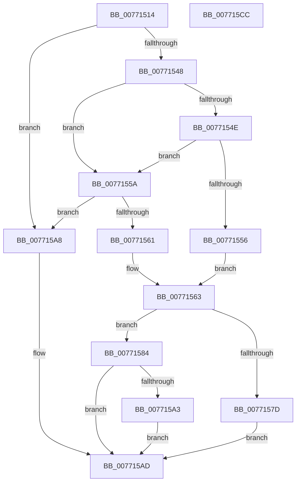

# PopDirectedDripsUmCreateTestDevice

- RVA: `0x00771514`–`0x007715CD` (길이 `185` bytes)
- VA: `0x0000000140771514`
- 실행 섹션: `PAGE`
- PDB 이름 있음: `예`; PDB Function 태그: `아니요`
- unwind 정보 RVA: `0x00075C18`
- 디코드: `62`개 명령, `185/185` bytes 표시
- 미해석 바이트: `0` (있으면 어셈블리에 `.byte`로 보존)

> 이 문서는 커널 이미지의 기계어와 PDB 기호를 분석해 생성했습니다. 4번과 5번은 함수 원형과 자료형을 바이너리 사용 방식에서 추정한 C 해석이며 원본 소스 복구 결과는 아닙니다.

## 1. Dependencies

- 직접 호출 지점: **2**; 고유 호출 대상: **2**
- 직접 호출자로 확인된 함수: **1**
- RIP 상대 이미지 참조: **0**

### Outgoing calls
- `0x00771570` → [ExAllocatePool2](../../poolcode/B8/ExAllocatePool2_function_00B820F0.md) (function, `0x00B820F0`)
- `0x0077158E` → [memcpy](../../text/6C/memcpy_function_006C6840.md) (function, `0x006C6840`)

### Direct callers
- [PopDirectedDripsUmDirectedFxAddTestDevice](PopDirectedDripsUmDirectedFxAddTestDevice_function_007715D4.md) at `0x00771634`

### Static image references
- 디코드된 RIP-relative 메모리 참조가 없습니다.

## 2. Other-region calls and transfers

- 다른 실행 섹션으로 향하는 call: **2**
  - `0x00771570` → [ExAllocatePool2](../../poolcode/B8/ExAllocatePool2_function_00B820F0.md) (`PAGE` → `POOLCODE`)
  - `0x0077158E` → [memcpy](../../text/6C/memcpy_function_006C6840.md) (`PAGE` → `.text`)
- 별도 외부 분기/꼬리 이동을 확인하지 못했습니다.

## 3. Assembly (complete function range)

```asm
00771514  48 89 5C 24 08                  mov qword ptr [rsp + 8], rbx
00771519  48 89 6C 24 10                  mov qword ptr [rsp + 0x10], rbp
0077151E  48 89 74 24 18                  mov qword ptr [rsp + 0x18], rsi
00771523  57                              push rdi
00771524  41 54                           push r12
00771526  41 55                           push r13
00771528  41 56                           push r14
0077152A  41 57                           push r15
0077152C  48 83 EC 20                     sub rsp, 0x20
00771530  44 8D 2C 09                     lea r13d, [rcx + rcx]
00771534  4D 8B F9                        mov r15, r9
00771537  41 8D 7D 08                     lea edi, [r13 + 8]
0077153B  4D 8B E0                        mov r12, r8
0077153E  48 8B EA                        mov rbp, rdx
00771541  8B F1                           mov esi, ecx
00771543  83 FF 08                        cmp edi, 8
00771546  72 60                           jb 0x1407715a8
00771548  33 DB                           xor ebx, ebx
0077154A  85 C9                           test ecx, ecx
0077154C  74 0C                           je 0x14077155a
0077154E  FF C9                           dec ecx
00771550  66 39 1C 4A                     cmp word ptr [rdx + rcx*2], bx
00771554  75 04                           jne 0x14077155a
00771556  8B F1                           mov esi, ecx
00771558  EB 09                           jmp 0x140771563
0077155A  8D 47 02                        lea eax, [rdi + 2]
0077155D  3B C7                           cmp eax, edi
0077155F  72 47                           jb 0x1407715a8
00771561  8B F8                           mov edi, eax
00771563  8B D7                           mov edx, edi
00771565  B9 00 01 00 00                  mov ecx, 0x100
0077156A  41 B8 44 44 55 4D               mov r8d, 0x4d554444
00771570  E8 7B 0B 41 00                  call 0x140b820f0
00771575  4C 8B F0                        mov r14, rax
00771578  48 85 C0                        test rax, rax
0077157B  75 07                           jne 0x140771584
0077157D  BB 9A 00 00 C0                  mov ebx, 0xc000009a
00771582  EB 29                           jmp 0x1407715ad
00771584  45 8B C5                        mov r8d, r13d
00771587  48 8D 48 08                     lea rcx, [rax + 8]
0077158B  48 8B D5                        mov rdx, rbp
0077158E  E8 AD 52 F5 FF                  call 0x1406c6840
00771593  41 89 1E                        mov dword ptr [r14], ebx
00771596  41 89 76 04                     mov dword ptr [r14 + 4], esi
0077159A  4D 89 34 24                     mov qword ptr [r12], r14
0077159E  4D 85 FF                        test r15, r15
007715A1  74 0A                           je 0x1407715ad
007715A3  41 89 3F                        mov dword ptr [r15], edi
007715A6  EB 05                           jmp 0x1407715ad
007715A8  BB 95 00 00 C0                  mov ebx, 0xc0000095
007715AD  48 8B 6C 24 58                  mov rbp, qword ptr [rsp + 0x58]
007715B2  8B C3                           mov eax, ebx
007715B4  48 8B 5C 24 50                  mov rbx, qword ptr [rsp + 0x50]
007715B9  48 8B 74 24 60                  mov rsi, qword ptr [rsp + 0x60]
007715BE  48 83 C4 20                     add rsp, 0x20
007715C2  41 5F                           pop r15
007715C4  41 5E                           pop r14
007715C6  41 5D                           pop r13
007715C8  41 5C                           pop r12
007715CA  5F                              pop rdi
007715CB  C3                              ret
007715CC  CC                              int3
```

## 4. C-style interpretation (structured pseudocode)

```c
__int64 __fastcall PopDirectedDripsUmCreateTestDevice(__int64 a1, __int64 a2, __int64 a3, __int64 a4)
{
    __int64 result;
    __int64 v_rbx;
    __int64 v_rsp;
    unsigned __int64 v_stack_p10;
    unsigned __int64 v_stack_p18;
    unsigned __int64 v_stack_p8;

    v_stack_p8 = v_rbx;
    v_stack_p10 = v_rbp;
    v_stack_p18 = v_rsi;
    v_rsp = (v_rsp) - (32);
    if (((unsigned int)(a1 + a1 * 1 + 8)) < 8) goto loc_007715A8;
    v_rbx = 0;
    if ((unsigned int)(a1) == 0) goto loc_0077155A;
    a1 = (unsigned int)((a1) - 1);
    if ((*(unsigned __int16 *)(a2 + a1 * 2)) != 0) goto loc_0077155A;
    goto loc_00771563;
loc_0077155A:
    if (((unsigned int)(a1 + a1 * 1 + 8 + 2)) < ((unsigned int)(a1 + a1 * 1 + 8))) goto loc_007715A8;
loc_00771563:
    result = ExAllocatePool2(256, (unsigned int)((unsigned int)((unsigned int)((unsigned int)(a1 + a1 * 1 + 8 + 2)))), (unsigned int)(0x4D554444ULL), a4);
    if (result != 0) goto loc_00771584;
    goto loc_007715AD;
loc_00771584:
    result = memcpy(result + 8, a2, (unsigned int)((unsigned int)(a1 + a1 * 1)), a4);
    *(unsigned int *)(result) = (unsigned int)((unsigned int)(0xC000009AULL));
    *(unsigned int *)(result + 4) = (unsigned int)((unsigned int)((unsigned int)(a1)));
    *(unsigned __int64 *)(a3) = result;
    if (a4 == 0) goto loc_007715AD;
    *(unsigned int *)(a4) = (unsigned int)((unsigned int)((unsigned int)(a1 + a1 * 1 + 8 + 2)));
    goto loc_007715AD;
loc_007715A8:
loc_007715AD:
    v_rsp = (v_rsp) + (32);
    return (unsigned int)((unsigned int)((unsigned int)(0xC0000095ULL)));
}
```

## 5. (Beta) C Style

```c
int64_t PopDirectedDripsUmCreateTestDevice(void *Arg1, void *Arg2, void *Arg3, int64_t Arg4)
{
    uint8_t *arg1 = (uint8_t *)Arg1;
    uint8_t *arg2 = (uint8_t *)Arg2;
    uint8_t *arg3 = (uint8_t *)Arg3;

    int64_t result;
    int64_t local_rbx;
    int64_t local_rsp;
    uint64_t v_stack_p10;
    uint64_t v_stack_p18;
    uint64_t v_stack_p8;

    v_stack_p8 = local_rbx;
    v_stack_p10 = local_rbp;
    v_stack_p18 = local_rsi;
    local_rsp = (local_rsp) - (32);
    if (((uint32_t)(Arg1 + Arg1 * 1 + 8)) < 8) goto loc_007715A8;
    local_rbx = 0;
    if ((uint32_t)(Arg1) == 0) goto loc_0077155A;
    Arg1 = (uint32_t)((Arg1) - 1);
    if ((*(uint16_t *)(arg2 + arg1 * 2)) != 0) goto loc_0077155A;
    goto loc_00771563;
loc_0077155A:
    if (((uint32_t)(Arg1 + Arg1 * 1 + 8 + 2)) < ((uint32_t)(Arg1 + Arg1 * 1 + 8))) goto loc_007715A8;
loc_00771563:
    result = ExAllocatePool2(256, (uint32_t)((uint32_t)((uint32_t)((uint32_t)(Arg1 + Arg1 * 1 + 8 + 2)))), (uint32_t)(0x4D554444ULL), Arg4);
    if (result != 0) goto loc_00771584;
    goto loc_007715AD;
loc_00771584:
    result = memcpy(result + 8, Arg2, (uint32_t)((uint32_t)(Arg1 + Arg1 * 1)), Arg4);
    *(uint32_t *)(result) = (uint32_t)((uint32_t)(0xC000009AULL));
    *(uint32_t *)(result + 0x4) = (uint32_t)((uint32_t)((uint32_t)(Arg1)));
    *(uint64_t *)(arg3) = result;
    if (Arg4 == 0) goto loc_007715AD;
    *(uint32_t *)(Arg4) = (uint32_t)((uint32_t)((uint32_t)(Arg1 + Arg1 * 1 + 8 + 2)));
    goto loc_007715AD;
loc_007715A8:
loc_007715AD:
    local_rsp = (local_rsp) + (32);
    return (uint32_t)((uint32_t)((uint32_t)(0xC0000095ULL)));
}
```

### 관측된 메모리 오프셋

구조체 형식이 확인되지 않은 접근은 인자 기준의 오프셋으로만 기록했습니다.

| 기준 인자 | 오프셋 표현 | 폭 (bit) | 접근 |
|---|---:|---:|---|
| `Arg1` | `+ 0x0 + rcx*1` | `32` | `R` |
| `Arg1` | `+ 0x8` | `32` | `R` |
| `Arg2` | `+ 0x0 + rcx*2` | `16` | `R` |
| `Arg3` | `+ 0x0` | `64` | `W` |

## 6. Execution-region graph

[열기: 2D/3D 그래프와 함수 탐색 컨트롤 패널](../../../control-panel.html?section=page&rva=0x00771514&view=graph)

- 2D 그래프는 위에서 아래로 흐르고, 3D 그래프는 빈 공간을 드래그해 회전합니다. Shift+드래그는 이동, 휠은 확대·축소, 함수 노드 선택은 대상 보고서 이동입니다.

### Static fallback


