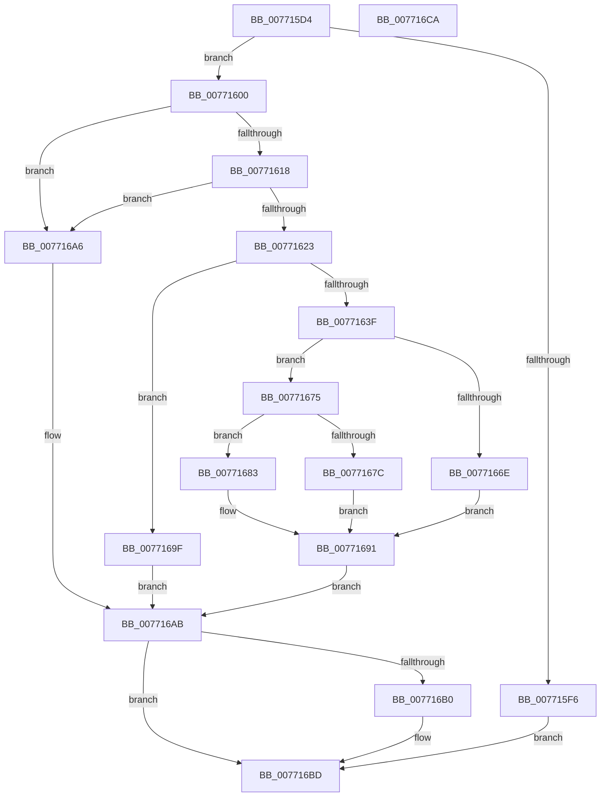

# PopDirectedDripsUmDirectedFxAddTestDevice

- RVA: `0x007715D4`–`0x007716CB` (길이 `247` bytes)
- VA: `0x00000001407715D4`
- 실행 섹션: `PAGE`
- PDB 이름 있음: `예`; PDB Function 태그: `아니요`
- unwind 정보 RVA: `0x000CD720`
- 디코드: `66`개 명령, `247/247` bytes 표시
- 미해석 바이트: `0` (있으면 어셈블리에 `.byte`로 보존)

> 이 문서는 커널 이미지의 기계어와 PDB 기호를 분석해 생성했습니다. 4번과 5번은 함수 원형과 자료형을 바이너리 사용 방식에서 추정한 C 해석이며 원본 소스 복구 결과는 아닙니다.

## 1. Dependencies

- 직접 호출 지점: **5**; 고유 호출 대상: **5**
- 직접 호출자로 확인된 함수: **1**
- RIP 상대 이미지 참조: **3**

### Outgoing calls
- `0x00771634` → [PopDirectedDripsUmCreateTestDevice](PopDirectedDripsUmCreateTestDevice_function_00771514.md) (function, `0x00771514`)
- `0x00771646` → [PopAcquireRwLockExclusive](../../text/43/PopAcquireRwLockExclusive_function_00430B44.md) (function, `0x00430B44`)
- `0x00771664` → [RtlInsertElementGenericTableAvl](../../text/3E/RtlInsertElementGenericTableAvl_function_003EE510.md) (function, `0x003EE510`)
- `0x00771698` → [PopReleaseRwLock](../../text/2D/PopReleaseRwLock_function_002DFBBC.md) (function, `0x002DFBBC`)
- `0x007716B8` → [ExFreePoolWithTag](../../poolcode/B8/ExFreePoolWithTag_function_00B82870.md) (function, `0x00B82870`)

### Direct callers
- [PopDirectedDripsUmPowerInformationInternal](../70/PopDirectedDripsUmPowerInformationInternal_function_007010E4.md) at `0x00701163`

### Static image references
- `0x0077163F` → RVA `0x00F07290` (`.data`; read)
- `0x0077165A` → RVA `0x00F07220` (`.data`; read)
- `0x00771683` → RVA `0x00F07288` (`.data`; read/write)

## 2. Other-region calls and transfers

- 다른 실행 섹션으로 향하는 call: **4**
  - `0x00771646` → [PopAcquireRwLockExclusive](../../text/43/PopAcquireRwLockExclusive_function_00430B44.md) (`PAGE` → `.text`)
  - `0x00771664` → [RtlInsertElementGenericTableAvl](../../text/3E/RtlInsertElementGenericTableAvl_function_003EE510.md) (`PAGE` → `.text`)
  - `0x00771698` → [PopReleaseRwLock](../../text/2D/PopReleaseRwLock_function_002DFBBC.md) (`PAGE` → `.text`)
  - `0x007716B8` → [ExFreePoolWithTag](../../poolcode/B8/ExFreePoolWithTag_function_00B82870.md) (`PAGE` → `POOLCODE`)
- 별도 외부 분기/꼬리 이동을 확인하지 못했습니다.

## 3. Assembly (complete function range)

```asm
007715D4  48 8B C4                        mov rax, rsp
007715D7  48 89 58 10                     mov qword ptr [rax + 0x10], rbx
007715DB  57                              push rdi
007715DC  48 83 EC 20                     sub rsp, 0x20
007715E0  83 60 18 00                     and dword ptr [rax + 0x18], 0
007715E4  33 FF                           xor edi, edi
007715E6  C6 40 08 00                     mov byte ptr [rax + 8], 0
007715EA  4C 8B C2                        mov r8, rdx
007715ED  48 89 78 20                     mov qword ptr [rax + 0x20], rdi
007715F1  83 F9 10                        cmp ecx, 0x10
007715F4  73 0A                           jae 0x140771600
007715F6  BB 0D 00 00 C0                  mov ebx, 0xc000000d
007715FB  E9 BD 00 00 00                  jmp 0x1407716bd
00771600  44 8B 52 0C                     mov r10d, dword ptr [rdx + 0xc]
00771604  B8 FF FF FF FF                  mov eax, 0xffffffff
00771609  41 8B D2                        mov edx, r10d
0077160C  48 03 D2                        add rdx, rdx
0077160F  48 3B D0                        cmp rdx, rax
00771612  0F 87 8E 00 00 00               ja 0x1407716a6
00771618  8D 41 F0                        lea eax, [rcx - 0x10]
0077161B  3B D0                           cmp edx, eax
0077161D  0F 87 83 00 00 00               ja 0x1407716a6
00771623  49 8D 50 10                     lea rdx, [r8 + 0x10]
00771627  41 8B CA                        mov ecx, r10d
0077162A  4C 8D 44 24 48                  lea r8, [rsp + 0x48]
0077162F  4C 8D 4C 24 40                  lea r9, [rsp + 0x40]
00771634  E8 DB FE FF FF                  call 0x140771514
00771639  8B D8                           mov ebx, eax
0077163B  85 C0                           test eax, eax
0077163D  78 60                           js 0x14077169f
0077163F  48 8D 0D 4A 5C 79 00            lea rcx, [rip + 0x795c4a]
00771646  E8 F9 F4 CB FF                  call 0x140430b44
0077164B  48 8B 7C 24 48                  mov rdi, qword ptr [rsp + 0x48]
00771650  4C 8D 4C 24 30                  lea r9, [rsp + 0x30]
00771655  44 8B 44 24 40                  mov r8d, dword ptr [rsp + 0x40]
0077165A  48 8D 0D BF 5B 79 00            lea rcx, [rip + 0x795bbf]
00771661  48 8B D7                        mov rdx, rdi
00771664  E8 A7 CE C7 FF                  call 0x1403ee510
00771669  48 85 C0                        test rax, rax
0077166C  75 07                           jne 0x140771675
0077166E  BB 9A 00 00 C0                  mov ebx, 0xc000009a
00771673  EB 1C                           jmp 0x140771691
00771675  80 7C 24 30 00                  cmp byte ptr [rsp + 0x30], 0
0077167A  75 07                           jne 0x140771683
0077167C  BB 18 07 00 C0                  mov ebx, 0xc0000718
00771681  EB 0E                           jmp 0x140771691
00771683  F0 FF 05 FE 5B 79 00            lock inc dword ptr [rip + 0x795bfe]
0077168A  48 8B 7C 24 48                  mov rdi, qword ptr [rsp + 0x48]
0077168F  33 DB                           xor ebx, ebx
00771691  48 8D 0D F8 5B 79 00            lea rcx, [rip + 0x795bf8]
00771698  E8 1F E5 B6 FF                  call 0x1402dfbbc
0077169D  EB 0C                           jmp 0x1407716ab
0077169F  48 8B 7C 24 48                  mov rdi, qword ptr [rsp + 0x48]
007716A4  EB 05                           jmp 0x1407716ab
007716A6  BB 0D 00 00 C0                  mov ebx, 0xc000000d
007716AB  48 85 FF                        test rdi, rdi
007716AE  74 0D                           je 0x1407716bd
007716B0  BA 44 44 55 4D                  mov edx, 0x4d554444
007716B5  48 8B CF                        mov rcx, rdi
007716B8  E8 B3 11 41 00                  call 0x140b82870
007716BD  8B C3                           mov eax, ebx
007716BF  48 8B 5C 24 38                  mov rbx, qword ptr [rsp + 0x38]
007716C4  48 83 C4 20                     add rsp, 0x20
007716C8  5F                              pop rdi
007716C9  C3                              ret
007716CA  CC                              int3
```

## 4. C-style interpretation (structured pseudocode)

```c
__int64 __fastcall PopDirectedDripsUmDirectedFxAddTestDevice(__int64 a1, __int64 a2)
{
    __int64 result;
    __int64 v_rbx;
    __int64 v_rdi;
    __int64 v_rsp;
    unsigned __int64 v_stack_p10;
    unsigned __int64 v_stack_p18;
    unsigned __int64 v_stack_p20;
    unsigned __int64 v_stack_p8;

    *(unsigned __int64 *)(v_rsp + 16) = v_rbx;
    v_rsp = (v_rsp) - (32);
    v_rdi = 0;
    *(unsigned __int8 *)(v_rsp + 8) = 0;
    *(unsigned __int64 *)(v_rsp + 32) = 0;
    if (((unsigned int)(a1)) >= 16) goto loc_00771600;
    goto loc_007716BD;
loc_00771600:
    a2 = ((unsigned int)((unsigned int)((unsigned int)(*(unsigned int *)(a2 + 12))))) + ((unsigned int)((unsigned int)((unsigned int)(*(unsigned int *)(a2 + 12)))));
    if (a2 > ((unsigned int)(0xFFFFFFFFULL))) goto loc_007716A6;
    if (((unsigned int)(a2)) > ((unsigned int)(a1 - 16))) goto loc_007716A6;
    result = PopDirectedDripsUmCreateTestDevice((unsigned int)((unsigned int)((unsigned int)(*(unsigned int *)(a2 + 12)))), a2 + 16, v_stack_p20, v_stack_p18);
    if (sign_flag) goto loc_0077169F;
    result = PopAcquireRwLockExclusive(v_rip + 7953482, a2 + 16, v_stack_p20, v_stack_p18);
    result = RtlInsertElementGenericTableAvl(v_rip + 7953343, v_stack_p20, (unsigned int)(v_stack_p18), v_stack_p8);
    if (result != 0) goto loc_00771675;
    goto loc_00771691;
loc_00771675:
    if (v_stack_p8 != 0) goto loc_00771683;
    goto loc_00771691;
loc_00771683:
    v_rbx = 0;
loc_00771691:
    result = PopReleaseRwLock(v_rip + 7953400, v_stack_p20, (unsigned int)(v_stack_p18), v_stack_p8);
    goto loc_007716AB;
loc_0077169F:
    goto loc_007716AB;
loc_007716A6:
loc_007716AB:
    if (v_stack_p20 != 0) {
        a2 = 0x4D554444ULL;
        a1 = v_stack_p20;
        result = ExFreePoolWithTag(a1, a2, (unsigned int)(v_stack_p18), v_stack_p8);
    }
    v_rsp = (v_rsp) + (32);
    return (unsigned int)((unsigned int)((unsigned int)(0xC000000DULL)));
}
```

## 5. (Beta) C Style

```c
int64_t PopDirectedDripsUmDirectedFxAddTestDevice(int64_t Arg1, void *Arg2)
{
    uint8_t *arg2 = (uint8_t *)Arg2;

    int64_t result;
    int64_t local_rbx;
    int64_t local_rdi;
    int64_t local_rsp;
    uint64_t v_stack_p10;
    uint64_t v_stack_p18;
    uint64_t v_stack_p20;
    uint64_t v_stack_p8;

    *(uint64_t *)(local_rsp + 0x10) = local_rbx;
    local_rsp = (local_rsp) - (32);
    local_rdi = 0;
    *(uint8_t *)(local_rsp + 0x8) = 0;
    *(uint64_t *)(local_rsp + 0x20) = 0;
    if (((uint32_t)(Arg1)) >= 16) goto loc_00771600;
    goto loc_007716BD;
loc_00771600:
    Arg2 = ((uint32_t)((uint32_t)((uint32_t)(*(uint32_t *)(arg2 + 0xC))))) + ((uint32_t)((uint32_t)((uint32_t)(*(uint32_t *)(arg2 + 0xC)))));
    if (Arg2 > ((uint32_t)(0xFFFFFFFFULL))) goto loc_007716A6;
    if (((uint32_t)(Arg2)) > ((uint32_t)(Arg1 - 16))) goto loc_007716A6;
    result = PopDirectedDripsUmCreateTestDevice((uint32_t)((uint32_t)((uint32_t)(*(uint32_t *)(arg2 + 0xC)))), Arg2 + 16, v_stack_p20, v_stack_p18);
    if (sign_flag) goto loc_0077169F;
    result = PopAcquireRwLockExclusive(v_rip + 7953482, Arg2 + 16, v_stack_p20, v_stack_p18);
    result = RtlInsertElementGenericTableAvl(v_rip + 7953343, v_stack_p20, (uint32_t)(v_stack_p18), v_stack_p8);
    if (result != 0) goto loc_00771675;
    goto loc_00771691;
loc_00771675:
    if (v_stack_p8 != 0) goto loc_00771683;
    goto loc_00771691;
loc_00771683:
    local_rbx = 0;
loc_00771691:
    result = PopReleaseRwLock(v_rip + 7953400, v_stack_p20, (uint32_t)(v_stack_p18), v_stack_p8);
    goto loc_007716AB;
loc_0077169F:
    goto loc_007716AB;
loc_007716A6:
loc_007716AB:
    if (v_stack_p20 != 0) {
        Arg2 = 0x4D554444ULL;
        Arg1 = v_stack_p20;
        result = ExFreePoolWithTag(Arg1, Arg2, (uint32_t)(v_stack_p18), v_stack_p8);
    }
    local_rsp = (local_rsp) + (32);
    return (uint32_t)((uint32_t)((uint32_t)(0xC000000DULL)));
}
```

### 관측된 메모리 오프셋

구조체 형식이 확인되지 않은 접근은 인자 기준의 오프셋으로만 기록했습니다.

| 기준 인자 | 오프셋 표현 | 폭 (bit) | 접근 |
|---|---:|---:|---|
| `Arg2` | `+ 0xC` | `32` | `R` |
| `Arg2` | `+ 0x10` | `64` | `R` |

## 6. Execution-region graph

[열기: 2D/3D 그래프와 함수 탐색 컨트롤 패널](../../../control-panel.html?section=page&rva=0x007715D4&view=graph)

- 2D 그래프는 위에서 아래로 흐르고, 3D 그래프는 빈 공간을 드래그해 회전합니다. Shift+드래그는 이동, 휠은 확대·축소, 함수 노드 선택은 대상 보고서 이동입니다.

### Static fallback


