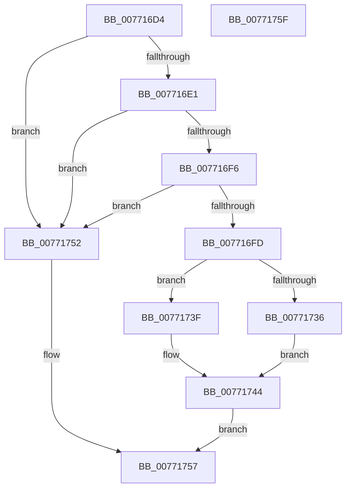

# PopDirectedDripsUmDirectedFxRemoveTestDevice

- RVA: `0x007716D4`–`0x00771760` (길이 `140` bytes)
- VA: `0x00000001407716D4`
- 실행 섹션: `PAGE`
- PDB 이름 있음: `예`; PDB Function 태그: `아니요`
- unwind 정보 RVA: `0x00064C80`
- 디코드: `38`개 명령, `140/140` bytes 표시
- 미해석 바이트: `0` (있으면 어셈블리에 `.byte`로 보존)

> 이 문서는 커널 이미지의 기계어와 PDB 기호를 분석해 생성했습니다. 4번과 5번은 함수 원형과 자료형을 바이너리 사용 방식에서 추정한 C 해석이며 원본 소스 복구 결과는 아닙니다.

## 1. Dependencies

- 직접 호출 지점: **3**; 고유 호출 대상: **3**
- 직접 호출자로 확인된 함수: **1**
- RIP 상대 이미지 참조: **3**

### Outgoing calls
- `0x0077171A` → [PopAcquireRwLockExclusive](../../text/43/PopAcquireRwLockExclusive_function_00430B44.md) (function, `0x00430B44`)
- `0x0077172B` → [RtlDeleteElementGenericTableAvl](../../text/3E/RtlDeleteElementGenericTableAvl_function_003EE750.md) (function, `0x003EE750`)
- `0x0077174B` → [PopReleaseRwLock](../../text/2D/PopReleaseRwLock_function_002DFBBC.md) (function, `0x002DFBBC`)

### Direct callers
- [PopDirectedDripsUmPowerInformationInternal](../70/PopDirectedDripsUmPowerInformationInternal_function_007010E4.md) at `0x00701156`

### Static image references
- `0x00771709` → RVA `0x00F07290` (`.data`; read)
- `0x00771724` → RVA `0x00F07220` (`.data`; read)
- `0x00771736` → RVA `0x00F07288` (`.data`; read/write)

## 2. Other-region calls and transfers

- 다른 실행 섹션으로 향하는 call: **3**
  - `0x0077171A` → [PopAcquireRwLockExclusive](../../text/43/PopAcquireRwLockExclusive_function_00430B44.md) (`PAGE` → `.text`)
  - `0x0077172B` → [RtlDeleteElementGenericTableAvl](../../text/3E/RtlDeleteElementGenericTableAvl_function_003EE750.md) (`PAGE` → `.text`)
  - `0x0077174B` → [PopReleaseRwLock](../../text/2D/PopReleaseRwLock_function_002DFBBC.md) (`PAGE` → `.text`)
- 별도 외부 분기/꼬리 이동을 확인하지 못했습니다.

## 3. Assembly (complete function range)

```asm
007716D4  40 53                           push rbx
007716D6  48 83 EC 30                     sub rsp, 0x30
007716DA  8B C1                           mov eax, ecx
007716DC  83 F9 0C                        cmp ecx, 0xc
007716DF  72 71                           jb 0x140771752
007716E1  44 8B 42 08                     mov r8d, dword ptr [rdx + 8]
007716E5  41 B9 FF FF FF FF               mov r9d, 0xffffffff
007716EB  41 8B C8                        mov ecx, r8d
007716EE  48 03 C9                        add rcx, rcx
007716F1  49 3B C9                        cmp rcx, r9
007716F4  77 5C                           ja 0x140771752
007716F6  83 C0 F4                        add eax, -0xc
007716F9  3B C8                           cmp ecx, eax
007716FB  77 55                           ja 0x140771752
007716FD  48 8D 42 0C                     lea rax, [rdx + 0xc]
00771701  C7 44 24 20 01 00 00 00         mov dword ptr [rsp + 0x20], 1
00771709  48 8D 0D 80 5B 79 00            lea rcx, [rip + 0x795b80]
00771710  48 89 44 24 28                  mov qword ptr [rsp + 0x28], rax
00771715  44 89 44 24 24                  mov dword ptr [rsp + 0x24], r8d
0077171A  E8 25 F4 CB FF                  call 0x140430b44
0077171F  48 8D 54 24 20                  lea rdx, [rsp + 0x20]
00771724  48 8D 0D F5 5A 79 00            lea rcx, [rip + 0x795af5]
0077172B  E8 20 D0 C7 FF                  call 0x1403ee750
00771730  33 DB                           xor ebx, ebx
00771732  84 C0                           test al, al
00771734  74 09                           je 0x14077173f
00771736  F0 FF 0D 4B 5B 79 00            lock dec dword ptr [rip + 0x795b4b]
0077173D  EB 05                           jmp 0x140771744
0077173F  BB 25 02 00 C0                  mov ebx, 0xc0000225
00771744  48 8D 0D 45 5B 79 00            lea rcx, [rip + 0x795b45]
0077174B  E8 6C E4 B6 FF                  call 0x1402dfbbc
00771750  EB 05                           jmp 0x140771757
00771752  BB 0D 00 00 C0                  mov ebx, 0xc000000d
00771757  8B C3                           mov eax, ebx
00771759  48 83 C4 30                     add rsp, 0x30
0077175D  5B                              pop rbx
0077175E  C3                              ret
0077175F  CC                              int3
```

## 4. C-style interpretation (structured pseudocode)

```c
__int64 __fastcall PopDirectedDripsUmDirectedFxRemoveTestDevice(int a1, __int64 a2)
{
    __int64 result;
    __int64 v_rbx;
    __int64 v_rsp;
    unsigned __int64 v_stack_m10;
    unsigned int v_stack_m14;
    unsigned int v_stack_m18;

    v_rsp = (v_rsp) - (48);
    if (a1 < 12) goto loc_00771752;
    a1 = ((unsigned int)((unsigned int)((unsigned int)(*(unsigned int *)(a2 + 8))))) + ((unsigned int)((unsigned int)((unsigned int)(*(unsigned int *)(a2 + 8)))));
    if (a1 > ((unsigned int)(0xFFFFFFFFULL))) goto loc_00771752;
    result = (unsigned int)(((unsigned int)(a1)) + (-12));
    if (a1 > ((unsigned int)(result))) goto loc_00771752;
    v_stack_m18 = 1;
    v_stack_m10 = a2 + 12;
    v_stack_m14 = (unsigned int)((unsigned int)(*(unsigned int *)(a2 + 8)));
    result = PopAcquireRwLockExclusive(v_rip + 7953280, a2, (unsigned int)(*(unsigned int *)(a2 + 8)), (unsigned int)(0xFFFFFFFFULL));
    result = RtlDeleteElementGenericTableAvl(v_rip + 7953141, v_stack_m18, (unsigned int)(*(unsigned int *)(a2 + 8)), (unsigned int)(0xFFFFFFFFULL));
    v_rbx = 0;
    if ((unsigned __int8)(result) == 0) goto loc_0077173F;
    goto loc_00771744;
loc_0077173F:
loc_00771744:
    result = PopReleaseRwLock(v_rip + 7953221, v_stack_m18, (unsigned int)(*(unsigned int *)(a2 + 8)), (unsigned int)(0xFFFFFFFFULL));
    goto loc_00771757;
loc_00771752:
loc_00771757:
    v_rsp = (v_rsp) + (48);
    return (unsigned int)((unsigned int)((unsigned int)(0xC000000DULL)));
}
```

## 5. (Beta) C Style

```c
int64_t PopDirectedDripsUmDirectedFxRemoveTestDevice(int32_t Arg1, void *Arg2)
{
    uint8_t *arg2 = (uint8_t *)Arg2;

    int64_t result;
    int64_t local_rbx;
    int64_t local_rsp;
    uint64_t v_stack_m10;
    uint32_t v_stack_m14;
    uint32_t v_stack_m18;

    local_rsp = (local_rsp) - (48);
    if (Arg1 < 12) goto loc_00771752;
    Arg1 = ((uint32_t)((uint32_t)((uint32_t)(*(uint32_t *)(arg2 + 0x8))))) + ((uint32_t)((uint32_t)((uint32_t)(*(uint32_t *)(arg2 + 0x8)))));
    if (Arg1 > ((uint32_t)(0xFFFFFFFFULL))) goto loc_00771752;
    result = (uint32_t)(((uint32_t)(Arg1)) + (-12));
    if (Arg1 > ((uint32_t)(result))) goto loc_00771752;
    v_stack_m18 = 1;
    v_stack_m10 = Arg2 + 12;
    v_stack_m14 = (uint32_t)((uint32_t)(*(uint32_t *)(arg2 + 0x8)));
    result = PopAcquireRwLockExclusive(v_rip + 7953280, Arg2, (uint32_t)(*(uint32_t *)(arg2 + 0x8)), (uint32_t)(0xFFFFFFFFULL));
    result = RtlDeleteElementGenericTableAvl(v_rip + 7953141, v_stack_m18, (uint32_t)(*(uint32_t *)(arg2 + 0x8)), (uint32_t)(0xFFFFFFFFULL));
    local_rbx = 0;
    if ((uint8_t)(result) == 0) goto loc_0077173F;
    goto loc_00771744;
loc_0077173F:
loc_00771744:
    result = PopReleaseRwLock(v_rip + 7953221, v_stack_m18, (uint32_t)(*(uint32_t *)(arg2 + 0x8)), (uint32_t)(0xFFFFFFFFULL));
    goto loc_00771757;
loc_00771752:
loc_00771757:
    local_rsp = (local_rsp) + (48);
    return (uint32_t)((uint32_t)((uint32_t)(0xC000000DULL)));
}
```

### 관측된 메모리 오프셋

구조체 형식이 확인되지 않은 접근은 인자 기준의 오프셋으로만 기록했습니다.

| 기준 인자 | 오프셋 표현 | 폭 (bit) | 접근 |
|---|---:|---:|---|
| `Arg2` | `+ 0x8` | `32` | `R` |
| `Arg2` | `+ 0xC` | `64` | `R` |

## 6. Execution-region graph

[열기: 2D/3D 그래프와 함수 탐색 컨트롤 패널](../../../control-panel.html?section=page&rva=0x007716D4&view=graph)

- 2D 그래프는 위에서 아래로 흐르고, 3D 그래프는 빈 공간을 드래그해 회전합니다. Shift+드래그는 이동, 휠은 확대·축소, 함수 노드 선택은 대상 보고서 이동입니다.

### Static fallback


