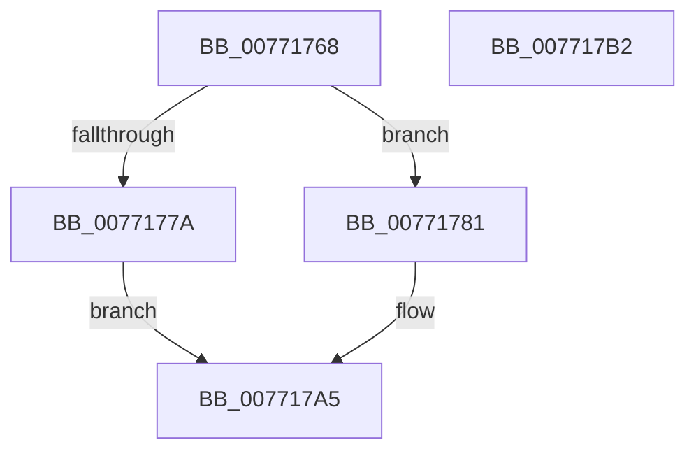

# PopDirectedDripsUmDirectedFxSetMode

- RVA: `0x00771768`–`0x007717B3` (길이 `75` bytes)
- VA: `0x0000000140771768`
- 실행 섹션: `PAGE`
- PDB 이름 있음: `예`; PDB Function 태그: `아니요`
- unwind 정보 RVA: `0x0005CAAC`
- 디코드: `21`개 명령, `75/75` bytes 표시
- 미해석 바이트: `0` (있으면 어셈블리에 `.byte`로 보존)

> 이 문서는 커널 이미지의 기계어와 PDB 기호를 분석해 생성했습니다. 4번과 5번은 함수 원형과 자료형을 바이너리 사용 방식에서 추정한 C 해석이며 원본 소스 복구 결과는 아닙니다.

## 1. Dependencies

- 직접 호출 지점: **2**; 고유 호출 대상: **2**
- 직접 호출자로 확인된 함수: **1**
- RIP 상대 이미지 참조: **2**

### Outgoing calls
- `0x00771788` → [PopAcquireRwLockExclusive](../../text/43/PopAcquireRwLockExclusive_function_00430B44.md) (function, `0x00430B44`)
- `0x007717A0` → [PopReleaseRwLock](../../text/2D/PopReleaseRwLock_function_002DFBBC.md) (function, `0x002DFBBC`)

### Direct callers
- [PopDirectedDripsUmPowerInformationInternal](../70/PopDirectedDripsUmPowerInformationInternal_function_007010E4.md) at `0x00701149`

### Static image references
- `0x00771781` → RVA `0x00F07290` (`.data`; read)
- `0x00771799` → RVA `0x00F07210` (`.data`; write)

## 2. Other-region calls and transfers

- 다른 실행 섹션으로 향하는 call: **2**
  - `0x00771788` → [PopAcquireRwLockExclusive](../../text/43/PopAcquireRwLockExclusive_function_00430B44.md) (`PAGE` → `.text`)
  - `0x007717A0` → [PopReleaseRwLock](../../text/2D/PopReleaseRwLock_function_002DFBBC.md) (`PAGE` → `.text`)
- 별도 외부 분기/꼬리 이동을 확인하지 못했습니다.

## 3. Assembly (complete function range)

```asm
00771768  48 89 5C 24 08                  mov qword ptr [rsp + 8], rbx
0077176D  57                              push rdi
0077176E  48 83 EC 20                     sub rsp, 0x20
00771772  48 8B FA                        mov rdi, rdx
00771775  83 F9 0C                        cmp ecx, 0xc
00771778  73 07                           jae 0x140771781
0077177A  BB 0D 00 00 C0                  mov ebx, 0xc000000d
0077177F  EB 24                           jmp 0x1407717a5
00771781  48 8D 0D 08 5B 79 00            lea rcx, [rip + 0x795b08]
00771788  E8 B7 F3 CB FF                  call 0x140430b44
0077178D  33 DB                           xor ebx, ebx
0077178F  48 8D 0D FA 5A 79 00            lea rcx, [rip + 0x795afa]
00771796  38 5F 08                        cmp byte ptr [rdi + 8], bl
00771799  0F 95 05 70 5A 79 00            setne byte ptr [rip + 0x795a70]
007717A0  E8 17 E4 B6 FF                  call 0x1402dfbbc
007717A5  8B C3                           mov eax, ebx
007717A7  48 8B 5C 24 30                  mov rbx, qword ptr [rsp + 0x30]
007717AC  48 83 C4 20                     add rsp, 0x20
007717B0  5F                              pop rdi
007717B1  C3                              ret
007717B2  CC                              int3
```

## 4. C-style interpretation (structured pseudocode)

```c
__int64 __fastcall PopDirectedDripsUmDirectedFxSetMode(int a1, __int64 a2)
{
    __int64 result;
    __int64 v_rbx;
    __int64 v_rsp;
    unsigned __int64 v_stack_p8;

    v_stack_p8 = v_rbx;
    v_rsp = (v_rsp) - (32);
    if (a1 >= 12) goto loc_00771781;
    goto loc_007717A5;
loc_00771781:
    result = PopAcquireRwLockExclusive(v_rip + 7953160, a2, a3, a4);
    v_rbx = 0;
    result = PopReleaseRwLock(v_rip + 7953146, a2, a3, a4);
loc_007717A5:
    v_rsp = (v_rsp) + (32);
    return 0;
}
```

## 5. (Beta) C Style

```c
int64_t PopDirectedDripsUmDirectedFxSetMode(int32_t Arg1, void *Arg2)
{
    uint8_t *arg2 = (uint8_t *)Arg2;

    int64_t result;
    int64_t local_rbx;
    int64_t local_rsp;
    uint64_t v_stack_p8;

    v_stack_p8 = local_rbx;
    local_rsp = (local_rsp) - (32);
    if (Arg1 >= 12) goto loc_00771781;
    goto loc_007717A5;
loc_00771781:
    result = PopAcquireRwLockExclusive(v_rip + 7953160, Arg2, a3, a4);
    local_rbx = 0;
    result = PopReleaseRwLock(v_rip + 7953146, Arg2, a3, a4);
loc_007717A5:
    local_rsp = (local_rsp) + (32);
    return 0;
}
```

### 관측된 메모리 오프셋

구조체 형식이 확인되지 않은 접근은 인자 기준의 오프셋으로만 기록했습니다.

| 기준 인자 | 오프셋 표현 | 폭 (bit) | 접근 |
|---|---:|---:|---|
| `Arg2` | `+ 0x8` | `8` | `R` |

## 6. Execution-region graph

[열기: 2D/3D 그래프와 함수 탐색 컨트롤 패널](../../../control-panel.html?section=page&rva=0x00771768&view=graph)

- 2D 그래프는 위에서 아래로 흐르고, 3D 그래프는 빈 공간을 드래그해 회전합니다. Shift+드래그는 이동, 휠은 확대·축소, 함수 노드 선택은 대상 보고서 이동입니다.

### Static fallback


