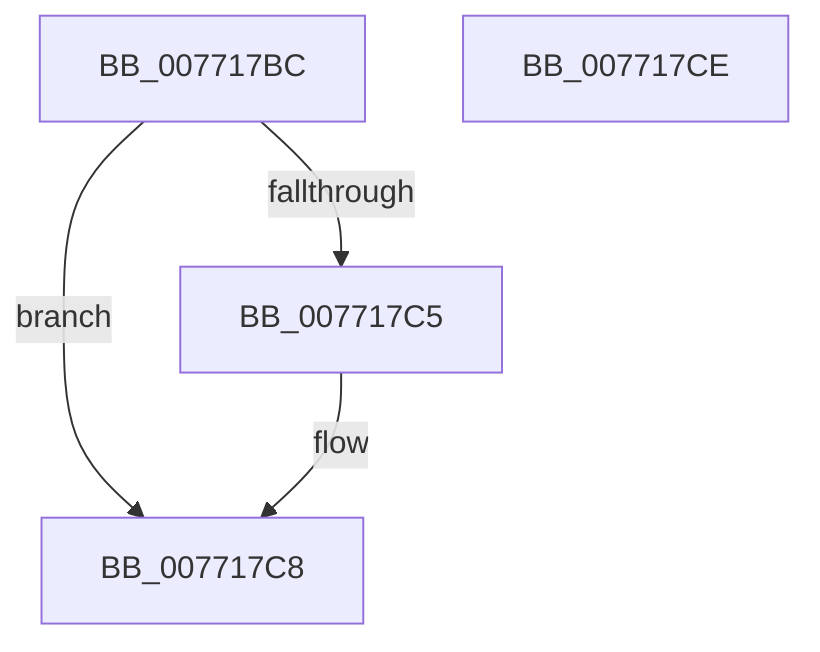

# PopDirectedDripsUmGetDeviceInstancePath

- RVA: `0x007717BC`–`0x007717CF` (길이 `19` bytes)
- VA: `0x00000001407717BC`
- 실행 섹션: `PAGE`
- PDB 이름 있음: `예`; PDB Function 태그: `아니요`
- unwind 정보 RVA: `0x000DB714`
- 디코드: `8`개 명령, `19/19` bytes 표시
- 미해석 바이트: `0` (있으면 어셈블리에 `.byte`로 보존)

> 이 문서는 커널 이미지의 기계어와 PDB 기호를 분석해 생성했습니다. 4번과 5번은 함수 원형과 자료형을 바이너리 사용 방식에서 추정한 C 해석이며 원본 소스 복구 결과는 아닙니다.

## 1. Dependencies

- 직접 호출 지점: **0**; 고유 호출 대상: **0**
- 직접 호출자로 확인된 함수: **1**
- RIP 상대 이미지 참조: **0**

### Outgoing calls
- 직접 디코드된 call 명령이 없습니다.

### Direct callers
- [PopDirectedDripsUmTestDeviceCompare](PopDirectedDripsUmTestDeviceCompare_function_007718F0.md) at `0x00771908`
- [PopDirectedDripsUmTestDeviceCompare](PopDirectedDripsUmTestDeviceCompare_function_007718F0.md) at `0x00771918`

### Static image references
- 디코드된 RIP-relative 메모리 참조가 없습니다.

## 2. Other-region calls and transfers

- 다른 실행 섹션으로 향하는 call: **0**
- 별도 외부 분기/꼬리 이동을 확인하지 못했습니다.

## 3. Assembly (complete function range)

```asm
007717BC  83 39 00                        cmp dword ptr [rcx], 0
007717BF  48 8D 41 08                     lea rax, [rcx + 8]
007717C3  74 03                           je 0x1407717c8
007717C5  48 8B 00                        mov rax, qword ptr [rax]
007717C8  8B 49 04                        mov ecx, dword ptr [rcx + 4]
007717CB  89 0A                           mov dword ptr [rdx], ecx
007717CD  C3                              ret
007717CE  CC                              int3
```

## 4. C-style interpretation (structured pseudocode)

```c
__int64 __fastcall PopDirectedDripsUmGetDeviceInstancePath(__int64 a1, __int64 a2)
{
    __int64 result;

    result = a1 + 8;
    if ((*(unsigned int *)(a1)) != 0) {
        result = *(unsigned __int64 *)(a1 + 8);
    }
    *(unsigned int *)(a2) = (unsigned int)((unsigned int)(*(unsigned int *)(a1 + 4)));
    return result;
}
```

## 5. (Beta) C Style

```c
int64_t PopDirectedDripsUmGetDeviceInstancePath(void *Arg1, void *Arg2)
{
    uint8_t *arg1 = (uint8_t *)Arg1;
    uint8_t *arg2 = (uint8_t *)Arg2;

    int64_t result;

    result = Arg1 + 8;
    if ((*(uint32_t *)(arg1)) != 0) {
        result = *(uint64_t *)(arg1 + 0x8);
    }
    *(uint32_t *)(arg2) = (uint32_t)((uint32_t)(*(uint32_t *)(arg1 + 0x4)));
    return result;
}
```

### 관측된 메모리 오프셋

구조체 형식이 확인되지 않은 접근은 인자 기준의 오프셋으로만 기록했습니다.

| 기준 인자 | 오프셋 표현 | 폭 (bit) | 접근 |
|---|---:|---:|---|
| `Arg1` | `+ 0x0` | `32` | `R` |
| `Arg1` | `+ 0x0` | `64` | `R` |
| `Arg1` | `+ 0x4` | `32` | `R` |
| `Arg1` | `+ 0x8` | `64` | `R` |
| `Arg2` | `+ 0x0` | `32` | `W` |

## 6. Execution-region graph

[열기: 2D/3D 그래프와 함수 탐색 컨트롤 패널](../../../control-panel.html?section=page&rva=0x007717BC&view=graph)

- 2D 그래프는 위에서 아래로 흐르고, 3D 그래프는 빈 공간을 드래그해 회전합니다. Shift+드래그는 이동, 휠은 확대·축소, 함수 노드 선택은 대상 보고서 이동입니다.

### Static fallback


