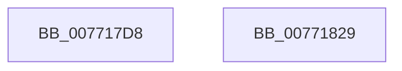

# PopDirectedDripsUmInitialize

- RVA: `0x007717D8`–`0x0077182A` (길이 `82` bytes)
- VA: `0x00000001407717D8`
- 실행 섹션: `PAGE`
- PDB 이름 있음: `예`; PDB Function 태그: `아니요`
- unwind 정보 RVA: `0x0005D2F4`
- 디코드: `14`개 명령, `82/82` bytes 표시
- 미해석 바이트: `0` (있으면 어셈블리에 `.byte`로 보존)

> 이 문서는 커널 이미지의 기계어와 PDB 기호를 분석해 생성했습니다. 4번과 5번은 함수 원형과 자료형을 바이너리 사용 방식에서 추정한 C 해석이며 원본 소스 복구 결과는 아닙니다.

## 1. Dependencies

- 직접 호출 지점: **1**; 고유 호출 대상: **1**
- 직접 호출자로 확인된 함수: **1**
- RIP 상대 이미지 참조: **8**

### Outgoing calls
- `0x00771818` → [RtlInitializeGenericTableAvl](../../text/46/RtlInitializeGenericTableAvl_function_00466100.md) (function, `0x00466100`)

### Direct callers
- [PopDirectedDripsInitializePhase0](../../init/C3/PopDirectedDripsInitializePhase0_function_00C3E4BC.md) at `0x00C3E583`

### Static image references
- `0x007717DC` → RVA `0x00F07298` (`.data`; read/write)
- `0x007717E4` → RVA `0x00771950` (`PopDirectedDripsUmTestDeviceFree`; read)
- `0x007717EB` → RVA `0x00F07290` (`.data`; read/write)
- `0x007717F3` → RVA `0x007718C0` (`PopDirectedDripsUmTestDeviceAllocate`; read)
- `0x00771800` → RVA `0x007718F0` (`PopDirectedDripsUmTestDeviceCompare`; read)
- `0x00771807` → RVA `0x00F07220` (`.data`; read)
- `0x0077180E` → RVA `0x00F07288` (`.data`; write)
- `0x0077181D` → RVA `0x00F07210` (`.data`; write)

## 2. Other-region calls and transfers

- 다른 실행 섹션으로 향하는 call: **1**
  - `0x00771818` → [RtlInitializeGenericTableAvl](../../text/46/RtlInitializeGenericTableAvl_function_00466100.md) (`PAGE` → `.text`)
- 별도 외부 분기/꼬리 이동을 확인하지 못했습니다.

## 3. Assembly (complete function range)

```asm
007717D8  48 83 EC 38                     sub rsp, 0x38
007717DC  48 83 25 B4 5A 79 00 00         and qword ptr [rip + 0x795ab4], 0
007717E4  4C 8D 0D 65 01 00 00            lea r9, [rip + 0x165]
007717EB  48 83 25 9D 5A 79 00 00         and qword ptr [rip + 0x795a9d], 0
007717F3  4C 8D 05 C6 00 00 00            lea r8, [rip + 0xc6]
007717FA  48 83 64 24 20 00               and qword ptr [rsp + 0x20], 0
00771800  48 8D 15 E9 00 00 00            lea rdx, [rip + 0xe9]
00771807  48 8D 0D 12 5A 79 00            lea rcx, [rip + 0x795a12]
0077180E  C7 05 70 5A 79 00 00 00 00 00   mov dword ptr [rip + 0x795a70], 0
00771818  E8 E3 48 CF FF                  call 0x140466100
0077181D  C6 05 EC 59 79 00 00            mov byte ptr [rip + 0x7959ec], 0
00771824  48 83 C4 38                     add rsp, 0x38
00771828  C3                              ret
00771829  CC                              int3
```

## 4. C-style interpretation (structured pseudocode)

```c
__int64 __fastcall PopDirectedDripsUmInitialize(void)
{
    __int64 result;
    __int64 v_rsp;
    unsigned __int64 v_stack_m18;

    v_rsp = (v_rsp) - (56);
    *(unsigned int *)(v_rip + 7953008) = 0;
    result = RtlInitializeGenericTableAvl(v_rip + 7952914, v_rip + 233, v_rip + 198, v_rip + 357);
    *(unsigned __int8 *)(v_rip + 7952876) = 0;
    v_rsp = (v_rsp) + (56);
    return result;
}
```

## 5. (Beta) C Style

```c
void PopDirectedDripsUmInitialize(void)
{
    int64_t result;
    int64_t local_rsp;
    uint64_t v_stack_m18;

    local_rsp = (local_rsp) - (56);
    *(uint32_t *)(v_rip + 0x795A70) = 0;
    result = RtlInitializeGenericTableAvl(v_rip + 7952914, v_rip + 233, v_rip + 198, v_rip + 357);
    *(uint8_t *)(v_rip + 0x7959EC) = 0;
    local_rsp = (local_rsp) + (56);
    return result;
}
```

## 6. Execution-region graph

[열기: 2D/3D 그래프와 함수 탐색 컨트롤 패널](../../../control-panel.html?section=page&rva=0x007717D8&view=graph)

- 2D 그래프는 위에서 아래로 흐르고, 3D 그래프는 빈 공간을 드래그해 회전합니다. Shift+드래그는 이동, 휠은 확대·축소, 함수 노드 선택은 대상 보고서 이동입니다.

### Static fallback


