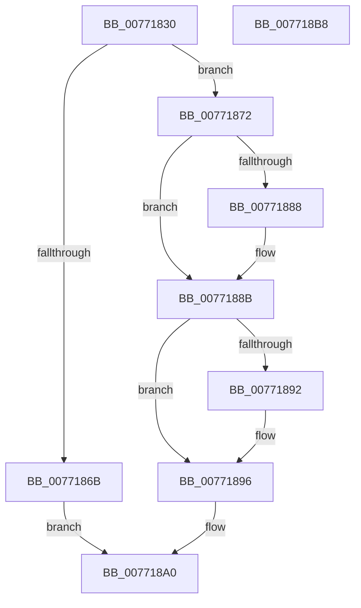

# PopDirectedDripsUmQueryCapabilities

- RVA: `0x00771830`–`0x007718B9` (길이 `137` bytes)
- VA: `0x0000000140771830`
- 실행 섹션: `PAGE`
- PDB 이름 있음: `예`; PDB Function 태그: `아니요`
- unwind 정보 RVA: `0x000BF8F0`
- 디코드: `39`개 명령, `137/137` bytes 표시
- 미해석 바이트: `0` (있으면 어셈블리에 `.byte`로 보존)

> 이 문서는 커널 이미지의 기계어와 PDB 기호를 분석해 생성했습니다. 4번과 5번은 함수 원형과 자료형을 바이너리 사용 방식에서 추정한 C 해석이며 원본 소스 복구 결과는 아닙니다.

## 1. Dependencies

- 직접 호출 지점: **2**; 고유 호출 대상: **2**
- 직접 호출자로 확인된 함수: **1**
- RIP 상대 이미지 참조: **0**

### Outgoing calls
- `0x0077185E` → [ExAllocatePool2](../../poolcode/B8/ExAllocatePool2_function_00B820F0.md) (function, `0x00B820F0`)
- `0x0077187C` → [PopDirectedDripsQueryMitigationStatus](../A9/PopDirectedDripsQueryMitigationStatus_function_00A994B8.md) (function, `0x00A994B8`)

### Direct callers
- [PopDirectedDripsUmPowerInformationInternal](../70/PopDirectedDripsUmPowerInformationInternal_function_007010E4.md) at `0x0070113C`

### Static image references
- 디코드된 RIP-relative 메모리 참조가 없습니다.

## 2. Other-region calls and transfers

- 다른 실행 섹션으로 향하는 call: **1**
  - `0x0077185E` → [ExAllocatePool2](../../poolcode/B8/ExAllocatePool2_function_00B820F0.md) (`PAGE` → `POOLCODE`)
- 별도 외부 분기/꼬리 이동을 확인하지 못했습니다.

## 3. Assembly (complete function range)

```asm
00771830  48 8B C4                        mov rax, rsp
00771833  48 89 58 08                     mov qword ptr [rax + 8], rbx
00771837  48 89 70 10                     mov qword ptr [rax + 0x10], rsi
0077183B  48 89 78 20                     mov qword ptr [rax + 0x20], rdi
0077183F  41 56                           push r14
00771841  48 83 EC 20                     sub rsp, 0x20
00771845  33 DB                           xor ebx, ebx
00771847  48 8B F2                        mov rsi, rdx
0077184A  4C 8B F1                        mov r14, rcx
0077184D  89 58 18                        mov dword ptr [rax + 0x18], ebx
00771850  B9 00 01 00 00                  mov ecx, 0x100
00771855  41 B8 4D 65 6D 20               mov r8d, 0x206d654d
0077185B  8D 53 02                        lea edx, [rbx + 2]
0077185E  E8 8D 08 41 00                  call 0x140b820f0
00771863  48 8B F8                        mov rdi, rax
00771866  48 85 C0                        test rax, rax
00771869  75 07                           jne 0x140771872
0077186B  BB 9A 00 00 C0                  mov ebx, 0xc000009a
00771870  EB 2E                           jmp 0x1407718a0
00771872  45 33 C0                        xor r8d, r8d
00771875  48 8D 4C 24 40                  lea rcx, [rsp + 0x40]
0077187A  33 D2                           xor edx, edx
0077187C  E8 37 7C 32 00                  call 0x140a994b8
00771881  F6 44 24 40 01                  test byte ptr [rsp + 0x40], 1
00771886  74 03                           je 0x14077188b
00771888  C6 07 01                        mov byte ptr [rdi], 1
0077188B  F6 44 24 40 02                  test byte ptr [rsp + 0x40], 2
00771890  74 04                           je 0x140771896
00771892  C6 47 01 01                     mov byte ptr [rdi + 1], 1
00771896  41 C7 06 02 00 00 00            mov dword ptr [r14], 2
0077189D  48 89 3E                        mov qword ptr [rsi], rdi
007718A0  48 8B 74 24 38                  mov rsi, qword ptr [rsp + 0x38]
007718A5  8B C3                           mov eax, ebx
007718A7  48 8B 5C 24 30                  mov rbx, qword ptr [rsp + 0x30]
007718AC  48 8B 7C 24 48                  mov rdi, qword ptr [rsp + 0x48]
007718B1  48 83 C4 20                     add rsp, 0x20
007718B5  41 5E                           pop r14
007718B7  C3                              ret
007718B8  CC                              int3
```

## 4. C-style interpretation (structured pseudocode)

```c
__int64 __fastcall PopDirectedDripsUmQueryCapabilities(__int64 a1, __int64 a2)
{
    __int64 result;
    __int64 v_rbx;
    __int64 v_rsp;
    unsigned __int64 v_stack_p10;
    unsigned __int64 v_stack_p18;
    unsigned __int64 v_stack_p20;
    unsigned __int64 v_stack_p8;

    *(unsigned __int64 *)(v_rsp + 8) = v_rbx;
    *(unsigned __int64 *)(v_rsp + 16) = v_rsi;
    *(unsigned __int64 *)(v_rsp + 32) = v_rdi;
    v_rsp = (v_rsp) - (32);
    v_rbx = 0;
    *(unsigned int *)(v_rsp + 24) = 0;
    result = ExAllocatePool2(256, v_rbx + 2, (unsigned int)(0x206D654DULL), a4);
    if (result != 0) goto loc_00771872;
    goto loc_007718A0;
loc_00771872:
    a3 = 0;
    a2 = 0;
    result = PopDirectedDripsQueryMitigationStatus(v_stack_p18, a2, a3, a4);
    if (((v_stack_p18) & (1)) != 0) {
        *(unsigned __int8 *)(result) = 1;
    }
    if (((v_stack_p18) & (2)) != 0) {
        *(unsigned __int8 *)(result + 1) = 1;
    }
    *(unsigned int *)(a1) = 2;
    *(unsigned __int64 *)(a2) = result;
loc_007718A0:
    v_rsp = (v_rsp) + (32);
    return (unsigned int)((unsigned int)((unsigned int)(0xC000009AULL)));
}
```

## 5. (Beta) C Style

```c
int64_t PopDirectedDripsUmQueryCapabilities(void *Arg1, void *Arg2)
{
    uint8_t *arg1 = (uint8_t *)Arg1;
    uint8_t *arg2 = (uint8_t *)Arg2;

    int64_t result;
    int64_t local_rbx;
    int64_t local_rsp;
    uint64_t v_stack_p10;
    uint64_t v_stack_p18;
    uint64_t v_stack_p20;
    uint64_t v_stack_p8;

    *(uint64_t *)(local_rsp + 0x8) = local_rbx;
    *(uint64_t *)(local_rsp + 0x10) = local_rsi;
    *(uint64_t *)(local_rsp + 0x20) = local_rdi;
    local_rsp = (local_rsp) - (32);
    local_rbx = 0;
    *(uint32_t *)(local_rsp + 0x18) = 0;
    result = ExAllocatePool2(256, local_rbx + 2, (uint32_t)(0x206D654DULL), a4);
    if (result != 0) goto loc_00771872;
    goto loc_007718A0;
loc_00771872:
    a3 = 0;
    Arg2 = 0;
    result = PopDirectedDripsQueryMitigationStatus(v_stack_p18, Arg2, a3, a4);
    if (((v_stack_p18) & (1)) != 0) {
        *(uint8_t *)(result) = 1;
    }
    if (((v_stack_p18) & (2)) != 0) {
        *(uint8_t *)(result + 0x1) = 1;
    }
    *(uint32_t *)(arg1) = 2;
    *(uint64_t *)(arg2) = result;
loc_007718A0:
    local_rsp = (local_rsp) + (32);
    return (uint32_t)((uint32_t)((uint32_t)(0xC000009AULL)));
}
```

### 관측된 메모리 오프셋

구조체 형식이 확인되지 않은 접근은 인자 기준의 오프셋으로만 기록했습니다.

| 기준 인자 | 오프셋 표현 | 폭 (bit) | 접근 |
|---|---:|---:|---|
| `Arg1` | `+ 0x0` | `32` | `W` |
| `Arg2` | `+ 0x0` | `64` | `W` |

## 6. Execution-region graph

[열기: 2D/3D 그래프와 함수 탐색 컨트롤 패널](../../../control-panel.html?section=page&rva=0x00771830&view=graph)

- 2D 그래프는 위에서 아래로 흐르고, 3D 그래프는 빈 공간을 드래그해 회전합니다. Shift+드래그는 이동, 휠은 확대·축소, 함수 노드 선택은 대상 보고서 이동입니다.

### Static fallback


