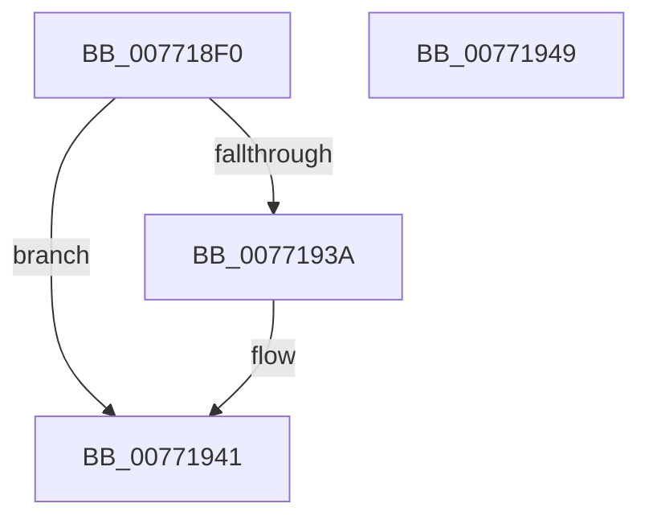

# PopDirectedDripsUmTestDeviceCompare

- RVA: `0x007718F0`–`0x0077194A` (길이 `90` bytes)
- VA: `0x00000001407718F0`
- 실행 섹션: `PAGE`
- PDB 이름 있음: `예`; PDB Function 태그: `아니요`
- unwind 정보 RVA: `0x00064C80`
- 디코드: `28`개 명령, `90/90` bytes 표시
- 미해석 바이트: `0` (있으면 어셈블리에 `.byte`로 보존)

> 이 문서는 커널 이미지의 기계어와 PDB 기호를 분석해 생성했습니다. 4번과 5번은 함수 원형과 자료형을 바이너리 사용 방식에서 추정한 C 해석이며 원본 소스 복구 결과는 아닙니다.

## 1. Dependencies

- 직접 호출 지점: **3**; 고유 호출 대상: **2**
- 직접 호출자로 확인된 함수: **0**
- RIP 상대 이미지 참조: **0**

### Outgoing calls
- `0x00771908` → [PopDirectedDripsUmGetDeviceInstancePath](PopDirectedDripsUmGetDeviceInstancePath_function_007717BC.md) (function, `0x007717BC`)
- `0x00771918` → [PopDirectedDripsUmGetDeviceInstancePath](PopDirectedDripsUmGetDeviceInstancePath_function_007717BC.md) (function, `0x007717BC`)
- `0x00771931` → [RtlCompareUnicodeStrings](../97/RtlCompareUnicodeStrings_function_009727E0.md) (function, `0x009727E0`)

### Direct callers
- 이 함수 시작 RVA로 연결되는 직접 call은 확인되지 않았습니다. 간접 호출은 완전히 역산할 수 없습니다.

### Static image references
- 디코드된 RIP-relative 메모리 참조가 없습니다.

## 2. Other-region calls and transfers

- 다른 실행 섹션으로 향하는 call: **0**
- 별도 외부 분기/꼬리 이동을 확인하지 못했습니다.

## 3. Assembly (complete function range)

```asm
007718F0  40 53                           push rbx
007718F2  48 83 EC 30                     sub rsp, 0x30
007718F6  48 8B CA                        mov rcx, rdx
007718F9  33 DB                           xor ebx, ebx
007718FB  48 8D 54 24 50                  lea rdx, [rsp + 0x50]
00771900  89 5C 24 50                     mov dword ptr [rsp + 0x50], ebx
00771904  89 5C 24 48                     mov dword ptr [rsp + 0x48], ebx
00771908  E8 AF FE FF FF                  call 0x1407717bc
0077190D  49 8B C8                        mov rcx, r8
00771910  48 8D 54 24 48                  lea rdx, [rsp + 0x48]
00771915  4C 8B D0                        mov r10, rax
00771918  E8 9F FE FF FF                  call 0x1407717bc
0077191D  44 8B 4C 24 48                  mov r9d, dword ptr [rsp + 0x48]
00771922  4C 8B C0                        mov r8, rax
00771925  8B 54 24 50                     mov edx, dword ptr [rsp + 0x50]
00771929  49 8B CA                        mov rcx, r10
0077192C  C6 44 24 20 01                  mov byte ptr [rsp + 0x20], 1
00771931  E8 AA 0E 20 00                  call 0x1409727e0
00771936  85 C0                           test eax, eax
00771938  78 07                           js 0x140771941
0077193A  F7 D8                           neg eax
0077193C  1B DB                           sbb ebx, ebx
0077193E  83 C3 02                        add ebx, 2
00771941  8B C3                           mov eax, ebx
00771943  48 83 C4 30                     add rsp, 0x30
00771947  5B                              pop rbx
00771948  C3                              ret
00771949  CC                              int3
```

## 4. C-style interpretation (structured pseudocode)

```c
__int64 __fastcall PopDirectedDripsUmTestDeviceCompare(__int64 a1, __int64 a2, __int64 a3)
{
    __int64 result;
    __int64 v_rbx;
    __int64 v_rsp;
    unsigned __int8 v_stack_m18;
    unsigned int v_stack_p10;
    unsigned __int64 v_stack_p18;

    v_rsp = (v_rsp) - (48);
    v_rbx = 0;
    v_stack_p18 = 0;
    v_stack_p10 = 0;
    result = PopDirectedDripsUmGetDeviceInstancePath(a2, v_stack_p18, a3, a4);
    result = PopDirectedDripsUmGetDeviceInstancePath(a3, v_stack_p10, a3, a4);
    v_stack_m18 = 1;
    result = RtlCompareUnicodeStrings(result, (unsigned int)(v_stack_p18), result, (unsigned int)(v_stack_p10));
    if (!(sign_flag)) {
        result = (unsigned int)(-(result));
        v_rbx = (unsigned int)((v_rbx) + (2));
    }
    v_rsp = (v_rsp) + (48);
    return (unsigned int)((unsigned int)(v_rbx));
}
```

## 5. (Beta) C Style

```c
int64_t PopDirectedDripsUmTestDeviceCompare(int64_t Arg1, int64_t Arg2, int64_t Arg3)
{
    int64_t result;
    int64_t local_rbx;
    int64_t local_rsp;
    uint8_t v_stack_m18;
    uint32_t v_stack_p10;
    uint64_t v_stack_p18;

    local_rsp = (local_rsp) - (48);
    local_rbx = 0;
    v_stack_p18 = 0;
    v_stack_p10 = 0;
    result = PopDirectedDripsUmGetDeviceInstancePath(Arg2, v_stack_p18, Arg3, a4);
    result = PopDirectedDripsUmGetDeviceInstancePath(Arg3, v_stack_p10, Arg3, a4);
    v_stack_m18 = 1;
    result = RtlCompareUnicodeStrings(result, (uint32_t)(v_stack_p18), result, (uint32_t)(v_stack_p10));
    if (!(sign_flag)) {
        result = (uint32_t)(-(result));
        local_rbx = (uint32_t)((local_rbx) + (2));
    }
    local_rsp = (local_rsp) + (48);
    return (uint32_t)((uint32_t)(local_rbx));
}
```

## 6. Execution-region graph

[열기: 2D/3D 그래프와 함수 탐색 컨트롤 패널](../../../control-panel.html?section=page&rva=0x007718F0&view=graph)

- 2D 그래프는 위에서 아래로 흐르고, 3D 그래프는 빈 공간을 드래그해 회전합니다. Shift+드래그는 이동, 휠은 확대·축소, 함수 노드 선택은 대상 보고서 이동입니다.

### Static fallback


