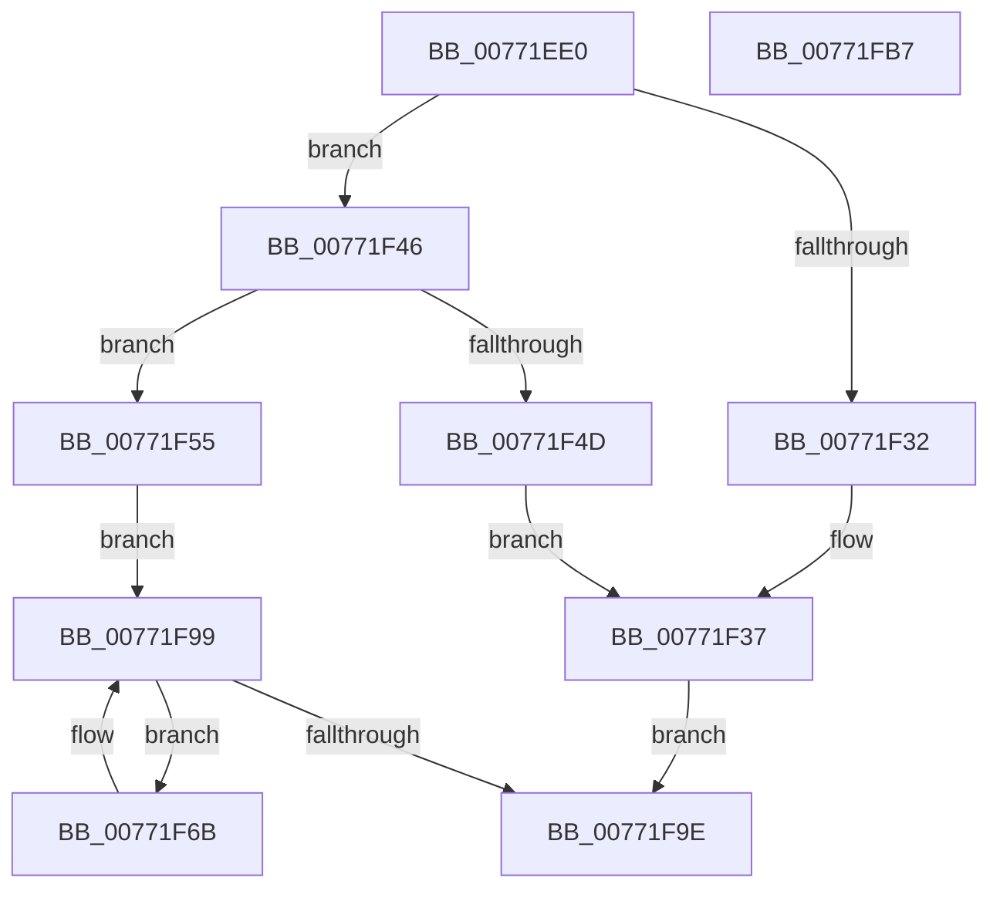

# PopDirectedDripsVisitPs4Device

- RVA: `0x00771EE0`–`0x00771FB8` (길이 `216` bytes)
- VA: `0x0000000140771EE0`
- 실행 섹션: `PAGE`
- PDB 이름 있음: `예`; PDB Function 태그: `아니요`
- unwind 정보 RVA: `0x00083688`
- 디코드: `64`개 명령, `216/216` bytes 표시
- 미해석 바이트: `0` (있으면 어셈블리에 `.byte`로 보존)

> 이 문서는 커널 이미지의 기계어와 PDB 기호를 분석해 생성했습니다. 4번과 5번은 함수 원형과 자료형을 바이너리 사용 방식에서 추정한 C 해석이며 원본 소스 복구 결과는 아닙니다.

## 1. Dependencies

- 직접 호출 지점: **5**; 고유 호출 대상: **4**
- 직접 호출자로 확인된 함수: **1**
- RIP 상대 이미지 참조: **0**

### Outgoing calls
- `0x00771F1C` → [PopDirectedDripsVisitDevice](../70/PopDirectedDripsVisitDevice_function_00703068.md) (function, `0x00703068`)
- `0x00771F29` → [PopDirectedDripsIsLikelySpecialDevice](PopDirectedDripsIsLikelySpecialDevice_function_00771E68.md) (function, `0x00771E68`)
- `0x00771F3A` → [PopDirectedDripsDiagTraceProblemDevice](PopDirectedDripsDiagTraceProblemDevice_function_0077135C.md) (function, `0x0077135C`)
- `0x00771F82` → [PopDirectedDripsVisitDevice](../70/PopDirectedDripsVisitDevice_function_00703068.md) (function, `0x00703068`)
- `0x00771F91` → [PopDirectedDripsInsertQueueDevice](PopDirectedDripsInsertQueueDevice_function_00771E28.md) (function, `0x00771E28`)

### Direct callers
- [PopDirectedDripsBuildPs4BroadcastTree](PopDirectedDripsBuildPs4BroadcastTree_function_00771C90.md) at `0x00771D2E`
- [PopDirectedDripsBuildPs4BroadcastTree](PopDirectedDripsBuildPs4BroadcastTree_function_00771C90.md) at `0x00771D66`

### Static image references
- 디코드된 RIP-relative 메모리 참조가 없습니다.

## 2. Other-region calls and transfers

- 다른 실행 섹션으로 향하는 call: **0**
- 별도 외부 분기/꼬리 이동을 확인하지 못했습니다.

## 3. Assembly (complete function range)

```asm
00771EE0  48 89 5C 24 10                  mov qword ptr [rsp + 0x10], rbx
00771EE5  48 89 6C 24 18                  mov qword ptr [rsp + 0x18], rbp
00771EEA  56                              push rsi
00771EEB  57                              push rdi
00771EEC  41 54                           push r12
00771EEE  41 56                           push r14
00771EF0  41 57                           push r15
00771EF2  48 83 EC 20                     sub rsp, 0x20
00771EF6  49 8B E9                        mov rbp, r9
00771EF9  48 8D B1 D8 02 00 00            lea rsi, [rcx + 0x2d8]
00771F00  4D 8B F8                        mov r15, r8
00771F03  33 FF                           xor edi, edi
00771F05  4C 8B E2                        mov r12, rdx
00771F08  89 7C 24 50                     mov dword ptr [rsp + 0x50], edi
00771F0C  48 8B D9                        mov rbx, rcx
00771F0F  4C 8B C5                        mov r8, rbp
00771F12  48 8B D6                        mov rdx, rsi
00771F15  49 8B CF                        mov rcx, r15
00771F18  44 8D 4F 05                     lea r9d, [rdi + 5]
00771F1C  E8 47 11 F9 FF                  call 0x140703068
00771F21  48 8D 54 24 50                  lea rdx, [rsp + 0x50]
00771F26  48 8B CB                        mov rcx, rbx
00771F29  E8 3A FF FF FF                  call 0x140771e68
00771F2E  84 C0                           test al, al
00771F30  74 14                           je 0x140771f46
00771F32  44 8B 44 24 50                  mov r8d, dword ptr [rsp + 0x50]
00771F37  48 8B D5                        mov rdx, rbp
00771F3A  E8 1D F4 FF FF                  call 0x14077135c
00771F3F  BF BB 00 00 C0                  mov edi, 0xc00000bb
00771F44  EB 58                           jmp 0x140771f9e
00771F46  8B 46 20                        mov eax, dword ptr [rsi + 0x20]
00771F49  A8 08                           test al, 8
00771F4B  74 08                           je 0x140771f55
00771F4D  41 B8 03 00 00 00               mov r8d, 3
00771F53  EB E2                           jmp 0x140771f37
00771F55  8B 46 20                        mov eax, dword ptr [rsi + 0x20]
00771F58  4C 8D B3 B0 00 00 00            lea r14, [rbx + 0xb0]
00771F5F  0F BA E8 11                     bts eax, 0x11
00771F63  89 46 20                        mov dword ptr [rsi + 0x20], eax
00771F66  49 8B 36                        mov rsi, qword ptr [r14]
00771F69  EB 2E                           jmp 0x140771f99
00771F6B  48 8B 5E F8                     mov rbx, qword ptr [rsi - 8]
00771F6F  41 B9 06 00 00 00               mov r9d, 6
00771F75  4C 8B C5                        mov r8, rbp
00771F78  49 8B CF                        mov rcx, r15
00771F7B  48 8D 93 38 02 00 00            lea rdx, [rbx + 0x238]
00771F82  E8 E1 10 F9 FF                  call 0x140703068
00771F87  48 8D 93 38 02 00 00            lea rdx, [rbx + 0x238]
00771F8E  49 8B CC                        mov rcx, r12
00771F91  E8 92 FE FF FF                  call 0x140771e28
00771F96  48 8B 36                        mov rsi, qword ptr [rsi]
00771F99  49 3B F6                        cmp rsi, r14
00771F9C  75 CD                           jne 0x140771f6b
00771F9E  48 8B 5C 24 58                  mov rbx, qword ptr [rsp + 0x58]
00771FA3  8B C7                           mov eax, edi
00771FA5  48 8B 6C 24 60                  mov rbp, qword ptr [rsp + 0x60]
00771FAA  48 83 C4 20                     add rsp, 0x20
00771FAE  41 5F                           pop r15
00771FB0  41 5E                           pop r14
00771FB2  41 5C                           pop r12
00771FB4  5F                              pop rdi
00771FB5  5E                              pop rsi
00771FB6  C3                              ret
00771FB7  CC                              int3
```

## 4. C-style interpretation (structured pseudocode)

```c
__int64 __fastcall PopDirectedDripsVisitPs4Device(__int64 a1, __int64 a2, __int64 a3, __int64 a4)
{
    __int64 result;
    __int64 v_rdi;
    __int64 v_rsp;
    unsigned __int64 v_stack_p10;
    unsigned __int64 v_stack_p18;
    unsigned int v_stack_p8;

    v_stack_p10 = v_rbx;
    v_stack_p18 = v_rbp;
    v_rsp = (v_rsp) - (32);
    v_rdi = 0;
    v_stack_p8 = 0;
    result = PopDirectedDripsVisitDevice(a3, a1 + 728, a4, v_rdi + 5);
    result = PopDirectedDripsIsLikelySpecialDevice(a1, v_stack_p8, a4, v_rdi + 5);
    if ((unsigned __int8)(result) == 0) goto loc_00771F46;
loc_00771F37:
    result = PopDirectedDripsDiagTraceProblemDevice(a1, a4, (unsigned int)(v_stack_p8), v_rdi + 5);
    goto loc_00771F9E;
loc_00771F46:
    if ((((unsigned __int8)((unsigned int)(*(unsigned int *)(a1 + 728 + 32)))) & (8)) == 0) goto loc_00771F55;
    goto loc_00771F37;
loc_00771F55:
    *(unsigned int *)(a1 + 728 + 32) = (unsigned int)((unsigned int)(*(unsigned int *)(a1 + 728 + 32)));
    goto loc_00771F99;
loc_00771F6B:
    result = PopDirectedDripsVisitDevice(a3, *(unsigned __int64 *)(*(unsigned __int64 *)(a1 + 176) - 8) + 568, a4, 6);
    result = PopDirectedDripsInsertQueueDevice(a2, *(unsigned __int64 *)(*(unsigned __int64 *)(a1 + 176) - 8) + 568, a4, 6);
loc_00771F99:
    if ((*(unsigned __int64 *)(*(unsigned __int64 *)(a1 + 176))) != (a1 + 176)) goto loc_00771F6B;
loc_00771F9E:
    v_rsp = (v_rsp) + (32);
    return (unsigned int)((unsigned int)((unsigned int)(0xC00000BBULL)));
}
```

## 5. (Beta) C Style

```c
int64_t PopDirectedDripsVisitPs4Device(void *Arg1, int64_t Arg2, int64_t Arg3, int64_t Arg4)
{
    uint8_t *arg1 = (uint8_t *)Arg1;

    int64_t result;
    int64_t local_rdi;
    int64_t local_rsp;
    uint64_t v_stack_p10;
    uint64_t v_stack_p18;
    uint32_t v_stack_p8;

    v_stack_p10 = local_rbx;
    v_stack_p18 = local_rbp;
    local_rsp = (local_rsp) - (32);
    local_rdi = 0;
    v_stack_p8 = 0;
    result = PopDirectedDripsVisitDevice(Arg3, Arg1 + 728, Arg4, local_rdi + 5);
    result = PopDirectedDripsIsLikelySpecialDevice(Arg1, v_stack_p8, Arg4, local_rdi + 5);
    if ((uint8_t)(result) == 0) goto loc_00771F46;
loc_00771F37:
    result = PopDirectedDripsDiagTraceProblemDevice(Arg1, Arg4, (uint32_t)(v_stack_p8), local_rdi + 5);
    goto loc_00771F9E;
loc_00771F46:
    if ((((uint8_t)((uint32_t)(*(uint32_t *)(arg1 + 0x2D8 + 0x20)))) & (8)) == 0) goto loc_00771F55;
    goto loc_00771F37;
loc_00771F55:
    *(uint32_t *)(arg1 + 0x2D8 + 0x20) = (uint32_t)((uint32_t)(*(uint32_t *)(arg1 + 0x2D8 + 0x20)));
    goto loc_00771F99;
loc_00771F6B:
    result = PopDirectedDripsVisitDevice(Arg3, *(uint64_t *)(*(uint64_t *)(arg1 + 0xB0) - 0x8) + 568, Arg4, 6);
    result = PopDirectedDripsInsertQueueDevice(Arg2, *(uint64_t *)(*(uint64_t *)(arg1 + 0xB0) - 0x8) + 568, Arg4, 6);
loc_00771F99:
    if ((*(uint64_t *)(*(uint64_t *)(arg1 + 0xB0))) != (Arg1 + 176)) goto loc_00771F6B;
loc_00771F9E:
    local_rsp = (local_rsp) + (32);
    return (uint32_t)((uint32_t)((uint32_t)(0xC00000BBULL)));
}
```

### 관측된 메모리 오프셋

구조체 형식이 확인되지 않은 접근은 인자 기준의 오프셋으로만 기록했습니다.

| 기준 인자 | 오프셋 표현 | 폭 (bit) | 접근 |
|---|---:|---:|---|
| `Arg1` | `+ 0x0` | `64` | `R` |
| `Arg1` | `+ 0x20` | `32` | `R` |
| `Arg1` | `+ 0x20` | `32` | `W` |
| `Arg1` | `+ 0xB0` | `64` | `R` |
| `Arg1` | `+ 0x2D8` | `64` | `R` |

## 6. Execution-region graph

[열기: 2D/3D 그래프와 함수 탐색 컨트롤 패널](../../../control-panel.html?section=page&rva=0x00771EE0&view=graph)

- 2D 그래프는 위에서 아래로 흐르고, 3D 그래프는 빈 공간을 드래그해 회전합니다. Shift+드래그는 이동, 휠은 확대·축소, 함수 노드 선택은 대상 보고서 이동입니다.

### Static fallback


