# PopDripsWatchdogTakeAction

- RVA: `0x007732D0`–`0x0077360D` (길이 `829` bytes)
- VA: `0x00000001407732D0`
- 실행 섹션: `PAGE`
- PDB 이름 있음: `예`; PDB Function 태그: `아니요`
- unwind 정보 RVA: `0x000CDA30`
- 디코드: `224`개 명령, `829/829` bytes 표시
- 미해석 바이트: `0` (있으면 어셈블리에 `.byte`로 보존)

> 이 문서는 커널 이미지의 기계어와 PDB 기호를 분석해 생성했습니다. 4번과 5번은 함수 원형과 자료형을 바이너리 사용 방식에서 추정한 C 해석이며 원본 소스 복구 결과는 아닙니다.

## 1. Dependencies

- 직접 호출 지점: **13**; 고유 호출 대상: **10**
- 직접 호출자로 확인된 함수: **1**
- RIP 상대 이미지 참조: **4**

### Outgoing calls
- `0x00773314` → [PopFxBuildDripsBlockingDeviceList](../../text/49/PopFxBuildDripsBlockingDeviceList_function_0049B5B0.md) (function, `0x0049B5B0`)
- `0x00773383` → [PopDiagTraceCsDripsWatchdog](../../text/5D/PopDiagTraceCsDripsWatchdog_function_005D602C.md) (function, `0x005D602C`)
- `0x007733D6` → [PopDiagTraceCsDripsWatchdog](../../text/5D/PopDiagTraceCsDripsWatchdog_function_005D602C.md) (function, `0x005D602C`)
- `0x00773417` → [PpmIdlePrevetoWatchdog](../../text/5D/PpmIdlePrevetoWatchdog_function_005D0010.md) (function, `0x005D0010`)
- `0x00773455` → [PopDiagTraceCsDripsWatchdog](../../text/5D/PopDiagTraceCsDripsWatchdog_function_005D602C.md) (function, `0x005D602C`)
- `0x00773492` → [PopDiagTraceCsDripsWatchdogPerfTrack](../../text/5D/PopDiagTraceCsDripsWatchdogPerfTrack_function_005D621C.md) (function, `0x005D621C`)
- `0x007734EE` → [PopDeviceConstraintsEnforced](../../text/4C/PopDeviceConstraintsEnforced_function_004CF710.md) (function, `0x004CF710`)
- `0x00773557` → [PopFxBugCheck](../../text/2B/PopFxBugCheck_function_002BFC6C.md) (function, `0x002BFC6C`)
- `0x0077355D` → [VfIsVerifierEnabled](../../text/4C/VfIsVerifierEnabled_function_004C72F0.md) (function, `0x004C72F0`)
- `0x00773566` → [PopCheckTestsigningEnabled](../75/PopCheckTestsigningEnabled_function_00753FE0.md) (function, `0x00753FE0`)
- `0x00773595` → [PopFxBugCheck](../../text/2B/PopFxBugCheck_function_002BFC6C.md) (function, `0x002BFC6C`)
- `0x007735E6` → [DbgkWerCaptureLiveKernelDump](../AC/DbgkWerCaptureLiveKernelDump_function_00AC1E90.md) (function, `0x00AC1E90`)
- `0x007735EF` → [PopFxDestroyDripsBlockingDeviceList](../75/PopFxDestroyDripsBlockingDeviceList_function_00758DEC.md) (function, `0x00758DEC`)

### Direct callers
- [PopDripsWatchdogDiagnosticWorker](../76/PopDripsWatchdogDiagnosticWorker_function_0076C600.md) at `0x0076C778`

### Static image references
- `0x007734CB` → RVA `0x00F475F8` (`.data`; read)
- `0x007734D8` → RVA `0x00F475DC` (`.data`; read)
- `0x007735A0` → RVA `0x00E676B8` (`.data`; read)
- `0x007735DF` → RVA `0x00B03F40` (` ?? ::NNGAKEGL::`string'`; read)

## 2. Other-region calls and transfers

- 다른 실행 섹션으로 향하는 call: **10**
  - `0x00773314` → [PopFxBuildDripsBlockingDeviceList](../../text/49/PopFxBuildDripsBlockingDeviceList_function_0049B5B0.md) (`PAGE` → `.text`)
  - `0x00773383` → [PopDiagTraceCsDripsWatchdog](../../text/5D/PopDiagTraceCsDripsWatchdog_function_005D602C.md) (`PAGE` → `.text`)
  - `0x007733D6` → [PopDiagTraceCsDripsWatchdog](../../text/5D/PopDiagTraceCsDripsWatchdog_function_005D602C.md) (`PAGE` → `.text`)
  - `0x00773417` → [PpmIdlePrevetoWatchdog](../../text/5D/PpmIdlePrevetoWatchdog_function_005D0010.md) (`PAGE` → `.text`)
  - `0x00773455` → [PopDiagTraceCsDripsWatchdog](../../text/5D/PopDiagTraceCsDripsWatchdog_function_005D602C.md) (`PAGE` → `.text`)
  - `0x00773492` → [PopDiagTraceCsDripsWatchdogPerfTrack](../../text/5D/PopDiagTraceCsDripsWatchdogPerfTrack_function_005D621C.md) (`PAGE` → `.text`)
  - `0x007734EE` → [PopDeviceConstraintsEnforced](../../text/4C/PopDeviceConstraintsEnforced_function_004CF710.md) (`PAGE` → `.text`)
  - `0x00773557` → [PopFxBugCheck](../../text/2B/PopFxBugCheck_function_002BFC6C.md) (`PAGE` → `.text`)
  - `0x0077355D` → [VfIsVerifierEnabled](../../text/4C/VfIsVerifierEnabled_function_004C72F0.md) (`PAGE` → `.text`)
  - `0x00773595` → [PopFxBugCheck](../../text/2B/PopFxBugCheck_function_002BFC6C.md) (`PAGE` → `.text`)
- 별도 외부 분기/꼬리 이동을 확인하지 못했습니다.

## 3. Assembly (complete function range)

```asm
007732D0  48 89 5C 24 10                  mov qword ptr [rsp + 0x10], rbx
007732D5  44 89 44 24 18                  mov dword ptr [rsp + 0x18], r8d
007732DA  55                              push rbp
007732DB  56                              push rsi
007732DC  57                              push rdi
007732DD  41 54                           push r12
007732DF  41 55                           push r13
007732E1  41 56                           push r14
007732E3  41 57                           push r15
007732E5  48 8B EC                        mov rbp, rsp
007732E8  48 83 EC 70                     sub rsp, 0x70
007732EC  8B 41 08                        mov eax, dword ptr [rcx + 8]
007732EF  48 8B D9                        mov rbx, rcx
007732F2  8B F2                           mov esi, edx
007732F4  0F 57 C0                        xorps xmm0, xmm0
007732F7  45 33 ED                        xor r13d, r13d
007732FA  48 8D 55 F0                     lea rdx, [rbp - 0x10]
007732FE  4C 21 6D 58                     and qword ptr [rbp + 0x58], r13
00773302  45 8B E0                        mov r12d, r8d
00773305  48 69 C8 10 27 00 00            imul rcx, rax, 0x2710
0077330C  0F 11 45 F0                     movups xmmword ptr [rbp - 0x10], xmm0
00773310  44 89 6D 40                     mov dword ptr [rbp + 0x40], r13d
00773314  E8 97 82 D2 FF                  call 0x14049b5b0
00773319  85 C0                           test eax, eax
0077331B  0F 88 D3 02 00 00               js 0x1407735f4
00773321  48 8B 7D F0                     mov rdi, qword ptr [rbp - 0x10]
00773325  48 8D 45 F0                     lea rax, [rbp - 0x10]
00773329  48 3B F8                        cmp rdi, rax
0077332C  48 8D 45 F0                     lea rax, [rbp - 0x10]
00773330  41 0F 95 C7                     setne r15b
00773334  48 3B F8                        cmp rdi, rax
00773337  0F 84 C3 00 00 00               je 0x140773400
0077333D  4C 8B B7 A0 FC FF FF            mov r14, qword ptr [rdi - 0x360]
00773344  8B 47 20                        mov eax, dword ptr [rdi + 0x20]
00773347  49 83 C6 38                     add r14, 0x38
0077334B  85 C0                           test eax, eax
0077334D  75 3B                           jne 0x14077338a
0077334F  38 43 18                        cmp byte ptr [rbx + 0x18], al
00773352  44 8B 43 08                     mov r8d, dword ptr [rbx + 8]
00773356  8B 53 0C                        mov edx, dword ptr [rbx + 0xc]
00773359  41 0F 95 C1                     setne r9b
0077335D  8B 0B                           mov ecx, dword ptr [rbx]
0077335F  44 89 64 24 50                  mov dword ptr [rsp + 0x50], r12d
00773364  21 44 24 48                     and dword ptr [rsp + 0x48], eax
00773368  48 83 64 24 40 00               and qword ptr [rsp + 0x40], 0
0077336E  8B 43 14                        mov eax, dword ptr [rbx + 0x14]
00773371  4C 89 74 24 38                  mov qword ptr [rsp + 0x38], r14
00773376  89 74 24 30                     mov dword ptr [rsp + 0x30], esi
0077337A  C6 44 24 28 01                  mov byte ptr [rsp + 0x28], 1
0077337F  89 44 24 20                     mov dword ptr [rsp + 0x20], eax
00773383  E8 A4 2C E6 FF                  call 0x1405d602c
00773388  EB 5E                           jmp 0x1407733e8
0077338A  45 33 E4                        xor r12d, r12d
0077338D  85 C0                           test eax, eax
0077338F  74 53                           je 0x1407733e4
00773391  44 8B 6D 50                     mov r13d, dword ptr [rbp + 0x50]
00773395  48 8B 47 18                     mov rax, qword ptr [rdi + 0x18]
00773399  44 8B 43 08                     mov r8d, dword ptr [rbx + 8]
0077339D  8B 0B                           mov ecx, dword ptr [rbx]
0077339F  44 89 6C 24 50                  mov dword ptr [rsp + 0x50], r13d
007733A4  4A 8B 14 E0                     mov rdx, qword ptr [rax + r12*8]
007733A8  8B 43 14                        mov eax, dword ptr [rbx + 0x14]
007733AB  48 83 C2 38                     add rdx, 0x38
007733AF  80 7B 18 00                     cmp byte ptr [rbx + 0x18], 0
007733B3  41 0F 95 C1                     setne r9b
007733B7  83 64 24 48 00                  and dword ptr [rsp + 0x48], 0
007733BC  48 89 54 24 40                  mov qword ptr [rsp + 0x40], rdx
007733C1  8B 53 0C                        mov edx, dword ptr [rbx + 0xc]
007733C4  4C 89 74 24 38                  mov qword ptr [rsp + 0x38], r14
007733C9  89 74 24 30                     mov dword ptr [rsp + 0x30], esi
007733CD  C6 44 24 28 01                  mov byte ptr [rsp + 0x28], 1
007733D2  89 44 24 20                     mov dword ptr [rsp + 0x20], eax
007733D6  E8 51 2C E6 FF                  call 0x1405d602c
007733DB  41 FF C4                        inc r12d
007733DE  44 3B 67 20                     cmp r12d, dword ptr [rdi + 0x20]
007733E2  72 B1                           jb 0x140773395
007733E4  44 8B 65 50                     mov r12d, dword ptr [rbp + 0x50]
007733E8  48 8B 3F                        mov rdi, qword ptr [rdi]
007733EB  48 8D 45 F0                     lea rax, [rbp - 0x10]
007733EF  48 3B F8                        cmp rdi, rax
007733F2  0F 85 45 FF FF FF               jne 0x14077333d
007733F8  48 8B 7D F0                     mov rdi, qword ptr [rbp - 0x10]
007733FC  44 8B 6D 40                     mov r13d, dword ptr [rbp + 0x40]
00773400  45 84 FF                        test r15b, r15b
00773403  75 59                           jne 0x14077345e
00773405  8B 43 08                        mov eax, dword ptr [rbx + 8]
00773408  4C 8D 45 58                     lea r8, [rbp + 0x58]
0077340C  48 69 C8 10 27 00 00            imul rcx, rax, 0x2710
00773413  48 8D 55 40                     lea rdx, [rbp + 0x40]
00773417  E8 F4 CB E5 FF                  call 0x1405d0010
0077341C  44 8B 6D 40                     mov r13d, dword ptr [rbp + 0x40]
00773420  33 C0                           xor eax, eax
00773422  38 43 18                        cmp byte ptr [rbx + 0x18], al
00773425  44 8B 43 08                     mov r8d, dword ptr [rbx + 8]
00773429  8B 53 0C                        mov edx, dword ptr [rbx + 0xc]
0077342C  41 0F 95 C1                     setne r9b
00773430  8B 0B                           mov ecx, dword ptr [rbx]
00773432  44 89 64 24 50                  mov dword ptr [rsp + 0x50], r12d
00773437  44 89 6C 24 48                  mov dword ptr [rsp + 0x48], r13d
0077343C  48 89 44 24 40                  mov qword ptr [rsp + 0x40], rax
00773441  48 89 44 24 38                  mov qword ptr [rsp + 0x38], rax
00773446  89 74 24 30                     mov dword ptr [rsp + 0x30], esi
0077344A  88 44 24 28                     mov byte ptr [rsp + 0x28], al
0077344E  8B 43 14                        mov eax, dword ptr [rbx + 0x14]
00773451  89 44 24 20                     mov dword ptr [rsp + 0x20], eax
00773455  E8 D2 2B E6 FF                  call 0x1405d602c
0077345A  48 8B 7D F0                     mov rdi, qword ptr [rbp - 0x10]
0077345E  0F B6 43 18                     movzx eax, byte ptr [rbx + 0x18]
00773462  84 C0                           test al, al
00773464  74 0A                           je 0x140773470
00773466  40 F6 C6 01                     test sil, 1
0077346A  0F 84 7B 01 00 00               je 0x1407735eb
00773470  40 F6 C6 02                     test sil, 2
00773474  74 25                           je 0x14077349b
00773476  44 8B 43 08                     mov r8d, dword ptr [rbx + 8]
0077347A  44 8B C8                        mov r9d, eax
0077347D  8B 43 14                        mov eax, dword ptr [rbx + 0x14]
00773480  8B 53 0C                        mov edx, dword ptr [rbx + 0xc]
00773483  8B 0B                           mov ecx, dword ptr [rbx]
00773485  89 74 24 30                     mov dword ptr [rsp + 0x30], esi
00773489  44 88 7C 24 28                  mov byte ptr [rsp + 0x28], r15b
0077348E  89 44 24 20                     mov dword ptr [rsp + 0x20], eax
00773492  E8 85 2D E6 FF                  call 0x1405d621c
00773497  48 8B 7D F0                     mov rdi, qword ptr [rbp - 0x10]
0077349B  45 84 FF                        test r15b, r15b
0077349E  74 23                           je 0x1407734c3
007734A0  48 81 C7 70 FC FF FF            add rdi, -0x390
007734A7  4C 8D B7 90 03 00 00            lea r14, [rdi + 0x390]
007734AE  41 83 7E 20 00                  cmp dword ptr [r14 + 0x20], 0
007734B3  4C 8D 67 30                     lea r12, [rdi + 0x30]
007734B7  74 04                           je 0x1407734bd
007734B9  4D 8B 66 18                     mov r12, qword ptr [r14 + 0x18]
007734BD  4D 8B 24 24                     mov r12, qword ptr [r12]
007734C1  EB 08                           jmp 0x1407734cb
007734C3  45 33 E4                        xor r12d, r12d
007734C6  33 FF                           xor edi, edi
007734C8  45 33 F6                        xor r14d, r14d
007734CB  80 3D 26 41 7D 00 00            cmp byte ptr [rip + 0x7d4126], 0
007734D2  0F 84 85 00 00 00               je 0x14077355d
007734D8  80 3D FD 40 7D 00 00            cmp byte ptr [rip + 0x7d40fd], 0
007734DF  75 7C                           jne 0x14077355d
007734E1  40 F6 C6 08                     test sil, 8
007734E5  74 4C                           je 0x140773533
007734E7  83 7B 10 64                     cmp dword ptr [rbx + 0x10], 0x64
007734EB  77 01                           ja 0x1407734ee
007734ED  CC                              int3
007734EE  E8 1D C2 D5 FF                  call 0x1404cf710
007734F3  33 D2                           xor edx, edx
007734F5  84 C0                           test al, al
007734F7  0F 84 EE 00 00 00               je 0x1407735eb
007734FD  40 F6 C6 04                     test sil, 4
00773501  0F 84 E4 00 00 00               je 0x1407735eb
00773507  45 84 FF                        test r15b, r15b
0077350A  0F 84 8B 00 00 00               je 0x14077359b
00773510  41 8B 46 10                     mov eax, dword ptr [r14 + 0x10]
00773514  44 8D 42 02                     lea r8d, [rdx + 2]
00773518  89 54 24 40                     mov dword ptr [rsp + 0x40], edx
0077351C  4C 8B CF                        mov r9, rdi
0077351F  48 89 54 24 38                  mov qword ptr [rsp + 0x38], rdx
00773524  48 89 54 24 30                  mov qword ptr [rsp + 0x30], rdx
00773529  4C 89 64 24 28                  mov qword ptr [rsp + 0x28], r12
0077352E  E9 A2 00 00 00                  jmp 0x1407735d5
00773533  45 84 FF                        test r15b, r15b
00773536  74 B6                           je 0x1407734ee
00773538  40 F6 C6 40                     test sil, 0x40
0077353C  74 04                           je 0x140773542
0077353E  CD 2C                           int 0x2c
00773540  EB AC                           jmp 0x1407734ee
00773542  40 F6 C6 20                     test sil, 0x20
00773546  74 A6                           je 0x1407734ee
00773548  45 8B 46 10                     mov r8d, dword ptr [r14 + 0x10]
0077354C  4D 8B CC                        mov r9, r12
0077354F  48 8B D7                        mov rdx, rdi
00773552  B9 19 06 00 00                  mov ecx, 0x619
00773557  E8 10 C7 B4 FF                  call 0x1402bfc6c
0077355C  CC                              int3
0077355D  E8 8E 3D D5 FF                  call 0x1404c72f0
00773562  85 C0                           test eax, eax
00773564  75 0D                           jne 0x140773573
00773566  E8 75 0A FE FF                  call 0x140753fe0
0077356B  84 C0                           test al, al
0077356D  0F 84 7B FF FF FF               je 0x1407734ee
00773573  45 84 FF                        test r15b, r15b
00773576  0F 84 72 FF FF FF               je 0x1407734ee
0077357C  40 F6 C6 20                     test sil, 0x20
00773580  0F 84 68 FF FF FF               je 0x1407734ee
00773586  45 8B 46 10                     mov r8d, dword ptr [r14 + 0x10]
0077358A  4D 8B CC                        mov r9, r12
0077358D  48 8B D7                        mov rdx, rdi
00773590  B9 19 06 00 00                  mov ecx, 0x619
00773595  E8 D2 C6 B4 FF                  call 0x1402bfc6c
0077359A  CC                              int3
0077359B  45 85 ED                        test r13d, r13d
0077359E  74 4B                           je 0x1407735eb
007735A0  48 8B 05 11 41 6F 00            mov rax, qword ptr [rip + 0x6f4111]
007735A7  48 85 C0                        test rax, rax
007735AA  74 06                           je 0x1407735b2
007735AC  48 8B 48 68                     mov rcx, qword ptr [rax + 0x68]
007735B0  EB 03                           jmp 0x1407735b5
007735B2  48 8B CA                        mov rcx, rdx
007735B5  48 8B 45 58                     mov rax, qword ptr [rbp + 0x58]
007735B9  41 B8 03 00 00 00               mov r8d, 3
007735BF  89 54 24 40                     mov dword ptr [rsp + 0x40], edx
007735C3  48 89 54 24 38                  mov qword ptr [rsp + 0x38], rdx
007735C8  48 89 54 24 30                  mov qword ptr [rsp + 0x30], rdx
007735CD  48 89 4C 24 28                  mov qword ptr [rsp + 0x28], rcx
007735D2  45 8B CD                        mov r9d, r13d
007735D5  BA 5F 01 00 00                  mov edx, 0x15f
007735DA  48 89 44 24 20                  mov qword ptr [rsp + 0x20], rax
007735DF  48 8D 0D 5A 09 39 00            lea rcx, [rip + 0x39095a]
007735E6  E8 A5 E8 34 00                  call 0x140ac1e90
007735EB  48 8D 4D F0                     lea rcx, [rbp - 0x10]
007735EF  E8 F8 57 FE FF                  call 0x140758dec
007735F4  48 8B 9C 24 B8 00 00 00         mov rbx, qword ptr [rsp + 0xb8]
007735FC  48 83 C4 70                     add rsp, 0x70
00773600  41 5F                           pop r15
00773602  41 5E                           pop r14
00773604  41 5D                           pop r13
00773606  41 5C                           pop r12
00773608  5F                              pop rdi
00773609  5E                              pop rsi
0077360A  5D                              pop rbp
0077360B  C3                              ret
0077360C  CC                              int3
```

## 4. C-style interpretation (structured pseudocode)

```c
__int64 __fastcall PopDripsWatchdogTakeAction(__int64 a1, int a2, int a3)
{
    __int64 result;
    __int64 v_r12;
    __int64 v_r13;
    __int64 v_r14;
    __int64 v_r15;
    __int64 v_rdi;
    __int64 v_rsp;
    unsigned __int64 v_stack_m48;
    unsigned int v_stack_m58;
    unsigned int v_stack_m60;
    unsigned __int64 v_stack_m68;
    unsigned __int64 v_stack_m70;
    unsigned int v_stack_m78;
    unsigned __int8 v_stack_m80;
    unsigned int v_stack_m88;
    unsigned __int64 v_stack_p10;
    unsigned int v_stack_p18;
    unsigned __int64 v_stack_p20;
    unsigned int v_stack_p8;

    v_stack_p10 = v_rbx;
    v_stack_p18 = a3;
    v_rsp = (v_rsp) - (112);
    v_r13 = 0;
    a1 = (a1) * ((unsigned int)(*(unsigned int *)(a1 + 8)));
    v_stack_m48 = v_xmm0;
    v_stack_p8 = 0;
    result = PopFxBuildDripsBlockingDeviceList(a1, v_stack_m48, a3, a4);
    if (sign_flag) goto loc_007735F4;
    v_r15 = (v_stack_m48 != v_stack_m48) ? 1 : 0;
    if (v_stack_m48 == v_stack_m48) goto loc_00773400;
loc_0077333D:
    v_r14 = (*(unsigned __int64 *)(v_stack_m48 - 864)) + (56);
    if ((unsigned int)((unsigned int)(*(unsigned int *)(v_stack_m48 + 32))) != 0) goto loc_0077338A;
    a4 = ((*(unsigned __int8 *)(a1 + 24)) != ((unsigned __int8)((unsigned int)(*(unsigned int *)(v_stack_m48 + 32))))) ? 1 : 0;
    v_stack_m58 = (unsigned int)((unsigned int)(a3));
    v_stack_m70 = v_r14;
    v_stack_m78 = (unsigned int)((unsigned int)(a2));
    v_stack_m80 = 1;
    v_stack_m88 = (unsigned int)((unsigned int)(*(unsigned int *)(a1 + 20)));
    result = PopDiagTraceCsDripsWatchdog((unsigned int)(*(unsigned int *)(a1)), (unsigned int)(*(unsigned int *)(a1 + 12)), (unsigned int)(*(unsigned int *)(a1 + 8)), a4);
    goto loc_007733E8;
loc_0077338A:
    v_r12 = 0;
    if ((unsigned int)(result) == 0) goto loc_007733E4;
loc_00773395:
    v_stack_m58 = (unsigned int)((unsigned int)(v_stack_p18));
    a2 = (*(unsigned __int64 *)(*(unsigned __int64 *)(v_stack_m48 + 24) + v_r12 * 8)) + (56);
    a4 = ((*(unsigned __int8 *)(a1 + 24)) != 0) ? 1 : 0;
    v_stack_m68 = a2;
    v_stack_m70 = v_r14;
    v_stack_m78 = (unsigned int)((unsigned int)(a2));
    v_stack_m80 = 1;
    v_stack_m88 = (unsigned int)((unsigned int)(*(unsigned int *)(a1 + 20)));
    result = PopDiagTraceCsDripsWatchdog((unsigned int)(*(unsigned int *)(a1)), (unsigned int)(*(unsigned int *)(a1 + 12)), (unsigned int)(*(unsigned int *)(a1 + 8)), a4);
    v_r12 = (unsigned int)((v_r12) + 1);
    if (((unsigned int)(v_r12)) < (*(unsigned int *)(v_stack_m48 + 32))) goto loc_00773395;
loc_007733E4:
loc_007733E8:
    if ((*(unsigned __int64 *)(v_stack_m48)) != v_stack_m48) goto loc_0077333D;
loc_00773400:
    result = v_stack_m48;
    v_rdi = v_stack_m48;
    v_r13 = (unsigned int)(v_stack_p8);
    if ((unsigned __int8)(v_r15) == 0) {
        result = *(unsigned int *)(a1 + 8);
        a3 = v_stack_p20;
        a1 = ((unsigned int)(*(unsigned int *)(a1))) * (result);
        a2 = v_stack_p8;
        result = PpmIdlePrevetoWatchdog(a1, a2, a3, a4);
        v_r13 = v_stack_p8;
        result = 0;
        a3 = *(unsigned int *)(a1 + 8);
        a2 = *(unsigned int *)(a1 + 12);
        a4 = ((*(unsigned __int8 *)(a1 + 24)) != 0) ? 1 : 0;
        a1 = *(unsigned int *)(a1);
        v_stack_m58 = (unsigned int)((unsigned int)(v_stack_p18));
        v_stack_m60 = (unsigned int)(v_r13);
        v_stack_m68 = 0;
        v_stack_m70 = 0;
        v_stack_m78 = (unsigned int)((unsigned int)(a2));
        v_stack_m80 = 0;
        result = *(unsigned int *)(a1 + 20);
        v_stack_m88 = (unsigned int)(result);
        result = PopDiagTraceCsDripsWatchdog(a1, a2, a3, a4);
        v_rdi = v_stack_m48;
    }
    if ((unsigned __int8)(*(unsigned __int8 *)(a1 + 24)) == 0) goto loc_00773470;
    if ((((unsigned __int8)((unsigned int)(a2))) & (1)) == 0) goto loc_007735EB;
loc_00773470:
    result = *(unsigned __int8 *)(a1 + 24);
    if ((((unsigned __int8)((unsigned int)(a2))) & (2)) != 0) {
        a3 = *(unsigned int *)(a1 + 8);
        a4 = (unsigned int)(*(unsigned __int8 *)(a1 + 24));
        result = *(unsigned int *)(a1 + 20);
        a2 = *(unsigned int *)(a1 + 12);
        a1 = *(unsigned int *)(a1);
        v_stack_m78 = (unsigned int)((unsigned int)(a2));
        v_stack_m80 = (unsigned __int8)(v_r15);
        v_stack_m88 = (unsigned int)(result);
        result = PopDiagTraceCsDripsWatchdogPerfTrack(a1, a2, a3, a4);
        v_rdi = v_stack_m48;
    }
    if ((unsigned __int8)(v_r15) == 0) goto loc_007734C3;
    v_rdi = (v_rdi) + (-912);
    v_r12 = v_rdi + 48;
    if ((*(unsigned int *)(v_rdi + 912 + 32)) != 0) {
        v_r12 = *(unsigned __int64 *)(v_rdi + 912 + 24);
    }
    goto loc_007734CB;
loc_007734C3:
    v_r12 = 0;
    v_rdi = 0;
    v_r14 = 0;
loc_007734CB:
    if ((*(unsigned __int8 *)(v_rip + 8208678)) == 0) goto loc_0077355D;
    if ((*(unsigned __int8 *)(v_rip + 8208637)) != 0) goto loc_0077355D;
    if ((((unsigned __int8)((unsigned int)(a2))) & (8)) == 0) goto loc_00773533;
    if ((*(unsigned int *)(a1 + 16)) <= 100) {
    }
    result = PopDeviceConstraintsEnforced(a1, a2, a3, a4);
    a2 = 0;
    if ((unsigned __int8)(result) == 0) goto loc_007735EB;
    if ((((unsigned __int8)((unsigned int)(a2))) & (4)) == 0) goto loc_007735EB;
    if ((unsigned __int8)(v_r15) == 0) goto loc_0077359B;
    v_stack_m68 = 0;
    v_stack_m70 = 0;
    v_stack_m78 = 0;
    v_stack_m80 = 0;
    goto loc_007735D5;
loc_00773533:
    if ((unsigned __int8)(v_r15) == 0) goto loc_007734EE;
    if ((((unsigned __int8)((unsigned int)(a2))) & (64)) == 0) goto loc_00773542;
    goto loc_007734EE;
loc_00773542:
    if ((((unsigned __int8)((unsigned int)(a2))) & (32)) == 0) goto loc_007734EE;
    result = PopFxBugCheck((unsigned int)(0x619ULL), 0, (unsigned int)(*(unsigned int *)(v_r14 + 16)), 0);
loc_0077355D:
    result = VfIsVerifierEnabled((unsigned int)(0x619ULL), 0, (unsigned int)(*(unsigned int *)(v_r14 + 16)), 0);
    if ((unsigned int)(result) != 0) goto loc_00773573;
    result = PopCheckTestsigningEnabled((unsigned int)(0x619ULL), 0, (unsigned int)(*(unsigned int *)(v_r14 + 16)), 0);
    if ((unsigned __int8)(result) == 0) goto loc_007734EE;
loc_00773573:
    if ((unsigned __int8)(v_r15) == 0) goto loc_007734EE;
    if ((((unsigned __int8)((unsigned int)(a2))) & (32)) == 0) goto loc_007734EE;
    result = PopFxBugCheck((unsigned int)(0x619ULL), 0, (unsigned int)(*(unsigned int *)(v_r14 + 16)), 0);
loc_0077359B:
    if ((unsigned int)(v_r13) == 0) goto loc_007735EB;
    if (*(unsigned __int64 *)(v_rip + 7291153) == 0) goto loc_007735B2;
    goto loc_007735B5;
loc_007735B2:
loc_007735B5:
    v_stack_m68 = 0;
    v_stack_m70 = 0;
    v_stack_m78 = 0;
    v_stack_m80 = 0;
loc_007735D5:
    v_stack_m88 = v_stack_p20;
    result = DbgkWerCaptureLiveKernelDump(v_rip + 3737946, 351, 3, (unsigned int)((unsigned int)(v_r13)));
loc_007735EB:
    result = PopFxDestroyDripsBlockingDeviceList(v_stack_m48, 351, 3, (unsigned int)((unsigned int)(v_r13)));
loc_007735F4:
    v_rsp = (v_rsp) + (112);
    return result;
}
```

## 5. (Beta) C Style

```c
int64_t PopDripsWatchdogTakeAction(void *Arg1, int32_t Arg2, int32_t Arg3)
{
    uint8_t *arg1 = (uint8_t *)Arg1;

    int64_t result;
    int64_t local_r12;
    int64_t local_r13;
    int64_t local_r14;
    int64_t local_r15;
    int64_t local_rdi;
    int64_t local_rsp;
    uint64_t v_stack_m48;
    uint32_t v_stack_m58;
    uint32_t v_stack_m60;
    uint64_t v_stack_m68;
    uint64_t v_stack_m70;
    uint32_t v_stack_m78;
    uint8_t v_stack_m80;
    uint32_t v_stack_m88;
    uint64_t v_stack_p10;
    uint32_t v_stack_p18;
    uint64_t v_stack_p20;
    uint32_t v_stack_p8;

    v_stack_p10 = local_rbx;
    v_stack_p18 = Arg3;
    local_rsp = (local_rsp) - (112);
    local_r13 = 0;
    Arg1 = (Arg1) * ((uint32_t)(*(uint32_t *)(arg1 + 0x8)));
    v_stack_m48 = v_xmm0;
    v_stack_p8 = 0;
    result = PopFxBuildDripsBlockingDeviceList(Arg1, v_stack_m48, Arg3, a4);
    if (sign_flag) goto loc_007735F4;
    local_r15 = (v_stack_m48 != v_stack_m48) ? 1 : 0;
    if (v_stack_m48 == v_stack_m48) goto loc_00773400;
loc_0077333D:
    local_r14 = (*(uint64_t *)(v_stack_m48 - 0x360)) + (56);
    if ((uint32_t)((uint32_t)(*(uint32_t *)(v_stack_m48 + 0x20))) != 0) goto loc_0077338A;
    a4 = ((*(uint8_t *)(arg1 + 0x18)) != ((uint8_t)((uint32_t)(*(uint32_t *)(v_stack_m48 + 0x20))))) ? 1 : 0;
    v_stack_m58 = (uint32_t)((uint32_t)(Arg3));
    v_stack_m70 = local_r14;
    v_stack_m78 = (uint32_t)((uint32_t)(Arg2));
    v_stack_m80 = 1;
    v_stack_m88 = (uint32_t)((uint32_t)(*(uint32_t *)(arg1 + 0x14)));
    result = PopDiagTraceCsDripsWatchdog((uint32_t)(*(uint32_t *)(arg1)), (uint32_t)(*(uint32_t *)(arg1 + 0xC)), (uint32_t)(*(uint32_t *)(arg1 + 0x8)), a4);
    goto loc_007733E8;
loc_0077338A:
    local_r12 = 0;
    if ((uint32_t)(result) == 0) goto loc_007733E4;
loc_00773395:
    v_stack_m58 = (uint32_t)((uint32_t)(v_stack_p18));
    Arg2 = (*(uint64_t *)(*(uint64_t *)(v_stack_m48 + 0x18) + local_r12 * 8)) + (56);
    a4 = ((*(uint8_t *)(arg1 + 0x18)) != 0) ? 1 : 0;
    v_stack_m68 = Arg2;
    v_stack_m70 = local_r14;
    v_stack_m78 = (uint32_t)((uint32_t)(Arg2));
    v_stack_m80 = 1;
    v_stack_m88 = (uint32_t)((uint32_t)(*(uint32_t *)(arg1 + 0x14)));
    result = PopDiagTraceCsDripsWatchdog((uint32_t)(*(uint32_t *)(arg1)), (uint32_t)(*(uint32_t *)(arg1 + 0xC)), (uint32_t)(*(uint32_t *)(arg1 + 0x8)), a4);
    local_r12 = (uint32_t)((local_r12) + 1);
    if (((uint32_t)(local_r12)) < (*(uint32_t *)(v_stack_m48 + 0x20))) goto loc_00773395;
loc_007733E4:
loc_007733E8:
    if ((*(uint64_t *)(v_stack_m48)) != v_stack_m48) goto loc_0077333D;
loc_00773400:
    result = v_stack_m48;
    local_rdi = v_stack_m48;
    local_r13 = (uint32_t)(v_stack_p8);
    if ((uint8_t)(local_r15) == 0) {
        result = *(uint32_t *)(arg1 + 0x8);
        Arg3 = v_stack_p20;
        Arg1 = ((uint32_t)(*(uint32_t *)(arg1))) * (result);
        Arg2 = v_stack_p8;
        result = PpmIdlePrevetoWatchdog(Arg1, Arg2, Arg3, a4);
        local_r13 = v_stack_p8;
        result = 0;
        Arg3 = *(uint32_t *)(arg1 + 0x8);
        Arg2 = *(uint32_t *)(arg1 + 0xC);
        a4 = ((*(uint8_t *)(arg1 + 0x18)) != 0) ? 1 : 0;
        Arg1 = *(uint32_t *)(arg1);
        v_stack_m58 = (uint32_t)((uint32_t)(v_stack_p18));
        v_stack_m60 = (uint32_t)(local_r13);
        v_stack_m68 = 0;
        v_stack_m70 = 0;
        v_stack_m78 = (uint32_t)((uint32_t)(Arg2));
        v_stack_m80 = 0;
        result = *(uint32_t *)(arg1 + 0x14);
        v_stack_m88 = (uint32_t)(result);
        result = PopDiagTraceCsDripsWatchdog(Arg1, Arg2, Arg3, a4);
        local_rdi = v_stack_m48;
    }
    if ((uint8_t)(*(uint8_t *)(arg1 + 0x18)) == 0) goto loc_00773470;
    if ((((uint8_t)((uint32_t)(Arg2))) & (1)) == 0) goto loc_007735EB;
loc_00773470:
    result = *(uint8_t *)(arg1 + 0x18);
    if ((((uint8_t)((uint32_t)(Arg2))) & (2)) != 0) {
        Arg3 = *(uint32_t *)(arg1 + 0x8);
        a4 = (uint32_t)(*(uint8_t *)(arg1 + 0x18));
        result = *(uint32_t *)(arg1 + 0x14);
        Arg2 = *(uint32_t *)(arg1 + 0xC);
        Arg1 = *(uint32_t *)(arg1);
        v_stack_m78 = (uint32_t)((uint32_t)(Arg2));
        v_stack_m80 = (uint8_t)(local_r15);
        v_stack_m88 = (uint32_t)(result);
        result = PopDiagTraceCsDripsWatchdogPerfTrack(Arg1, Arg2, Arg3, a4);
        local_rdi = v_stack_m48;
    }
    if ((uint8_t)(local_r15) == 0) goto loc_007734C3;
    local_rdi = (local_rdi) + (-912);
    local_r12 = local_rdi + 48;
    if ((*(uint32_t *)(local_rdi + 0x390 + 0x20)) != 0) {
        local_r12 = *(uint64_t *)(local_rdi + 0x390 + 0x18);
    }
    goto loc_007734CB;
loc_007734C3:
    local_r12 = 0;
    local_rdi = 0;
    local_r14 = 0;
loc_007734CB:
    if ((*(uint8_t *)(v_rip + 0x7D4126)) == 0) goto loc_0077355D;
    if ((*(uint8_t *)(v_rip + 0x7D40FD)) != 0) goto loc_0077355D;
    if ((((uint8_t)((uint32_t)(Arg2))) & (8)) == 0) goto loc_00773533;
    if ((*(uint32_t *)(arg1 + 0x10)) <= 100) {
    }
    result = PopDeviceConstraintsEnforced(Arg1, Arg2, Arg3, a4);
    Arg2 = 0;
    if ((uint8_t)(result) == 0) goto loc_007735EB;
    if ((((uint8_t)((uint32_t)(Arg2))) & (4)) == 0) goto loc_007735EB;
    if ((uint8_t)(local_r15) == 0) goto loc_0077359B;
    v_stack_m68 = 0;
    v_stack_m70 = 0;
    v_stack_m78 = 0;
    v_stack_m80 = 0;
    goto loc_007735D5;
loc_00773533:
    if ((uint8_t)(local_r15) == 0) goto loc_007734EE;
    if ((((uint8_t)((uint32_t)(Arg2))) & (64)) == 0) goto loc_00773542;
    goto loc_007734EE;
loc_00773542:
    if ((((uint8_t)((uint32_t)(Arg2))) & (32)) == 0) goto loc_007734EE;
    result = PopFxBugCheck((uint32_t)(0x619ULL), 0, (uint32_t)(*(uint32_t *)(local_r14 + 0x10)), 0);
loc_0077355D:
    result = VfIsVerifierEnabled((uint32_t)(0x619ULL), 0, (uint32_t)(*(uint32_t *)(local_r14 + 0x10)), 0);
    if ((uint32_t)(result) != 0) goto loc_00773573;
    result = PopCheckTestsigningEnabled((uint32_t)(0x619ULL), 0, (uint32_t)(*(uint32_t *)(local_r14 + 0x10)), 0);
    if ((uint8_t)(result) == 0) goto loc_007734EE;
loc_00773573:
    if ((uint8_t)(local_r15) == 0) goto loc_007734EE;
    if ((((uint8_t)((uint32_t)(Arg2))) & (32)) == 0) goto loc_007734EE;
    result = PopFxBugCheck((uint32_t)(0x619ULL), 0, (uint32_t)(*(uint32_t *)(local_r14 + 0x10)), 0);
loc_0077359B:
    if ((uint32_t)(local_r13) == 0) goto loc_007735EB;
    if (*(uint64_t *)(v_rip + 0x6F4111) == 0) goto loc_007735B2;
    goto loc_007735B5;
loc_007735B2:
loc_007735B5:
    v_stack_m68 = 0;
    v_stack_m70 = 0;
    v_stack_m78 = 0;
    v_stack_m80 = 0;
loc_007735D5:
    v_stack_m88 = v_stack_p20;
    result = DbgkWerCaptureLiveKernelDump(v_rip + 3737946, 351, 3, (uint32_t)((uint32_t)(local_r13)));
loc_007735EB:
    result = PopFxDestroyDripsBlockingDeviceList(v_stack_m48, 351, 3, (uint32_t)((uint32_t)(local_r13)));
loc_007735F4:
    local_rsp = (local_rsp) + (112);
    return result;
}
```

### 관측된 메모리 오프셋

구조체 형식이 확인되지 않은 접근은 인자 기준의 오프셋으로만 기록했습니다.

| 기준 인자 | 오프셋 표현 | 폭 (bit) | 접근 |
|---|---:|---:|---|
| `Arg1` | `+ 0x0` | `32` | `R` |
| `Arg1` | `+ 0x8` | `32` | `R` |
| `Arg1` | `+ 0xC` | `32` | `R` |
| `Arg1` | `+ 0x10` | `32` | `R` |
| `Arg1` | `+ 0x14` | `32` | `R` |
| `Arg1` | `+ 0x18` | `8` | `R` |

## 6. Execution-region graph

[열기: 2D/3D 그래프와 함수 탐색 컨트롤 패널](../../../control-panel.html?section=page&rva=0x007732D0&view=graph)

- 2D 그래프는 위에서 아래로 흐르고, 3D 그래프는 빈 공간을 드래그해 회전합니다. Shift+드래그는 이동, 휠은 확대·축소, 함수 노드 선택은 대상 보고서 이동입니다.

### Static fallback

```mermaid
flowchart TD
  bb_007732D0[BB_007732D0]
  bb_00773321[BB_00773321]
  bb_0077333D[BB_0077333D]
  bb_0077334F[BB_0077334F]
  bb_0077338A[BB_0077338A]
  bb_00773391[BB_00773391]
  bb_00773395[BB_00773395]
  bb_007733E4[BB_007733E4]
  bb_007733E8[BB_007733E8]
  bb_007733F8[BB_007733F8]
  bb_00773400[BB_00773400]
  bb_00773405[BB_00773405]
  bb_0077345E[BB_0077345E]
  bb_00773466[BB_00773466]
  bb_00773470[BB_00773470]
  bb_00773476[BB_00773476]
  bb_0077349B[BB_0077349B]
  bb_007734A0[BB_007734A0]
  bb_007734B9[BB_007734B9]
  bb_007734BD[BB_007734BD]
  bb_007734C3[BB_007734C3]
  bb_007734CB[BB_007734CB]
  bb_007734D8[BB_007734D8]
  bb_007734E1[BB_007734E1]
  bb_007734E7[BB_007734E7]
  bb_007734ED[BB_007734ED]
  bb_007734EE[BB_007734EE]
  bb_007734FD[BB_007734FD]
  bb_00773507[BB_00773507]
  bb_00773510[BB_00773510]
  bb_00773533[BB_00773533]
  bb_00773538[BB_00773538]
  bb_0077353E[BB_0077353E]
  bb_00773542[BB_00773542]
  bb_00773548[BB_00773548]
  bb_0077355D[BB_0077355D]
  bb_00773566[BB_00773566]
  bb_00773573[BB_00773573]
  bb_0077357C[BB_0077357C]
  bb_00773586[BB_00773586]
  bb_0077359B[BB_0077359B]
  bb_007735A0[BB_007735A0]
  bb_007735AC[BB_007735AC]
  bb_007735B2[BB_007735B2]
  bb_007735B5[BB_007735B5]
  bb_007735D5[BB_007735D5]
  bb_007735EB[BB_007735EB]
  bb_007735F4[BB_007735F4]
  bb_0077360C[BB_0077360C]
  bb_007732D0 -->|branch| bb_007735F4
  bb_007732D0 -->|fallthrough| bb_00773321
  bb_00773321 -->|branch| bb_00773400
  bb_00773321 -->|fallthrough| bb_0077333D
  bb_0077333D -->|branch| bb_0077338A
  bb_0077333D -->|fallthrough| bb_0077334F
  bb_0077334F -->|branch| bb_007733E8
  bb_0077338A -->|branch| bb_007733E4
  bb_0077338A -->|fallthrough| bb_00773391
  bb_00773391 -->|flow| bb_00773395
  bb_00773395 -->|branch| bb_00773395
  bb_00773395 -->|fallthrough| bb_007733E4
  bb_007733E4 -->|flow| bb_007733E8
  bb_007733E8 -->|branch| bb_0077333D
  bb_007733E8 -->|fallthrough| bb_007733F8
  bb_007733F8 -->|flow| bb_00773400
  bb_00773400 -->|branch| bb_0077345E
  bb_00773400 -->|fallthrough| bb_00773405
  bb_00773405 -->|flow| bb_0077345E
  bb_0077345E -->|branch| bb_00773470
  bb_0077345E -->|fallthrough| bb_00773466
  bb_00773466 -->|branch| bb_007735EB
  bb_00773466 -->|fallthrough| bb_00773470
  bb_00773470 -->|branch| bb_0077349B
  bb_00773470 -->|fallthrough| bb_00773476
  bb_00773476 -->|flow| bb_0077349B
  bb_0077349B -->|branch| bb_007734C3
  bb_0077349B -->|fallthrough| bb_007734A0
  bb_007734A0 -->|branch| bb_007734BD
  bb_007734A0 -->|fallthrough| bb_007734B9
  bb_007734B9 -->|flow| bb_007734BD
  bb_007734BD -->|branch| bb_007734CB
  bb_007734C3 -->|flow| bb_007734CB
  bb_007734CB -->|branch| bb_0077355D
  bb_007734CB -->|fallthrough| bb_007734D8
  bb_007734D8 -->|branch| bb_0077355D
  bb_007734D8 -->|fallthrough| bb_007734E1
  bb_007734E1 -->|branch| bb_00773533
  bb_007734E1 -->|fallthrough| bb_007734E7
  bb_007734E7 -->|branch| bb_007734EE
  bb_007734E7 -->|fallthrough| bb_007734ED
  bb_007734ED -->|flow| bb_007734EE
  bb_007734EE -->|branch| bb_007735EB
  bb_007734EE -->|fallthrough| bb_007734FD
  bb_007734FD -->|branch| bb_007735EB
  bb_007734FD -->|fallthrough| bb_00773507
  bb_00773507 -->|branch| bb_0077359B
  bb_00773507 -->|fallthrough| bb_00773510
  bb_00773510 -->|branch| bb_007735D5
  bb_00773533 -->|branch| bb_007734EE
  bb_00773533 -->|fallthrough| bb_00773538
  bb_00773538 -->|branch| bb_00773542
  bb_00773538 -->|fallthrough| bb_0077353E
  bb_0077353E -->|branch| bb_007734EE
  bb_00773542 -->|branch| bb_007734EE
  bb_00773542 -->|fallthrough| bb_00773548
  bb_00773548 -->|flow| bb_0077355D
  bb_0077355D -->|branch| bb_00773573
  bb_0077355D -->|fallthrough| bb_00773566
  bb_00773566 -->|branch| bb_007734EE
  bb_00773566 -->|fallthrough| bb_00773573
  bb_00773573 -->|branch| bb_007734EE
  bb_00773573 -->|fallthrough| bb_0077357C
  bb_0077357C -->|branch| bb_007734EE
  bb_0077357C -->|fallthrough| bb_00773586
  bb_00773586 -->|flow| bb_0077359B
  bb_0077359B -->|branch| bb_007735EB
  bb_0077359B -->|fallthrough| bb_007735A0
  bb_007735A0 -->|branch| bb_007735B2
  bb_007735A0 -->|fallthrough| bb_007735AC
  bb_007735AC -->|branch| bb_007735B5
  bb_007735B2 -->|flow| bb_007735B5
  bb_007735B5 -->|flow| bb_007735D5
  bb_007735D5 -->|flow| bb_007735EB
  bb_007735EB -->|flow| bb_007735F4
```


