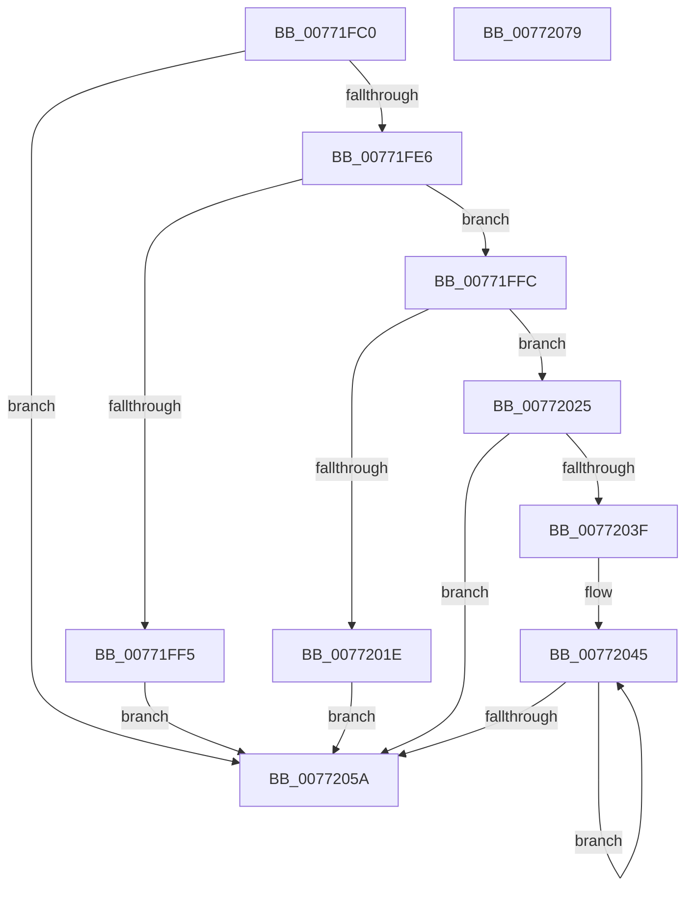

# PopPlInitComponent

- RVA: `0x00771FC0`–`0x0077207A` (길이 `186` bytes)
- VA: `0x0000000140771FC0`
- 실행 섹션: `PAGE`
- PDB 이름 있음: `예`; PDB Function 태그: `아니요`
- unwind 정보 RVA: `0x0005C954`
- 디코드: `55`개 명령, `186/186` bytes 표시
- 미해석 바이트: `0` (있으면 어셈블리에 `.byte`로 보존)

> 이 문서는 커널 이미지의 기계어와 PDB 기호를 분석해 생성했습니다. 4번과 5번은 함수 원형과 자료형을 바이너리 사용 방식에서 추정한 C 해석이며 원본 소스 복구 결과는 아닙니다.

## 1. Dependencies

- 직접 호출 지점: **1**; 고유 호출 대상: **1**
- 직접 호출자로 확인된 함수: **1**
- RIP 상대 이미지 참조: **0**

### Outgoing calls
- `0x00772011` → [ExAllocatePool2](../../poolcode/B8/ExAllocatePool2_function_00B820F0.md) (function, `0x00B820F0`)

### Direct callers
- [PopPlInitComponents](PopPlInitComponents_function_00772080.md) at `0x00772124`

### Static image references
- 디코드된 RIP-relative 메모리 참조가 없습니다.

## 2. Other-region calls and transfers

- 다른 실행 섹션으로 향하는 call: **1**
  - `0x00772011` → [ExAllocatePool2](../../poolcode/B8/ExAllocatePool2_function_00B820F0.md) (`PAGE` → `POOLCODE`)
- 별도 외부 분기/꼬리 이동을 확인하지 못했습니다.

## 3. Assembly (complete function range)

```asm
00771FC0  48 89 5C 24 08                  mov qword ptr [rsp + 8], rbx
00771FC5  48 89 6C 24 10                  mov qword ptr [rsp + 0x10], rbp
00771FCA  48 89 74 24 18                  mov qword ptr [rsp + 0x18], rsi
00771FCF  57                              push rdi
00771FD0  48 83 EC 20                     sub rsp, 0x20
00771FD4  33 DB                           xor ebx, ebx
00771FD6  48 8B F2                        mov rsi, rdx
00771FD9  8B 52 10                        mov edx, dword ptr [rdx + 0x10]
00771FDC  48 8B E9                        mov rbp, rcx
00771FDF  44 8B D3                        mov r10d, ebx
00771FE2  85 D2                           test edx, edx
00771FE4  74 74                           je 0x14077205a
00771FE6  8B 7E 14                        mov edi, dword ptr [rsi + 0x14]
00771FE9  49 03 F8                        add rdi, r8
00771FEC  48 8D 0C D7                     lea rcx, [rdi + rdx*8]
00771FF0  49 3B C9                        cmp rcx, r9
00771FF3  76 07                           jbe 0x140771ffc
00771FF5  BB 06 02 00 C0                  mov ebx, 0xc0000206
00771FFA  EB 5E                           jmp 0x14077205a
00771FFC  8D 04 D5 20 00 00 00            lea eax, [rdx*8 + 0x20]
00772003  B9 40 00 00 00                  mov ecx, 0x40
00772008  48 63 D0                        movsxd rdx, eax
0077200B  41 B8 50 6F 50 6C               mov r8d, 0x6c506f50
00772011  E8 DA 00 41 00                  call 0x140b820f0
00772016  4C 8B D0                        mov r10, rax
00772019  48 85 C0                        test rax, rax
0077201C  75 07                           jne 0x140772025
0077201E  BB 9A 00 00 C0                  mov ebx, 0xc000009a
00772023  EB 35                           jmp 0x14077205a
00772025  0F 10 06                        movups xmm0, xmmword ptr [rsi]
00772028  48 89 68 10                     mov qword ptr [rax + 0x10], rbp
0077202C  48 8B D3                        mov rdx, rbx
0077202F  F3 0F 7F 00                     movdqu xmmword ptr [rax], xmm0
00772033  8B 46 10                        mov eax, dword ptr [rsi + 0x10]
00772036  49 89 42 18                     mov qword ptr [r10 + 0x18], rax
0077203A  48 85 C0                        test rax, rax
0077203D  74 1B                           je 0x14077205a
0077203F  49 8B C2                        mov rax, r10
00772042  48 2B C7                        sub rax, rdi
00772045  48 8B 0F                        mov rcx, qword ptr [rdi]
00772048  48 FF C2                        inc rdx
0077204B  48 89 4C 38 20                  mov qword ptr [rax + rdi + 0x20], rcx
00772050  48 8D 7F 08                     lea rdi, [rdi + 8]
00772054  49 3B 52 18                     cmp rdx, qword ptr [r10 + 0x18]
00772058  72 EB                           jb 0x140772045
0077205A  48 8B 4C 24 50                  mov rcx, qword ptr [rsp + 0x50]
0077205F  8B C3                           mov eax, ebx
00772061  48 8B 5C 24 30                  mov rbx, qword ptr [rsp + 0x30]
00772066  48 8B 6C 24 38                  mov rbp, qword ptr [rsp + 0x38]
0077206B  48 8B 74 24 40                  mov rsi, qword ptr [rsp + 0x40]
00772070  4C 89 11                        mov qword ptr [rcx], r10
00772073  48 83 C4 20                     add rsp, 0x20
00772077  5F                              pop rdi
00772078  C3                              ret
00772079  CC                              int3
```

## 4. C-style interpretation (structured pseudocode)

```c
__int64 __fastcall PopPlInitComponent(__int64 a1, __int64 a2, __int64 a3, __int64 a4, __int64 a5)
{
    __int64 result;
    __int64 v_rbx;
    __int64 v_rdi;
    __int64 v_rsp;
    unsigned __int64 v_stack_p10;
    unsigned __int64 v_stack_p18;
    unsigned __int64 v_stack_p8;

    v_stack_p8 = v_rbx;
    v_stack_p10 = v_rbp;
    v_stack_p18 = v_rsi;
    v_rsp = (v_rsp) - (32);
    v_rbx = 0;
    if ((unsigned int)((unsigned int)(*(unsigned int *)(a2 + 16))) == 0) goto loc_0077205A;
    v_rdi = ((unsigned int)(*(unsigned int *)(a2 + 20))) + (a3);
    if ((v_rdi + (unsigned int)(*(unsigned int *)(a2 + 16)) * 8) <= a4) goto loc_00771FFC;
    goto loc_0077205A;
loc_00771FFC:
    result = ExAllocatePool2(64, (int)((unsigned int)((unsigned int)(*(unsigned int *)(a2 + 16)) * 8 + 32)), (unsigned int)(0x6C506F50ULL), a4);
    if (result != 0) goto loc_00772025;
    goto loc_0077205A;
loc_00772025:
    *(unsigned __int64 *)(result + 16) = a1;
    *(unsigned __int64 *)(result) = v_xmm0;
    *(unsigned __int64 *)(result + 24) = (unsigned int)(*(unsigned int *)(a2 + 16));
    if ((unsigned int)(*(unsigned int *)(a2 + 16)) == 0) goto loc_0077205A;
    result = (result) - (v_rdi);
loc_00772045:
    a2 = ((unsigned int)(0xC000009AULL)) + 1;
    *(unsigned __int64 *)(result + v_rdi * 1 + 32) = *(unsigned __int64 *)(v_rdi);
    if (a2 < (*(unsigned __int64 *)(result + 24))) goto loc_00772045;
loc_0077205A:
    *(unsigned __int64 *)(a5) = result;
    v_rsp = (v_rsp) + (32);
    return (unsigned int)((unsigned int)((unsigned int)(0xC000009AULL)));
}
```

## 5. (Beta) C Style

```c
int64_t PopPlInitComponent(int64_t Arg1, void *Arg2, int64_t Arg3, int64_t Arg4, void *Arg5)
{
    uint8_t *arg2 = (uint8_t *)Arg2;
    uint8_t *arg5 = (uint8_t *)Arg5;

    int64_t result;
    int64_t local_rbx;
    int64_t local_rdi;
    int64_t local_rsp;
    uint64_t v_stack_p10;
    uint64_t v_stack_p18;
    uint64_t v_stack_p8;

    v_stack_p8 = local_rbx;
    v_stack_p10 = local_rbp;
    v_stack_p18 = local_rsi;
    local_rsp = (local_rsp) - (32);
    local_rbx = 0;
    if ((uint32_t)((uint32_t)(*(uint32_t *)(arg2 + 0x10))) == 0) goto loc_0077205A;
    local_rdi = ((uint32_t)(*(uint32_t *)(arg2 + 0x14))) + (Arg3);
    if ((local_rdi + (uint32_t)(*(uint32_t *)(arg2 + 0x10)) * 8) <= Arg4) goto loc_00771FFC;
    goto loc_0077205A;
loc_00771FFC:
    result = ExAllocatePool2(64, (int32_t)((uint32_t)((uint32_t)(*(uint32_t *)(arg2 + 0x10)) * 8 + 32)), (uint32_t)(0x6C506F50ULL), Arg4);
    if (result != 0) goto loc_00772025;
    goto loc_0077205A;
loc_00772025:
    *(uint64_t *)(result + 0x10) = Arg1;
    *(uint64_t *)(result) = v_xmm0;
    *(uint64_t *)(result + 0x18) = (uint32_t)(*(uint32_t *)(arg2 + 0x10));
    if ((uint32_t)(*(uint32_t *)(arg2 + 0x10)) == 0) goto loc_0077205A;
    result = (result) - (local_rdi);
loc_00772045:
    Arg2 = ((uint32_t)(0xC000009AULL)) + 1;
    *(uint64_t *)(result + local_rdi * 1 + 0x20) = *(uint64_t *)(local_rdi);
    if (Arg2 < (*(uint64_t *)(result + 0x18))) goto loc_00772045;
loc_0077205A:
    *(uint64_t *)(arg5) = result;
    local_rsp = (local_rsp) + (32);
    return (uint32_t)((uint32_t)((uint32_t)(0xC000009AULL)));
}
```

### 관측된 메모리 오프셋

구조체 형식이 확인되지 않은 접근은 인자 기준의 오프셋으로만 기록했습니다.

| 기준 인자 | 오프셋 표현 | 폭 (bit) | 접근 |
|---|---:|---:|---|
| `Arg2` | `+ 0x0` | `128` | `R` |
| `Arg2` | `+ 0x10` | `32` | `R` |
| `Arg2` | `+ 0x14` | `32` | `R` |
| `Arg5` | `+ 0x0` | `64` | `W` |

## 6. Execution-region graph

[열기: 2D/3D 그래프와 함수 탐색 컨트롤 패널](../../../control-panel.html?section=page&rva=0x00771FC0&view=graph)

- 2D 그래프는 위에서 아래로 흐르고, 3D 그래프는 빈 공간을 드래그해 회전합니다. Shift+드래그는 이동, 휠은 확대·축소, 함수 노드 선택은 대상 보고서 이동입니다.

### Static fallback


