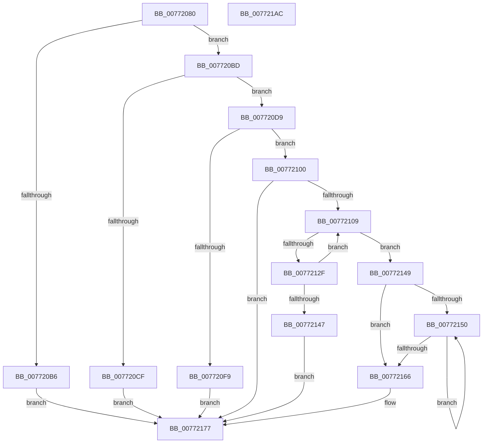

# PopPlInitComponents

- RVA: `0x00772080`–`0x007721AD` (길이 `301` bytes)
- VA: `0x0000000140772080`
- 실행 섹션: `PAGE`
- PDB 이름 있음: `예`; PDB Function 태그: `아니요`
- unwind 정보 RVA: `0x000CD76C`
- 디코드: `88`개 명령, `301/301` bytes 표시
- 미해석 바이트: `0` (있으면 어셈블리에 `.byte`로 보존)

> 이 문서는 커널 이미지의 기계어와 PDB 기호를 분석해 생성했습니다. 4번과 5번은 함수 원형과 자료형을 바이너리 사용 방식에서 추정한 C 해석이며 원본 소스 복구 결과는 아닙니다.

## 1. Dependencies

- 직접 호출 지점: **4**; 고유 호출 대상: **3**
- 직접 호출자로 확인된 함수: **1**
- RIP 상대 이미지 참조: **0**

### Outgoing calls
- `0x007720EC` → [ExAllocatePool2](../../poolcode/B8/ExAllocatePool2_function_00B820F0.md) (function, `0x00B820F0`)
- `0x00772124` → [PopPlInitComponent](PopPlInitComponent_function_00771FC0.md) (function, `0x00771FC0`)
- `0x00772159` → [ExFreePoolWithTag](../../poolcode/B8/ExFreePoolWithTag_function_00B82870.md) (function, `0x00B82870`)
- `0x0077216E` → [ExFreePoolWithTag](../../poolcode/B8/ExFreePoolWithTag_function_00B82870.md) (function, `0x00B82870`)

### Direct callers
- [PopPlInitDevice](PopPlInitDevice_function_007721B4.md) at `0x00772272`

### Static image references
- 디코드된 RIP-relative 메모리 참조가 없습니다.

## 2. Other-region calls and transfers

- 다른 실행 섹션으로 향하는 call: **3**
  - `0x007720EC` → [ExAllocatePool2](../../poolcode/B8/ExAllocatePool2_function_00B820F0.md) (`PAGE` → `POOLCODE`)
  - `0x00772159` → [ExFreePoolWithTag](../../poolcode/B8/ExFreePoolWithTag_function_00B82870.md) (`PAGE` → `POOLCODE`)
  - `0x0077216E` → [ExFreePoolWithTag](../../poolcode/B8/ExFreePoolWithTag_function_00B82870.md) (`PAGE` → `POOLCODE`)
- 별도 외부 분기/꼬리 이동을 확인하지 못했습니다.

## 3. Assembly (complete function range)

```asm
00772080  48 8B C4                        mov rax, rsp
00772083  48 89 58 08                     mov qword ptr [rax + 8], rbx
00772087  48 89 68 10                     mov qword ptr [rax + 0x10], rbp
0077208B  48 89 70 20                     mov qword ptr [rax + 0x20], rsi
0077208F  57                              push rdi
00772090  41 54                           push r12
00772092  41 55                           push r13
00772094  41 56                           push r14
00772096  41 57                           push r15
00772098  48 83 EC 30                     sub rsp, 0x30
0077209C  48 83 60 18 00                  and qword ptr [rax + 0x18], 0
007720A1  33 F6                           xor esi, esi
007720A3  33 FF                           xor edi, edi
007720A5  4D 8B E1                        mov r12, r9
007720A8  4D 8B F0                        mov r14, r8
007720AB  4C 8B FA                        mov r15, rdx
007720AE  4C 8B E9                        mov r13, rcx
007720B1  4D 85 C0                        test r8, r8
007720B4  75 07                           jne 0x1407720bd
007720B6  33 DB                           xor ebx, ebx
007720B8  E9 BA 00 00 00                  jmp 0x140772177
007720BD  4B 8D 04 40                     lea rax, [r8 + r8*2]
007720C1  48 8D 0C C2                     lea rcx, [rdx + rax*8]
007720C5  48 3B 8C 24 80 00 00 00         cmp rcx, qword ptr [rsp + 0x80]
007720CD  76 0A                           jbe 0x1407720d9
007720CF  BB 06 02 00 C0                  mov ebx, 0xc0000206
007720D4  E9 9E 00 00 00                  jmp 0x140772177
007720D9  4A 8D 14 C5 00 00 00 00         lea rdx, [r8*8]
007720E1  B9 40 00 00 00                  mov ecx, 0x40
007720E6  41 B8 50 6F 50 6C               mov r8d, 0x6c506f50
007720EC  E8 FF FF 40 00                  call 0x140b820f0
007720F1  48 8B F0                        mov rsi, rax
007720F4  48 85 C0                        test rax, rax
007720F7  75 07                           jne 0x140772100
007720F9  BB 9A 00 00 C0                  mov ebx, 0xc000009a
007720FE  EB 77                           jmp 0x140772177
00772100  33 DB                           xor ebx, ebx
00772102  33 ED                           xor ebp, ebp
00772104  4D 85 F6                        test r14, r14
00772107  74 6E                           je 0x140772177
00772109  4C 8B 8C 24 80 00 00 00         mov r9, qword ptr [rsp + 0x80]
00772111  48 8D 44 24 70                  lea rax, [rsp + 0x70]
00772116  4D 8B C4                        mov r8, r12
00772119  48 89 44 24 20                  mov qword ptr [rsp + 0x20], rax
0077211E  49 8B D7                        mov rdx, r15
00772121  49 8B CD                        mov rcx, r13
00772124  E8 97 FE FF FF                  call 0x140771fc0
00772129  8B D8                           mov ebx, eax
0077212B  85 C0                           test eax, eax
0077212D  78 1A                           js 0x140772149
0077212F  48 8B 4C 24 70                  mov rcx, qword ptr [rsp + 0x70]
00772134  48 FF C5                        inc rbp
00772137  48 89 0C FE                     mov qword ptr [rsi + rdi*8], rcx
0077213B  49 83 C7 18                     add r15, 0x18
0077213F  48 FF C7                        inc rdi
00772142  49 3B EE                        cmp rbp, r14
00772145  72 C2                           jb 0x140772109
00772147  EB 2E                           jmp 0x140772177
00772149  33 ED                           xor ebp, ebp
0077214B  48 85 FF                        test rdi, rdi
0077214E  74 16                           je 0x140772166
00772150  48 8B 0C EE                     mov rcx, qword ptr [rsi + rbp*8]
00772154  BA 50 6F 50 6C                  mov edx, 0x6c506f50
00772159  E8 12 07 41 00                  call 0x140b82870
0077215E  48 FF C5                        inc rbp
00772161  48 3B EF                        cmp rbp, rdi
00772164  72 EA                           jb 0x140772150
00772166  BA 50 6F 50 6C                  mov edx, 0x6c506f50
0077216B  48 8B CE                        mov rcx, rsi
0077216E  E8 FD 06 41 00                  call 0x140b82870
00772173  33 F6                           xor esi, esi
00772175  33 FF                           xor edi, edi
00772177  48 8B 84 24 90 00 00 00         mov rax, qword ptr [rsp + 0x90]
0077217F  48 8B 6C 24 68                  mov rbp, qword ptr [rsp + 0x68]
00772184  48 89 30                        mov qword ptr [rax], rsi
00772187  48 8B 84 24 88 00 00 00         mov rax, qword ptr [rsp + 0x88]
0077218F  48 8B 74 24 78                  mov rsi, qword ptr [rsp + 0x78]
00772194  48 89 38                        mov qword ptr [rax], rdi
00772197  8B C3                           mov eax, ebx
00772199  48 8B 5C 24 60                  mov rbx, qword ptr [rsp + 0x60]
0077219E  48 83 C4 30                     add rsp, 0x30
007721A2  41 5F                           pop r15
007721A4  41 5E                           pop r14
007721A6  41 5D                           pop r13
007721A8  41 5C                           pop r12
007721AA  5F                              pop rdi
007721AB  C3                              ret
007721AC  CC                              int3
```

## 4. C-style interpretation (structured pseudocode)

```c
__int64 __fastcall PopPlInitComponents(__int64 a1, __int64 a2, __int64 a3, __int64 a4, __int64 a5, __int64 a6, __int64 a7)
{
    __int64 result;
    __int64 v_r15;
    __int64 v_rbp;
    __int64 v_rbx;
    __int64 v_rdi;
    __int64 v_rsi;
    __int64 v_rsp;
    unsigned __int64 v_stack_m38;
    unsigned __int64 v_stack_p10;
    unsigned __int64 v_stack_p18;
    unsigned __int64 v_stack_p20;
    unsigned __int64 v_stack_p8;

    *(unsigned __int64 *)(v_rsp + 8) = v_rbx;
    *(unsigned __int64 *)(v_rsp + 16) = v_rbp;
    *(unsigned __int64 *)(v_rsp + 32) = v_rsi;
    v_rsp = (v_rsp) - (48);
    v_rsi = 0;
    v_rdi = 0;
    if (a3 != 0) goto loc_007720BD;
    v_rbx = 0;
    goto loc_00772177;
loc_007720BD:
    if ((a2 + a3 + a3 * 2 * 8) <= a5) goto loc_007720D9;
    goto loc_00772177;
loc_007720D9:
    result = ExAllocatePool2(64, a3 * 8, (unsigned int)(0x6C506F50ULL), a4);
    if (result != 0) goto loc_00772100;
    goto loc_00772177;
loc_00772100:
    v_rbx = 0;
    v_rbp = 0;
    if (a3 == 0) goto loc_00772177;
loc_00772109:
    v_stack_m38 = v_stack_p18;
    result = PopPlInitComponent(a1, a2, a4, a5);
    if (sign_flag) goto loc_00772149;
    v_rbp = (v_rbp) + 1;
    *(unsigned __int64 *)(result + v_rdi * 8) = v_stack_p18;
    v_r15 = (a2) + (24);
    v_rdi = (v_rdi) + 1;
    if (v_rbp < a3) goto loc_00772109;
    goto loc_00772177;
loc_00772149:
    v_rbp = 0;
    if (v_rdi == 0) goto loc_00772166;
loc_00772150:
    result = ExFreePoolWithTag(*(unsigned __int64 *)(result + v_rbp * 8), (unsigned int)(0x6C506F50ULL), a4, a5);
    v_rbp = (v_rbp) + 1;
    if (v_rbp < v_rdi) goto loc_00772150;
loc_00772166:
    result = ExFreePoolWithTag(result, (unsigned int)(0x6C506F50ULL), a4, a5);
    v_rsi = 0;
    v_rdi = 0;
loc_00772177:
    *(unsigned __int64 *)(a7) = 0;
    *(unsigned __int64 *)(a6) = 0;
    v_rsp = (v_rsp) + (48);
    return (unsigned int)((unsigned int)((unsigned int)((unsigned int)(result))));
}
```

## 5. (Beta) C Style

```c
int64_t PopPlInitComponents(int64_t Arg1, void *Arg2, int64_t Arg3, int64_t Arg4, int64_t Arg5, void *Arg6, void *Arg7)
{
    uint8_t *arg2 = (uint8_t *)Arg2;
    uint8_t *arg6 = (uint8_t *)Arg6;
    uint8_t *arg7 = (uint8_t *)Arg7;

    int64_t result;
    int64_t local_r15;
    int64_t local_rbp;
    int64_t local_rbx;
    int64_t local_rdi;
    int64_t local_rsi;
    int64_t local_rsp;
    uint64_t v_stack_m38;
    uint64_t v_stack_p10;
    uint64_t v_stack_p18;
    uint64_t v_stack_p20;
    uint64_t v_stack_p8;

    *(uint64_t *)(local_rsp + 0x8) = local_rbx;
    *(uint64_t *)(local_rsp + 0x10) = local_rbp;
    *(uint64_t *)(local_rsp + 0x20) = local_rsi;
    local_rsp = (local_rsp) - (48);
    local_rsi = 0;
    local_rdi = 0;
    if (Arg3 != 0) goto loc_007720BD;
    local_rbx = 0;
    goto loc_00772177;
loc_007720BD:
    if ((Arg2 + Arg3 + Arg3 * 2 * 8) <= Arg5) goto loc_007720D9;
    goto loc_00772177;
loc_007720D9:
    result = ExAllocatePool2(64, Arg3 * 8, (uint32_t)(0x6C506F50ULL), Arg4);
    if (result != 0) goto loc_00772100;
    goto loc_00772177;
loc_00772100:
    local_rbx = 0;
    local_rbp = 0;
    if (Arg3 == 0) goto loc_00772177;
loc_00772109:
    v_stack_m38 = v_stack_p18;
    result = PopPlInitComponent(Arg1, Arg2, Arg4, Arg5);
    if (sign_flag) goto loc_00772149;
    local_rbp = (local_rbp) + 1;
    *(uint64_t *)(result + local_rdi * 8) = v_stack_p18;
    local_r15 = (Arg2) + (24);
    local_rdi = (local_rdi) + 1;
    if (local_rbp < Arg3) goto loc_00772109;
    goto loc_00772177;
loc_00772149:
    local_rbp = 0;
    if (local_rdi == 0) goto loc_00772166;
loc_00772150:
    result = ExFreePoolWithTag(*(uint64_t *)(result + local_rbp * 8), (uint32_t)(0x6C506F50ULL), Arg4, Arg5);
    local_rbp = (local_rbp) + 1;
    if (local_rbp < local_rdi) goto loc_00772150;
loc_00772166:
    result = ExFreePoolWithTag(result, (uint32_t)(0x6C506F50ULL), Arg4, Arg5);
    local_rsi = 0;
    local_rdi = 0;
loc_00772177:
    *(uint64_t *)(arg7) = 0;
    *(uint64_t *)(arg6) = 0;
    local_rsp = (local_rsp) + (48);
    return (uint32_t)((uint32_t)((uint32_t)((uint32_t)(result))));
}
```

### 관측된 메모리 오프셋

구조체 형식이 확인되지 않은 접근은 인자 기준의 오프셋으로만 기록했습니다.

| 기준 인자 | 오프셋 표현 | 폭 (bit) | 접근 |
|---|---:|---:|---|
| `Arg2` | `+ 0x0 + rax*8` | `64` | `R` |
| `Arg6` | `+ 0x0` | `64` | `W` |
| `Arg7` | `+ 0x0` | `64` | `W` |

## 6. Execution-region graph

[열기: 2D/3D 그래프와 함수 탐색 컨트롤 패널](../../../control-panel.html?section=page&rva=0x00772080&view=graph)

- 2D 그래프는 위에서 아래로 흐르고, 3D 그래프는 빈 공간을 드래그해 회전합니다. Shift+드래그는 이동, 휠은 확대·축소, 함수 노드 선택은 대상 보고서 이동입니다.

### Static fallback


