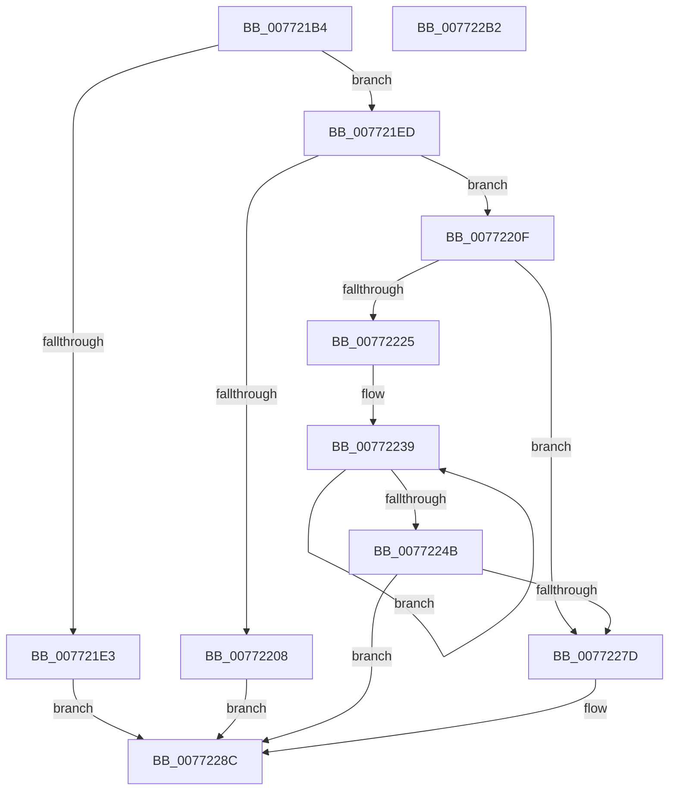

# PopPlInitDevice

- RVA: `0x007721B4`–`0x007722B3` (길이 `255` bytes)
- VA: `0x00000001407721B4`
- 실행 섹션: `PAGE`
- PDB 이름 있음: `예`; PDB Function 태그: `아니요`
- unwind 정보 RVA: `0x00093E28`
- 디코드: `74`개 명령, `255/255` bytes 표시
- 미해석 바이트: `0` (있으면 어셈블리에 `.byte`로 보존)

> 이 문서는 커널 이미지의 기계어와 PDB 기호를 분석해 생성했습니다. 4번과 5번은 함수 원형과 자료형을 바이너리 사용 방식에서 추정한 C 해석이며 원본 소스 복구 결과는 아닙니다.

## 1. Dependencies

- 직접 호출 지점: **4**; 고유 호출 대상: **4**
- 직접 호출자로 확인된 함수: **1**
- RIP 상대 이미지 참조: **0**

### Outgoing calls
- `0x007721FB` → [ExAllocatePool2](../../poolcode/B8/ExAllocatePool2_function_00B820F0.md) (function, `0x00B820F0`)
- `0x0077221A` → [PopPlInitWString](PopPlInitWString_function_0077252C.md) (function, `0x0077252C`)
- `0x00772272` → [PopPlInitComponents](PopPlInitComponents_function_00772080.md) (function, `0x00772080`)
- `0x00772285` → [ExFreePoolWithTag](../../poolcode/B8/ExFreePoolWithTag_function_00B82870.md) (function, `0x00B82870`)

### Direct callers
- [PopPlInitDevices](PopPlInitDevices_function_007722BC.md) at `0x0077236A`

### Static image references
- 디코드된 RIP-relative 메모리 참조가 없습니다.

## 2. Other-region calls and transfers

- 다른 실행 섹션으로 향하는 call: **2**
  - `0x007721FB` → [ExAllocatePool2](../../poolcode/B8/ExAllocatePool2_function_00B820F0.md) (`PAGE` → `POOLCODE`)
  - `0x00772285` → [ExFreePoolWithTag](../../poolcode/B8/ExFreePoolWithTag_function_00B82870.md) (`PAGE` → `POOLCODE`)
- 별도 외부 분기/꼬리 이동을 확인하지 못했습니다.

## 3. Assembly (complete function range)

```asm
007721B4  48 89 5C 24 08                  mov qword ptr [rsp + 8], rbx
007721B9  48 89 6C 24 10                  mov qword ptr [rsp + 0x10], rbp
007721BE  48 89 74 24 18                  mov qword ptr [rsp + 0x18], rsi
007721C3  57                              push rdi
007721C4  41 56                           push r14
007721C6  41 57                           push r15
007721C8  48 83 EC 40                     sub rsp, 0x40
007721CC  33 DB                           xor ebx, ebx
007721CE  48 8D 42 2C                     lea rax, [rdx + 0x2c]
007721D2  49 8B E9                        mov rbp, r9
007721D5  4D 8B F0                        mov r14, r8
007721D8  48 8B F2                        mov rsi, rdx
007721DB  4C 8B F9                        mov r15, rcx
007721DE  49 3B C1                        cmp rax, r9
007721E1  76 0A                           jbe 0x1407721ed
007721E3  BF 06 02 00 C0                  mov edi, 0xc0000206
007721E8  E9 9F 00 00 00                  jmp 0x14077228c
007721ED  BA 58 00 00 00                  mov edx, 0x58
007721F2  41 B8 50 6F 50 6C               mov r8d, 0x6c506f50
007721F8  8D 4A E8                        lea ecx, [rdx - 0x18]
007721FB  E8 F0 FE 40 00                  call 0x140b820f0
00772200  48 8B D8                        mov rbx, rax
00772203  48 85 C0                        test rax, rax
00772206  75 07                           jne 0x14077220f
00772208  BF 9A 00 00 C0                  mov edi, 0xc000009a
0077220D  EB 7D                           jmp 0x14077228c
0077220F  8B 16                           mov edx, dword ptr [rsi]
00772211  4C 8B CD                        mov r9, rbp
00772214  4D 8B C6                        mov r8, r14
00772217  48 8B CB                        mov rcx, rbx
0077221A  E8 0D 03 00 00                  call 0x14077252c
0077221F  8B F8                           mov edi, eax
00772221  85 C0                           test eax, eax
00772223  78 58                           js 0x14077227d
00772225  48 8B D6                        mov rdx, rsi
00772228  4C 89 7B 10                     mov qword ptr [rbx + 0x10], r15
0077222C  48 2B D3                        sub rdx, rbx
0077222F  48 8D 4B 24                     lea rcx, [rbx + 0x24]
00772233  41 B8 04 00 00 00               mov r8d, 4
00772239  48 8B 44 0A E0                  mov rax, qword ptr [rdx + rcx - 0x20]
0077223E  48 89 01                        mov qword ptr [rcx], rax
00772241  48 8D 49 08                     lea rcx, [rcx + 8]
00772245  49 83 E8 01                     sub r8, 1
00772249  75 EE                           jne 0x140772239
0077224B  8B 56 28                        mov edx, dword ptr [rsi + 0x28]
0077224E  48 8D 43 50                     lea rax, [rbx + 0x50]
00772252  44 8B 46 24                     mov r8d, dword ptr [rsi + 0x24]
00772256  48 8D 4B 48                     lea rcx, [rbx + 0x48]
0077225A  48 89 44 24 30                  mov qword ptr [rsp + 0x30], rax
0077225F  49 03 D6                        add rdx, r14
00772262  48 89 4C 24 28                  mov qword ptr [rsp + 0x28], rcx
00772267  4D 8B CE                        mov r9, r14
0077226A  48 8B CB                        mov rcx, rbx
0077226D  48 89 6C 24 20                  mov qword ptr [rsp + 0x20], rbp
00772272  E8 09 FE FF FF                  call 0x140772080
00772277  8B F8                           mov edi, eax
00772279  85 C0                           test eax, eax
0077227B  79 0F                           jns 0x14077228c
0077227D  BA 50 6F 50 6C                  mov edx, 0x6c506f50
00772282  48 8B CB                        mov rcx, rbx
00772285  E8 E6 05 41 00                  call 0x140b82870
0077228A  33 DB                           xor ebx, ebx
0077228C  48 8B 84 24 80 00 00 00         mov rax, qword ptr [rsp + 0x80]
00772294  48 8B 6C 24 68                  mov rbp, qword ptr [rsp + 0x68]
00772299  48 8B 74 24 70                  mov rsi, qword ptr [rsp + 0x70]
0077229E  48 89 18                        mov qword ptr [rax], rbx
007722A1  8B C7                           mov eax, edi
007722A3  48 8B 5C 24 60                  mov rbx, qword ptr [rsp + 0x60]
007722A8  48 83 C4 40                     add rsp, 0x40
007722AC  41 5F                           pop r15
007722AE  41 5E                           pop r14
007722B0  5F                              pop rdi
007722B1  C3                              ret
007722B2  CC                              int3
```

## 4. C-style interpretation (structured pseudocode)

```c
__int64 __fastcall PopPlInitDevice(__int64 a1, __int64 a2, __int64 a3, __int64 a4, __int64 a5)
{
    __int64 result;
    __int64 v_rbx;
    __int64 v_rsp;
    unsigned __int64 v_stack_m28;
    unsigned __int64 v_stack_m30;
    unsigned __int64 v_stack_m38;
    unsigned __int64 v_stack_p10;
    unsigned __int64 v_stack_p18;
    unsigned __int64 v_stack_p8;

    v_stack_p8 = v_rbx;
    v_stack_p10 = v_rbp;
    v_stack_p18 = v_rsi;
    v_rsp = (v_rsp) - (64);
    v_rbx = 0;
    if ((a2 + 44) <= a4) goto loc_007721ED;
    goto loc_0077228C;
loc_007721ED:
    result = ExAllocatePool2(88 - 24, 88, (unsigned int)(0x6C506F50ULL), a4);
    if (result != 0) goto loc_0077220F;
    goto loc_0077228C;
loc_0077220F:
    result = PopPlInitWString(result, (unsigned int)(*(unsigned int *)(a2)), a3, a4);
    if (sign_flag) goto loc_0077227D;
    *(unsigned __int64 *)(result + 16) = a1;
    a2 = (a2) - (result);
loc_00772239:
    *(unsigned __int64 *)(result + 36) = *(unsigned __int64 *)(a2 + result + 36 * 1 - 32);
    a3 = (4) - (1);
    if (condition_is_not_equal) goto loc_00772239;
    v_stack_m28 = result + 80;
    a2 = ((unsigned int)(*(unsigned int *)(a2 + 40))) + (a3);
    v_stack_m30 = result + 72;
    v_stack_m38 = a4;
    result = PopPlInitComponents(result, a2, (unsigned int)(*(unsigned int *)(a2 + 36)), a3);
    v_rbx = result;
    if (sign_flag) {
        a2 = 0x6C506F50ULL;
        a1 = result;
        result = ExFreePoolWithTag(a1, a2, (unsigned int)(*(unsigned int *)(a2 + 36)), a3);
        v_rbx = 0;
    }
    *(unsigned __int64 *)(a5) = 0;
    v_rsp = (v_rsp) + (64);
    return (unsigned int)((unsigned int)((unsigned int)((unsigned int)(result))));
}
```

## 5. (Beta) C Style

```c
int64_t PopPlInitDevice(int64_t Arg1, void *Arg2, int64_t Arg3, int64_t Arg4, void *Arg5)
{
    uint8_t *arg2 = (uint8_t *)Arg2;
    uint8_t *arg5 = (uint8_t *)Arg5;

    int64_t result;
    int64_t local_rbx;
    int64_t local_rsp;
    uint64_t v_stack_m28;
    uint64_t v_stack_m30;
    uint64_t v_stack_m38;
    uint64_t v_stack_p10;
    uint64_t v_stack_p18;
    uint64_t v_stack_p8;

    v_stack_p8 = local_rbx;
    v_stack_p10 = local_rbp;
    v_stack_p18 = local_rsi;
    local_rsp = (local_rsp) - (64);
    local_rbx = 0;
    if ((Arg2 + 44) <= Arg4) goto loc_007721ED;
    goto loc_0077228C;
loc_007721ED:
    result = ExAllocatePool2(88 - 24, 88, (uint32_t)(0x6C506F50ULL), Arg4);
    if (result != 0) goto loc_0077220F;
    goto loc_0077228C;
loc_0077220F:
    result = PopPlInitWString(result, (uint32_t)(*(uint32_t *)(arg2)), Arg3, Arg4);
    if (sign_flag) goto loc_0077227D;
    *(uint64_t *)(result + 0x10) = Arg1;
    Arg2 = (Arg2) - (result);
loc_00772239:
    *(uint64_t *)(result + 0x24) = *(uint64_t *)(arg2 + result + 0x24 * 1 - 0x20);
    Arg3 = (4) - (1);
    if (condition_is_not_equal) goto loc_00772239;
    v_stack_m28 = result + 80;
    Arg2 = ((uint32_t)(*(uint32_t *)(arg2 + 0x28))) + (Arg3);
    v_stack_m30 = result + 72;
    v_stack_m38 = Arg4;
    result = PopPlInitComponents(result, Arg2, (uint32_t)(*(uint32_t *)(arg2 + 0x24)), Arg3);
    local_rbx = result;
    if (sign_flag) {
        Arg2 = 0x6C506F50ULL;
        Arg1 = result;
        result = ExFreePoolWithTag(Arg1, Arg2, (uint32_t)(*(uint32_t *)(arg2 + 0x24)), Arg3);
        local_rbx = 0;
    }
    *(uint64_t *)(arg5) = 0;
    local_rsp = (local_rsp) + (64);
    return (uint32_t)((uint32_t)((uint32_t)((uint32_t)(result))));
}
```

### 관측된 메모리 오프셋

구조체 형식이 확인되지 않은 접근은 인자 기준의 오프셋으로만 기록했습니다.

| 기준 인자 | 오프셋 표현 | 폭 (bit) | 접근 |
|---|---:|---:|---|
| `Arg2` | `- 0x20 + rcx*1` | `64` | `R` |
| `Arg2` | `+ 0x0` | `32` | `R` |
| `Arg2` | `+ 0x24` | `32` | `R` |
| `Arg2` | `+ 0x28` | `32` | `R` |
| `Arg2` | `+ 0x2C` | `64` | `R` |
| `Arg5` | `+ 0x0` | `64` | `W` |

## 6. Execution-region graph

[열기: 2D/3D 그래프와 함수 탐색 컨트롤 패널](../../../control-panel.html?section=page&rva=0x007721B4&view=graph)

- 2D 그래프는 위에서 아래로 흐르고, 3D 그래프는 빈 공간을 드래그해 회전합니다. Shift+드래그는 이동, 휠은 확대·축소, 함수 노드 선택은 대상 보고서 이동입니다.

### Static fallback


