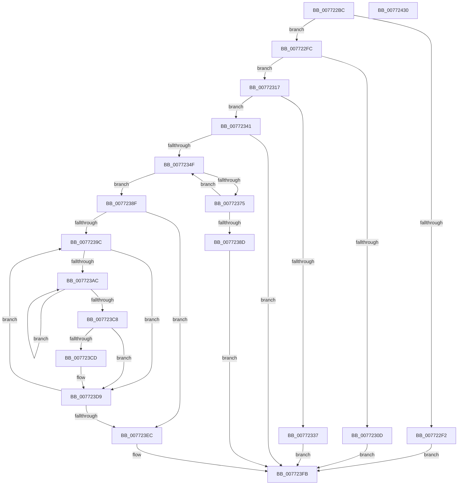

# PopPlInitDevices

- RVA: `0x007722BC`–`0x00772431` (길이 `373` bytes)
- VA: `0x00000001407722BC`
- 실행 섹션: `PAGE`
- PDB 이름 있음: `예`; PDB Function 태그: `아니요`
- unwind 정보 RVA: `0x000CD76C`
- 디코드: `107`개 명령, `373/373` bytes 표시
- 미해석 바이트: `0` (있으면 어셈블리에 `.byte`로 보존)

> 이 문서는 커널 이미지의 기계어와 PDB 기호를 분석해 생성했습니다. 4번과 5번은 함수 원형과 자료형을 바이너리 사용 방식에서 추정한 C 해석이며 원본 소스 복구 결과는 아닙니다.

## 1. Dependencies

- 직접 호출 지점: **6**; 고유 호출 대상: **3**
- 직접 호출자로 확인된 함수: **1**
- RIP 상대 이미지 참조: **0**

### Outgoing calls
- `0x0077232A` → [ExAllocatePool2](../../poolcode/B8/ExAllocatePool2_function_00B820F0.md) (function, `0x00B820F0`)
- `0x0077236A` → [PopPlInitDevice](PopPlInitDevice_function_007721B4.md) (function, `0x007721B4`)
- `0x007723B7` → [ExFreePoolWithTag](../../poolcode/B8/ExFreePoolWithTag_function_00B82870.md) (function, `0x00B82870`)
- `0x007723D4` → [ExFreePoolWithTag](../../poolcode/B8/ExFreePoolWithTag_function_00B82870.md) (function, `0x00B82870`)
- `0x007723DF` → [ExFreePoolWithTag](../../poolcode/B8/ExFreePoolWithTag_function_00B82870.md) (function, `0x00B82870`)
- `0x007723F2` → [ExFreePoolWithTag](../../poolcode/B8/ExFreePoolWithTag_function_00B82870.md) (function, `0x00B82870`)

### Direct callers
- [PopPlInitPowerPlane](PopPlInitPowerPlane_function_00772438.md) at `0x007724D2`

### Static image references
- 디코드된 RIP-relative 메모리 참조가 없습니다.

## 2. Other-region calls and transfers

- 다른 실행 섹션으로 향하는 call: **5**
  - `0x0077232A` → [ExAllocatePool2](../../poolcode/B8/ExAllocatePool2_function_00B820F0.md) (`PAGE` → `POOLCODE`)
  - `0x007723B7` → [ExFreePoolWithTag](../../poolcode/B8/ExFreePoolWithTag_function_00B82870.md) (`PAGE` → `POOLCODE`)
  - `0x007723D4` → [ExFreePoolWithTag](../../poolcode/B8/ExFreePoolWithTag_function_00B82870.md) (`PAGE` → `POOLCODE`)
  - `0x007723DF` → [ExFreePoolWithTag](../../poolcode/B8/ExFreePoolWithTag_function_00B82870.md) (`PAGE` → `POOLCODE`)
  - `0x007723F2` → [ExFreePoolWithTag](../../poolcode/B8/ExFreePoolWithTag_function_00B82870.md) (`PAGE` → `POOLCODE`)
- 별도 외부 분기/꼬리 이동을 확인하지 못했습니다.

## 3. Assembly (complete function range)

```asm
007722BC  48 8B C4                        mov rax, rsp
007722BF  48 89 58 08                     mov qword ptr [rax + 8], rbx
007722C3  48 89 68 10                     mov qword ptr [rax + 0x10], rbp
007722C7  48 89 70 20                     mov qword ptr [rax + 0x20], rsi
007722CB  57                              push rdi
007722CC  41 54                           push r12
007722CE  41 55                           push r13
007722D0  41 56                           push r14
007722D2  41 57                           push r15
007722D4  48 83 EC 30                     sub rsp, 0x30
007722D8  48 83 60 18 00                  and qword ptr [rax + 0x18], 0
007722DD  33 F6                           xor esi, esi
007722DF  33 FF                           xor edi, edi
007722E1  4D 8B E1                        mov r12, r9
007722E4  49 8B E8                        mov rbp, r8
007722E7  4C 8B F2                        mov r14, rdx
007722EA  4C 8B E9                        mov r13, rcx
007722ED  4D 85 C0                        test r8, r8
007722F0  75 0A                           jne 0x1407722fc
007722F2  BB 0D 00 00 C0                  mov ebx, 0xc000000d
007722F7  E9 FF 00 00 00                  jmp 0x1407723fb
007722FC  48 6B C5 2C                     imul rax, rbp, 0x2c
00772300  48 03 C2                        add rax, rdx
00772303  48 3B 84 24 80 00 00 00         cmp rax, qword ptr [rsp + 0x80]
0077230B  76 0A                           jbe 0x140772317
0077230D  BB 06 02 00 C0                  mov ebx, 0xc0000206
00772312  E9 E4 00 00 00                  jmp 0x1407723fb
00772317  4A 8D 14 C5 00 00 00 00         lea rdx, [r8*8]
0077231F  B9 40 00 00 00                  mov ecx, 0x40
00772324  41 B8 50 6F 50 6C               mov r8d, 0x6c506f50
0077232A  E8 C1 FD 40 00                  call 0x140b820f0
0077232F  48 8B F0                        mov rsi, rax
00772332  48 85 C0                        test rax, rax
00772335  75 0A                           jne 0x140772341
00772337  BB 9A 00 00 C0                  mov ebx, 0xc000009a
0077233C  E9 BA 00 00 00                  jmp 0x1407723fb
00772341  33 DB                           xor ebx, ebx
00772343  45 33 FF                        xor r15d, r15d
00772346  48 85 ED                        test rbp, rbp
00772349  0F 84 AC 00 00 00               je 0x1407723fb
0077234F  4C 8B 8C 24 80 00 00 00         mov r9, qword ptr [rsp + 0x80]
00772357  48 8D 44 24 70                  lea rax, [rsp + 0x70]
0077235C  4D 8B C4                        mov r8, r12
0077235F  48 89 44 24 20                  mov qword ptr [rsp + 0x20], rax
00772364  49 8B D6                        mov rdx, r14
00772367  49 8B CD                        mov rcx, r13
0077236A  E8 45 FE FF FF                  call 0x1407721b4
0077236F  8B D8                           mov ebx, eax
00772371  85 C0                           test eax, eax
00772373  78 1A                           js 0x14077238f
00772375  48 8B 4C 24 70                  mov rcx, qword ptr [rsp + 0x70]
0077237A  49 FF C7                        inc r15
0077237D  48 89 0C FE                     mov qword ptr [rsi + rdi*8], rcx
00772381  49 83 C6 2C                     add r14, 0x2c
00772385  48 FF C7                        inc rdi
00772388  4C 3B FD                        cmp r15, rbp
0077238B  72 C2                           jb 0x14077234f
0077238D  EB 6C                           jmp 0x1407723fb
0077238F  33 ED                           xor ebp, ebp
00772391  41 BC 50 6F 50 6C               mov r12d, 0x6c506f50
00772397  48 85 FF                        test rdi, rdi
0077239A  74 50                           je 0x1407723ec
0077239C  4C 8B 34 EE                     mov r14, qword ptr [rsi + rbp*8]
007723A0  45 33 FF                        xor r15d, r15d
007723A3  49 8B 46 48                     mov rax, qword ptr [r14 + 0x48]
007723A7  48 85 C0                        test rax, rax
007723AA  74 2D                           je 0x1407723d9
007723AC  49 8B 4E 50                     mov rcx, qword ptr [r14 + 0x50]
007723B0  41 8B D4                        mov edx, r12d
007723B3  4A 8B 0C F9                     mov rcx, qword ptr [rcx + r15*8]
007723B7  E8 B4 04 41 00                  call 0x140b82870
007723BC  49 8B 46 48                     mov rax, qword ptr [r14 + 0x48]
007723C0  49 FF C7                        inc r15
007723C3  4C 3B F8                        cmp r15, rax
007723C6  72 E4                           jb 0x1407723ac
007723C8  48 85 C0                        test rax, rax
007723CB  74 0C                           je 0x1407723d9
007723CD  49 8B 4E 50                     mov rcx, qword ptr [r14 + 0x50]
007723D1  41 8B D4                        mov edx, r12d
007723D4  E8 97 04 41 00                  call 0x140b82870
007723D9  41 8B D4                        mov edx, r12d
007723DC  49 8B CE                        mov rcx, r14
007723DF  E8 8C 04 41 00                  call 0x140b82870
007723E4  48 FF C5                        inc rbp
007723E7  48 3B EF                        cmp rbp, rdi
007723EA  72 B0                           jb 0x14077239c
007723EC  41 8B D4                        mov edx, r12d
007723EF  48 8B CE                        mov rcx, rsi
007723F2  E8 79 04 41 00                  call 0x140b82870
007723F7  33 F6                           xor esi, esi
007723F9  33 FF                           xor edi, edi
007723FB  48 8B 84 24 90 00 00 00         mov rax, qword ptr [rsp + 0x90]
00772403  48 8B 6C 24 68                  mov rbp, qword ptr [rsp + 0x68]
00772408  48 89 30                        mov qword ptr [rax], rsi
0077240B  48 8B 84 24 88 00 00 00         mov rax, qword ptr [rsp + 0x88]
00772413  48 8B 74 24 78                  mov rsi, qword ptr [rsp + 0x78]
00772418  48 89 38                        mov qword ptr [rax], rdi
0077241B  8B C3                           mov eax, ebx
0077241D  48 8B 5C 24 60                  mov rbx, qword ptr [rsp + 0x60]
00772422  48 83 C4 30                     add rsp, 0x30
00772426  41 5F                           pop r15
00772428  41 5E                           pop r14
0077242A  41 5D                           pop r13
0077242C  41 5C                           pop r12
0077242E  5F                              pop rdi
0077242F  C3                              ret
00772430  CC                              int3
```

## 4. C-style interpretation (structured pseudocode)

```c
__int64 __fastcall PopPlInitDevices(__int64 a1, __int64 a2, __int64 a3, __int64 a4, __int64 a5, __int64 a6, __int64 a7)
{
    __int64 result;
    __int64 v_r14;
    __int64 v_r15;
    __int64 v_rbp;
    __int64 v_rbx;
    __int64 v_rdi;
    __int64 v_rsi;
    __int64 v_rsp;
    unsigned __int64 v_stack_m38;
    unsigned __int64 v_stack_p10;
    unsigned __int64 v_stack_p18;
    unsigned __int64 v_stack_p20;
    unsigned __int64 v_stack_p8;

    *(unsigned __int64 *)(v_rsp + 8) = v_rbx;
    *(unsigned __int64 *)(v_rsp + 16) = v_rbp;
    *(unsigned __int64 *)(v_rsp + 32) = v_rsi;
    v_rsp = (v_rsp) - (48);
    v_rsi = 0;
    v_rdi = 0;
    if (a3 != 0) goto loc_007722FC;
    goto loc_007723FB;
loc_007722FC:
    result = (v_rsp) * (a3);
    result = (result) + (a2);
    if (result <= a5) goto loc_00772317;
    goto loc_007723FB;
loc_00772317:
    result = ExAllocatePool2(64, a3 * 8, (unsigned int)(0x6C506F50ULL), a4);
    if (result != 0) goto loc_00772341;
    goto loc_007723FB;
loc_00772341:
    v_rbx = 0;
    v_r15 = 0;
    if (a3 == 0) goto loc_007723FB;
loc_0077234F:
    v_stack_m38 = v_stack_p18;
    result = PopPlInitDevice(a1, a2, a4, a5);
    if (sign_flag) goto loc_0077238F;
    v_r15 = (v_r15) + 1;
    *(unsigned __int64 *)(result + v_rdi * 8) = v_stack_p18;
    v_r14 = (a2) + (44);
    v_rdi = (v_rdi) + 1;
    if (v_r15 < a3) goto loc_0077234F;
    goto loc_007723FB;
loc_0077238F:
    v_rbp = 0;
    if (v_rdi == 0) goto loc_007723EC;
loc_0077239C:
    v_r15 = 0;
    if (*(unsigned __int64 *)(*(unsigned __int64 *)(result + v_rbp * 8) + 72) == 0) goto loc_007723D9;
loc_007723AC:
    result = ExFreePoolWithTag(*(unsigned __int64 *)(*(unsigned __int64 *)(*(unsigned __int64 *)(result + v_rbp * 8) + 80) + v_r15 * 8), (unsigned int)((unsigned int)((unsigned int)(0x6C506F50ULL))), a4, a5);
    v_r15 = (v_r15) + 1;
    if (v_r15 < (*(unsigned __int64 *)(*(unsigned __int64 *)(result + v_rbp * 8) + 72))) goto loc_007723AC;
    result = *(unsigned __int64 *)(*(unsigned __int64 *)(result + v_rbp * 8) + 72);
    if (*(unsigned __int64 *)(*(unsigned __int64 *)(result + v_rbp * 8) + 72) != 0) {
        a1 = *(unsigned __int64 *)(*(unsigned __int64 *)(result + v_rbp * 8) + 80);
        a2 = (unsigned int)((unsigned int)(0x6C506F50ULL));
        result = ExFreePoolWithTag(a1, a2, a4, a5);
    }
    result = ExFreePoolWithTag(*(unsigned __int64 *)(result + v_rbp * 8), (unsigned int)((unsigned int)((unsigned int)(0x6C506F50ULL))), a4, a5);
    v_rbp = (v_rbp) + 1;
    if (v_rbp < v_rdi) goto loc_0077239C;
loc_007723EC:
    result = ExFreePoolWithTag(result, (unsigned int)((unsigned int)((unsigned int)(0x6C506F50ULL))), a4, a5);
    v_rsi = 0;
    v_rdi = 0;
loc_007723FB:
    *(unsigned __int64 *)(a7) = 0;
    *(unsigned __int64 *)(a6) = 0;
    v_rsp = (v_rsp) + (48);
    return (unsigned int)((unsigned int)((unsigned int)((unsigned int)(result))));
}
```

## 5. (Beta) C Style

```c
int64_t PopPlInitDevices(int64_t Arg1, int64_t Arg2, int64_t Arg3, int64_t Arg4, int64_t Arg5, void *Arg6, void *Arg7)
{
    uint8_t *arg6 = (uint8_t *)Arg6;
    uint8_t *arg7 = (uint8_t *)Arg7;

    int64_t result;
    int64_t local_r14;
    int64_t local_r15;
    int64_t local_rbp;
    int64_t local_rbx;
    int64_t local_rdi;
    int64_t local_rsi;
    int64_t local_rsp;
    uint64_t v_stack_m38;
    uint64_t v_stack_p10;
    uint64_t v_stack_p18;
    uint64_t v_stack_p20;
    uint64_t v_stack_p8;

    *(uint64_t *)(local_rsp + 0x8) = local_rbx;
    *(uint64_t *)(local_rsp + 0x10) = local_rbp;
    *(uint64_t *)(local_rsp + 0x20) = local_rsi;
    local_rsp = (local_rsp) - (48);
    local_rsi = 0;
    local_rdi = 0;
    if (Arg3 != 0) goto loc_007722FC;
    goto loc_007723FB;
loc_007722FC:
    result = (local_rsp) * (Arg3);
    result = (result) + (Arg2);
    if (result <= Arg5) goto loc_00772317;
    goto loc_007723FB;
loc_00772317:
    result = ExAllocatePool2(64, Arg3 * 8, (uint32_t)(0x6C506F50ULL), Arg4);
    if (result != 0) goto loc_00772341;
    goto loc_007723FB;
loc_00772341:
    local_rbx = 0;
    local_r15 = 0;
    if (Arg3 == 0) goto loc_007723FB;
loc_0077234F:
    v_stack_m38 = v_stack_p18;
    result = PopPlInitDevice(Arg1, Arg2, Arg4, Arg5);
    if (sign_flag) goto loc_0077238F;
    local_r15 = (local_r15) + 1;
    *(uint64_t *)(result + local_rdi * 8) = v_stack_p18;
    local_r14 = (Arg2) + (44);
    local_rdi = (local_rdi) + 1;
    if (local_r15 < Arg3) goto loc_0077234F;
    goto loc_007723FB;
loc_0077238F:
    local_rbp = 0;
    if (local_rdi == 0) goto loc_007723EC;
loc_0077239C:
    local_r15 = 0;
    if (*(uint64_t *)(*(uint64_t *)(result + local_rbp * 8) + 0x48) == 0) goto loc_007723D9;
loc_007723AC:
    result = ExFreePoolWithTag(*(uint64_t *)(*(uint64_t *)(*(uint64_t *)(result + local_rbp * 8) + 0x50) + local_r15 * 8), (uint32_t)((uint32_t)((uint32_t)(0x6C506F50ULL))), Arg4, Arg5);
    local_r15 = (local_r15) + 1;
    if (local_r15 < (*(uint64_t *)(*(uint64_t *)(result + local_rbp * 8) + 0x48))) goto loc_007723AC;
    result = *(uint64_t *)(*(uint64_t *)(result + local_rbp * 8) + 0x48);
    if (*(uint64_t *)(*(uint64_t *)(result + local_rbp * 8) + 0x48) != 0) {
        Arg1 = *(uint64_t *)(*(uint64_t *)(result + local_rbp * 8) + 0x50);
        Arg2 = (uint32_t)((uint32_t)(0x6C506F50ULL));
        result = ExFreePoolWithTag(Arg1, Arg2, Arg4, Arg5);
    }
    result = ExFreePoolWithTag(*(uint64_t *)(result + local_rbp * 8), (uint32_t)((uint32_t)((uint32_t)(0x6C506F50ULL))), Arg4, Arg5);
    local_rbp = (local_rbp) + 1;
    if (local_rbp < local_rdi) goto loc_0077239C;
loc_007723EC:
    result = ExFreePoolWithTag(result, (uint32_t)((uint32_t)((uint32_t)(0x6C506F50ULL))), Arg4, Arg5);
    local_rsi = 0;
    local_rdi = 0;
loc_007723FB:
    *(uint64_t *)(arg7) = 0;
    *(uint64_t *)(arg6) = 0;
    local_rsp = (local_rsp) + (48);
    return (uint32_t)((uint32_t)((uint32_t)((uint32_t)(result))));
}
```

### 관측된 메모리 오프셋

구조체 형식이 확인되지 않은 접근은 인자 기준의 오프셋으로만 기록했습니다.

| 기준 인자 | 오프셋 표현 | 폭 (bit) | 접근 |
|---|---:|---:|---|
| `Arg6` | `+ 0x0` | `64` | `W` |
| `Arg7` | `+ 0x0` | `64` | `W` |

## 6. Execution-region graph

[열기: 2D/3D 그래프와 함수 탐색 컨트롤 패널](../../../control-panel.html?section=page&rva=0x007722BC&view=graph)

- 2D 그래프는 위에서 아래로 흐르고, 3D 그래프는 빈 공간을 드래그해 회전합니다. Shift+드래그는 이동, 휠은 확대·축소, 함수 노드 선택은 대상 보고서 이동입니다.

### Static fallback


