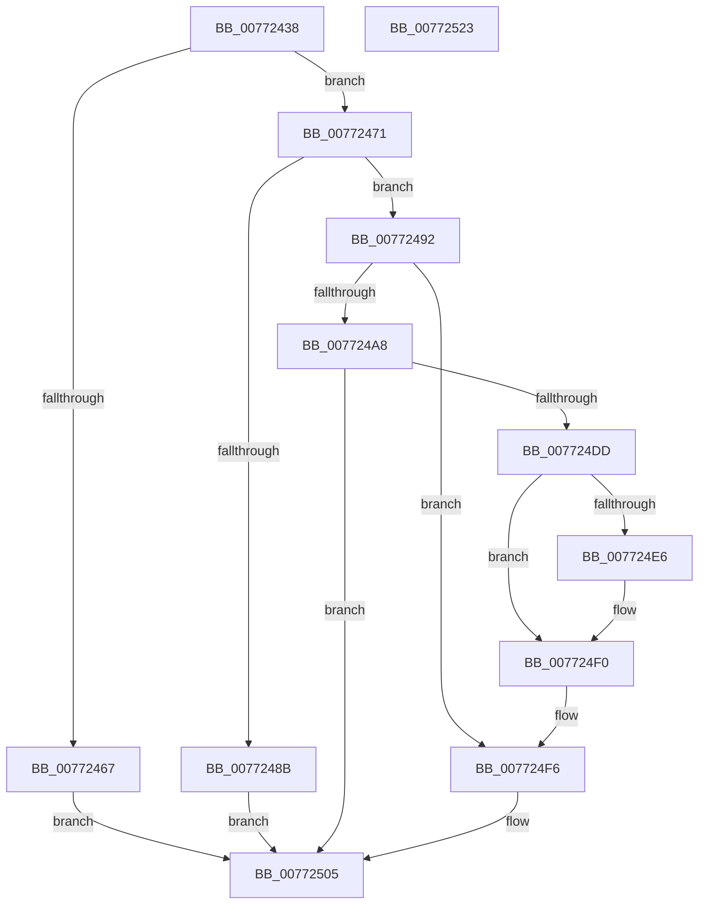

# PopPlInitPowerPlane

- RVA: `0x00772438`–`0x00772524` (길이 `236` bytes)
- VA: `0x0000000140772438`
- 실행 섹션: `PAGE`
- PDB 이름 있음: `예`; PDB Function 태그: `아니요`
- unwind 정보 RVA: `0x00093E28`
- 디코드: `70`개 명령, `236/236` bytes 표시
- 미해석 바이트: `0` (있으면 어셈블리에 `.byte`로 보존)

> 이 문서는 커널 이미지의 기계어와 PDB 기호를 분석해 생성했습니다. 4번과 5번은 함수 원형과 자료형을 바이너리 사용 방식에서 추정한 C 해석이며 원본 소스 복구 결과는 아닙니다.

## 1. Dependencies

- 직접 호출 지점: **5**; 고유 호출 대상: **4**
- 직접 호출자로 확인된 함수: **1**
- RIP 상대 이미지 참조: **0**

### Outgoing calls
- `0x0077247E` → [ExAllocatePool2](../../poolcode/B8/ExAllocatePool2_function_00B820F0.md) (function, `0x00B820F0`)
- `0x0077249D` → [PopPlInitWString](PopPlInitWString_function_0077252C.md) (function, `0x0077252C`)
- `0x007724D2` → [PopPlInitDevices](PopPlInitDevices_function_007722BC.md) (function, `0x007722BC`)
- `0x007724EB` → [ExFreePoolWithTag](../../poolcode/B8/ExFreePoolWithTag_function_00B82870.md) (function, `0x00B82870`)
- `0x007724FE` → [ExFreePoolWithTag](../../poolcode/B8/ExFreePoolWithTag_function_00B82870.md) (function, `0x00B82870`)

### Direct callers
- [PopPlRegisterPowerPlane](../../text/4D/PopPlRegisterPowerPlane_function_004DB504.md) at `0x004DB583`

### Static image references
- 디코드된 RIP-relative 메모리 참조가 없습니다.

## 2. Other-region calls and transfers

- 다른 실행 섹션으로 향하는 call: **3**
  - `0x0077247E` → [ExAllocatePool2](../../poolcode/B8/ExAllocatePool2_function_00B820F0.md) (`PAGE` → `POOLCODE`)
  - `0x007724EB` → [ExFreePoolWithTag](../../poolcode/B8/ExFreePoolWithTag_function_00B82870.md) (`PAGE` → `POOLCODE`)
  - `0x007724FE` → [ExFreePoolWithTag](../../poolcode/B8/ExFreePoolWithTag_function_00B82870.md) (`PAGE` → `POOLCODE`)
- 별도 외부 분기/꼬리 이동을 확인하지 못했습니다.

## 3. Assembly (complete function range)

```asm
00772438  48 89 5C 24 08                  mov qword ptr [rsp + 8], rbx
0077243D  48 89 6C 24 10                  mov qword ptr [rsp + 0x10], rbp
00772442  48 89 74 24 18                  mov qword ptr [rsp + 0x18], rsi
00772447  57                              push rdi
00772448  41 56                           push r14
0077244A  41 57                           push r15
0077244C  48 83 EC 40                     sub rsp, 0x40
00772450  33 DB                           xor ebx, ebx
00772452  48 8D 41 34                     lea rax, [rcx + 0x34]
00772456  4D 8B F9                        mov r15, r9
00772459  49 8B E8                        mov rbp, r8
0077245C  4C 8B F2                        mov r14, rdx
0077245F  48 8B F1                        mov rsi, rcx
00772462  49 3B C0                        cmp rax, r8
00772465  76 0A                           jbe 0x140772471
00772467  BF 06 02 00 C0                  mov edi, 0xc0000206
0077246C  E9 94 00 00 00                  jmp 0x140772505
00772471  B9 40 00 00 00                  mov ecx, 0x40
00772476  41 B8 50 6F 50 6C               mov r8d, 0x6c506f50
0077247C  8B D1                           mov edx, ecx
0077247E  E8 6D FC 40 00                  call 0x140b820f0
00772483  48 8B D8                        mov rbx, rax
00772486  48 85 C0                        test rax, rax
00772489  75 07                           jne 0x140772492
0077248B  BF 9A 00 00 C0                  mov edi, 0xc000009a
00772490  EB 73                           jmp 0x140772505
00772492  8B 16                           mov edx, dword ptr [rsi]
00772494  4C 8B CD                        mov r9, rbp
00772497  4D 8B C6                        mov r8, r14
0077249A  48 8B CB                        mov rcx, rbx
0077249D  E8 8A 00 00 00                  call 0x14077252c
007724A2  8B F8                           mov edi, eax
007724A4  85 C0                           test eax, eax
007724A6  78 4E                           js 0x1407724f6
007724A8  48 83 63 10 00                  and qword ptr [rbx + 0x10], 0
007724AD  48 8D 43 38                     lea rax, [rbx + 0x38]
007724B1  44 8B 46 04                     mov r8d, dword ptr [rsi + 4]
007724B5  48 8D 4B 30                     lea rcx, [rbx + 0x30]
007724B9  48 89 44 24 30                  mov qword ptr [rsp + 0x30], rax
007724BE  48 8D 56 08                     lea rdx, [rsi + 8]
007724C2  48 89 4C 24 28                  mov qword ptr [rsp + 0x28], rcx
007724C7  4D 8B CE                        mov r9, r14
007724CA  48 8B CB                        mov rcx, rbx
007724CD  48 89 6C 24 20                  mov qword ptr [rsp + 0x20], rbp
007724D2  E8 E5 FD FF FF                  call 0x1407722bc
007724D7  8B F8                           mov edi, eax
007724D9  85 C0                           test eax, eax
007724DB  79 28                           jns 0x140772505
007724DD  48 8B 4B 08                     mov rcx, qword ptr [rbx + 8]
007724E1  48 85 C9                        test rcx, rcx
007724E4  74 0A                           je 0x1407724f0
007724E6  BA 50 6F 50 6C                  mov edx, 0x6c506f50
007724EB  E8 80 03 41 00                  call 0x140b82870
007724F0  0F 57 C0                        xorps xmm0, xmm0
007724F3  0F 11 03                        movups xmmword ptr [rbx], xmm0
007724F6  BA 50 6F 50 6C                  mov edx, 0x6c506f50
007724FB  48 8B CB                        mov rcx, rbx
007724FE  E8 6D 03 41 00                  call 0x140b82870
00772503  33 DB                           xor ebx, ebx
00772505  48 8B 6C 24 68                  mov rbp, qword ptr [rsp + 0x68]
0077250A  8B C7                           mov eax, edi
0077250C  48 8B 74 24 70                  mov rsi, qword ptr [rsp + 0x70]
00772511  49 89 1F                        mov qword ptr [r15], rbx
00772514  48 8B 5C 24 60                  mov rbx, qword ptr [rsp + 0x60]
00772519  48 83 C4 40                     add rsp, 0x40
0077251D  41 5F                           pop r15
0077251F  41 5E                           pop r14
00772521  5F                              pop rdi
00772522  C3                              ret
00772523  CC                              int3
```

## 4. C-style interpretation (structured pseudocode)

```c
__int64 __fastcall PopPlInitPowerPlane(__int64 a1, __int64 a2, __int64 a3, __int64 a4)
{
    __int64 result;
    __int64 v_rbx;
    __int64 v_rsp;
    unsigned __int64 v_stack_m28;
    unsigned __int64 v_stack_m30;
    unsigned __int64 v_stack_m38;
    unsigned __int64 v_stack_p10;
    unsigned __int64 v_stack_p18;
    unsigned __int64 v_stack_p8;

    v_stack_p8 = v_rbx;
    v_stack_p10 = v_rbp;
    v_stack_p18 = v_rsi;
    v_rsp = (v_rsp) - (64);
    v_rbx = 0;
    if ((a1 + 52) <= a3) goto loc_00772471;
    goto loc_00772505;
loc_00772471:
    result = ExAllocatePool2(64, 64, (unsigned int)(0x6C506F50ULL), a4);
    if (result != 0) goto loc_00772492;
    goto loc_00772505;
loc_00772492:
    result = PopPlInitWString(result, (unsigned int)(*(unsigned int *)(a1)), a2, a3);
    if (sign_flag) goto loc_007724F6;
    v_stack_m28 = result + 56;
    v_stack_m30 = result + 48;
    v_stack_m38 = a3;
    result = PopPlInitDevices(result, a1 + 8, (unsigned int)(*(unsigned int *)(a1 + 4)), a2);
    if (!sign_flag) goto loc_00772505;
    if (*(unsigned __int64 *)(result + 8) != 0) {
        a2 = 0x6C506F50ULL;
        result = ExFreePoolWithTag(*(unsigned __int64 *)(result + 8), a2, (unsigned int)(*(unsigned int *)(a1 + 4)), a2);
    }
    *(unsigned __int64 *)(result) = v_xmm0;
loc_007724F6:
    result = ExFreePoolWithTag(result, (unsigned int)(0x6C506F50ULL), (unsigned int)(*(unsigned int *)(a1 + 4)), a2);
    v_rbx = 0;
loc_00772505:
    *(unsigned __int64 *)(a4) = 0;
    v_rsp = (v_rsp) + (64);
    return (unsigned int)((unsigned int)((unsigned int)((unsigned int)(result))));
}
```

## 5. (Beta) C Style

```c
int64_t PopPlInitPowerPlane(void *Arg1, int64_t Arg2, int64_t Arg3, void *Arg4)
{
    uint8_t *arg1 = (uint8_t *)Arg1;
    uint8_t *arg4 = (uint8_t *)Arg4;

    int64_t result;
    int64_t local_rbx;
    int64_t local_rsp;
    uint64_t v_stack_m28;
    uint64_t v_stack_m30;
    uint64_t v_stack_m38;
    uint64_t v_stack_p10;
    uint64_t v_stack_p18;
    uint64_t v_stack_p8;

    v_stack_p8 = local_rbx;
    v_stack_p10 = local_rbp;
    v_stack_p18 = local_rsi;
    local_rsp = (local_rsp) - (64);
    local_rbx = 0;
    if ((Arg1 + 52) <= Arg3) goto loc_00772471;
    goto loc_00772505;
loc_00772471:
    result = ExAllocatePool2(64, 64, (uint32_t)(0x6C506F50ULL), Arg4);
    if (result != 0) goto loc_00772492;
    goto loc_00772505;
loc_00772492:
    result = PopPlInitWString(result, (uint32_t)(*(uint32_t *)(arg1)), Arg2, Arg3);
    if (sign_flag) goto loc_007724F6;
    v_stack_m28 = result + 56;
    v_stack_m30 = result + 48;
    v_stack_m38 = Arg3;
    result = PopPlInitDevices(result, Arg1 + 8, (uint32_t)(*(uint32_t *)(arg1 + 0x4)), Arg2);
    if (!sign_flag) goto loc_00772505;
    if (*(uint64_t *)(result + 0x8) != 0) {
        Arg2 = 0x6C506F50ULL;
        result = ExFreePoolWithTag(*(uint64_t *)(result + 0x8), Arg2, (uint32_t)(*(uint32_t *)(arg1 + 0x4)), Arg2);
    }
    *(uint64_t *)(result) = v_xmm0;
loc_007724F6:
    result = ExFreePoolWithTag(result, (uint32_t)(0x6C506F50ULL), (uint32_t)(*(uint32_t *)(arg1 + 0x4)), Arg2);
    local_rbx = 0;
loc_00772505:
    *(uint64_t *)(arg4) = 0;
    local_rsp = (local_rsp) + (64);
    return (uint32_t)((uint32_t)((uint32_t)((uint32_t)(result))));
}
```

### 관측된 메모리 오프셋

구조체 형식이 확인되지 않은 접근은 인자 기준의 오프셋으로만 기록했습니다.

| 기준 인자 | 오프셋 표현 | 폭 (bit) | 접근 |
|---|---:|---:|---|
| `Arg1` | `+ 0x0` | `32` | `R` |
| `Arg1` | `+ 0x4` | `32` | `R` |
| `Arg1` | `+ 0x8` | `64` | `R` |
| `Arg1` | `+ 0x34` | `64` | `R` |
| `Arg4` | `+ 0x0` | `64` | `W` |

## 6. Execution-region graph

[열기: 2D/3D 그래프와 함수 탐색 컨트롤 패널](../../../control-panel.html?section=page&rva=0x00772438&view=graph)

- 2D 그래프는 위에서 아래로 흐르고, 3D 그래프는 빈 공간을 드래그해 회전합니다. Shift+드래그는 이동, 휠은 확대·축소, 함수 노드 선택은 대상 보고서 이동입니다.

### Static fallback


