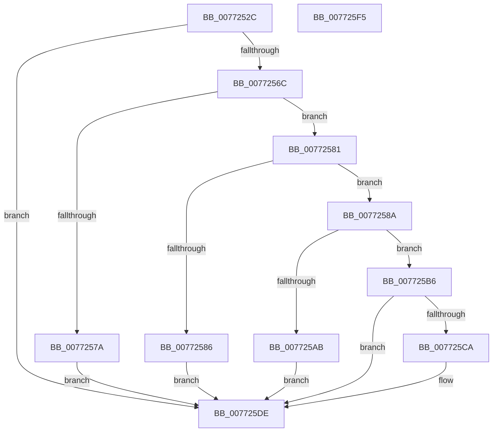

# PopPlInitWString

- RVA: `0x0077252C`–`0x007725F6` (길이 `202` bytes)
- VA: `0x000000014077252C`
- 실행 섹션: `PAGE`
- PDB 이름 있음: `예`; PDB Function 태그: `아니요`
- unwind 정보 RVA: `0x000AEEA8`
- 디코드: `61`개 명령, `202/202` bytes 표시
- 미해석 바이트: `0` (있으면 어셈블리에 `.byte`로 보존)

> 이 문서는 커널 이미지의 기계어와 PDB 기호를 분석해 생성했습니다. 4번과 5번은 함수 원형과 자료형을 바이너리 사용 방식에서 추정한 C 해석이며 원본 소스 복구 결과는 아닙니다.

## 1. Dependencies

- 직접 호출 지점: **4**; 고유 호출 대상: **4**
- 직접 호출자로 확인된 함수: **2**
- RIP 상대 이미지 참조: **0**

### Outgoing calls
- `0x00772561` → [RtlStringCchLengthW](../../text/43/RtlStringCchLengthW_function_00435A70.md) (function, `0x00435A70`)
- `0x0077259D` → [ExAllocatePool2](../../poolcode/B8/ExAllocatePool2_function_00B820F0.md) (function, `0x00B820F0`)
- `0x007725BF` → [RtlUnicodeStringCchCopyStringN](../../text/5D/RtlUnicodeStringCchCopyStringN_function_005DE390.md) (function, `0x005DE390`)
- `0x007725D3` → [ExFreePoolWithTag](../../poolcode/B8/ExFreePoolWithTag_function_00B82870.md) (function, `0x00B82870`)

### Direct callers
- [PopPlInitDevice](PopPlInitDevice_function_007721B4.md) at `0x0077221A`
- [PopPlInitPowerPlane](PopPlInitPowerPlane_function_00772438.md) at `0x0077249D`

### Static image references
- 디코드된 RIP-relative 메모리 참조가 없습니다.

## 2. Other-region calls and transfers

- 다른 실행 섹션으로 향하는 call: **4**
  - `0x00772561` → [RtlStringCchLengthW](../../text/43/RtlStringCchLengthW_function_00435A70.md) (`PAGE` → `.text`)
  - `0x0077259D` → [ExAllocatePool2](../../poolcode/B8/ExAllocatePool2_function_00B820F0.md) (`PAGE` → `POOLCODE`)
  - `0x007725BF` → [RtlUnicodeStringCchCopyStringN](../../text/5D/RtlUnicodeStringCchCopyStringN_function_005DE390.md) (`PAGE` → `.text`)
  - `0x007725D3` → [ExFreePoolWithTag](../../poolcode/B8/ExFreePoolWithTag_function_00B82870.md) (`PAGE` → `POOLCODE`)
- 별도 외부 분기/꼬리 이동을 확인하지 못했습니다.

## 3. Assembly (complete function range)

```asm
0077252C  48 8B C4                        mov rax, rsp
0077252F  48 89 58 08                     mov qword ptr [rax + 8], rbx
00772533  48 89 68 10                     mov qword ptr [rax + 0x10], rbp
00772537  48 89 70 20                     mov qword ptr [rax + 0x20], rsi
0077253B  57                              push rdi
0077253C  48 83 EC 20                     sub rsp, 0x20
00772540  8B F2                           mov esi, edx
00772542  48 8B F9                        mov rdi, rcx
00772545  49 03 F0                        add rsi, r8
00772548  0F 57 C0                        xorps xmm0, xmm0
0077254B  4C 2B CE                        sub r9, rsi
0077254E  4C 8D 40 18                     lea r8, [rax + 0x18]
00772552  0F 11 01                        movups xmmword ptr [rcx], xmm0
00772555  33 ED                           xor ebp, ebp
00772557  49 8B D1                        mov rdx, r9
0077255A  48 8B CE                        mov rcx, rsi
0077255D  48 89 68 18                     mov qword ptr [rax + 0x18], rbp
00772561  E8 0A 35 CC FF                  call 0x140435a70
00772566  8B D8                           mov ebx, eax
00772568  85 C0                           test eax, eax
0077256A  78 72                           js 0x1407725de
0077256C  48 8B 5C 24 40                  mov rbx, qword ptr [rsp + 0x40]
00772571  48 81 FB FF 7F 00 00            cmp rbx, 0x7fff
00772578  76 07                           jbe 0x140772581
0077257A  BB 04 00 00 C0                  mov ebx, 0xc0000004
0077257F  EB 5D                           jmp 0x1407725de
00772581  48 85 DB                        test rbx, rbx
00772584  75 04                           jne 0x14077258a
00772586  8B DD                           mov ebx, ebp
00772588  EB 54                           jmp 0x1407725de
0077258A  48 8D 14 1B                     lea rdx, [rbx + rbx]
0077258E  B9 40 00 00 00                  mov ecx, 0x40
00772593  41 B8 50 6F 50 6C               mov r8d, 0x6c506f50
00772599  66 89 57 02                     mov word ptr [rdi + 2], dx
0077259D  E8 4E FB 40 00                  call 0x140b820f0
007725A2  48 89 47 08                     mov qword ptr [rdi + 8], rax
007725A6  48 85 C0                        test rax, rax
007725A9  75 0B                           jne 0x1407725b6
007725AB  66 89 6F 02                     mov word ptr [rdi + 2], bp
007725AF  BB 9A 00 00 C0                  mov ebx, 0xc000009a
007725B4  EB 28                           jmp 0x1407725de
007725B6  4C 8B C3                        mov r8, rbx
007725B9  48 8B D6                        mov rdx, rsi
007725BC  48 8B CF                        mov rcx, rdi
007725BF  E8 CC BD E6 FF                  call 0x1405de390
007725C4  8B D8                           mov ebx, eax
007725C6  85 C0                           test eax, eax
007725C8  79 14                           jns 0x1407725de
007725CA  48 8B 4F 08                     mov rcx, qword ptr [rdi + 8]
007725CE  BA 50 6F 50 6C                  mov edx, 0x6c506f50
007725D3  E8 98 02 41 00                  call 0x140b82870
007725D8  0F 57 C0                        xorps xmm0, xmm0
007725DB  0F 11 07                        movups xmmword ptr [rdi], xmm0
007725DE  48 8B 6C 24 38                  mov rbp, qword ptr [rsp + 0x38]
007725E3  8B C3                           mov eax, ebx
007725E5  48 8B 5C 24 30                  mov rbx, qword ptr [rsp + 0x30]
007725EA  48 8B 74 24 48                  mov rsi, qword ptr [rsp + 0x48]
007725EF  48 83 C4 20                     add rsp, 0x20
007725F3  5F                              pop rdi
007725F4  C3                              ret
007725F5  CC                              int3
```

## 4. C-style interpretation (structured pseudocode)

```c
__int64 __fastcall PopPlInitWString(__int64 a1, int a2, __int64 a3, __int64 a4)
{
    __int64 result;
    __int64 v_rbp;
    __int64 v_rsi;
    __int64 v_rsp;
    unsigned __int64 v_stack_p10;
    unsigned __int64 v_stack_p18;
    unsigned __int64 v_stack_p20;
    unsigned __int64 v_stack_p8;

    *(unsigned __int64 *)(v_rsp + 8) = v_rbx;
    *(unsigned __int64 *)(v_rsp + 16) = v_rbp;
    *(unsigned __int64 *)(v_rsp + 32) = v_rsi;
    v_rsp = (v_rsp) - (32);
    v_rsi = ((unsigned int)(a2)) + (a3);
    a4 = (a4) - (v_rsi);
    *(unsigned __int64 *)(a1) = v_xmm0;
    v_rbp = 0;
    *(unsigned __int64 *)(v_rsp + 24) = 0;
    result = RtlStringCchLengthW(v_rsi, a4, v_rsp + 24, a4);
    if (sign_flag) goto loc_007725DE;
    if (v_stack_p18 <= 0x7FFFULL) goto loc_00772581;
    goto loc_007725DE;
loc_00772581:
    if ((unsigned int)(0xC0000004ULL) != 0) goto loc_0077258A;
    goto loc_007725DE;
loc_0077258A:
    *(unsigned __int16 *)(a1 + 2) = (unsigned __int16)(0 + 0 * 1);
    result = ExAllocatePool2(64, 0 + 0 * 1, (unsigned int)(0x6C506F50ULL), a4);
    *(unsigned __int64 *)(a1 + 8) = result;
    if (result != 0) goto loc_007725B6;
    *(unsigned __int16 *)(a1 + 2) = 0;
    goto loc_007725DE;
loc_007725B6:
    result = RtlUnicodeStringCchCopyStringN(a1, v_rsi, (unsigned int)(0xC000009AULL), a4);
    if (sign_flag) {
        a1 = *(unsigned __int64 *)(a1 + 8);
        a2 = 0x6C506F50ULL;
        result = ExFreePoolWithTag(a1, a2, (unsigned int)(0xC000009AULL), a4);
        *(unsigned __int64 *)(a1) = v_xmm0;
    }
    v_rsp = (v_rsp) + (32);
    return (unsigned int)((unsigned int)((unsigned int)((unsigned int)(result))));
}
```

## 5. (Beta) C Style

```c
int64_t PopPlInitWString(void *Arg1, int32_t Arg2, int64_t Arg3, int64_t Arg4)
{
    uint8_t *arg1 = (uint8_t *)Arg1;

    int64_t result;
    int64_t local_rbp;
    int64_t local_rsi;
    int64_t local_rsp;
    uint64_t v_stack_p10;
    uint64_t v_stack_p18;
    uint64_t v_stack_p20;
    uint64_t v_stack_p8;

    *(uint64_t *)(local_rsp + 0x8) = local_rbx;
    *(uint64_t *)(local_rsp + 0x10) = local_rbp;
    *(uint64_t *)(local_rsp + 0x20) = local_rsi;
    local_rsp = (local_rsp) - (32);
    local_rsi = ((uint32_t)(Arg2)) + (Arg3);
    Arg4 = (Arg4) - (local_rsi);
    *(uint64_t *)(arg1) = v_xmm0;
    local_rbp = 0;
    *(uint64_t *)(local_rsp + 0x18) = 0;
    result = RtlStringCchLengthW(local_rsi, Arg4, local_rsp + 24, Arg4);
    if (sign_flag) goto loc_007725DE;
    if (v_stack_p18 <= 0x7FFFULL) goto loc_00772581;
    goto loc_007725DE;
loc_00772581:
    if ((uint32_t)(0xC0000004ULL) != 0) goto loc_0077258A;
    goto loc_007725DE;
loc_0077258A:
    *(uint16_t *)(arg1 + 0x2) = (uint16_t)(0 + 0 * 1);
    result = ExAllocatePool2(64, 0 + 0 * 1, (uint32_t)(0x6C506F50ULL), Arg4);
    *(uint64_t *)(arg1 + 0x8) = result;
    if (result != 0) goto loc_007725B6;
    *(uint16_t *)(arg1 + 0x2) = 0;
    goto loc_007725DE;
loc_007725B6:
    result = RtlUnicodeStringCchCopyStringN(Arg1, local_rsi, (uint32_t)(0xC000009AULL), Arg4);
    if (sign_flag) {
        Arg1 = *(uint64_t *)(arg1 + 0x8);
        Arg2 = 0x6C506F50ULL;
        result = ExFreePoolWithTag(Arg1, Arg2, (uint32_t)(0xC000009AULL), Arg4);
        *(uint64_t *)(arg1) = v_xmm0;
    }
    local_rsp = (local_rsp) + (32);
    return (uint32_t)((uint32_t)((uint32_t)((uint32_t)(result))));
}
```

### 관측된 메모리 오프셋

구조체 형식이 확인되지 않은 접근은 인자 기준의 오프셋으로만 기록했습니다.

| 기준 인자 | 오프셋 표현 | 폭 (bit) | 접근 |
|---|---:|---:|---|
| `Arg1` | `+ 0x0` | `128` | `R` |
| `Arg1` | `+ 0x2` | `16` | `W` |
| `Arg1` | `+ 0x8` | `64` | `R` |
| `Arg1` | `+ 0x8` | `64` | `W` |

## 6. Execution-region graph

[열기: 2D/3D 그래프와 함수 탐색 컨트롤 패널](../../../control-panel.html?section=page&rva=0x0077252C&view=graph)

- 2D 그래프는 위에서 아래로 흐르고, 3D 그래프는 빈 공간을 드래그해 회전합니다. Shift+드래그는 이동, 휠은 확대·축소, 함수 노드 선택은 대상 보고서 이동입니다.

### Static fallback


