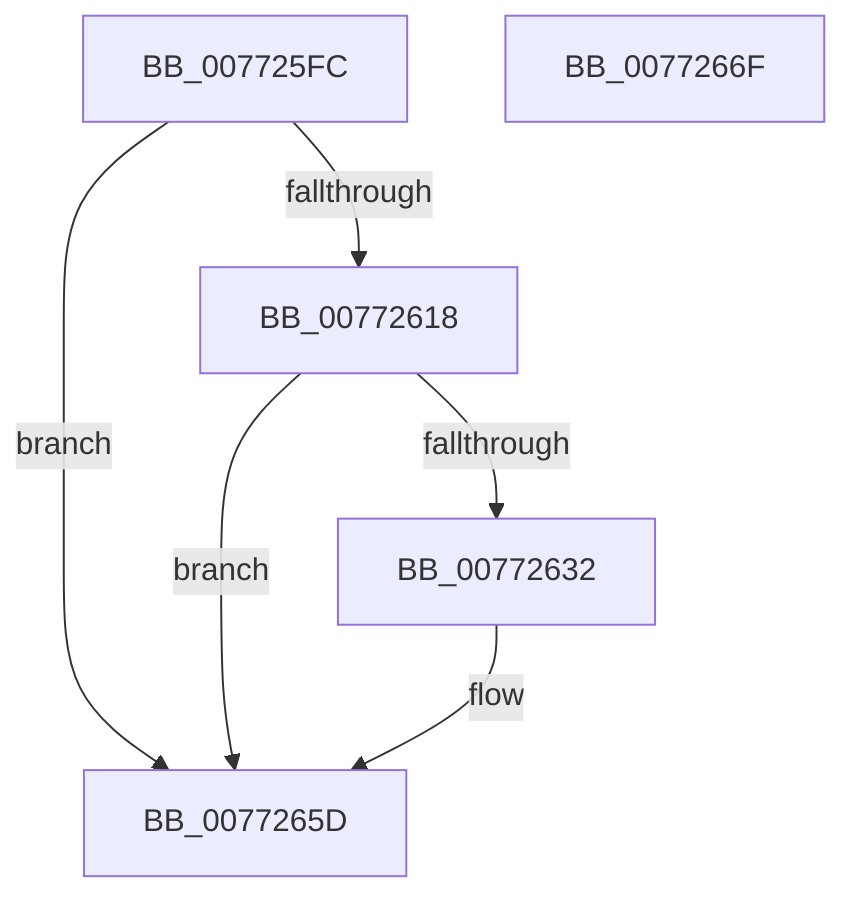

# PopSqmFanEnumeration

- RVA: `0x007725FC`–`0x00772670` (길이 `116` bytes)
- VA: `0x00000001407725FC`
- 실행 섹션: `PAGE`
- PDB 이름 있음: `예`; PDB Function 태그: `아니요`
- unwind 정보 RVA: `0x0006F9F8`
- 디코드: `25`개 명령, `116/116` bytes 표시
- 미해석 바이트: `0` (있으면 어셈블리에 `.byte`로 보존)

> 이 문서는 커널 이미지의 기계어와 PDB 기호를 분석해 생성했습니다. 4번과 5번은 함수 원형과 자료형을 바이너리 사용 방식에서 추정한 C 해석이며 원본 소스 복구 결과는 아닙니다.

## 1. Dependencies

- 직접 호출 지점: **3**; 고유 호출 대상: **3**
- 직접 호출자로 확인된 함수: **2**
- RIP 상대 이미지 참조: **3**

### Outgoing calls
- `0x00772629` → [tlgKeywordOn](../../text/42/tlgKeywordOn_function_0042EAA0.md) (function, `0x0042EAA0`)
- `0x00772658` → [tlgWriteTransfer_EtwWriteTransfer](../../text/42/tlgWriteTransfer_EtwWriteTransfer_function_004260E0.md) (function, `0x004260E0`)
- `0x00772665` → [_security_check_cookie](../../text/6A/_security_check_cookie_function_006AC640.md) (function, `0x006AC640`)

### Direct callers
- [PopFanAdd](../76/PopFanAdd_function_007690D0.md) at `0x00769132`
- [PopFanReportBootStartDevices](../../init/C4/PopFanReportBootStartDevices_function_00C4289C.md) at `0x00C428C2`

### Static image references
- `0x00772600` → RVA `0x00E0A740` (`.data`; read)
- `0x0077260F` → RVA `0x00E07748` (`.data`; read)
- `0x0077263F` → RVA `0x00050E14` (`.rdata`; read)

## 2. Other-region calls and transfers

- 다른 실행 섹션으로 향하는 call: **3**
  - `0x00772629` → [tlgKeywordOn](../../text/42/tlgKeywordOn_function_0042EAA0.md) (`PAGE` → `.text`)
  - `0x00772658` → [tlgWriteTransfer_EtwWriteTransfer](../../text/42/tlgWriteTransfer_EtwWriteTransfer_function_004260E0.md) (`PAGE` → `.text`)
  - `0x00772665` → [_security_check_cookie](../../text/6A/_security_check_cookie_function_006AC640.md) (`PAGE` → `.text`)
- 별도 외부 분기/꼬리 이동을 확인하지 못했습니다.

## 3. Assembly (complete function range)

```asm
007725FC  48 83 EC 68                     sub rsp, 0x68
00772600  48 8B 05 39 81 69 00            mov rax, qword ptr [rip + 0x698139]
00772607  48 33 C4                        xor rax, rsp
0077260A  48 89 44 24 50                  mov qword ptr [rsp + 0x50], rax
0077260F  83 3D 32 51 69 00 05            cmp dword ptr [rip + 0x695132], 5
00772616  76 45                           jbe 0x14077265d
00772618  48 BA 00 00 00 00 00 40 00 00   movabs rdx, 0x400000000000
00772622  48 8D 0D 1F 51 69 00            lea rcx, [rip + 0x69511f]
00772629  E8 72 C4 CB FF                  call 0x14042eaa0
0077262E  84 C0                           test al, al
00772630  74 2B                           je 0x14077265d
00772632  48 8D 44 24 30                  lea rax, [rsp + 0x30]
00772637  45 33 C9                        xor r9d, r9d
0077263A  48 89 44 24 28                  mov qword ptr [rsp + 0x28], rax
0077263F  48 8D 15 CE E7 8D FF            lea rdx, [rip - 0x721832]
00772646  45 33 C0                        xor r8d, r8d
00772649  C7 44 24 20 02 00 00 00         mov dword ptr [rsp + 0x20], 2
00772651  48 8D 0D F0 50 69 00            lea rcx, [rip + 0x6950f0]
00772658  E8 83 3A CB FF                  call 0x1404260e0
0077265D  48 8B 4C 24 50                  mov rcx, qword ptr [rsp + 0x50]
00772662  48 33 CC                        xor rcx, rsp
00772665  E8 D6 9F F3 FF                  call 0x1406ac640
0077266A  48 83 C4 68                     add rsp, 0x68
0077266E  C3                              ret
0077266F  CC                              int3
```

## 4. C-style interpretation (structured pseudocode)

```c
__int64 __fastcall PopSqmFanEnumeration(__int64 a1, __int64 a2, int a3, int a4)
{
    __int64 result;
    __int64 v_rsp;
    unsigned __int64 v_stack_m18;
    unsigned __int64 v_stack_m38;
    unsigned __int64 v_stack_m40;
    unsigned int v_stack_m48;

    v_rsp = (v_rsp) - (104);
    result = (*(unsigned __int64 *)(v_rip + 6914361)) ^ (v_rsp);
    v_stack_m18 = result;
    if ((*(unsigned int *)(v_rip + 6902066)) <= 5) goto loc_0077265D;
    result = tlgKeywordOn(v_rip + 6902047, a2, a3, a4);
    if ((unsigned __int8)(result) != 0) {
        result = v_stack_m38;
        a4 = 0;
        v_stack_m40 = result;
        a2 = v_rip - 7477298;
        a3 = 0;
        v_stack_m48 = 2;
        a1 = v_rip + 6902000;
        result = tlgWriteTransfer_EtwWriteTransfer(a1, a2, a3, a4);
    }
    a1 = (v_stack_m18) ^ (v_rsp);
    result = _security_check_cookie(a1, a2, a3, a4);
    v_rsp = (v_rsp) + (104);
    return result;
}
```

## 5. (Beta) C Style

```c
int64_t PopSqmFanEnumeration(int64_t Arg1, int64_t Arg2, int32_t Arg3, int32_t Arg4)
{
    int64_t result;
    int64_t local_rsp;
    uint64_t v_stack_m18;
    uint64_t v_stack_m38;
    uint64_t v_stack_m40;
    uint32_t v_stack_m48;

    local_rsp = (local_rsp) - (104);
    result = (*(uint64_t *)(v_rip + 0x698139)) ^ (local_rsp);
    v_stack_m18 = result;
    if ((*(uint32_t *)(v_rip + 0x695132)) <= 5) goto loc_0077265D;
    result = tlgKeywordOn(v_rip + 6902047, Arg2, Arg3, Arg4);
    if ((uint8_t)(result) != 0) {
        result = v_stack_m38;
        Arg4 = 0;
        v_stack_m40 = result;
        Arg2 = v_rip - 7477298;
        Arg3 = 0;
        v_stack_m48 = 2;
        Arg1 = v_rip + 6902000;
        result = tlgWriteTransfer_EtwWriteTransfer(Arg1, Arg2, Arg3, Arg4);
    }
    Arg1 = (v_stack_m18) ^ (local_rsp);
    result = _security_check_cookie(Arg1, Arg2, Arg3, Arg4);
    local_rsp = (local_rsp) + (104);
    return result;
}
```

## 6. Execution-region graph

[열기: 2D/3D 그래프와 함수 탐색 컨트롤 패널](../../../control-panel.html?section=page&rva=0x007725FC&view=graph)

- 2D 그래프는 위에서 아래로 흐르고, 3D 그래프는 빈 공간을 드래그해 회전합니다. Shift+드래그는 이동, 휠은 확대·축소, 함수 노드 선택은 대상 보고서 이동입니다.

### Static fallback


