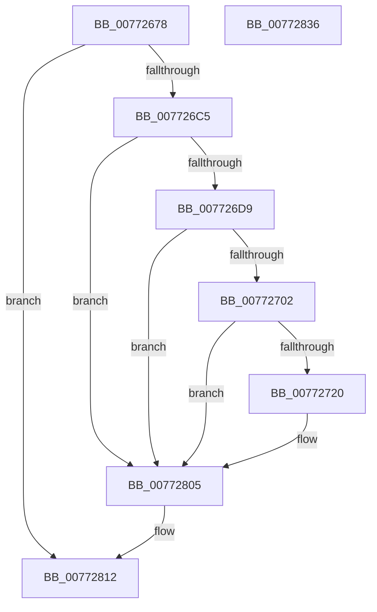

# PopSqmThermalCriticalEvent

- RVA: `0x00772678`–`0x00772837` (길이 `447` bytes)
- VA: `0x0000000140772678`
- 실행 섹션: `PAGE`
- PDB 이름 있음: `예`; PDB Function 태그: `아니요`
- unwind 정보 RVA: `0x000CD810`
- 디코드: `101`개 명령, `447/447` bytes 표시
- 미해석 바이트: `0` (있으면 어셈블리에 `.byte`로 보존)

> 이 문서는 커널 이미지의 기계어와 PDB 기호를 분석해 생성했습니다. 4번과 5번은 함수 원형과 자료형을 바이너리 사용 방식에서 추정한 C 해석이며 원본 소스 복구 결과는 아닙니다.

## 1. Dependencies

- 직접 호출 지점: **7**; 고유 호출 대상: **6**
- 직접 호출자로 확인된 함수: **2**
- RIP 상대 이미지 참조: **4**

### Outgoing calls
- `0x007726B1` → [IoGetDeviceAttachmentBaseRefWithTag](../../text/27/IoGetDeviceAttachmentBaseRefWithTag_function_00272788.md) (function, `0x00272788`)
- `0x00772713` → [tlgKeywordOn](../../text/42/tlgKeywordOn_function_0042EAA0.md) (function, `0x0042EAA0`)
- `0x007727CA` → [tlgCreate1Sz_wchar_t](../../text/42/tlgCreate1Sz_wchar_t_function_00426198.md) (function, `0x00426198`)
- `0x007727D6` → [tlgCreate1Sz_wchar_t](../../text/42/tlgCreate1Sz_wchar_t_function_00426198.md) (function, `0x00426198`)
- `0x00772800` → [tlgWriteTransfer_EtwWriteTransfer](../../text/42/tlgWriteTransfer_EtwWriteTransfer_function_004260E0.md) (function, `0x004260E0`)
- `0x0077280D` → [ObfDereferenceObjectWithTag](../../text/2F/ObfDereferenceObjectWithTag_function_002F78E0.md) (function, `0x002F78E0`)
- `0x00772819` → [_security_check_cookie](../../text/6A/_security_check_cookie_function_006AC640.md) (function, `0x006AC640`)

### Direct callers
- [PopSqmThermalCriticalShutdown](PopSqmThermalCriticalShutdown_function_00772840.md) at `0x00772850`
- [PopSqmThermalHibernate](PopSqmThermalHibernate_function_00772864.md) at `0x00772871`

### Static image references
- `0x00772692` → RVA `0x00E0A740` (`.data`; read)
- `0x007726E0` → RVA `0x00AFCAD0` (` ?? ::NNGAKEGL::`string'`; read)
- `0x007726F5` → RVA `0x00E07748` (`.data`; read)
- `0x007727E7` → RVA `0x00050E32` (`.rdata`; read)

## 2. Other-region calls and transfers

- 다른 실행 섹션으로 향하는 call: **7**
  - `0x007726B1` → [IoGetDeviceAttachmentBaseRefWithTag](../../text/27/IoGetDeviceAttachmentBaseRefWithTag_function_00272788.md) (`PAGE` → `.text`)
  - `0x00772713` → [tlgKeywordOn](../../text/42/tlgKeywordOn_function_0042EAA0.md) (`PAGE` → `.text`)
  - `0x007727CA` → [tlgCreate1Sz_wchar_t](../../text/42/tlgCreate1Sz_wchar_t_function_00426198.md) (`PAGE` → `.text`)
  - `0x007727D6` → [tlgCreate1Sz_wchar_t](../../text/42/tlgCreate1Sz_wchar_t_function_00426198.md) (`PAGE` → `.text`)
  - `0x00772800` → [tlgWriteTransfer_EtwWriteTransfer](../../text/42/tlgWriteTransfer_EtwWriteTransfer_function_004260E0.md) (`PAGE` → `.text`)
  - `0x0077280D` → [ObfDereferenceObjectWithTag](../../text/2F/ObfDereferenceObjectWithTag_function_002F78E0.md) (`PAGE` → `.text`)
  - `0x00772819` → [_security_check_cookie](../../text/6A/_security_check_cookie_function_006AC640.md) (`PAGE` → `.text`)
- 별도 외부 분기/꼬리 이동을 확인하지 못했습니다.

## 3. Assembly (complete function range)

```asm
00772678  48 89 5C 24 10                  mov qword ptr [rsp + 0x10], rbx
0077267D  48 89 74 24 18                  mov qword ptr [rsp + 0x18], rsi
00772682  55                              push rbp
00772683  57                              push rdi
00772684  41 56                           push r14
00772686  48 8D 6C 24 B9                  lea rbp, [rsp - 0x47]
0077268B  48 81 EC 00 01 00 00            sub rsp, 0x100
00772692  48 8B 05 A7 80 69 00            mov rax, qword ptr [rip + 0x6980a7]
00772699  48 33 C4                        xor rax, rsp
0077269C  48 89 45 37                     mov qword ptr [rbp + 0x37], rax
007726A0  8B F2                           mov esi, edx
007726A2  48 8B D9                        mov rbx, rcx
007726A5  48 8B 49 30                     mov rcx, qword ptr [rcx + 0x30]
007726A9  BA 50 6F 44 67                  mov edx, 0x67446f50
007726AE  45 8B F0                        mov r14d, r8d
007726B1  E8 D2 00 B0 FF                  call 0x140272788
007726B6  45 33 DB                        xor r11d, r11d
007726B9  48 8B F8                        mov rdi, rax
007726BC  48 85 C0                        test rax, rax
007726BF  0F 84 4D 01 00 00               je 0x140772812
007726C5  48 8B 90 38 01 00 00            mov rdx, qword ptr [rax + 0x138]
007726CC  4C 8B 42 28                     mov r8, qword ptr [rdx + 0x28]
007726D0  4D 85 C0                        test r8, r8
007726D3  0F 84 2C 01 00 00               je 0x140772805
007726D9  48 8B 8B 18 04 00 00            mov rcx, qword ptr [rbx + 0x418]
007726E0  4C 8D 0D E9 A3 38 00            lea r9, [rip + 0x38a3e9]
007726E7  44 8B 93 80 00 00 00            mov r10d, dword ptr [rbx + 0x80]
007726EE  48 85 C9                        test rcx, rcx
007726F1  4C 0F 45 C9                     cmovne r9, rcx
007726F5  83 3D 4C 50 69 00 05            cmp dword ptr [rip + 0x69504c], 5
007726FC  0F 86 03 01 00 00               jbe 0x140772805
00772702  48 BA 00 00 00 00 00 80 00 00   movabs rdx, 0x800000000000
0077270C  48 8D 0D 35 50 69 00            lea rcx, [rip + 0x695035]
00772713  E8 88 C3 CB FF                  call 0x14042eaa0
00772718  84 C0                           test al, al
0077271A  0F 84 E5 00 00 00               je 0x140772805
00772720  8A 4B 41                        mov cl, byte ptr [rbx + 0x41]
00772723  41 8D 53 01                     lea edx, [r11 + 1]
00772727  44 38 9B E4 00 00 00            cmp byte ptr [rbx + 0xe4], r11b
0077272E  48 8D 44 24 30                  lea rax, [rsp + 0x30]
00772733  48 89 45 A7                     mov qword ptr [rbp - 0x59], rax
00772737  8A C1                           mov al, cl
00772739  0F 95 44 24 30                  setne byte ptr [rsp + 0x30]
0077273E  48 89 55 AF                     mov qword ptr [rbp - 0x51], rdx
00772742  22 C2                           and al, dl
00772744  C0 E9 02                        shr cl, 2
00772747  88 44 24 31                     mov byte ptr [rsp + 0x31], al
0077274B  22 CA                           and cl, dl
0077274D  48 8D 44 24 31                  lea rax, [rsp + 0x31]
00772752  48 89 55 BF                     mov qword ptr [rbp - 0x41], rdx
00772756  48 89 45 B7                     mov qword ptr [rbp - 0x49], rax
0077275A  44 3B D6                        cmp r10d, esi
0077275D  48 8D 44 24 32                  lea rax, [rsp + 0x32]
00772762  88 4C 24 32                     mov byte ptr [rsp + 0x32], cl
00772766  48 89 45 C7                     mov qword ptr [rbp - 0x39], rax
0077276A  48 8D 4D 17                     lea rcx, [rbp + 0x17]
0077276E  48 8D 44 24 34                  lea rax, [rsp + 0x34]
00772773  48 89 55 CF                     mov qword ptr [rbp - 0x31], rdx
00772777  48 89 45 D7                     mov qword ptr [rbp - 0x29], rax
0077277B  0F 97 44 24 33                  seta byte ptr [rsp + 0x33]
00772780  48 8D 44 24 38                  lea rax, [rsp + 0x38]
00772785  48 89 55 0F                     mov qword ptr [rbp + 0xf], rdx
00772789  49 8B 90 88 00 00 00            mov rdx, qword ptr [r8 + 0x88]
00772790  48 89 45 E7                     mov qword ptr [rbp - 0x19], rax
00772794  48 8D 45 83                     lea rax, [rbp - 0x7d]
00772798  48 89 45 F7                     mov qword ptr [rbp - 9], rax
0077279C  48 8D 44 24 33                  lea rax, [rsp + 0x33]
007727A1  48 89 45 07                     mov qword ptr [rbp + 7], rax
007727A5  44 89 74 24 34                  mov dword ptr [rsp + 0x34], r14d
007727AA  48 C7 45 DF 04 00 00 00         mov qword ptr [rbp - 0x21], 4
007727B2  44 89 54 24 38                  mov dword ptr [rsp + 0x38], r10d
007727B7  48 C7 45 EF 04 00 00 00         mov qword ptr [rbp - 0x11], 4
007727BF  89 75 83                        mov dword ptr [rbp - 0x7d], esi
007727C2  48 C7 45 FF 04 00 00 00         mov qword ptr [rbp - 1], 4
007727CA  E8 C9 39 CB FF                  call 0x140426198
007727CF  49 8B D1                        mov rdx, r9
007727D2  48 8D 4D 27                     lea rcx, [rbp + 0x27]
007727D6  E8 BD 39 CB FF                  call 0x140426198
007727DB  4C 8D 4D 87                     lea r9, [rbp - 0x79]
007727DF  45 33 C0                        xor r8d, r8d
007727E2  4C 89 4C 24 28                  mov qword ptr [rsp + 0x28], r9
007727E7  48 8D 15 44 E6 8D FF            lea rdx, [rip - 0x7219bc]
007727EE  45 33 C9                        xor r9d, r9d
007727F1  C7 44 24 20 0B 00 00 00         mov dword ptr [rsp + 0x20], 0xb
007727F9  48 8D 0D 48 4F 69 00            lea rcx, [rip + 0x694f48]
00772800  E8 DB 38 CB FF                  call 0x1404260e0
00772805  BA 50 6F 44 67                  mov edx, 0x67446f50
0077280A  48 8B CF                        mov rcx, rdi
0077280D  E8 CE 50 B8 FF                  call 0x1402f78e0
00772812  48 8B 4D 37                     mov rcx, qword ptr [rbp + 0x37]
00772816  48 33 CC                        xor rcx, rsp
00772819  E8 22 9E F3 FF                  call 0x1406ac640
0077281E  4C 8D 9C 24 00 01 00 00         lea r11, [rsp + 0x100]
00772826  49 8B 5B 28                     mov rbx, qword ptr [r11 + 0x28]
0077282A  49 8B 73 30                     mov rsi, qword ptr [r11 + 0x30]
0077282E  49 8B E3                        mov rsp, r11
00772831  41 5E                           pop r14
00772833  5F                              pop rdi
00772834  5D                              pop rbp
00772835  C3                              ret
00772836  CC                              int3
```

## 4. C-style interpretation (structured pseudocode)

```c
__int64 __fastcall PopSqmThermalCriticalEvent(__int64 a1, int a2, int a3)
{
    __int64 result;
    __int64 v_r11;
    __int64 v_rsp;
    unsigned __int64 v_stack_m18;
    unsigned __int64 v_stack_m28;
    unsigned __int64 v_stack_m38;
    unsigned __int64 v_stack_m48;
    unsigned __int64 v_stack_m50;
    unsigned __int64 v_stack_m58;
    unsigned __int64 v_stack_m5F;
    unsigned __int64 v_stack_m60;
    unsigned __int64 v_stack_m68;
    unsigned __int64 v_stack_m70;
    unsigned __int64 v_stack_m78;
    unsigned __int64 v_stack_m80;
    unsigned __int64 v_stack_m88;
    unsigned __int64 v_stack_m90;
    unsigned __int64 v_stack_m98;
    unsigned __int64 v_stack_mA0;
    unsigned __int64 v_stack_mA8;
    unsigned __int64 v_stack_mB0;
    unsigned __int64 v_stack_mB8;
    unsigned __int64 v_stack_mD8;
    unsigned __int64 v_stack_mDC;
    unsigned __int64 v_stack_mE0;
    unsigned __int64 v_stack_mE4;
    unsigned __int8 v_stack_mE5;
    unsigned __int64 v_stack_mE6;
    unsigned __int8 v_stack_mE7;
    unsigned __int64 v_stack_mE8;
    unsigned __int64 v_stack_mF0;
    unsigned int v_stack_mF8;
    unsigned __int64 v_stack_p10;
    unsigned __int64 v_stack_p18;

    v_stack_p10 = v_rbx;
    v_stack_p18 = v_rsi;
    v_rsp = (v_rsp) - (256);
    result = (*(unsigned __int64 *)(v_rip + 6914215)) ^ (v_rsp);
    v_stack_m28 = result;
    result = IoGetDeviceAttachmentBaseRefWithTag(*(unsigned __int64 *)(a1 + 48), (unsigned int)(0x67446F50ULL), a3, a4);
    v_r11 = 0;
    if (result == 0) goto loc_00772812;
    if (*(unsigned __int64 *)(*(unsigned __int64 *)(result + 312) + 40) == 0) goto loc_00772805;
    a4 = v_rip + 3711977;
    if (*(unsigned __int64 *)(a1 + 1048) != 0) { a4 = *(unsigned __int64 *)(a1 + 1048); }
    if ((*(unsigned int *)(v_rip + 6901836)) <= 5) goto loc_00772805;
    result = tlgKeywordOn(v_rip + 6901813, *(unsigned __int64 *)(result + 312), *(unsigned __int64 *)(*(unsigned __int64 *)(result + 312) + 40), a4);
    if ((unsigned __int8)(result) != 0) {
        a1 = *(unsigned __int8 *)(a1 + 65);
        a2 = v_r11 + 1;
        result = v_stack_mE8;
        v_stack_mB8 = result;
        result = (unsigned __int8)(a1);
        v_stack_mB0 = a2;
        result = (unsigned __int8)((result) & ((unsigned __int8)(a2)));
        a1 = (unsigned __int8)((a1) >> (2));
        v_stack_mE7 = (unsigned __int8)(result);
        a1 = (unsigned __int8)((a1) & ((unsigned __int8)(a2)));
        result = v_stack_mE7;
        v_stack_mA0 = a2;
        v_stack_mA8 = result;
        result = v_stack_mE6;
        v_stack_mE6 = (unsigned __int8)(a1);
        v_stack_m98 = result;
        a1 = v_stack_m48;
        result = v_stack_mE4;
        v_stack_m90 = a2;
        v_stack_m88 = result;
        result = v_stack_mE0;
        v_stack_m50 = a2;
        a2 = *(unsigned __int64 *)(*(unsigned __int64 *)(*(unsigned __int64 *)(result + 312) + 40) + 136);
        v_stack_m78 = result;
        result = v_stack_mDC;
        v_stack_m68 = result;
        result = v_stack_mE5;
        v_stack_m58 = result;
        v_stack_mE4 = (unsigned int)((unsigned int)(a3));
        v_stack_m80 = 4;
        v_stack_mE0 = (unsigned int)((unsigned int)(*(unsigned int *)(a1 + 128)));
        v_stack_m70 = 4;
        v_stack_mDC = (unsigned int)((unsigned int)(a2));
        v_stack_m60 = 4;
        result = tlgCreate1Sz_wchar_t(a1, a2, *(unsigned __int64 *)(*(unsigned __int64 *)(result + 312) + 40), a4);
        a2 = a4;
        a1 = v_stack_m38;
        result = tlgCreate1Sz_wchar_t(a1, a2, *(unsigned __int64 *)(*(unsigned __int64 *)(result + 312) + 40), a4);
        a4 = v_stack_mD8;
        a3 = 0;
        v_stack_mF0 = a4;
        a2 = v_rip - 7477692;
        a4 = 0;
        v_stack_mF8 = 11;
        a1 = v_rip + 6901576;
        result = tlgWriteTransfer_EtwWriteTransfer(a1, a2, a3, a4);
    }
    result = ObfDereferenceObjectWithTag(result, (unsigned int)(0x67446F50ULL), a3, a4);
loc_00772812:
    a1 = (v_stack_m28) ^ (v_rsp);
    result = _security_check_cookie(a1, (unsigned int)(0x67446F50ULL), a3, a4);
    return result;
}
```

## 5. (Beta) C Style

```c
int64_t PopSqmThermalCriticalEvent(void *Arg1, int32_t Arg2, int32_t Arg3)
{
    uint8_t *arg1 = (uint8_t *)Arg1;

    int64_t result;
    int64_t local_r11;
    int64_t local_rsp;
    uint64_t v_stack_m18;
    uint64_t v_stack_m28;
    uint64_t v_stack_m38;
    uint64_t v_stack_m48;
    uint64_t v_stack_m50;
    uint64_t v_stack_m58;
    uint64_t v_stack_m5F;
    uint64_t v_stack_m60;
    uint64_t v_stack_m68;
    uint64_t v_stack_m70;
    uint64_t v_stack_m78;
    uint64_t v_stack_m80;
    uint64_t v_stack_m88;
    uint64_t v_stack_m90;
    uint64_t v_stack_m98;
    uint64_t v_stack_mA0;
    uint64_t v_stack_mA8;
    uint64_t v_stack_mB0;
    uint64_t v_stack_mB8;
    uint64_t v_stack_mD8;
    uint64_t v_stack_mDC;
    uint64_t v_stack_mE0;
    uint64_t v_stack_mE4;
    uint8_t v_stack_mE5;
    uint64_t v_stack_mE6;
    uint8_t v_stack_mE7;
    uint64_t v_stack_mE8;
    uint64_t v_stack_mF0;
    uint32_t v_stack_mF8;
    uint64_t v_stack_p10;
    uint64_t v_stack_p18;

    v_stack_p10 = local_rbx;
    v_stack_p18 = local_rsi;
    local_rsp = (local_rsp) - (256);
    result = (*(uint64_t *)(v_rip + 0x6980A7)) ^ (local_rsp);
    v_stack_m28 = result;
    result = IoGetDeviceAttachmentBaseRefWithTag(*(uint64_t *)(arg1 + 0x30), (uint32_t)(0x67446F50ULL), Arg3, a4);
    local_r11 = 0;
    if (result == 0) goto loc_00772812;
    if (*(uint64_t *)(*(uint64_t *)(result + 0x138) + 0x28) == 0) goto loc_00772805;
    a4 = v_rip + 3711977;
    if (*(uint64_t *)(arg1 + 0x418) != 0) { a4 = *(uint64_t *)(arg1 + 0x418); }
    if ((*(uint32_t *)(v_rip + 0x69504C)) <= 5) goto loc_00772805;
    result = tlgKeywordOn(v_rip + 6901813, *(uint64_t *)(result + 0x138), *(uint64_t *)(*(uint64_t *)(result + 0x138) + 0x28), a4);
    if ((uint8_t)(result) != 0) {
        Arg1 = *(uint8_t *)(arg1 + 0x41);
        Arg2 = local_r11 + 1;
        result = v_stack_mE8;
        v_stack_mB8 = result;
        result = (uint8_t)(Arg1);
        v_stack_mB0 = Arg2;
        result = (uint8_t)((result) & ((uint8_t)(Arg2)));
        Arg1 = (uint8_t)((Arg1) >> (2));
        v_stack_mE7 = (uint8_t)(result);
        Arg1 = (uint8_t)((Arg1) & ((uint8_t)(Arg2)));
        result = v_stack_mE7;
        v_stack_mA0 = Arg2;
        v_stack_mA8 = result;
        result = v_stack_mE6;
        v_stack_mE6 = (uint8_t)(Arg1);
        v_stack_m98 = result;
        Arg1 = v_stack_m48;
        result = v_stack_mE4;
        v_stack_m90 = Arg2;
        v_stack_m88 = result;
        result = v_stack_mE0;
        v_stack_m50 = Arg2;
        Arg2 = *(uint64_t *)(*(uint64_t *)(*(uint64_t *)(result + 0x138) + 0x28) + 0x88);
        v_stack_m78 = result;
        result = v_stack_mDC;
        v_stack_m68 = result;
        result = v_stack_mE5;
        v_stack_m58 = result;
        v_stack_mE4 = (uint32_t)((uint32_t)(Arg3));
        v_stack_m80 = 4;
        v_stack_mE0 = (uint32_t)((uint32_t)(*(uint32_t *)(arg1 + 0x80)));
        v_stack_m70 = 4;
        v_stack_mDC = (uint32_t)((uint32_t)(Arg2));
        v_stack_m60 = 4;
        result = tlgCreate1Sz_wchar_t(Arg1, Arg2, *(uint64_t *)(*(uint64_t *)(result + 0x138) + 0x28), a4);
        Arg2 = a4;
        Arg1 = v_stack_m38;
        result = tlgCreate1Sz_wchar_t(Arg1, Arg2, *(uint64_t *)(*(uint64_t *)(result + 0x138) + 0x28), a4);
        a4 = v_stack_mD8;
        Arg3 = 0;
        v_stack_mF0 = a4;
        Arg2 = v_rip - 7477692;
        a4 = 0;
        v_stack_mF8 = 11;
        Arg1 = v_rip + 6901576;
        result = tlgWriteTransfer_EtwWriteTransfer(Arg1, Arg2, Arg3, a4);
    }
    result = ObfDereferenceObjectWithTag(result, (uint32_t)(0x67446F50ULL), Arg3, a4);
loc_00772812:
    Arg1 = (v_stack_m28) ^ (local_rsp);
    result = _security_check_cookie(Arg1, (uint32_t)(0x67446F50ULL), Arg3, a4);
    return result;
}
```

### 관측된 메모리 오프셋

구조체 형식이 확인되지 않은 접근은 인자 기준의 오프셋으로만 기록했습니다.

| 기준 인자 | 오프셋 표현 | 폭 (bit) | 접근 |
|---|---:|---:|---|
| `Arg1` | `+ 0x30` | `64` | `R` |
| `Arg1` | `+ 0x41` | `8` | `R` |
| `Arg1` | `+ 0x80` | `32` | `R` |
| `Arg1` | `+ 0xE4` | `8` | `R` |
| `Arg1` | `+ 0x418` | `64` | `R` |

## 6. Execution-region graph

[열기: 2D/3D 그래프와 함수 탐색 컨트롤 패널](../../../control-panel.html?section=page&rva=0x00772678&view=graph)

- 2D 그래프는 위에서 아래로 흐르고, 3D 그래프는 빈 공간을 드래그해 회전합니다. Shift+드래그는 이동, 휠은 확대·축소, 함수 노드 선택은 대상 보고서 이동입니다.

### Static fallback


