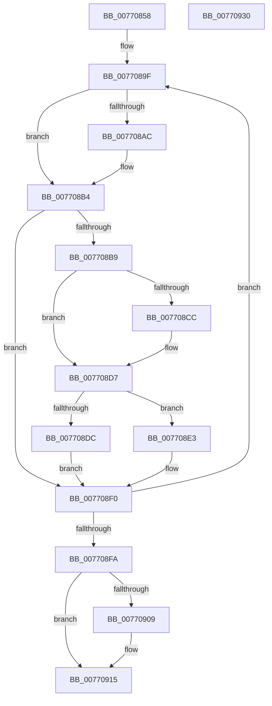

# PpmDisableProfile

- RVA: `0x00770858`–`0x00770931` (길이 `217` bytes)
- VA: `0x0000000140770858`
- 실행 섹션: `PAGE`
- PDB 이름 있음: `예`; PDB Function 태그: `아니요`
- unwind 정보 RVA: `0x0005E6B4`
- 디코드: `58`개 명령, `217/217` bytes 표시
- 미해석 바이트: `0` (있으면 어셈블리에 `.byte`로 보존)

> 이 문서는 커널 이미지의 기계어와 PDB 기호를 분석해 생성했습니다. 4번과 5번은 함수 원형과 자료형을 바이너리 사용 방식에서 추정한 C 해석이며 원본 소스 복구 결과는 아닙니다.

## 1. Dependencies

- 직접 호출 지점: **6**; 고유 호출 대상: **6**
- 직접 호출자로 확인된 함수: **1**
- RIP 상대 이미지 참조: **4**

### Outgoing calls
- `0x0077087B` → [PpmAcquireLock](../../text/2D/PpmAcquireLock_function_002D9AA4.md) (function, `0x002D9AA4`)
- `0x0077088E` → [PpmResetProfileSettings](../../text/4C/PpmResetProfileSettings_function_004C9960.md) (function, `0x004C9960`)
- `0x007708DC` → [PpmPerfUpdateMultimediaPowerModel](../../text/4B/PpmPerfUpdateMultimediaPowerModel_function_004BA06C.md) (function, `0x004BA06C`)
- `0x007708E8` → [PpmReinitializeHeteroEngine](../A5/PpmReinitializeHeteroEngine_function_00A53108.md) (function, `0x00A53108`)
- `0x007708FF` → [PpmEventTraceProfileEnable](../AB/PpmEventTraceProfileEnable_function_00ABD348.md) (function, `0x00ABD348`)
- `0x00770910` → [PpmReleaseLock](../../text/2D/PpmReleaseLock_function_002DA428.md) (function, `0x002DA428`)

### Direct callers
- [sub_00B4AAA2](../B4/Unknown_function_00B4AAA2.md) at `0x00B4AAA2`

### Static image references
- `0x00770874` → RVA `0x00F0CC00` (`.data`; read)
- `0x00770893` → RVA `0x00E08328` (`.data`; read)
- `0x007708C3` → RVA `0x00011B28` (`.rdata`; read)
- `0x007708D0` → RVA `0x00011B30` (`.rdata`; read)

## 2. Other-region calls and transfers

- 다른 실행 섹션으로 향하는 call: **4**
  - `0x0077087B` → [PpmAcquireLock](../../text/2D/PpmAcquireLock_function_002D9AA4.md) (`PAGE` → `.text`)
  - `0x0077088E` → [PpmResetProfileSettings](../../text/4C/PpmResetProfileSettings_function_004C9960.md) (`PAGE` → `.text`)
  - `0x007708DC` → [PpmPerfUpdateMultimediaPowerModel](../../text/4B/PpmPerfUpdateMultimediaPowerModel_function_004BA06C.md) (`PAGE` → `.text`)
  - `0x00770910` → [PpmReleaseLock](../../text/2D/PpmReleaseLock_function_002DA428.md) (`PAGE` → `.text`)
- 별도 외부 분기/꼬리 이동을 확인하지 못했습니다.

## 3. Assembly (complete function range)

```asm
00770858  48 8B C4                        mov rax, rsp
0077085B  48 89 58 08                     mov qword ptr [rax + 8], rbx
0077085F  48 89 68 10                     mov qword ptr [rax + 0x10], rbp
00770863  48 89 70 18                     mov qword ptr [rax + 0x18], rsi
00770867  48 89 78 20                     mov qword ptr [rax + 0x20], rdi
0077086B  41 56                           push r14
0077086D  48 83 EC 20                     sub rsp, 0x20
00770871  48 8B D9                        mov rbx, rcx
00770874  48 8D 0D 85 C3 79 00            lea rcx, [rip + 0x79c385]
0077087B  E8 24 92 B6 FF                  call 0x1402d9aa4
00770880  83 63 1C FE                     and dword ptr [rbx + 0x1c], 0xfffffffe
00770884  48 8B CB                        mov rcx, rbx
00770887  44 8A 73 08                     mov r14b, byte ptr [rbx + 8]
0077088B  40 B5 01                        mov bpl, 1
0077088E  E8 CD 90 D5 FF                  call 0x1404c9960
00770893  48 8D 3D 8E 7A 69 00            lea rdi, [rip + 0x697a8e]
0077089A  BE 06 00 00 00                  mov esi, 6
0077089F  48 8B 57 F8                     mov rdx, qword ptr [rdi - 8]
007708A3  48 8B 4B 0C                     mov rcx, qword ptr [rbx + 0xc]
007708A7  48 2B 0A                        sub rcx, qword ptr [rdx]
007708AA  75 08                           jne 0x1407708b4
007708AC  48 8B 4B 14                     mov rcx, qword ptr [rbx + 0x14]
007708B0  48 2B 4A 08                     sub rcx, qword ptr [rdx + 8]
007708B4  48 85 C9                        test rcx, rcx
007708B7  75 37                           jne 0x1407708f0
007708B9  48 8B 07                        mov rax, qword ptr [rdi]
007708BC  48 21 08                        and qword ptr [rax], rcx
007708BF  48 8B 43 0C                     mov rax, qword ptr [rbx + 0xc]
007708C3  48 2B 05 5E 12 8A FF            sub rax, qword ptr [rip - 0x75eda2]
007708CA  75 0B                           jne 0x1407708d7
007708CC  48 8B 43 14                     mov rax, qword ptr [rbx + 0x14]
007708D0  48 2B 05 59 12 8A FF            sub rax, qword ptr [rip - 0x75eda7]
007708D7  48 85 C0                        test rax, rax
007708DA  75 07                           jne 0x1407708e3
007708DC  E8 8B 97 D4 FF                  call 0x1404ba06c
007708E1  EB 0D                           jmp 0x1407708f0
007708E3  45 33 C0                        xor r8d, r8d
007708E6  B1 01                           mov cl, 1
007708E8  E8 1B 28 2E 00                  call 0x140a53108
007708ED  40 32 ED                        xor bpl, bpl
007708F0  48 83 C7 10                     add rdi, 0x10
007708F4  48 83 EE 01                     sub rsi, 1
007708F8  75 A5                           jne 0x14077089f
007708FA  33 D2                           xor edx, edx
007708FC  41 8A CE                        mov cl, r14b
007708FF  E8 44 CA 34 00                  call 0x140abd348
00770904  40 84 ED                        test bpl, bpl
00770907  74 0C                           je 0x140770915
00770909  48 8D 0D F0 C2 79 00            lea rcx, [rip + 0x79c2f0]
00770910  E8 13 9B B6 FF                  call 0x1402da428
00770915  48 8B 5C 24 30                  mov rbx, qword ptr [rsp + 0x30]
0077091A  48 8B 6C 24 38                  mov rbp, qword ptr [rsp + 0x38]
0077091F  48 8B 74 24 40                  mov rsi, qword ptr [rsp + 0x40]
00770924  48 8B 7C 24 48                  mov rdi, qword ptr [rsp + 0x48]
00770929  48 83 C4 20                     add rsp, 0x20
0077092D  41 5E                           pop r14
0077092F  C3                              ret
00770930  CC                              int3
```

## 4. C-style interpretation (structured pseudocode)

```c
__int64 __fastcall PpmDisableProfile(__int64 a1, __int64 a2, int a3)
{
    __int64 result;
    __int64 v_rbp;
    __int64 v_rdi;
    __int64 v_rsi;
    __int64 v_rsp;
    unsigned __int64 v_stack_p10;
    unsigned __int64 v_stack_p18;
    unsigned __int64 v_stack_p20;
    unsigned __int64 v_stack_p8;

    *(unsigned __int64 *)(v_rsp + 8) = v_rbx;
    *(unsigned __int64 *)(v_rsp + 16) = v_rbp;
    *(unsigned __int64 *)(v_rsp + 24) = v_rsi;
    *(unsigned __int64 *)(v_rsp + 32) = v_rdi;
    v_rsp = (v_rsp) - (32);
    result = PpmAcquireLock(v_rip + 7979909, a2, a3, a4);
    result = PpmResetProfileSettings(a1, a2, a3, a4);
loc_0077089F:
    a1 = (*(unsigned __int64 *)(a1 + 12)) - (*(unsigned __int64 *)(*(unsigned __int64 *)(v_rip + 6912654 - 8)));
    if (!(condition_is_not_equal)) {
        a1 = *(unsigned __int64 *)(a1 + 20);
        a1 = (a1) - (*(unsigned __int64 *)(*(unsigned __int64 *)(v_rip + 6912654 - 8) + 8));
    }
    if (a1 != 0) goto loc_007708F0;
    result = (*(unsigned __int64 *)(a1 + 12)) - (*(unsigned __int64 *)(v_rip - 7728546));
    if (!(condition_is_not_equal)) {
        result = *(unsigned __int64 *)(a1 + 20);
        result = (result) - (*(unsigned __int64 *)(v_rip - 7728551));
    }
    if (result != 0) goto loc_007708E3;
    result = PpmPerfUpdateMultimediaPowerModel(a1, *(unsigned __int64 *)(v_rip + 6912654 - 8), a3, a4);
    goto loc_007708F0;
loc_007708E3:
    a3 = 0;
    result = PpmReinitializeHeteroEngine(1, *(unsigned __int64 *)(v_rip + 6912654 - 8), a3, a4);
    v_rbp = 0;
loc_007708F0:
    v_rdi = (v_rip + 6912654) + (16);
    v_rsi = (6) - (1);
    if (condition_is_not_equal) goto loc_0077089F;
    a2 = 0;
    result = PpmEventTraceProfileEnable((unsigned __int8)(*(unsigned __int8 *)(a1 + 8)), a2, a3, a4);
    if (0 != 0) {
        a1 = v_rip + 7979760;
        result = PpmReleaseLock(a1, a2, a3, a4);
    }
    v_rsp = (v_rsp) + (32);
    return result;
}
```

## 5. (Beta) C Style

```c
int64_t PpmDisableProfile(void *Arg1, int64_t Arg2, int32_t Arg3)
{
    uint8_t *arg1 = (uint8_t *)Arg1;

    int64_t result;
    int64_t local_rbp;
    int64_t local_rdi;
    int64_t local_rsi;
    int64_t local_rsp;
    uint64_t v_stack_p10;
    uint64_t v_stack_p18;
    uint64_t v_stack_p20;
    uint64_t v_stack_p8;

    *(uint64_t *)(local_rsp + 0x8) = local_rbx;
    *(uint64_t *)(local_rsp + 0x10) = local_rbp;
    *(uint64_t *)(local_rsp + 0x18) = local_rsi;
    *(uint64_t *)(local_rsp + 0x20) = local_rdi;
    local_rsp = (local_rsp) - (32);
    result = PpmAcquireLock(v_rip + 7979909, Arg2, Arg3, a4);
    result = PpmResetProfileSettings(Arg1, Arg2, Arg3, a4);
loc_0077089F:
    Arg1 = (*(uint64_t *)(arg1 + 0xC)) - (*(uint64_t *)(*(uint64_t *)(v_rip + 0x697A8E - 0x8)));
    if (!(condition_is_not_equal)) {
        Arg1 = *(uint64_t *)(arg1 + 0x14);
        Arg1 = (Arg1) - (*(uint64_t *)(*(uint64_t *)(v_rip + 0x697A8E - 0x8) + 0x8));
    }
    if (Arg1 != NULL) goto loc_007708F0;
    result = (*(uint64_t *)(arg1 + 0xC)) - (*(uint64_t *)(v_rip - 0x75EDA2));
    if (!(condition_is_not_equal)) {
        result = *(uint64_t *)(arg1 + 0x14);
        result = (result) - (*(uint64_t *)(v_rip - 0x75EDA7));
    }
    if (result != 0) goto loc_007708E3;
    result = PpmPerfUpdateMultimediaPowerModel(Arg1, *(uint64_t *)(v_rip + 0x697A8E - 0x8), Arg3, a4);
    goto loc_007708F0;
loc_007708E3:
    Arg3 = 0;
    result = PpmReinitializeHeteroEngine(1, *(uint64_t *)(v_rip + 0x697A8E - 0x8), Arg3, a4);
    local_rbp = 0;
loc_007708F0:
    local_rdi = (v_rip + 6912654) + (16);
    local_rsi = (6) - (1);
    if (condition_is_not_equal) goto loc_0077089F;
    Arg2 = 0;
    result = PpmEventTraceProfileEnable((uint8_t)(*(uint8_t *)(arg1 + 0x8)), Arg2, Arg3, a4);
    if (0 != 0) {
        Arg1 = v_rip + 7979760;
        result = PpmReleaseLock(Arg1, Arg2, Arg3, a4);
    }
    local_rsp = (local_rsp) + (32);
    return result;
}
```

### 관측된 메모리 오프셋

구조체 형식이 확인되지 않은 접근은 인자 기준의 오프셋으로만 기록했습니다.

| 기준 인자 | 오프셋 표현 | 폭 (bit) | 접근 |
|---|---:|---:|---|
| `Arg1` | `+ 0x8` | `8` | `R` |
| `Arg1` | `+ 0xC` | `64` | `R` |
| `Arg1` | `+ 0x14` | `64` | `R` |
| `Arg1` | `+ 0x1C` | `32` | `R/W` |

## 6. Execution-region graph

[열기: 2D/3D 그래프와 함수 탐색 컨트롤 패널](../../../control-panel.html?section=page&rva=0x00770858&view=graph)

- 2D 그래프는 위에서 아래로 흐르고, 3D 그래프는 빈 공간을 드래그해 회전합니다. Shift+드래그는 이동, 휠은 확대·축소, 함수 노드 선택은 대상 보고서 이동입니다.

### Static fallback


