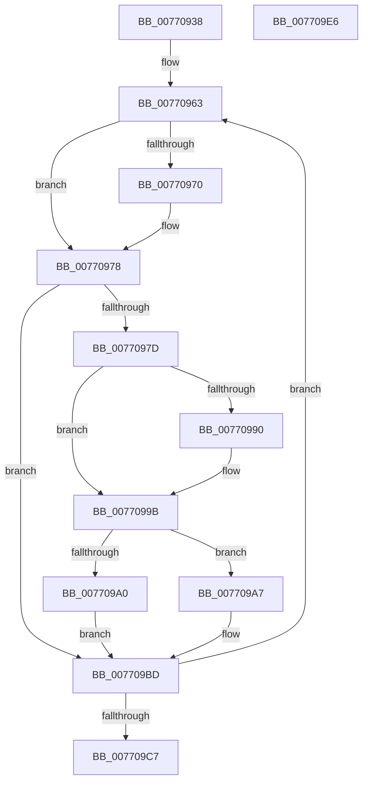

# PpmEnableProfile

- RVA: `0x00770938`–`0x007709E7` (길이 `175` bytes)
- VA: `0x0000000140770938`
- 실행 섹션: `PAGE`
- PDB 이름 있음: `예`; PDB Function 태그: `아니요`
- unwind 정보 RVA: `0x0005C954`
- 디코드: `47`개 명령, `175/175` bytes 표시
- 미해석 바이트: `0` (있으면 어셈블리에 `.byte`로 보존)

> 이 문서는 커널 이미지의 기계어와 PDB 기호를 분석해 생성했습니다. 4번과 5번은 함수 원형과 자료형을 바이너리 사용 방식에서 추정한 C 해석이며 원본 소스 복구 결과는 아닙니다.

## 1. Dependencies

- 직접 호출 지점: **4**; 고유 호출 대상: **4**
- 직접 호출자로 확인된 함수: **2**
- RIP 상대 이미지 참조: **4**

### Outgoing calls
- `0x007709A0` → [PpmPerfUpdateMultimediaPowerModel](../../text/4B/PpmPerfUpdateMultimediaPowerModel_function_004BA06C.md) (function, `0x004BA06C`)
- `0x007709AC` → [PpmReinitializeHeteroEngine](../A5/PpmReinitializeHeteroEngine_function_00A53108.md) (function, `0x00A53108`)
- `0x007709B8` → [PpmAcquireLock](../../text/2D/PpmAcquireLock_function_002D9AA4.md) (function, `0x002D9AA4`)
- `0x007709CC` → [PpmEventTraceProfileEnable](../AB/PpmEventTraceProfileEnable_function_00ABD348.md) (function, `0x00ABD348`)

### Direct callers
- [PdcPoPpmResetProfile](../AB/PdcPoPpmResetProfile_function_00ABA420.md) at `0x00ABA451`
- [PpmInitPolicyConfiguration](../../init/C4/PpmInitPolicyConfiguration_function_00C40708.md) at `0x00C40886`

### Static image references
- `0x00770950` → RVA `0x00E08328` (`.data`; read)
- `0x00770987` → RVA `0x00011B28` (`.rdata`; read)
- `0x00770994` → RVA `0x00011B30` (`.rdata`; read)
- `0x007709B1` → RVA `0x00F0CC00` (`.data`; read)

## 2. Other-region calls and transfers

- 다른 실행 섹션으로 향하는 call: **2**
  - `0x007709A0` → [PpmPerfUpdateMultimediaPowerModel](../../text/4B/PpmPerfUpdateMultimediaPowerModel_function_004BA06C.md) (`PAGE` → `.text`)
  - `0x007709B8` → [PpmAcquireLock](../../text/2D/PpmAcquireLock_function_002D9AA4.md) (`PAGE` → `.text`)
- 별도 외부 분기/꼬리 이동을 확인하지 못했습니다.

## 3. Assembly (complete function range)

```asm
00770938  48 89 5C 24 08                  mov qword ptr [rsp + 8], rbx
0077093D  48 89 6C 24 10                  mov qword ptr [rsp + 0x10], rbp
00770942  48 89 74 24 18                  mov qword ptr [rsp + 0x18], rsi
00770947  57                              push rdi
00770948  48 83 EC 20                     sub rsp, 0x20
0077094C  83 49 1C 01                     or dword ptr [rcx + 0x1c], 1
00770950  48 8D 3D D1 79 69 00            lea rdi, [rip + 0x6979d1]
00770957  40 8A 69 08                     mov bpl, byte ptr [rcx + 8]
0077095B  48 8B D9                        mov rbx, rcx
0077095E  BE 06 00 00 00                  mov esi, 6
00770963  48 8B 57 F8                     mov rdx, qword ptr [rdi - 8]
00770967  48 8B 4B 0C                     mov rcx, qword ptr [rbx + 0xc]
0077096B  48 2B 0A                        sub rcx, qword ptr [rdx]
0077096E  75 08                           jne 0x140770978
00770970  48 8B 4B 14                     mov rcx, qword ptr [rbx + 0x14]
00770974  48 2B 4A 08                     sub rcx, qword ptr [rdx + 8]
00770978  48 85 C9                        test rcx, rcx
0077097B  75 40                           jne 0x1407709bd
0077097D  48 8B 07                        mov rax, qword ptr [rdi]
00770980  48 89 18                        mov qword ptr [rax], rbx
00770983  48 8B 43 0C                     mov rax, qword ptr [rbx + 0xc]
00770987  48 2B 05 9A 11 8A FF            sub rax, qword ptr [rip - 0x75ee66]
0077098E  75 0B                           jne 0x14077099b
00770990  48 8B 43 14                     mov rax, qword ptr [rbx + 0x14]
00770994  48 2B 05 95 11 8A FF            sub rax, qword ptr [rip - 0x75ee6b]
0077099B  48 85 C0                        test rax, rax
0077099E  75 07                           jne 0x1407709a7
007709A0  E8 C7 96 D4 FF                  call 0x1404ba06c
007709A5  EB 16                           jmp 0x1407709bd
007709A7  45 33 C0                        xor r8d, r8d
007709AA  B1 01                           mov cl, 1
007709AC  E8 57 27 2E 00                  call 0x140a53108
007709B1  48 8D 0D 48 C2 79 00            lea rcx, [rip + 0x79c248]
007709B8  E8 E7 90 B6 FF                  call 0x1402d9aa4
007709BD  48 83 C7 10                     add rdi, 0x10
007709C1  48 83 EE 01                     sub rsi, 1
007709C5  75 9C                           jne 0x140770963
007709C7  B2 01                           mov dl, 1
007709C9  40 8A CD                        mov cl, bpl
007709CC  E8 77 C9 34 00                  call 0x140abd348
007709D1  48 8B 5C 24 30                  mov rbx, qword ptr [rsp + 0x30]
007709D6  48 8B 6C 24 38                  mov rbp, qword ptr [rsp + 0x38]
007709DB  48 8B 74 24 40                  mov rsi, qword ptr [rsp + 0x40]
007709E0  48 83 C4 20                     add rsp, 0x20
007709E4  5F                              pop rdi
007709E5  C3                              ret
007709E6  CC                              int3
```

## 4. C-style interpretation (structured pseudocode)

```c
__int64 __fastcall PpmEnableProfile(__int64 a1, __int64 a2, int a3)
{
    __int64 result;
    __int64 v_rdi;
    __int64 v_rsi;
    __int64 v_rsp;
    unsigned __int64 v_stack_p10;
    unsigned __int64 v_stack_p18;
    unsigned __int64 v_stack_p8;

    v_stack_p8 = v_rbx;
    v_stack_p10 = v_rbp;
    v_stack_p18 = v_rsi;
    v_rsp = (v_rsp) - (32);
loc_00770963:
    a1 = (*(unsigned __int64 *)(a1 + 12)) - (*(unsigned __int64 *)(*(unsigned __int64 *)(v_rip + 6912465 - 8)));
    if (!(condition_is_not_equal)) {
        a1 = *(unsigned __int64 *)(a1 + 20);
        a1 = (a1) - (*(unsigned __int64 *)(*(unsigned __int64 *)(v_rip + 6912465 - 8) + 8));
    }
    if (a1 != 0) goto loc_007709BD;
    *(unsigned __int64 *)(*(unsigned __int64 *)(v_rip + 6912465)) = a1;
    result = (*(unsigned __int64 *)(a1 + 12)) - (*(unsigned __int64 *)(v_rip - 7728742));
    if (!(condition_is_not_equal)) {
        result = *(unsigned __int64 *)(a1 + 20);
        result = (result) - (*(unsigned __int64 *)(v_rip - 7728747));
    }
    if (result != 0) goto loc_007709A7;
    result = PpmPerfUpdateMultimediaPowerModel(a1, *(unsigned __int64 *)(v_rip + 6912465 - 8), a3, a4);
    goto loc_007709BD;
loc_007709A7:
    a3 = 0;
    result = PpmReinitializeHeteroEngine(1, *(unsigned __int64 *)(v_rip + 6912465 - 8), a3, a4);
    result = PpmAcquireLock(v_rip + 7979592, *(unsigned __int64 *)(v_rip + 6912465 - 8), a3, a4);
loc_007709BD:
    v_rdi = (v_rip + 6912465) + (16);
    v_rsi = (6) - (1);
    if (condition_is_not_equal) goto loc_00770963;
    result = PpmEventTraceProfileEnable((unsigned __int8)(*(unsigned __int8 *)(a1 + 8)), 1, a3, a4);
    v_rsp = (v_rsp) + (32);
    return result;
}
```

## 5. (Beta) C Style

```c
int64_t PpmEnableProfile(void *Arg1, int64_t Arg2, int32_t Arg3)
{
    uint8_t *arg1 = (uint8_t *)Arg1;

    int64_t result;
    int64_t local_rdi;
    int64_t local_rsi;
    int64_t local_rsp;
    uint64_t v_stack_p10;
    uint64_t v_stack_p18;
    uint64_t v_stack_p8;

    v_stack_p8 = local_rbx;
    v_stack_p10 = local_rbp;
    v_stack_p18 = local_rsi;
    local_rsp = (local_rsp) - (32);
loc_00770963:
    Arg1 = (*(uint64_t *)(arg1 + 0xC)) - (*(uint64_t *)(*(uint64_t *)(v_rip + 0x6979D1 - 0x8)));
    if (!(condition_is_not_equal)) {
        Arg1 = *(uint64_t *)(arg1 + 0x14);
        Arg1 = (Arg1) - (*(uint64_t *)(*(uint64_t *)(v_rip + 0x6979D1 - 0x8) + 0x8));
    }
    if (Arg1 != NULL) goto loc_007709BD;
    *(void **)(*(uint64_t *)(v_rip + 0x6979D1)) = Arg1;
    result = (*(uint64_t *)(arg1 + 0xC)) - (*(uint64_t *)(v_rip - 0x75EE66));
    if (!(condition_is_not_equal)) {
        result = *(uint64_t *)(arg1 + 0x14);
        result = (result) - (*(uint64_t *)(v_rip - 0x75EE6B));
    }
    if (result != 0) goto loc_007709A7;
    result = PpmPerfUpdateMultimediaPowerModel(Arg1, *(uint64_t *)(v_rip + 0x6979D1 - 0x8), Arg3, a4);
    goto loc_007709BD;
loc_007709A7:
    Arg3 = 0;
    result = PpmReinitializeHeteroEngine(1, *(uint64_t *)(v_rip + 0x6979D1 - 0x8), Arg3, a4);
    result = PpmAcquireLock(v_rip + 7979592, *(uint64_t *)(v_rip + 0x6979D1 - 0x8), Arg3, a4);
loc_007709BD:
    local_rdi = (v_rip + 6912465) + (16);
    local_rsi = (6) - (1);
    if (condition_is_not_equal) goto loc_00770963;
    result = PpmEventTraceProfileEnable((uint8_t)(*(uint8_t *)(arg1 + 0x8)), 1, Arg3, a4);
    local_rsp = (local_rsp) + (32);
    return result;
}
```

### 관측된 메모리 오프셋

구조체 형식이 확인되지 않은 접근은 인자 기준의 오프셋으로만 기록했습니다.

| 기준 인자 | 오프셋 표현 | 폭 (bit) | 접근 |
|---|---:|---:|---|
| `Arg1` | `+ 0x8` | `8` | `R` |
| `Arg1` | `+ 0xC` | `64` | `R` |
| `Arg1` | `+ 0x14` | `64` | `R` |
| `Arg1` | `+ 0x1C` | `32` | `R/W` |

## 6. Execution-region graph

[열기: 2D/3D 그래프와 함수 탐색 컨트롤 패널](../../../control-panel.html?section=page&rva=0x00770938&view=graph)

- 2D 그래프는 위에서 아래로 흐르고, 3D 그래프는 빈 공간을 드래그해 회전합니다. Shift+드래그는 이동, 휠은 확대·축소, 함수 노드 선택은 대상 보고서 이동입니다.

### Static fallback


