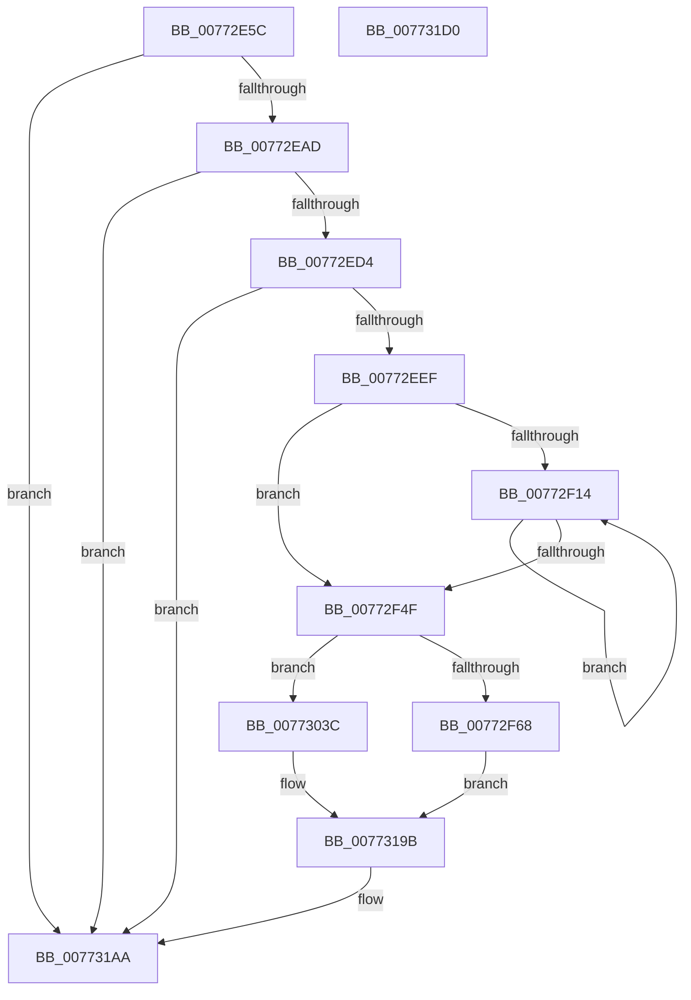

# PpmEventTraceParkNodeRundownEx

- RVA: `0x00772E5C`–`0x007731D1` (길이 `885` bytes)
- VA: `0x0000000140772E5C`
- 실행 섹션: `PAGE`
- PDB 이름 있음: `예`; PDB Function 태그: `아니요`
- unwind 정보 RVA: `0x000CD8D8`
- 디코드: `179`개 명령, `885/885` bytes 표시
- 미해석 바이트: `0` (있으면 어셈블리에 `.byte`로 보존)

> 이 문서는 커널 이미지의 기계어와 PDB 기호를 분석해 생성했습니다. 4번과 5번은 함수 원형과 자료형을 바이너리 사용 방식에서 추정한 C 해석이며 원본 소스 복구 결과는 아닙니다.

## 1. Dependencies

- 직접 호출 지점: **11**; 고유 호출 대상: **7**
- 직접 호출자로 확인된 함수: **1**
- RIP 상대 이미지 참조: **6**

### Outgoing calls
- `0x00772EC2` → [memset](../../text/6C/memset_function_006C6C40.md) (function, `0x006C6C40`)
- `0x00772EE2` → [EtwEventEnabled](../../text/39/EtwEventEnabled_function_00392450.md) (function, `0x00392450`)
- `0x00772F06` → [memset](../../text/6C/memset_function_006C6C40.md) (function, `0x006C6C40`)
- `0x00772F3F` → [KiOrAffinityEx](../../text/39/KiOrAffinityEx_function_0039A84C.md) (function, `0x0039A84C`)
- `0x00772F5B` → [KeIsSingleGroupAffinityEx](../../text/47/KeIsSingleGroupAffinityEx_function_0047AC50.md) (function, `0x0047AC50`)
- `0x00773089` → [PpmEventAddAffinityMaskAsSubset](../../text/4E/PpmEventAddAffinityMaskAsSubset_function_004EF628.md) (function, `0x004EF628`)
- `0x007730C9` → [PpmEventAddAffinityMaskAsSubset](../../text/4E/PpmEventAddAffinityMaskAsSubset_function_004EF628.md) (function, `0x004EF628`)
- `0x00773145` → [PpmEventAddAffinityMaskAsSubset](../../text/4E/PpmEventAddAffinityMaskAsSubset_function_004EF628.md) (function, `0x004EF628`)
- `0x00773185` → [PpmEventAddAffinityMaskAsSubset](../../text/4E/PpmEventAddAffinityMaskAsSubset_function_004EF628.md) (function, `0x004EF628`)
- `0x007731A5` → [EtwWrite](../../text/41/EtwWrite_function_0041C720.md) (function, `0x0041C720`)
- `0x007731B4` → [_security_check_cookie](../../text/6A/_security_check_cookie_function_006AC640.md) (function, `0x006AC640`)

### Direct callers
- [PpmEventTraceControlCallback](../A5/PpmEventTraceControlCallback_function_00A51F60.md) at `0x00A5223B`

### Static image references
- `0x00772E7C` → RVA `0x00E0A740` (`.data`; read)
- `0x00772E8D` → RVA `0x00E67A70` (`.data`; read)
- `0x00772EC7` → RVA `0x00E67A39` (`.data`; read)
- `0x00772ED4` → RVA `0x00F083E8` (`.data`; read)
- `0x00772EDB` → RVA `0x00022BE0` (`.rdata`; read)
- `0x00772F76` → RVA `0x0001BF38` (`.rdata`; read)

## 2. Other-region calls and transfers

- 다른 실행 섹션으로 향하는 call: **11**
  - `0x00772EC2` → [memset](../../text/6C/memset_function_006C6C40.md) (`PAGE` → `.text`)
  - `0x00772EE2` → [EtwEventEnabled](../../text/39/EtwEventEnabled_function_00392450.md) (`PAGE` → `.text`)
  - `0x00772F06` → [memset](../../text/6C/memset_function_006C6C40.md) (`PAGE` → `.text`)
  - `0x00772F3F` → [KiOrAffinityEx](../../text/39/KiOrAffinityEx_function_0039A84C.md) (`PAGE` → `.text`)
  - `0x00772F5B` → [KeIsSingleGroupAffinityEx](../../text/47/KeIsSingleGroupAffinityEx_function_0047AC50.md) (`PAGE` → `.text`)
  - `0x00773089` → [PpmEventAddAffinityMaskAsSubset](../../text/4E/PpmEventAddAffinityMaskAsSubset_function_004EF628.md) (`PAGE` → `.text`)
  - `0x007730C9` → [PpmEventAddAffinityMaskAsSubset](../../text/4E/PpmEventAddAffinityMaskAsSubset_function_004EF628.md) (`PAGE` → `.text`)
  - `0x00773145` → [PpmEventAddAffinityMaskAsSubset](../../text/4E/PpmEventAddAffinityMaskAsSubset_function_004EF628.md) (`PAGE` → `.text`)
  - `0x00773185` → [PpmEventAddAffinityMaskAsSubset](../../text/4E/PpmEventAddAffinityMaskAsSubset_function_004EF628.md) (`PAGE` → `.text`)
  - `0x007731A5` → [EtwWrite](../../text/41/EtwWrite_function_0041C720.md) (`PAGE` → `.text`)
  - `0x007731B4` → [_security_check_cookie](../../text/6A/_security_check_cookie_function_006AC640.md) (`PAGE` → `.text`)
- 별도 외부 분기/꼬리 이동을 확인하지 못했습니다.

## 3. Assembly (complete function range)

```asm
00772E5C  48 89 5C 24 18                  mov qword ptr [rsp + 0x18], rbx
00772E61  66 89 4C 24 08                  mov word ptr [rsp + 8], cx
00772E66  55                              push rbp
00772E67  56                              push rsi
00772E68  57                              push rdi
00772E69  41 54                           push r12
00772E6B  41 57                           push r15
00772E6D  48 8D AC 24 00 FE FF FF         lea rbp, [rsp - 0x200]
00772E75  48 81 EC 00 03 00 00            sub rsp, 0x300
00772E7C  48 8B 05 BD 78 69 00            mov rax, qword ptr [rip + 0x6978bd]
00772E83  48 33 C4                        xor rax, rsp
00772E86  48 89 85 F0 01 00 00            mov qword ptr [rbp + 0x1f0], rax
00772E8D  48 8B 35 DC 4B 6F 00            mov rsi, qword ptr [rip + 0x6f4bdc]
00772E94  45 33 FF                        xor r15d, r15d
00772E97  44 89 7C 24 50                  mov dword ptr [rsp + 0x50], r15d
00772E9C  48 8B DA                        mov rbx, rdx
00772E9F  44 89 7C 24 4C                  mov dword ptr [rsp + 0x4c], r15d
00772EA4  48 85 F6                        test rsi, rsi
00772EA7  0F 84 FD 02 00 00               je 0x1407731aa
00772EAD  BF 00 01 00 00                  mov edi, 0x100
00772EB2  66 44 89 7C 24 44               mov word ptr [rsp + 0x44], r15w
00772EB8  44 8B C7                        mov r8d, edi
00772EBB  48 8D 4C 24 68                  lea rcx, [rsp + 0x68]
00772EC0  33 D2                           xor edx, edx
00772EC2  E8 79 3D F5 FF                  call 0x1406c6c40
00772EC7  44 38 3D 6B 4B 6F 00            cmp byte ptr [rip + 0x6f4b6b], r15b
00772ECE  0F 84 D6 02 00 00               je 0x1407731aa
00772ED4  48 8B 0D 0D 55 79 00            mov rcx, qword ptr [rip + 0x79550d]
00772EDB  48 8D 15 FE FC 8A FF            lea rdx, [rip - 0x750302]
00772EE2  E8 69 F5 C1 FF                  call 0x140392450
00772EE7  84 C0                           test al, al
00772EE9  0F 84 BB 02 00 00               je 0x1407731aa
00772EEF  44 8B C7                        mov r8d, edi
00772EF2  48 C7 44 24 60 01 00 20 00      mov qword ptr [rsp + 0x60], 0x200001
00772EFB  33 D2                           xor edx, edx
00772EFD  48 8D 4C 24 68                  lea rcx, [rsp + 0x68]
00772F02  45 8D 67 01                     lea r12d, [r15 + 1]
00772F06  E8 35 3D F5 FF                  call 0x1406c6c40
00772F0B  41 8B FF                        mov edi, r15d
00772F0E  44 38 7B 0C                     cmp byte ptr [rbx + 0xc], r15b
00772F12  76 3B                           jbe 0x140772f4f
00772F14  48 8B 93 08 05 00 00            mov rdx, qword ptr [rbx + 0x508]
00772F1B  4C 8D 44 24 60                  lea r8, [rsp + 0x60]
00772F20  44 0F B7 4C 24 62               movzx r9d, word ptr [rsp + 0x62]
00772F26  48 81 C2 30 01 00 00            add rdx, 0x130
00772F2D  8B C7                           mov eax, edi
00772F2F  48 8D 0C 80                     lea rcx, [rax + rax*4]
00772F33  48 C1 E1 07                     shl rcx, 7
00772F37  48 03 D1                        add rdx, rcx
00772F3A  48 8D 4C 24 60                  lea rcx, [rsp + 0x60]
00772F3F  E8 08 79 C2 FF                  call 0x14039a84c
00772F44  0F B6 43 0C                     movzx eax, byte ptr [rbx + 0xc]
00772F48  41 03 FC                        add edi, r12d
00772F4B  3B F8                           cmp edi, eax
00772F4D  72 C5                           jb 0x140772f14
00772F4F  48 8D 7B 30                     lea rdi, [rbx + 0x30]
00772F53  48 8B CF                        mov rcx, rdi
00772F56  48 8D 54 24 44                  lea rdx, [rsp + 0x44]
00772F5B  E8 F0 7C D0 FF                  call 0x14047ac50
00772F60  85 C0                           test eax, eax
00772F62  0F 84 D4 00 00 00               je 0x14077303c
00772F68  0F B7 4C 24 44                  movzx ecx, word ptr [rsp + 0x44]
00772F6D  48 8D 44 24 44                  lea rax, [rsp + 0x44]
00772F72  48 89 45 70                     mov qword ptr [rbp + 0x70], rax
00772F76  48 8D 15 BB 8F 8A FF            lea rdx, [rip - 0x757045]
00772F7D  48 C7 45 78 02 00 00 00         mov qword ptr [rbp + 0x78], 2
00772F85  41 B9 07 00 00 00               mov r9d, 7
00772F8B  48 C7 85 88 00 00 00 08 00 00 00  mov qword ptr [rbp + 0x88], 8
00772F96  48 8D 41 07                     lea rax, [rcx + 7]
00772F9A  48 C7 85 98 00 00 00 08 00 00 00  mov qword ptr [rbp + 0x98], 8
00772FA5  48 8D 04 C3                     lea rax, [rbx + rax*8]
00772FA9  4C 89 A5 A8 00 00 00            mov qword ptr [rbp + 0xa8], r12
00772FB0  48 89 85 80 00 00 00            mov qword ptr [rbp + 0x80], rax
00772FB7  48 8D 41 28                     lea rax, [rcx + 0x28]
00772FBB  48 8D 04 C3                     lea rax, [rbx + rax*8]
00772FBF  4C 89 A5 B8 00 00 00            mov qword ptr [rbp + 0xb8], r12
00772FC6  48 89 85 90 00 00 00            mov qword ptr [rbp + 0x90], rax
00772FCD  8A 83 90 04 00 00               mov al, byte ptr [rbx + 0x490]
00772FD3  88 44 24 40                     mov byte ptr [rsp + 0x40], al
00772FD7  8A 83 94 04 00 00               mov al, byte ptr [rbx + 0x494]
00772FDD  88 44 24 41                     mov byte ptr [rsp + 0x41], al
00772FE1  48 8D 44 24 40                  lea rax, [rsp + 0x40]
00772FE6  48 89 85 A0 00 00 00            mov qword ptr [rbp + 0xa0], rax
00772FED  48 8D 44 24 41                  lea rax, [rsp + 0x41]
00772FF2  48 89 85 B0 00 00 00            mov qword ptr [rbp + 0xb0], rax
00772FF9  48 8D 44 24 68                  lea rax, [rsp + 0x68]
00772FFE  48 8D 04 C8                     lea rax, [rax + rcx*8]
00773002  48 C7 85 C8 00 00 00 08 00 00 00  mov qword ptr [rbp + 0xc8], 8
0077300D  48 89 85 C0 00 00 00            mov qword ptr [rbp + 0xc0], rax
00773014  48 83 C1 6A                     add rcx, 0x6a
00773018  48 C7 85 D8 00 00 00 08 00 00 00  mov qword ptr [rbp + 0xd8], 8
00773023  48 8D 04 CB                     lea rax, [rbx + rcx*8]
00773027  48 89 85 D0 00 00 00            mov qword ptr [rbp + 0xd0], rax
0077302E  48 8D 45 70                     lea rax, [rbp + 0x70]
00773032  48 89 44 24 20                  mov qword ptr [rsp + 0x20], rax
00773037  E9 5F 01 00 00                  jmp 0x14077319b
0077303C  48 8D 85 30 02 00 00            lea rax, [rbp + 0x230]
00773043  48 C7 46 08 02 00 00 00         mov qword ptr [rsi + 8], 2
0077304B  48 89 06                        mov qword ptr [rsi], rax
0077304E  4C 8D 8D F0 00 00 00            lea r9, [rbp + 0xf0]
00773055  48 8D 44 24 48                  lea rax, [rsp + 0x48]
0077305A  44 89 64 24 48                  mov dword ptr [rsp + 0x48], r12d
0077305F  48 89 44 24 38                  mov qword ptr [rsp + 0x38], rax
00773064  4C 8D 85 E0 00 00 00            lea r8, [rbp + 0xe0]
0077306B  48 8D 44 24 4C                  lea rax, [rsp + 0x4c]
00773070  48 8B D7                        mov rdx, rdi
00773073  48 89 44 24 30                  mov qword ptr [rsp + 0x30], rax
00773078  33 C9                           xor ecx, ecx
0077307A  48 8D 44 24 50                  lea rax, [rsp + 0x50]
0077307F  48 89 44 24 28                  mov qword ptr [rsp + 0x28], rax
00773084  48 89 74 24 20                  mov qword ptr [rsp + 0x20], rsi
00773089  E8 9A C5 D7 FF                  call 0x1404ef628
0077308E  48 8D 44 24 48                  lea rax, [rsp + 0x48]
00773093  48 8B CF                        mov rcx, rdi
00773096  48 89 44 24 38                  mov qword ptr [rsp + 0x38], rax
0077309B  48 8D 93 38 01 00 00            lea rdx, [rbx + 0x138]
007730A2  48 8D 44 24 4C                  lea rax, [rsp + 0x4c]
007730A7  48 89 44 24 30                  mov qword ptr [rsp + 0x30], rax
007730AC  4C 8D 8D F0 00 00 00            lea r9, [rbp + 0xf0]
007730B3  48 8D 44 24 50                  lea rax, [rsp + 0x50]
007730B8  48 89 44 24 28                  mov qword ptr [rsp + 0x28], rax
007730BD  4C 8D 85 E0 00 00 00            lea r8, [rbp + 0xe0]
007730C4  48 89 74 24 20                  mov qword ptr [rsp + 0x20], rsi
007730C9  E8 5A C5 D7 FF                  call 0x1404ef628
007730CE  8B 54 24 48                     mov edx, dword ptr [rsp + 0x48]
007730D2  48 8D 83 90 04 00 00            lea rax, [rbx + 0x490]
007730D9  8B CA                           mov ecx, edx
007730DB  4C 8D 8D F0 00 00 00            lea r9, [rbp + 0xf0]
007730E2  48 03 C9                        add rcx, rcx
007730E5  4C 8D 85 E0 00 00 00            lea r8, [rbp + 0xe0]
007730EC  48 89 04 CE                     mov qword ptr [rsi + rcx*8], rax
007730F0  48 8D 83 94 04 00 00            lea rax, [rbx + 0x494]
007730F7  48 C7 44 CE 08 02 00 00 00      mov qword ptr [rsi + rcx*8 + 8], 2
00773100  8D 4A 01                        lea ecx, [rdx + 1]
00773103  48 03 C9                        add rcx, rcx
00773106  83 C2 02                        add edx, 2
00773109  89 54 24 48                     mov dword ptr [rsp + 0x48], edx
0077310D  48 8D 54 24 60                  lea rdx, [rsp + 0x60]
00773112  48 89 04 CE                     mov qword ptr [rsi + rcx*8], rax
00773116  48 8D 44 24 48                  lea rax, [rsp + 0x48]
0077311B  48 89 44 24 38                  mov qword ptr [rsp + 0x38], rax
00773120  48 8D 44 24 4C                  lea rax, [rsp + 0x4c]
00773125  48 89 44 24 30                  mov qword ptr [rsp + 0x30], rax
0077312A  48 8D 44 24 50                  lea rax, [rsp + 0x50]
0077312F  48 C7 44 CE 08 02 00 00 00      mov qword ptr [rsi + rcx*8 + 8], 2
00773138  48 8B CF                        mov rcx, rdi
0077313B  48 89 44 24 28                  mov qword ptr [rsp + 0x28], rax
00773140  48 89 74 24 20                  mov qword ptr [rsp + 0x20], rsi
00773145  E8 DE C4 D7 FF                  call 0x1404ef628
0077314A  48 8D 44 24 48                  lea rax, [rsp + 0x48]
0077314F  48 8B CF                        mov rcx, rdi
00773152  48 89 44 24 38                  mov qword ptr [rsp + 0x38], rax
00773157  48 8D 93 48 03 00 00            lea rdx, [rbx + 0x348]
0077315E  48 8D 44 24 4C                  lea rax, [rsp + 0x4c]
00773163  48 89 44 24 30                  mov qword ptr [rsp + 0x30], rax
00773168  4C 8D 8D F0 00 00 00            lea r9, [rbp + 0xf0]
0077316F  48 8D 44 24 50                  lea rax, [rsp + 0x50]
00773174  48 89 44 24 28                  mov qword ptr [rsp + 0x28], rax
00773179  4C 8D 85 E0 00 00 00            lea r8, [rbp + 0xe0]
00773180  48 89 74 24 20                  mov qword ptr [rsp + 0x20], rsi
00773185  E8 9E C4 D7 FF                  call 0x1404ef628
0077318A  44 8B 4C 24 48                  mov r9d, dword ptr [rsp + 0x48]
0077318F  48 8D 15 4A FA 8A FF            lea rdx, [rip - 0x7505b6]
00773196  48 89 74 24 20                  mov qword ptr [rsp + 0x20], rsi
0077319B  48 8B 0D 46 52 79 00            mov rcx, qword ptr [rip + 0x795246]
007731A2  45 33 C0                        xor r8d, r8d
007731A5  E8 76 95 CA FF                  call 0x14041c720
007731AA  48 8B 8D F0 01 00 00            mov rcx, qword ptr [rbp + 0x1f0]
007731B1  48 33 CC                        xor rcx, rsp
007731B4  E8 87 94 F3 FF                  call 0x1406ac640
007731B9  48 8B 9C 24 40 03 00 00         mov rbx, qword ptr [rsp + 0x340]
007731C1  48 81 C4 00 03 00 00            add rsp, 0x300
007731C8  41 5F                           pop r15
007731CA  41 5C                           pop r12
007731CC  5F                              pop rdi
007731CD  5E                              pop rsi
007731CE  5D                              pop rbp
007731CF  C3                              ret
007731D0  CC                              int3
```

## 4. C-style interpretation (structured pseudocode)

```c
__int64 __fastcall PpmEventTraceParkNodeRundownEx(unsigned __int16 a1, __int64 a2)
{
    __int64 result;
    __int64 v_r15;
    __int64 v_rdi;
    __int64 v_rsp;
    unsigned __int64 v_stack_m138;
    unsigned __int64 v_stack_m148;
    unsigned __int64 v_stack_m150;
    unsigned __int64 v_stack_m158;
    unsigned __int64 v_stack_m160;
    unsigned __int64 v_stack_m168;
    unsigned __int64 v_stack_m170;
    unsigned __int64 v_stack_m178;
    unsigned __int64 v_stack_m180;
    unsigned __int64 v_stack_m188;
    unsigned __int64 v_stack_m190;
    unsigned __int64 v_stack_m198;
    unsigned __int64 v_stack_m1A0;
    unsigned __int64 v_stack_m1A8;
    unsigned __int64 v_stack_m1B0;
    unsigned __int64 v_stack_m1B8;
    unsigned __int64 v_stack_m228;
    unsigned __int64 v_stack_m2C0;
    unsigned __int16 v_stack_m2C6;
    unsigned __int64 v_stack_m2C8;
    unsigned int v_stack_m2D8;
    unsigned int v_stack_m2DC;
    unsigned __int64 v_stack_m2E0;
    unsigned __int16 v_stack_m2E4;
    unsigned __int8 v_stack_m2E7;
    unsigned __int8 v_stack_m2E8;
    unsigned __int64 v_stack_m2F0;
    unsigned __int64 v_stack_m2F8;
    unsigned __int64 v_stack_m300;
    unsigned __int64 v_stack_m308;
    unsigned __int64 v_stack_m38;
    unsigned __int64 v_stack_p18;
    unsigned __int16 v_stack_p8;

    v_stack_p18 = v_rbx;
    v_stack_p8 = a1;
    v_rsp = (v_rsp) - (768);
    result = (*(unsigned __int64 *)(v_rip + 6912189)) ^ (v_rsp);
    v_stack_m38 = result;
    v_r15 = 0;
    v_stack_m2D8 = 0;
    v_stack_m2DC = 0;
    if (*(unsigned __int64 *)(v_rip + 7293916) == 0) goto loc_007731AA;
    v_stack_m2E4 = 0;
    a2 = 0;
    result = memset(v_stack_m2C0, a2, 256, a4);
    if ((*(unsigned __int8 *)(v_rip + 7293803)) == 0) goto loc_007731AA;
    result = EtwEventEnabled(*(unsigned __int64 *)(v_rip + 7951629), v_rip - 7668482, 256, a4);
    if ((unsigned __int8)(result) == 0) goto loc_007731AA;
    v_stack_m2C8 = 0x200001ULL;
    a2 = 0;
    result = memset(v_stack_m2C0, a2, 256, a4);
    if ((*(unsigned __int8 *)(a2 + 12)) <= 0) goto loc_00772F4F;
loc_00772F14:
    a2 = (*(unsigned __int64 *)(a2 + 1288)) + (304);
    a1 = (0 + 0 * 4) << (7);
    a2 = (a2) + (a1);
    result = KiOrAffinityEx(v_stack_m2C8, a2, v_stack_m2C8, v_stack_m2C6);
    v_rdi = (unsigned int)((0) + ((unsigned int)(v_r15 + 1)));
    if (((unsigned int)(v_rdi)) < ((unsigned int)(*(unsigned __int8 *)(a2 + 12)))) goto loc_00772F14;
loc_00772F4F:
    result = KeIsSingleGroupAffinityEx(a2 + 48, v_stack_m2E4, v_stack_m2C8, v_stack_m2C6);
    if ((unsigned int)(result) == 0) goto loc_0077303C;
    v_stack_m1B8 = v_stack_m2E4;
    v_stack_m1B0 = 2;
    v_stack_m1A0 = 8;
    v_stack_m190 = 8;
    v_stack_m180 = v_r15 + 1;
    v_stack_m1A8 = a2 + v_stack_m2E4 + 7 * 8;
    v_stack_m170 = v_r15 + 1;
    v_stack_m198 = a2 + v_stack_m2E4 + 40 * 8;
    v_stack_m2E8 = (unsigned __int8)(*(unsigned __int8 *)(a2 + 1168));
    v_stack_m2E7 = (unsigned __int8)(*(unsigned __int8 *)(a2 + 1172));
    v_stack_m188 = v_stack_m2E8;
    v_stack_m178 = v_stack_m2E7;
    v_stack_m160 = 8;
    v_stack_m168 = v_stack_m2C0 + v_stack_m2E4 * 8;
    a1 = (v_stack_m2E4) + (106);
    v_stack_m150 = 8;
    v_stack_m158 = a2 + a1 * 8;
    v_stack_m308 = v_stack_m1B8;
    goto loc_0077319B;
loc_0077303C:
    *(unsigned __int64 *)(*(unsigned __int64 *)(v_rip + 7293916) + 8) = 2;
    *(unsigned __int64 *)(*(unsigned __int64 *)(v_rip + 7293916)) = v_stack_p8;
    v_stack_m2E0 = (unsigned int)(v_r15 + 1);
    v_stack_m2F0 = v_stack_m2E0;
    v_stack_m2F8 = v_stack_m2DC;
    a1 = 0;
    v_stack_m300 = v_stack_m2D8;
    v_stack_m308 = *(unsigned __int64 *)(v_rip + 7293916);
    result = PpmEventAddAffinityMaskAsSubset(a1, a2 + 48, v_stack_m148, v_stack_m138);
    v_stack_m2F0 = v_stack_m2E0;
    v_stack_m2F8 = v_stack_m2DC;
    v_stack_m300 = v_stack_m2D8;
    v_stack_m308 = *(unsigned __int64 *)(v_rip + 7293916);
    result = PpmEventAddAffinityMaskAsSubset(a2 + 48, a2 + 312, v_stack_m148, v_stack_m138);
    a1 = ((unsigned int)((unsigned int)((unsigned int)(v_stack_m2E0)))) + ((unsigned int)((unsigned int)((unsigned int)(v_stack_m2E0))));
    *(unsigned __int64 *)(*(unsigned __int64 *)(v_rip + 7293916) + a1 * 8) = a2 + 1168;
    *(unsigned __int64 *)(*(unsigned __int64 *)(v_rip + 7293916) + a1 * 8 + 8) = 2;
    a1 = ((unsigned int)(v_stack_m2E0) + 1) + ((unsigned int)(v_stack_m2E0) + 1);
    a2 = (unsigned int)(((unsigned int)(v_stack_m2E0)) + (2));
    v_stack_m2E0 = (unsigned int)(a2);
    *(unsigned __int64 *)(*(unsigned __int64 *)(v_rip + 7293916) + a1 * 8) = a2 + 1172;
    v_stack_m2F0 = v_stack_m2E0;
    v_stack_m2F8 = v_stack_m2DC;
    *(unsigned __int64 *)(*(unsigned __int64 *)(v_rip + 7293916) + a1 * 8 + 8) = 2;
    v_stack_m300 = v_stack_m2D8;
    v_stack_m308 = *(unsigned __int64 *)(v_rip + 7293916);
    result = PpmEventAddAffinityMaskAsSubset(a2 + 48, v_stack_m2C8, v_stack_m148, v_stack_m138);
    v_stack_m2F0 = v_stack_m2E0;
    v_stack_m2F8 = v_stack_m2DC;
    v_stack_m300 = v_stack_m2D8;
    v_stack_m308 = *(unsigned __int64 *)(v_rip + 7293916);
    result = PpmEventAddAffinityMaskAsSubset(a2 + 48, a2 + 840, v_stack_m148, v_stack_m138);
    v_stack_m308 = *(unsigned __int64 *)(v_rip + 7293916);
loc_0077319B:
    a3 = 0;
    result = EtwWrite(*(unsigned __int64 *)(v_rip + 7950918), v_rip - 7669174, a3, (unsigned int)(v_stack_m2E0));
loc_007731AA:
    a1 = (v_stack_m38) ^ (v_rsp);
    result = _security_check_cookie(a1, v_rip - 7669174, a3, (unsigned int)(v_stack_m2E0));
    v_rsp = (v_rsp) + (768);
    return result;
}
```

## 5. (Beta) C Style

```c
int64_t PpmEventTraceParkNodeRundownEx(uint16_t Arg1, void *Arg2)
{
    uint8_t *arg2 = (uint8_t *)Arg2;

    int64_t result;
    int64_t local_r15;
    int64_t local_rdi;
    int64_t local_rsp;
    uint64_t v_stack_m138;
    uint64_t v_stack_m148;
    uint64_t v_stack_m150;
    uint64_t v_stack_m158;
    uint64_t v_stack_m160;
    uint64_t v_stack_m168;
    uint64_t v_stack_m170;
    uint64_t v_stack_m178;
    uint64_t v_stack_m180;
    uint64_t v_stack_m188;
    uint64_t v_stack_m190;
    uint64_t v_stack_m198;
    uint64_t v_stack_m1A0;
    uint64_t v_stack_m1A8;
    uint64_t v_stack_m1B0;
    uint64_t v_stack_m1B8;
    uint64_t v_stack_m228;
    uint64_t v_stack_m2C0;
    uint16_t v_stack_m2C6;
    uint64_t v_stack_m2C8;
    uint32_t v_stack_m2D8;
    uint32_t v_stack_m2DC;
    uint64_t v_stack_m2E0;
    uint16_t v_stack_m2E4;
    uint8_t v_stack_m2E7;
    uint8_t v_stack_m2E8;
    uint64_t v_stack_m2F0;
    uint64_t v_stack_m2F8;
    uint64_t v_stack_m300;
    uint64_t v_stack_m308;
    uint64_t v_stack_m38;
    uint64_t v_stack_p18;
    uint16_t v_stack_p8;

    v_stack_p18 = local_rbx;
    v_stack_p8 = Arg1;
    local_rsp = (local_rsp) - (768);
    result = (*(uint64_t *)(v_rip + 0x6978BD)) ^ (local_rsp);
    v_stack_m38 = result;
    local_r15 = 0;
    v_stack_m2D8 = 0;
    v_stack_m2DC = 0;
    if (*(uint64_t *)(v_rip + 0x6F4BDC) == 0) goto loc_007731AA;
    v_stack_m2E4 = 0;
    Arg2 = 0;
    result = memset(v_stack_m2C0, Arg2, 256, a4);
    if ((*(uint8_t *)(v_rip + 0x6F4B6B)) == 0) goto loc_007731AA;
    result = EtwEventEnabled(*(uint64_t *)(v_rip + 0x79550D), v_rip - 7668482, 256, a4);
    if ((uint8_t)(result) == 0) goto loc_007731AA;
    v_stack_m2C8 = 0x200001ULL;
    Arg2 = 0;
    result = memset(v_stack_m2C0, Arg2, 256, a4);
    if ((*(uint8_t *)(arg2 + 0xC)) <= 0) goto loc_00772F4F;
loc_00772F14:
    Arg2 = (*(uint64_t *)(arg2 + 0x508)) + (304);
    Arg1 = (0 + 0 * 4) << (7);
    Arg2 = (Arg2) + (Arg1);
    result = KiOrAffinityEx(v_stack_m2C8, Arg2, v_stack_m2C8, v_stack_m2C6);
    local_rdi = (uint32_t)((0) + ((uint32_t)(local_r15 + 1)));
    if (((uint32_t)(local_rdi)) < ((uint32_t)(*(uint8_t *)(arg2 + 0xC)))) goto loc_00772F14;
loc_00772F4F:
    result = KeIsSingleGroupAffinityEx(Arg2 + 48, v_stack_m2E4, v_stack_m2C8, v_stack_m2C6);
    if ((uint32_t)(result) == 0) goto loc_0077303C;
    v_stack_m1B8 = v_stack_m2E4;
    v_stack_m1B0 = 2;
    v_stack_m1A0 = 8;
    v_stack_m190 = 8;
    v_stack_m180 = local_r15 + 1;
    v_stack_m1A8 = Arg2 + v_stack_m2E4 + 7 * 8;
    v_stack_m170 = local_r15 + 1;
    v_stack_m198 = Arg2 + v_stack_m2E4 + 40 * 8;
    v_stack_m2E8 = (uint8_t)(*(uint8_t *)(arg2 + 0x490));
    v_stack_m2E7 = (uint8_t)(*(uint8_t *)(arg2 + 0x494));
    v_stack_m188 = v_stack_m2E8;
    v_stack_m178 = v_stack_m2E7;
    v_stack_m160 = 8;
    v_stack_m168 = v_stack_m2C0 + v_stack_m2E4 * 8;
    Arg1 = (v_stack_m2E4) + (106);
    v_stack_m150 = 8;
    v_stack_m158 = Arg2 + Arg1 * 8;
    v_stack_m308 = v_stack_m1B8;
    goto loc_0077319B;
loc_0077303C:
    *(uint64_t *)(*(uint64_t *)(v_rip + 0x6F4BDC) + 0x8) = 2;
    *(uint64_t *)(*(uint64_t *)(v_rip + 0x6F4BDC)) = v_stack_p8;
    v_stack_m2E0 = (uint32_t)(local_r15 + 1);
    v_stack_m2F0 = v_stack_m2E0;
    v_stack_m2F8 = v_stack_m2DC;
    Arg1 = 0;
    v_stack_m300 = v_stack_m2D8;
    v_stack_m308 = *(uint64_t *)(v_rip + 0x6F4BDC);
    result = PpmEventAddAffinityMaskAsSubset(Arg1, Arg2 + 48, v_stack_m148, v_stack_m138);
    v_stack_m2F0 = v_stack_m2E0;
    v_stack_m2F8 = v_stack_m2DC;
    v_stack_m300 = v_stack_m2D8;
    v_stack_m308 = *(uint64_t *)(v_rip + 0x6F4BDC);
    result = PpmEventAddAffinityMaskAsSubset(Arg2 + 48, Arg2 + 312, v_stack_m148, v_stack_m138);
    Arg1 = ((uint32_t)((uint32_t)((uint32_t)(v_stack_m2E0)))) + ((uint32_t)((uint32_t)((uint32_t)(v_stack_m2E0))));
    *(void **)(*(uint64_t *)(v_rip + 0x6F4BDC) + Arg1 * 8) = Arg2 + 1168;
    *(uint64_t *)(*(uint64_t *)(v_rip + 0x6F4BDC) + Arg1 * 8 + 0x8) = 2;
    Arg1 = ((uint32_t)(v_stack_m2E0) + 1) + ((uint32_t)(v_stack_m2E0) + 1);
    Arg2 = (uint32_t)(((uint32_t)(v_stack_m2E0)) + (2));
    v_stack_m2E0 = (uint32_t)(Arg2);
    *(void **)(*(uint64_t *)(v_rip + 0x6F4BDC) + Arg1 * 8) = Arg2 + 1172;
    v_stack_m2F0 = v_stack_m2E0;
    v_stack_m2F8 = v_stack_m2DC;
    *(uint64_t *)(*(uint64_t *)(v_rip + 0x6F4BDC) + Arg1 * 8 + 0x8) = 2;
    v_stack_m300 = v_stack_m2D8;
    v_stack_m308 = *(uint64_t *)(v_rip + 0x6F4BDC);
    result = PpmEventAddAffinityMaskAsSubset(Arg2 + 48, v_stack_m2C8, v_stack_m148, v_stack_m138);
    v_stack_m2F0 = v_stack_m2E0;
    v_stack_m2F8 = v_stack_m2DC;
    v_stack_m300 = v_stack_m2D8;
    v_stack_m308 = *(uint64_t *)(v_rip + 0x6F4BDC);
    result = PpmEventAddAffinityMaskAsSubset(Arg2 + 48, Arg2 + 840, v_stack_m148, v_stack_m138);
    v_stack_m308 = *(uint64_t *)(v_rip + 0x6F4BDC);
loc_0077319B:
    a3 = 0;
    result = EtwWrite(*(uint64_t *)(v_rip + 0x795246), v_rip - 7669174, a3, (uint32_t)(v_stack_m2E0));
loc_007731AA:
    Arg1 = (v_stack_m38) ^ (local_rsp);
    result = _security_check_cookie(Arg1, v_rip - 7669174, a3, (uint32_t)(v_stack_m2E0));
    local_rsp = (local_rsp) + (768);
    return result;
}
```

### 관측된 메모리 오프셋

구조체 형식이 확인되지 않은 접근은 인자 기준의 오프셋으로만 기록했습니다.

| 기준 인자 | 오프셋 표현 | 폭 (bit) | 접근 |
|---|---:|---:|---|
| `Arg2` | `+ 0x0 + rax*8` | `64` | `R` |
| `Arg2` | `+ 0x0 + rcx*8` | `64` | `R` |
| `Arg2` | `+ 0xC` | `8` | `R` |
| `Arg2` | `+ 0x30` | `64` | `R` |
| `Arg2` | `+ 0x138` | `64` | `R` |
| `Arg2` | `+ 0x348` | `64` | `R` |
| `Arg2` | `+ 0x490` | `8` | `R` |
| `Arg2` | `+ 0x490` | `64` | `R` |
| `Arg2` | `+ 0x494` | `8` | `R` |
| `Arg2` | `+ 0x494` | `64` | `R` |
| `Arg2` | `+ 0x508` | `64` | `R` |

## 6. Execution-region graph

[열기: 2D/3D 그래프와 함수 탐색 컨트롤 패널](../../../control-panel.html?section=page&rva=0x00772E5C&view=graph)

- 2D 그래프는 위에서 아래로 흐르고, 3D 그래프는 빈 공간을 드래그해 회전합니다. Shift+드래그는 이동, 휠은 확대·축소, 함수 노드 선택은 대상 보고서 이동입니다.

### Static fallback


