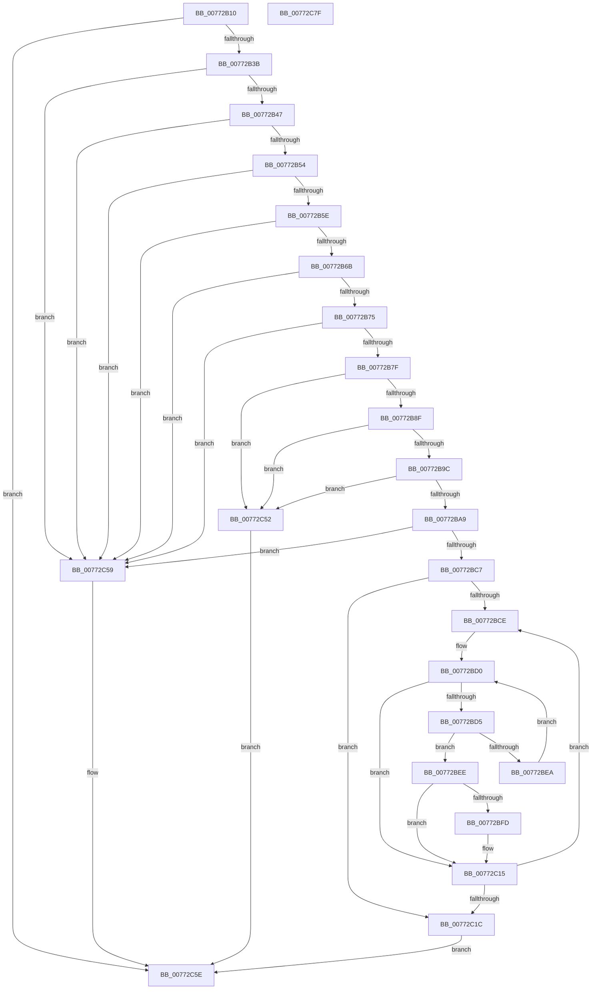

# PpmHeteroRegisterWpsUpdatesAmd

- RVA: `0x00772B10`–`0x00772C80` (길이 `368` bytes)
- VA: `0x0000000140772B10`
- 실행 섹션: `PAGE`
- PDB 이름 있음: `예`; PDB Function 태그: `아니요`
- unwind 정보 RVA: `0x0005FEF8`
- 디코드: `92`개 명령, `368/368` bytes 표시
- 미해석 바이트: `0` (있으면 어셈블리에 `.byte`로 보존)

> 이 문서는 커널 이미지의 기계어와 PDB 기호를 분석해 생성했습니다. 4번과 5번은 함수 원형과 자료형을 바이너리 사용 방식에서 추정한 C 해석이며 원본 소스 복구 결과는 아닙니다.

## 1. Dependencies

- 직접 호출 지점: **3**; 고유 호출 대상: **2**
- 직접 호출자로 확인된 함수: **0**
- RIP 상대 이미지 참조: **10**

### Outgoing calls
- `0x00772BB6` → [KeQueryMaximumProcessorCountEx](../../text/26/KeQueryMaximumProcessorCountEx_function_00264D60.md) (function, `0x00264D60`)
- `0x00772BD7` → [KeGetPrcb](../../text/2D/KeGetPrcb_function_002D85D0.md) (function, `0x002D85D0`)
- `0x00772BF0` → [KeGetPrcb](../../text/2D/KeGetPrcb_function_002D85D0.md) (function, `0x002D85D0`)

### Direct callers
- 이 함수 시작 RVA로 연결되는 직접 call은 확인되지 않았습니다. 간접 호출은 완전히 역산할 수 없습니다.

### Static image references
- `0x00772B3B` → RVA `0x00FC6A94` (`ALMOSTRO`; read)
- `0x00772B47` → RVA `0x00FC5003` (`ALMOSTRO`; read)
- `0x00772B7F` → RVA `0x00FC6E10` (`ALMOSTRO`; read)
- `0x00772B8F` → RVA `0x00F0B238` (`.data`; read)
- `0x00772B9C` → RVA `0x00F0B230` (`.data`; read)
- `0x00772C20` → RVA `0x00FC6E10` (`ALMOSTRO`; write)
- `0x00772C2A` → RVA `0x00F0B210` (`.data`; write)
- `0x00772C35` → RVA `0x00F0B238` (`.data`; write)
- `0x00772C40` → RVA `0x00F0B230` (`.data`; write)
- `0x00772C4A` → RVA `0x00FC6C2C` (`ALMOSTRO`; write)

## 2. Other-region calls and transfers

- 다른 실행 섹션으로 향하는 call: **3**
  - `0x00772BB6` → [KeQueryMaximumProcessorCountEx](../../text/26/KeQueryMaximumProcessorCountEx_function_00264D60.md) (`PAGE` → `.text`)
  - `0x00772BD7` → [KeGetPrcb](../../text/2D/KeGetPrcb_function_002D85D0.md) (`PAGE` → `.text`)
  - `0x00772BF0` → [KeGetPrcb](../../text/2D/KeGetPrcb_function_002D85D0.md) (`PAGE` → `.text`)
- 별도 외부 분기/꼬리 이동을 확인하지 못했습니다.

## 3. Assembly (complete function range)

```asm
00772B10  48 8B C4                        mov rax, rsp
00772B13  48 89 58 08                     mov qword ptr [rax + 8], rbx
00772B17  48 89 68 10                     mov qword ptr [rax + 0x10], rbp
00772B1B  48 89 70 18                     mov qword ptr [rax + 0x18], rsi
00772B1F  48 89 78 20                     mov qword ptr [rax + 0x20], rdi
00772B23  41 54                           push r12
00772B25  41 56                           push r14
00772B27  41 57                           push r15
00772B29  48 83 EC 20                     sub rsp, 0x20
00772B2D  33 DB                           xor ebx, ebx
00772B2F  48 8B FA                        mov rdi, rdx
00772B32  48 85 D2                        test rdx, rdx
00772B35  0F 84 23 01 00 00               je 0x140772c5e
00772B3B  38 1D 53 3F 85 00               cmp byte ptr [rip + 0x853f53], bl
00772B41  0F 84 12 01 00 00               je 0x140772c59
00772B47  80 3D B5 24 85 00 01            cmp byte ptr [rip + 0x8524b5], 1
00772B4E  0F 85 05 01 00 00               jne 0x140772c59
00772B54  48 39 5A 20                     cmp qword ptr [rdx + 0x20], rbx
00772B58  0F 84 FB 00 00 00               je 0x140772c59
00772B5E  48 8B 42 08                     mov rax, qword ptr [rdx + 8]
00772B62  48 85 C0                        test rax, rax
00772B65  0F 84 EE 00 00 00               je 0x140772c59
00772B6B  48 39 5A 28                     cmp qword ptr [rdx + 0x28], rbx
00772B6F  0F 84 E4 00 00 00               je 0x140772c59
00772B75  48 39 5A 30                     cmp qword ptr [rdx + 0x30], rbx
00772B79  0F 84 DA 00 00 00               je 0x140772c59
00772B7F  48 8B 05 8A 42 85 00            mov rax, qword ptr [rip + 0x85428a]
00772B86  48 85 C0                        test rax, rax
00772B89  0F 85 C3 00 00 00               jne 0x140772c52
00772B8F  48 39 1D A2 86 79 00            cmp qword ptr [rip + 0x7986a2], rbx
00772B96  0F 85 B6 00 00 00               jne 0x140772c52
00772B9C  48 39 1D 8D 86 79 00            cmp qword ptr [rip + 0x79868d], rbx
00772BA3  0F 85 A9 00 00 00               jne 0x140772c52
00772BA9  44 8B 72 10                     mov r14d, dword ptr [rdx + 0x10]
00772BAD  B9 FF FF 00 00                  mov ecx, 0xffff
00772BB2  4C 8B 62 20                     mov r12, qword ptr [rdx + 0x20]
00772BB6  E8 A5 21 AF FF                  call 0x140264d60
00772BBB  44 8B F8                        mov r15d, eax
00772BBE  44 3B F0                        cmp r14d, eax
00772BC1  0F 87 92 00 00 00               ja 0x140772c59
00772BC7  8B F3                           mov esi, ebx
00772BC9  45 85 F6                        test r14d, r14d
00772BCC  74 4E                           je 0x140772c1c
00772BCE  8B EB                           mov ebp, ebx
00772BD0  41 3B EF                        cmp ebp, r15d
00772BD3  73 40                           jae 0x140772c15
00772BD5  8B CD                           mov ecx, ebp
00772BD7  E8 F4 59 B6 FF                  call 0x1402d85d0
00772BDC  8B CE                           mov ecx, esi
00772BDE  8B 80 D4 00 00 00               mov eax, dword ptr [rax + 0xd4]
00772BE4  41 39 04 8C                     cmp dword ptr [r12 + rcx*4], eax
00772BE8  74 04                           je 0x140772bee
00772BEA  FF C5                           inc ebp
00772BEC  EB E2                           jmp 0x140772bd0
00772BEE  8B CD                           mov ecx, ebp
00772BF0  E8 DB 59 B6 FF                  call 0x1402d85d0
00772BF5  48 8B D0                        mov rdx, rax
00772BF8  48 85 C0                        test rax, rax
00772BFB  74 18                           je 0x140772c15
00772BFD  66 89 B0 4E 8A 00 00            mov word ptr [rax + 0x8a4e], si
00772C04  0F B7 4F 14                     movzx ecx, word ptr [rdi + 0x14]
00772C08  0F B7 C6                        movzx eax, si
00772C0B  0F AF C8                        imul ecx, eax
00772C0E  66 89 8A 4A 8A 00 00            mov word ptr [rdx + 0x8a4a], cx
00772C15  FF C6                           inc esi
00772C17  41 3B F6                        cmp esi, r14d
00772C1A  72 B2                           jb 0x140772bce
00772C1C  48 8B 47 08                     mov rax, qword ptr [rdi + 8]
00772C20  48 89 05 E9 41 85 00            mov qword ptr [rip + 0x8541e9], rax
00772C27  48 8B 07                        mov rax, qword ptr [rdi]
00772C2A  48 89 05 DF 85 79 00            mov qword ptr [rip + 0x7985df], rax
00772C31  48 8B 47 28                     mov rax, qword ptr [rdi + 0x28]
00772C35  48 89 05 FC 85 79 00            mov qword ptr [rip + 0x7985fc], rax
00772C3C  48 8B 47 30                     mov rax, qword ptr [rdi + 0x30]
00772C40  48 89 05 E9 85 79 00            mov qword ptr [rip + 0x7985e9], rax
00772C47  8B 47 18                        mov eax, dword ptr [rdi + 0x18]
00772C4A  89 05 DC 3F 85 00               mov dword ptr [rip + 0x853fdc], eax
00772C50  EB 0C                           jmp 0x140772c5e
00772C52  BB D0 00 00 C0                  mov ebx, 0xc00000d0
00772C57  EB 05                           jmp 0x140772c5e
00772C59  BB 0D 00 00 C0                  mov ebx, 0xc000000d
00772C5E  48 8B 6C 24 48                  mov rbp, qword ptr [rsp + 0x48]
00772C63  8B C3                           mov eax, ebx
00772C65  48 8B 5C 24 40                  mov rbx, qword ptr [rsp + 0x40]
00772C6A  48 8B 74 24 50                  mov rsi, qword ptr [rsp + 0x50]
00772C6F  48 8B 7C 24 58                  mov rdi, qword ptr [rsp + 0x58]
00772C74  48 83 C4 20                     add rsp, 0x20
00772C78  41 5F                           pop r15
00772C7A  41 5E                           pop r14
00772C7C  41 5C                           pop r12
00772C7E  C3                              ret
00772C7F  CC                              int3
```

## 4. C-style interpretation (structured pseudocode)

```c
__int64 __fastcall PpmHeteroRegisterWpsUpdatesAmd(__int64 a1, __int64 a2)
{
    __int64 result;
    __int64 v_rbp;
    __int64 v_rbx;
    __int64 v_rsi;
    __int64 v_rsp;
    unsigned __int64 v_stack_p10;
    unsigned __int64 v_stack_p18;
    unsigned __int64 v_stack_p20;
    unsigned __int64 v_stack_p8;

    *(unsigned __int64 *)(v_rsp + 8) = v_rbx;
    *(unsigned __int64 *)(v_rsp + 16) = v_rbp;
    *(unsigned __int64 *)(v_rsp + 24) = v_rsi;
    *(unsigned __int64 *)(v_rsp + 32) = v_rdi;
    v_rsp = (v_rsp) - (32);
    v_rbx = 0;
    if (a2 == 0) goto loc_00772C5E;
    if ((*(unsigned __int8 *)(v_rip + 8732499)) == 0) goto loc_00772C59;
    if ((*(unsigned __int8 *)(v_rip + 8725685)) != 1) goto loc_00772C59;
    if ((*(unsigned __int64 *)(a2 + 32)) == 0) goto loc_00772C59;
    if (*(unsigned __int64 *)(a2 + 8) == 0) goto loc_00772C59;
    if ((*(unsigned __int64 *)(a2 + 40)) == 0) goto loc_00772C59;
    if ((*(unsigned __int64 *)(a2 + 48)) == 0) goto loc_00772C59;
    if (*(unsigned __int64 *)(v_rip + 8733322) != 0) goto loc_00772C52;
    if ((*(unsigned __int64 *)(v_rip + 7964322)) != 0) goto loc_00772C52;
    if ((*(unsigned __int64 *)(v_rip + 7964301)) != 0) goto loc_00772C52;
    result = KeQueryMaximumProcessorCountEx((unsigned int)(0xFFFFULL), a2, a3, a4);
    if (((unsigned int)((unsigned int)(*(unsigned int *)(a2 + 16)))) > ((unsigned int)(result))) goto loc_00772C59;
    if ((unsigned int)((unsigned int)(*(unsigned int *)(a2 + 16))) == 0) goto loc_00772C1C;
loc_00772BCE:
loc_00772BD0:
    if (0 >= ((unsigned int)((unsigned int)((unsigned int)(result))))) goto loc_00772C15;
    result = KeGetPrcb(0, a2, a3, a4);
    if ((*(unsigned int *)(*(unsigned __int64 *)(a2 + 32) + 0 * 4)) == ((unsigned int)((unsigned int)(*(unsigned int *)(result + 212))))) goto loc_00772BEE;
    v_rbp = (unsigned int)((0) + 1);
    goto loc_00772BD0;
loc_00772BEE:
    result = KeGetPrcb((unsigned int)((unsigned int)(v_rbp)), a2, a3, a4);
    if (result != 0) {
        *(unsigned __int16 *)(result + 35406) = 0;
        a1 = *(unsigned __int16 *)(a2 + 20);
        result = 0;
        a1 = (unsigned int)((a1) * ((unsigned int)(result)));
        *(unsigned __int16 *)(result + 35402) = (unsigned __int16)(a1);
    }
    v_rsi = (unsigned int)((0) + 1);
    if (((unsigned int)(v_rsi)) < ((unsigned int)((unsigned int)(*(unsigned int *)(a2 + 16))))) goto loc_00772BCE;
loc_00772C1C:
    *(unsigned __int64 *)(v_rip + 8733161) = *(unsigned __int64 *)(a2 + 8);
    *(unsigned __int64 *)(v_rip + 7964127) = *(unsigned __int64 *)(a2);
    *(unsigned __int64 *)(v_rip + 7964156) = *(unsigned __int64 *)(a2 + 40);
    *(unsigned __int64 *)(v_rip + 7964137) = *(unsigned __int64 *)(a2 + 48);
    *(unsigned int *)(v_rip + 8732636) = (unsigned int)((unsigned int)(*(unsigned int *)(a2 + 24)));
    goto loc_00772C5E;
loc_00772C52:
    goto loc_00772C5E;
loc_00772C59:
loc_00772C5E:
    v_rsp = (v_rsp) + (32);
    return (unsigned int)((unsigned int)((unsigned int)(0xC000000DULL)));
}
```

## 5. (Beta) C Style

```c
int64_t PpmHeteroRegisterWpsUpdatesAmd(int64_t Arg1, void *Arg2)
{
    uint8_t *arg2 = (uint8_t *)Arg2;

    int64_t result;
    int64_t local_rbp;
    int64_t local_rbx;
    int64_t local_rsi;
    int64_t local_rsp;
    uint64_t v_stack_p10;
    uint64_t v_stack_p18;
    uint64_t v_stack_p20;
    uint64_t v_stack_p8;

    *(uint64_t *)(local_rsp + 0x8) = local_rbx;
    *(uint64_t *)(local_rsp + 0x10) = local_rbp;
    *(uint64_t *)(local_rsp + 0x18) = local_rsi;
    *(uint64_t *)(local_rsp + 0x20) = local_rdi;
    local_rsp = (local_rsp) - (32);
    local_rbx = 0;
    if (Arg2 == NULL) goto loc_00772C5E;
    if ((*(uint8_t *)(v_rip + 0x853F53)) == 0) goto loc_00772C59;
    if ((*(uint8_t *)(v_rip + 0x8524B5)) != 1) goto loc_00772C59;
    if ((*(uint64_t *)(arg2 + 0x20)) == 0) goto loc_00772C59;
    if (*(uint64_t *)(arg2 + 0x8) == 0) goto loc_00772C59;
    if ((*(uint64_t *)(arg2 + 0x28)) == 0) goto loc_00772C59;
    if ((*(uint64_t *)(arg2 + 0x30)) == 0) goto loc_00772C59;
    if (*(uint64_t *)(v_rip + 0x85428A) != 0) goto loc_00772C52;
    if ((*(uint64_t *)(v_rip + 0x7986A2)) != 0) goto loc_00772C52;
    if ((*(uint64_t *)(v_rip + 0x79868D)) != 0) goto loc_00772C52;
    result = KeQueryMaximumProcessorCountEx((uint32_t)(0xFFFFULL), Arg2, a3, a4);
    if (((uint32_t)((uint32_t)(*(uint32_t *)(arg2 + 0x10)))) > ((uint32_t)(result))) goto loc_00772C59;
    if ((uint32_t)((uint32_t)(*(uint32_t *)(arg2 + 0x10))) == 0) goto loc_00772C1C;
loc_00772BCE:
loc_00772BD0:
    if (0 >= ((uint32_t)((uint32_t)((uint32_t)(result))))) goto loc_00772C15;
    result = KeGetPrcb(0, Arg2, a3, a4);
    if ((*(uint32_t *)(*(uint64_t *)(arg2 + 0x20) + 0x0 * 4)) == ((uint32_t)((uint32_t)(*(uint32_t *)(result + 0xD4))))) goto loc_00772BEE;
    local_rbp = (uint32_t)((0) + 1);
    goto loc_00772BD0;
loc_00772BEE:
    result = KeGetPrcb((uint32_t)((uint32_t)(local_rbp)), Arg2, a3, a4);
    if (result != 0) {
        *(uint16_t *)(result + 0x8A4E) = 0;
        Arg1 = *(uint16_t *)(arg2 + 0x14);
        result = 0;
        Arg1 = (uint32_t)((Arg1) * ((uint32_t)(result)));
        *(uint16_t *)(result + 0x8A4A) = (uint16_t)(Arg1);
    }
    local_rsi = (uint32_t)((0) + 1);
    if (((uint32_t)(local_rsi)) < ((uint32_t)((uint32_t)(*(uint32_t *)(arg2 + 0x10))))) goto loc_00772BCE;
loc_00772C1C:
    *(uint64_t *)(v_rip + 0x8541E9) = *(uint64_t *)(arg2 + 0x8);
    *(uint64_t *)(v_rip + 0x7985DF) = *(uint64_t *)(arg2);
    *(uint64_t *)(v_rip + 0x7985FC) = *(uint64_t *)(arg2 + 0x28);
    *(uint64_t *)(v_rip + 0x7985E9) = *(uint64_t *)(arg2 + 0x30);
    *(uint32_t *)(v_rip + 0x853FDC) = (uint32_t)((uint32_t)(*(uint32_t *)(arg2 + 0x18)));
    goto loc_00772C5E;
loc_00772C52:
    goto loc_00772C5E;
loc_00772C59:
loc_00772C5E:
    local_rsp = (local_rsp) + (32);
    return (uint32_t)((uint32_t)((uint32_t)(0xC000000DULL)));
}
```

### 관측된 메모리 오프셋

구조체 형식이 확인되지 않은 접근은 인자 기준의 오프셋으로만 기록했습니다.

| 기준 인자 | 오프셋 표현 | 폭 (bit) | 접근 |
|---|---:|---:|---|
| `Arg2` | `+ 0x0` | `64` | `R` |
| `Arg2` | `+ 0x8` | `64` | `R` |
| `Arg2` | `+ 0x14` | `16` | `R` |
| `Arg2` | `+ 0x18` | `32` | `R` |
| `Arg2` | `+ 0x28` | `64` | `R` |
| `Arg2` | `+ 0x30` | `64` | `R` |

## 6. Execution-region graph

[열기: 2D/3D 그래프와 함수 탐색 컨트롤 패널](../../../control-panel.html?section=page&rva=0x00772B10&view=graph)

- 2D 그래프는 위에서 아래로 흐르고, 3D 그래프는 빈 공간을 드래그해 회전합니다. Shift+드래그는 이동, 휠은 확대·축소, 함수 노드 선택은 대상 보고서 이동입니다.

### Static fallback


