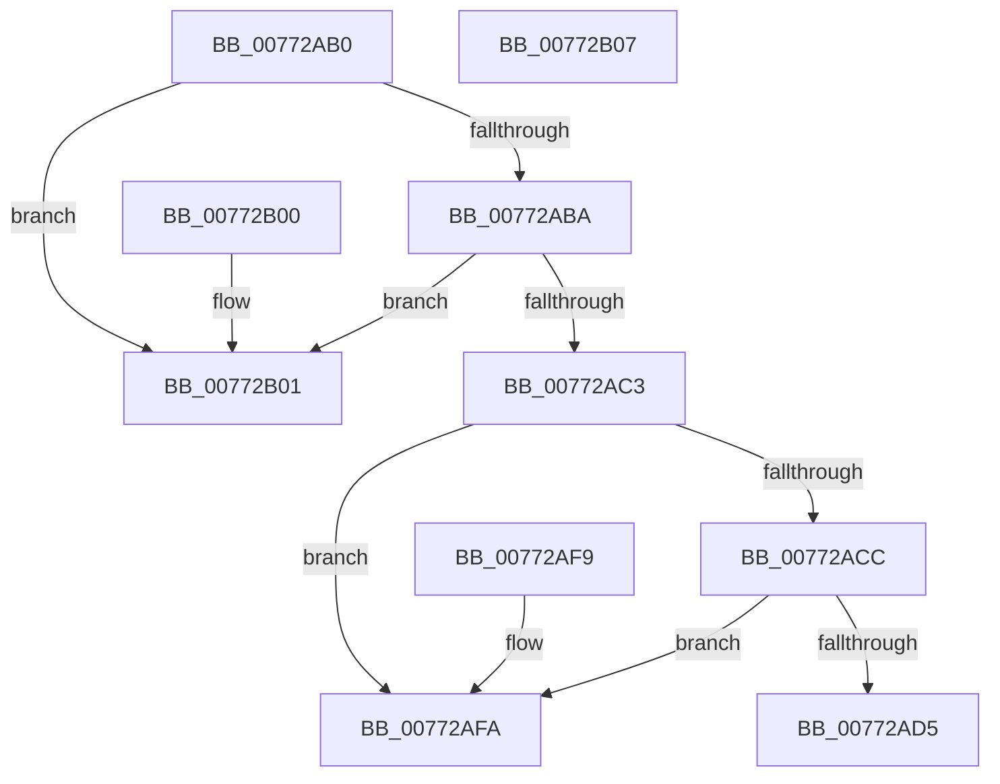

# PpmHeteroRegisterWpsUpdatesIntel

- RVA: `0x00772AB0`–`0x00772B08` (길이 `88` bytes)
- VA: `0x0000000140772AB0`
- 실행 섹션: `PAGE`
- PDB 이름 있음: `예`; PDB Function 태그: `아니요`
- unwind 정보 RVA: `0x000DB714`
- 디코드: `22`개 명령, `88/88` bytes 표시
- 미해석 바이트: `0` (있으면 어셈블리에 `.byte`로 보존)

> 이 문서는 커널 이미지의 기계어와 PDB 기호를 분석해 생성했습니다. 4번과 5번은 함수 원형과 자료형을 바이너리 사용 방식에서 추정한 C 해석이며 원본 소스 복구 결과는 아닙니다.

## 1. Dependencies

- 직접 호출 지점: **0**; 고유 호출 대상: **0**
- 직접 호출자로 확인된 함수: **0**
- RIP 상대 이미지 참조: **9**

### Outgoing calls
- 직접 디코드된 call 명령이 없습니다.

### Direct callers
- 이 함수 시작 RVA로 연결되는 직접 call은 확인되지 않았습니다. 간접 호출은 완전히 역산할 수 없습니다.

### Static image references
- `0x00772AB2` → RVA `0x00FC6A94` (`ALMOSTRO`; read)
- `0x00772ABA` → RVA `0x00FC5003` (`ALMOSTRO`; read)
- `0x00772AC3` → RVA `0x00F0B238` (`.data`; read)
- `0x00772ACC` → RVA `0x00F0B230` (`.data`; read)
- `0x00772AD5` → RVA `0x004C0630` (`PpmHeteroCheckWpsTableUpdatedIntel`; read)
- `0x00772ADC` → RVA `0x00F0B210` (`.data`; write)
- `0x00772AE3` → RVA `0x00F0B238` (`.data`; write)
- `0x00772AEA` → RVA `0x004C0590` (`PpmHeteroAcknowledgeWpsUpdateIntel`; read)
- `0x00772AF1` → RVA `0x00F0B230` (`.data`; write)

## 2. Other-region calls and transfers

- 다른 실행 섹션으로 향하는 call: **0**
- 별도 외부 분기/꼬리 이동을 확인하지 못했습니다.

## 3. Assembly (complete function range)

```asm
00772AB0  33 C0                           xor eax, eax
00772AB2  38 05 DC 3F 85 00               cmp byte ptr [rip + 0x853fdc], al
00772AB8  74 47                           je 0x140772b01
00772ABA  80 3D 42 25 85 00 02            cmp byte ptr [rip + 0x852542], 2
00772AC1  75 3E                           jne 0x140772b01
00772AC3  48 39 05 6E 87 79 00            cmp qword ptr [rip + 0x79876e], rax
00772ACA  75 2E                           jne 0x140772afa
00772ACC  48 39 05 5D 87 79 00            cmp qword ptr [rip + 0x79875d], rax
00772AD3  75 25                           jne 0x140772afa
00772AD5  48 8D 0D 54 DB D4 FF            lea rcx, [rip - 0x2b24ac]
00772ADC  48 89 05 2D 87 79 00            mov qword ptr [rip + 0x79872d], rax
00772AE3  48 89 0D 4E 87 79 00            mov qword ptr [rip + 0x79874e], rcx
00772AEA  48 8D 0D 9F DA D4 FF            lea rcx, [rip - 0x2b2561]
00772AF1  48 89 0D 38 87 79 00            mov qword ptr [rip + 0x798738], rcx
00772AF8  C3                              ret
00772AF9  CC                              int3
00772AFA  B8 D0 00 00 C0                  mov eax, 0xc00000d0
00772AFF  C3                              ret
00772B00  CC                              int3
00772B01  B8 0D 00 00 C0                  mov eax, 0xc000000d
00772B06  C3                              ret
00772B07  CC                              int3
```

## 4. C-style interpretation (structured pseudocode)

```c
__int64 __fastcall PpmHeteroRegisterWpsUpdatesIntel(void)
{
    __int64 result;

    result = 0;
    if ((*(unsigned __int8 *)(v_rip + 8732636)) == 0) goto loc_00772B01;
    if ((*(unsigned __int8 *)(v_rip + 8725826)) != 2) goto loc_00772B01;
    if ((*(unsigned __int64 *)(v_rip + 7964526)) != 0) goto loc_00772AFA;
    if ((*(unsigned __int64 *)(v_rip + 7964509)) != 0) goto loc_00772AFA;
    *(unsigned __int64 *)(v_rip + 7964461) = 0;
    *(unsigned __int64 *)(v_rip + 7964494) = v_rip - 2827436;
    *(unsigned __int64 *)(v_rip + 7964472) = v_rip - 2827617;
    return result;
loc_00772AFA:
    return (unsigned int)(0xC00000D0ULL);
loc_00772B01:
    return (unsigned int)(0xC000000DULL);
}
```

## 5. (Beta) C Style

```c
void PpmHeteroRegisterWpsUpdatesIntel(void)
{
    int64_t result;

    result = 0;
    if ((*(uint8_t *)(v_rip + 0x853FDC)) == 0) goto loc_00772B01;
    if ((*(uint8_t *)(v_rip + 0x852542)) != 2) goto loc_00772B01;
    if ((*(uint64_t *)(v_rip + 0x79876E)) != 0) goto loc_00772AFA;
    if ((*(uint64_t *)(v_rip + 0x79875D)) != 0) goto loc_00772AFA;
    *(uint64_t *)(v_rip + 0x79872D) = 0;
    *(uint64_t *)(v_rip + 0x79874E) = v_rip - 2827436;
    *(uint64_t *)(v_rip + 0x798738) = v_rip - 2827617;
    return result;
loc_00772AFA:
    return (uint32_t)(0xC00000D0ULL);
loc_00772B01:
    return (uint32_t)(0xC000000DULL);
}
```

## 6. Execution-region graph

[열기: 2D/3D 그래프와 함수 탐색 컨트롤 패널](../../../control-panel.html?section=page&rva=0x00772AB0&view=graph)

- 2D 그래프는 위에서 아래로 흐르고, 3D 그래프는 빈 공간을 드래그해 회전합니다. Shift+드래그는 이동, 휠은 확대·축소, 함수 노드 선택은 대상 보고서 이동입니다.

### Static fallback


