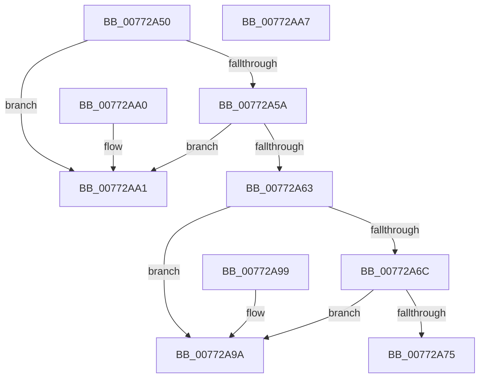

# PpmHeteroRegisterWpsUpdatesSim

- RVA: `0x00772A50`–`0x00772AA8` (길이 `88` bytes)
- VA: `0x0000000140772A50`
- 실행 섹션: `PAGE`
- PDB 이름 있음: `예`; PDB Function 태그: `아니요`
- unwind 정보 RVA: `0x000DB714`
- 디코드: `22`개 명령, `88/88` bytes 표시
- 미해석 바이트: `0` (있으면 어셈블리에 `.byte`로 보존)

> 이 문서는 커널 이미지의 기계어와 PDB 기호를 분석해 생성했습니다. 4번과 5번은 함수 원형과 자료형을 바이너리 사용 방식에서 추정한 C 해석이며 원본 소스 복구 결과는 아닙니다.

## 1. Dependencies

- 직접 호출 지점: **0**; 고유 호출 대상: **0**
- 직접 호출자로 확인된 함수: **0**
- RIP 상대 이미지 참조: **9**

### Outgoing calls
- 직접 디코드된 call 명령이 없습니다.

### Direct callers
- 이 함수 시작 RVA로 연결되는 직접 call은 확인되지 않았습니다. 간접 호출은 완전히 역산할 수 없습니다.

### Static image references
- `0x00772A52` → RVA `0x00FC6A94` (`ALMOSTRO`; read)
- `0x00772A5A` → RVA `0x00FC5003` (`ALMOSTRO`; read)
- `0x00772A63` → RVA `0x00F0B238` (`.data`; read)
- `0x00772A6C` → RVA `0x00F0B230` (`.data`; read)
- `0x00772A75` → RVA `0x005DE470` (`PpmHeteroCheckWpsTableUpdatedSim`; read)
- `0x00772A7C` → RVA `0x00F0B210` (`.data`; write)
- `0x00772A83` → RVA `0x00F0B238` (`.data`; write)
- `0x00772A8A` → RVA `0x004BEB10` (`PopSystemRequiredSet`; read)
- `0x00772A91` → RVA `0x00F0B230` (`.data`; write)

## 2. Other-region calls and transfers

- 다른 실행 섹션으로 향하는 call: **0**
- 별도 외부 분기/꼬리 이동을 확인하지 못했습니다.

## 3. Assembly (complete function range)

```asm
00772A50  33 C0                           xor eax, eax
00772A52  38 05 3C 40 85 00               cmp byte ptr [rip + 0x85403c], al
00772A58  74 47                           je 0x140772aa1
00772A5A  80 3D A2 25 85 00 0F            cmp byte ptr [rip + 0x8525a2], 0xf
00772A61  75 3E                           jne 0x140772aa1
00772A63  48 39 05 CE 87 79 00            cmp qword ptr [rip + 0x7987ce], rax
00772A6A  75 2E                           jne 0x140772a9a
00772A6C  48 39 05 BD 87 79 00            cmp qword ptr [rip + 0x7987bd], rax
00772A73  75 25                           jne 0x140772a9a
00772A75  48 8D 0D F4 B9 E6 FF            lea rcx, [rip - 0x19460c]
00772A7C  48 89 05 8D 87 79 00            mov qword ptr [rip + 0x79878d], rax
00772A83  48 89 0D AE 87 79 00            mov qword ptr [rip + 0x7987ae], rcx
00772A8A  48 8D 0D 7F C0 D4 FF            lea rcx, [rip - 0x2b3f81]
00772A91  48 89 0D 98 87 79 00            mov qword ptr [rip + 0x798798], rcx
00772A98  C3                              ret
00772A99  CC                              int3
00772A9A  B8 D0 00 00 C0                  mov eax, 0xc00000d0
00772A9F  C3                              ret
00772AA0  CC                              int3
00772AA1  B8 0D 00 00 C0                  mov eax, 0xc000000d
00772AA6  C3                              ret
00772AA7  CC                              int3
```

## 4. C-style interpretation (structured pseudocode)

```c
__int64 __fastcall PpmHeteroRegisterWpsUpdatesSim(void)
{
    __int64 result;

    result = 0;
    if ((*(unsigned __int8 *)(v_rip + 8732732)) == 0) goto loc_00772AA1;
    if ((*(unsigned __int8 *)(v_rip + 8725922)) != 15) goto loc_00772AA1;
    if ((*(unsigned __int64 *)(v_rip + 7964622)) != 0) goto loc_00772A9A;
    if ((*(unsigned __int64 *)(v_rip + 7964605)) != 0) goto loc_00772A9A;
    *(unsigned __int64 *)(v_rip + 7964557) = 0;
    *(unsigned __int64 *)(v_rip + 7964590) = v_rip - 1656332;
    *(unsigned __int64 *)(v_rip + 7964568) = v_rip - 2834305;
    return result;
loc_00772A9A:
    return (unsigned int)(0xC00000D0ULL);
loc_00772AA1:
    return (unsigned int)(0xC000000DULL);
}
```

## 5. (Beta) C Style

```c
void PpmHeteroRegisterWpsUpdatesSim(void)
{
    int64_t result;

    result = 0;
    if ((*(uint8_t *)(v_rip + 0x85403C)) == 0) goto loc_00772AA1;
    if ((*(uint8_t *)(v_rip + 0x8525A2)) != 15) goto loc_00772AA1;
    if ((*(uint64_t *)(v_rip + 0x7987CE)) != 0) goto loc_00772A9A;
    if ((*(uint64_t *)(v_rip + 0x7987BD)) != 0) goto loc_00772A9A;
    *(uint64_t *)(v_rip + 0x79878D) = 0;
    *(uint64_t *)(v_rip + 0x7987AE) = v_rip - 1656332;
    *(uint64_t *)(v_rip + 0x798798) = v_rip - 2834305;
    return result;
loc_00772A9A:
    return (uint32_t)(0xC00000D0ULL);
loc_00772AA1:
    return (uint32_t)(0xC000000DULL);
}
```

## 6. Execution-region graph

[열기: 2D/3D 그래프와 함수 탐색 컨트롤 패널](../../../control-panel.html?section=page&rva=0x00772A50&view=graph)

- 2D 그래프는 위에서 아래로 흐르고, 3D 그래프는 빈 공간을 드래그해 회전합니다. Shift+드래그는 이동, 휠은 확대·축소, 함수 노드 선택은 대상 보고서 이동입니다.

### Static fallback


