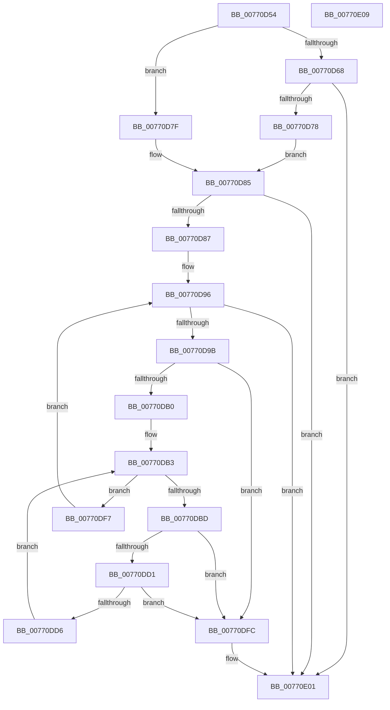

# PpmIdleUpdateCoordinatedDependencies

- RVA: `0x00770D54`–`0x00770E0A` (길이 `182` bytes)
- VA: `0x0000000140770D54`
- 실행 섹션: `PAGE`
- PDB 이름 있음: `예`; PDB Function 태그: `아니요`
- unwind 정보 RVA: `0x00071750`
- 디코드: `49`개 명령, `182/182` bytes 표시
- 미해석 바이트: `0` (있으면 어셈블리에 `.byte`로 보존)

> 이 문서는 커널 이미지의 기계어와 PDB 기호를 분석해 생성했습니다. 4번과 5번은 함수 원형과 자료형을 바이너리 사용 방식에서 추정한 C 해석이며 원본 소스 복구 결과는 아닙니다.

## 1. Dependencies

- 직접 호출 지점: **0**; 고유 호출 대상: **0**
- 직접 호출자로 확인된 함수: **1**
- RIP 상대 이미지 참조: **3**

### Outgoing calls
- 직접 디코드된 call 명령이 없습니다.

### Direct callers
- [PpmInstallCoordinatedIdleStates](../75/PpmInstallCoordinatedIdleStates_function_007552A0.md) at `0x007552E7`

### Static image references
- `0x00770D59` → RVA `0x00FC6A90` (`ALMOSTRO`; read)
- `0x00770D68` → RVA `0x00FC6AB8` (`ALMOSTRO`; read)
- `0x00770D7F` → RVA `0x00FC6A97` (`ALMOSTRO`; read)

## 2. Other-region calls and transfers

- 다른 실행 섹션으로 향하는 call: **0**
- 별도 외부 분기/꼬리 이동을 확인하지 못했습니다.

## 3. Assembly (complete function range)

```asm
00770D54  48 89 5C 24 08                  mov qword ptr [rsp + 8], rbx
00770D59  8B 05 31 5D 85 00               mov eax, dword ptr [rip + 0x855d31]
00770D5F  33 D2                           xor edx, edx
00770D61  4C 8B D1                        mov r10, rcx
00770D64  A8 02                           test al, 2
00770D66  74 17                           je 0x140770d7f
00770D68  8B 05 4A 5D 85 00               mov eax, dword ptr [rip + 0x855d4a]
00770D6E  0F BA E0 1C                     bt eax, 0x1c
00770D72  0F 82 89 00 00 00               jb 0x140770e01
00770D78  A9 00 04 00 00                  test eax, 0x400
00770D7D  EB 06                           jmp 0x140770d85
00770D7F  38 15 12 5D 85 00               cmp byte ptr [rip + 0x855d12], dl
00770D85  74 7A                           je 0x140770e01
00770D87  8B 1D 2B 5D 85 00               mov ebx, dword ptr [rip + 0x855d2b]
00770D8D  44 8B C2                        mov r8d, edx
00770D90  81 E3 00 02 00 00               and ebx, 0x200
00770D96  45 3B 02                        cmp r8d, dword ptr [r10]
00770D99  73 66                           jae 0x140770e01
00770D9B  41 8B C0                        mov eax, r8d
00770D9E  4C 8D 0C 80                     lea r9, [rax + rax*4]
00770DA2  49 C1 E1 06                     shl r9, 6
00770DA6  43 38 94 11 60 01 00 00         cmp byte ptr [r9 + r10 + 0x160], dl
00770DAE  74 4C                           je 0x140770dfc
00770DB0  44 8B DA                        mov r11d, edx
00770DB3  47 3B 9C 11 5C 01 00 00         cmp r11d, dword ptr [r9 + r10 + 0x15c]
00770DBB  73 3A                           jae 0x140770df7
00770DBD  41 8B CB                        mov ecx, r11d
00770DC0  48 C1 E1 04                     shl rcx, 4
00770DC4  4B 03 8C 11 68 01 00 00         add rcx, qword ptr [r9 + r10 + 0x168]
00770DCC  83 39 FF                        cmp dword ptr [rcx], -1
00770DCF  74 2B                           je 0x140770dfc
00770DD1  39 51 04                        cmp dword ptr [rcx + 4], edx
00770DD4  74 26                           je 0x140770dfc
00770DD6  C7 41 04 01 00 00 00            mov dword ptr [rcx + 4], 1
00770DDD  85 DB                           test ebx, ebx
00770DDF  48 8B 49 08                     mov rcx, qword ptr [rcx + 8]
00770DE3  0F 95 C0                        setne al
00770DE6  41 FF C3                        inc r11d
00770DE9  88 01                           mov byte ptr [rcx], al
00770DEB  66 C7 41 01 01 01               mov word ptr [rcx + 1], 0x101
00770DF1  C6 41 03 01                     mov byte ptr [rcx + 3], 1
00770DF5  EB BC                           jmp 0x140770db3
00770DF7  41 FF C0                        inc r8d
00770DFA  EB 9A                           jmp 0x140770d96
00770DFC  BA BB 00 00 C0                  mov edx, 0xc00000bb
00770E01  48 8B 5C 24 08                  mov rbx, qword ptr [rsp + 8]
00770E06  8B C2                           mov eax, edx
00770E08  C3                              ret
00770E09  CC                              int3
```

## 4. C-style interpretation (structured pseudocode)

```c
__int64 __fastcall PpmIdleUpdateCoordinatedDependencies(__int64 a1, int a2)
{
    __int64 result;
    __int64 v_r11;
    __int64 v_rbx;
    unsigned __int64 v_stack_p8;

    v_stack_p8 = v_rbx;
    a2 = 0;
    if ((((unsigned __int8)((unsigned int)(*(unsigned int *)(v_rip + 8740145)))) & (2)) == 0) goto loc_00770D7F;
    if (condition_is_below) goto loc_00770E01;
    goto loc_00770D85;
loc_00770D7F:
loc_00770D85:
    if ((*(unsigned __int8 *)(v_rip + 8740114)) == 0) goto loc_00770E01;
    v_rbx = (unsigned int)(((unsigned int)(*(unsigned int *)(v_rip + 8740139))) & (512));
loc_00770D96:
    if (0 >= (*(unsigned int *)(a1))) goto loc_00770E01;
    a4 = (0 + 0 * 4) << (6);
    if ((*(unsigned __int8 *)(a4 + a1 * 1 + 352)) == 0) goto loc_00770DFC;
loc_00770DB3:
    if (0 >= (*(unsigned int *)(a4 + a1 * 1 + 348))) goto loc_00770DF7;
    a1 = (0) << (4);
    a1 = (a1) + (*(unsigned __int64 *)(a4 + a1 * 1 + 360));
    if ((*(unsigned int *)(a1)) == -1) goto loc_00770DFC;
    if ((*(unsigned int *)(a1 + 4)) == 0) goto loc_00770DFC;
    *(unsigned int *)(a1 + 4) = 1;
    result = ((unsigned int)(v_rbx) != 0) ? 1 : 0;
    v_r11 = (unsigned int)((0) + 1);
    *(unsigned __int8 *)(*(unsigned __int64 *)(a1 + 8)) = (unsigned __int8)(result);
    *(unsigned __int16 *)(*(unsigned __int64 *)(a1 + 8) + 1) = 257;
    *(unsigned __int8 *)(*(unsigned __int64 *)(a1 + 8) + 3) = 1;
    goto loc_00770DB3;
loc_00770DF7:
    a3 = (unsigned int)((0) + 1);
    goto loc_00770D96;
loc_00770DFC:
loc_00770E01:
    return (unsigned int)((unsigned int)((unsigned int)(0xC00000BBULL)));
}
```

## 5. (Beta) C Style

```c
int64_t PpmIdleUpdateCoordinatedDependencies(void *Arg1, int32_t Arg2)
{
    uint8_t *arg1 = (uint8_t *)Arg1;

    int64_t result;
    int64_t local_r11;
    int64_t local_rbx;
    uint64_t v_stack_p8;

    v_stack_p8 = local_rbx;
    Arg2 = 0;
    if ((((uint8_t)((uint32_t)(*(uint32_t *)(v_rip + 0x855D31)))) & (2)) == 0) goto loc_00770D7F;
    if (condition_is_below) goto loc_00770E01;
    goto loc_00770D85;
loc_00770D7F:
loc_00770D85:
    if ((*(uint8_t *)(v_rip + 0x855D12)) == 0) goto loc_00770E01;
    local_rbx = (uint32_t)(((uint32_t)(*(uint32_t *)(v_rip + 0x855D2B))) & (512));
loc_00770D96:
    if (0 >= (*(uint32_t *)(arg1))) goto loc_00770E01;
    a4 = (0 + 0 * 4) << (6);
    if ((*(uint8_t *)(a4 + arg1 * 1 + 0x160)) == 0) goto loc_00770DFC;
loc_00770DB3:
    if (0 >= (*(uint32_t *)(a4 + arg1 * 1 + 0x15C))) goto loc_00770DF7;
    Arg1 = (0) << (4);
    Arg1 = (Arg1) + (*(uint64_t *)(a4 + arg1 * 1 + 0x168));
    if ((*(uint32_t *)(arg1)) == -1) goto loc_00770DFC;
    if ((*(uint32_t *)(arg1 + 0x4)) == 0) goto loc_00770DFC;
    *(uint32_t *)(arg1 + 0x4) = 1;
    result = ((uint32_t)(local_rbx) != 0) ? 1 : 0;
    local_r11 = (uint32_t)((0) + 1);
    *(uint8_t *)(*(uint64_t *)(arg1 + 0x8)) = (uint8_t)(result);
    *(uint16_t *)(*(uint64_t *)(arg1 + 0x8) + 0x1) = 257;
    *(uint8_t *)(*(uint64_t *)(arg1 + 0x8) + 0x3) = 1;
    goto loc_00770DB3;
loc_00770DF7:
    a3 = (uint32_t)((0) + 1);
    goto loc_00770D96;
loc_00770DFC:
loc_00770E01:
    return (uint32_t)((uint32_t)((uint32_t)(0xC00000BBULL)));
}
```

### 관측된 메모리 오프셋

구조체 형식이 확인되지 않은 접근은 인자 기준의 오프셋으로만 기록했습니다.

| 기준 인자 | 오프셋 표현 | 폭 (bit) | 접근 |
|---|---:|---:|---|
| `Arg1` | `+ 0x0` | `32` | `R` |

## 6. Execution-region graph

[열기: 2D/3D 그래프와 함수 탐색 컨트롤 패널](../../../control-panel.html?section=page&rva=0x00770D54&view=graph)

- 2D 그래프는 위에서 아래로 흐르고, 3D 그래프는 빈 공간을 드래그해 회전합니다. Shift+드래그는 이동, 휠은 확대·축소, 함수 노드 선택은 대상 보고서 이동입니다.

### Static fallback


