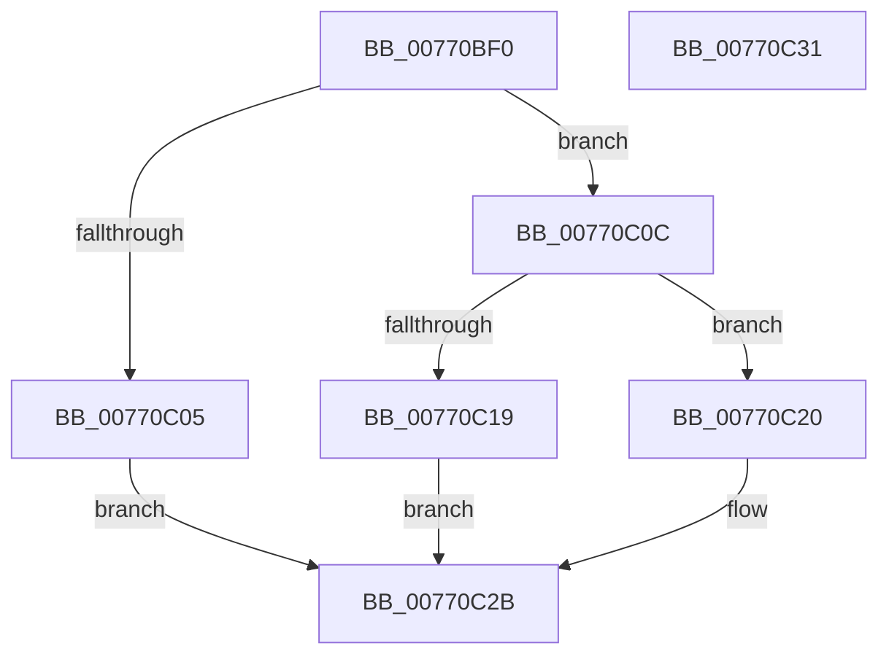

# PpmIdleUpdateHvStates

- RVA: `0x00770BF0`–`0x00770C32` (길이 `66` bytes)
- VA: `0x0000000140770BF0`
- 실행 섹션: `PAGE`
- PDB 이름 있음: `예`; PDB Function 태그: `아니요`
- unwind 정보 RVA: `0x0005CF00`
- 디코드: `20`개 명령, `66/66` bytes 표시
- 미해석 바이트: `0` (있으면 어셈블리에 `.byte`로 보존)

> 이 문서는 커널 이미지의 기계어와 PDB 기호를 분석해 생성했습니다. 4번과 5번은 함수 원형과 자료형을 바이너리 사용 방식에서 추정한 C 해석이며 원본 소스 복구 결과는 아닙니다.

## 1. Dependencies

- 직접 호출 지점: **2**; 고유 호출 대상: **2**
- 직접 호출자로 확인된 함수: **0**
- RIP 상대 이미지 참조: **1**

### Outgoing calls
- `0x00770C0F` → [HvlGetLpIndexFromApicId](../../text/58/HvlGetLpIndexFromApicId_function_00584640.md) (function, `0x00584640`)
- `0x00770C26` → [HvlConfigureIdleStates](../../text/58/HvlConfigureIdleStates_function_0058A324.md) (function, `0x0058A324`)

### Direct callers
- 이 함수 시작 RVA로 연결되는 직접 call은 확인되지 않았습니다. 간접 호출은 완전히 역산할 수 없습니다.

### Static image references
- `0x00770BF6` → RVA `0x00FC6AB8` (`ALMOSTRO`; read)

## 2. Other-region calls and transfers

- 다른 실행 섹션으로 향하는 call: **2**
  - `0x00770C0F` → [HvlGetLpIndexFromApicId](../../text/58/HvlGetLpIndexFromApicId_function_00584640.md) (`PAGE` → `.text`)
  - `0x00770C26` → [HvlConfigureIdleStates](../../text/58/HvlConfigureIdleStates_function_0058A324.md) (`PAGE` → `.text`)
- 별도 외부 분기/꼬리 이동을 확인하지 못했습니다.

## 3. Assembly (complete function range)

```asm
00770BF0  40 53                           push rbx
00770BF2  48 83 EC 20                     sub rsp, 0x20
00770BF6  F7 05 B8 5E 85 00 00 04 00 00   test dword ptr [rip + 0x855eb8], 0x400
00770C00  48 8B D9                        mov rbx, rcx
00770C03  75 07                           jne 0x140770c0c
00770C05  B8 BB 00 00 C0                  mov eax, 0xc00000bb
00770C0A  EB 1F                           jmp 0x140770c2b
00770C0C  8B 49 04                        mov ecx, dword ptr [rcx + 4]
00770C0F  E8 2C 3A E1 FF                  call 0x140584640
00770C14  83 F8 FF                        cmp eax, -1
00770C17  75 07                           jne 0x140770c20
00770C19  B8 0D 00 00 C0                  mov eax, 0xc000000d
00770C1E  EB 0B                           jmp 0x140770c2b
00770C20  48 8B 53 08                     mov rdx, qword ptr [rbx + 8]
00770C24  8B C8                           mov ecx, eax
00770C26  E8 F9 96 E1 FF                  call 0x14058a324
00770C2B  48 83 C4 20                     add rsp, 0x20
00770C2F  5B                              pop rbx
00770C30  C3                              ret
00770C31  CC                              int3
```

## 4. C-style interpretation (structured pseudocode)

```c
__int64 __fastcall PpmIdleUpdateHvStates(__int64 a1)
{
    __int64 result;
    __int64 v_rsp;

    v_rsp = (v_rsp) - (32);
    if (((*(unsigned int *)(v_rip + 8740536)) & (0x400ULL)) != 0) goto loc_00770C0C;
    goto loc_00770C2B;
loc_00770C0C:
    result = HvlGetLpIndexFromApicId((unsigned int)(*(unsigned int *)(a1 + 4)), a2, a3, a4);
    if (((unsigned int)(result)) != -1) goto loc_00770C20;
    goto loc_00770C2B;
loc_00770C20:
    result = HvlConfigureIdleStates((unsigned int)((unsigned int)((unsigned int)(0xC000000DULL))), *(unsigned __int64 *)(a1 + 8), a3, a4);
loc_00770C2B:
    v_rsp = (v_rsp) + (32);
    return result;
}
```

## 5. (Beta) C Style

```c
int64_t PpmIdleUpdateHvStates(void *Arg1)
{
    uint8_t *arg1 = (uint8_t *)Arg1;

    int64_t result;
    int64_t local_rsp;

    local_rsp = (local_rsp) - (32);
    if (((*(uint32_t *)(v_rip + 0x855EB8)) & (0x400ULL)) != 0) goto loc_00770C0C;
    goto loc_00770C2B;
loc_00770C0C:
    result = HvlGetLpIndexFromApicId((uint32_t)(*(uint32_t *)(arg1 + 0x4)), a2, a3, a4);
    if (((uint32_t)(result)) != -1) goto loc_00770C20;
    goto loc_00770C2B;
loc_00770C20:
    result = HvlConfigureIdleStates((uint32_t)((uint32_t)((uint32_t)(0xC000000DULL))), *(uint64_t *)(arg1 + 0x8), a3, a4);
loc_00770C2B:
    local_rsp = (local_rsp) + (32);
    return result;
}
```

### 관측된 메모리 오프셋

구조체 형식이 확인되지 않은 접근은 인자 기준의 오프셋으로만 기록했습니다.

| 기준 인자 | 오프셋 표현 | 폭 (bit) | 접근 |
|---|---:|---:|---|
| `Arg1` | `+ 0x4` | `32` | `R` |
| `Arg1` | `+ 0x8` | `64` | `R` |

## 6. Execution-region graph

[열기: 2D/3D 그래프와 함수 탐색 컨트롤 패널](../../../control-panel.html?section=page&rva=0x00770BF0&view=graph)

- 2D 그래프는 위에서 아래로 흐르고, 3D 그래프는 빈 공간을 드래그해 회전합니다. Shift+드래그는 이동, 휠은 확대·축소, 함수 노드 선택은 대상 보고서 이동입니다.

### Static fallback


