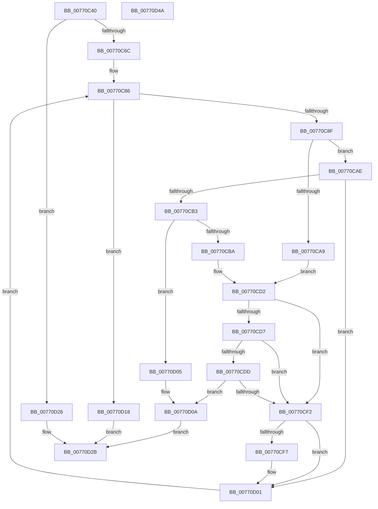

# PpmPerfRegisterHvPerfStateCounters

- RVA: `0x00770C40`–`0x00770D4B` (길이 `267` bytes)
- VA: `0x0000000140770C40`
- 실행 섹션: `PAGE`
- PDB 이름 있음: `예`; PDB Function 태그: `아니요`
- unwind 정보 RVA: `0x00075C18`
- 디코드: `78`개 명령, `267/267` bytes 표시
- 미해석 바이트: `0` (있으면 어셈블리에 `.byte`로 보존)

> 이 문서는 커널 이미지의 기계어와 PDB 기호를 분석해 생성했습니다. 4번과 5번은 함수 원형과 자료형을 바이너리 사용 방식에서 추정한 C 해석이며 원본 소스 복구 결과는 아닙니다.

## 1. Dependencies

- 직접 호출 지점: **6**; 고유 호출 대상: **6**
- 직접 호출자로 확인된 함수: **0**
- RIP 상대 이미지 참조: **2**

### Outgoing calls
- `0x00770C7F` → [PpmAcquireLock](../../text/2D/PpmAcquireLock_function_002D9AA4.md) (function, `0x002D9AA4`)
- `0x00770CBC` → [HvlGetLpIndexFromProcessorIndex](../../text/44/HvlGetLpIndexFromProcessorIndex_function_0044FFE0.md) (function, `0x0044FFE0`)
- `0x00770CC6` → [KeGetPrcb](../../text/2D/KeGetPrcb_function_002D85D0.md) (function, `0x002D85D0`)
- `0x00770CE7` → [HvlRegisterPerfFeedbackCounters](../../text/58/HvlRegisterPerfFeedbackCounters_function_0058A8D4.md) (function, `0x0058A8D4`)
- `0x00770D11` → [PpmReleaseLock](../../text/2D/PpmReleaseLock_function_002DA428.md) (function, `0x002DA428`)
- `0x00770D1D` → [PpmRegisterPerfStates](../75/PpmRegisterPerfStates_function_0075B084.md) (function, `0x0075B084`)

### Direct callers
- 이 함수 시작 RVA로 연결되는 직접 call은 확인되지 않았습니다. 간접 호출은 완전히 역산할 수 없습니다.

### Static image references
- `0x00770C5C` → RVA `0x00FC6AB8` (`ALMOSTRO`; read)
- `0x00770C74` → RVA `0x00F0CC00` (`.data`; read)

## 2. Other-region calls and transfers

- 다른 실행 섹션으로 향하는 call: **5**
  - `0x00770C7F` → [PpmAcquireLock](../../text/2D/PpmAcquireLock_function_002D9AA4.md) (`PAGE` → `.text`)
  - `0x00770CBC` → [HvlGetLpIndexFromProcessorIndex](../../text/44/HvlGetLpIndexFromProcessorIndex_function_0044FFE0.md) (`PAGE` → `.text`)
  - `0x00770CC6` → [KeGetPrcb](../../text/2D/KeGetPrcb_function_002D85D0.md) (`PAGE` → `.text`)
  - `0x00770CE7` → [HvlRegisterPerfFeedbackCounters](../../text/58/HvlRegisterPerfFeedbackCounters_function_0058A8D4.md) (`PAGE` → `.text`)
  - `0x00770D11` → [PpmReleaseLock](../../text/2D/PpmReleaseLock_function_002DA428.md) (`PAGE` → `.text`)
- 별도 외부 분기/꼬리 이동을 확인하지 못했습니다.

## 3. Assembly (complete function range)

```asm
00770C40  48 89 5C 24 08                  mov qword ptr [rsp + 8], rbx
00770C45  48 89 6C 24 10                  mov qword ptr [rsp + 0x10], rbp
00770C4A  48 89 74 24 18                  mov qword ptr [rsp + 0x18], rsi
00770C4F  57                              push rdi
00770C50  41 54                           push r12
00770C52  41 55                           push r13
00770C54  41 56                           push r14
00770C56  41 57                           push r15
00770C58  48 83 EC 20                     sub rsp, 0x20
00770C5C  F7 05 52 5E 85 00 00 04 00 00   test dword ptr [rip + 0x855e52], 0x400
00770C66  0F 84 BA 00 00 00               je 0x140770d26
00770C6C  48 8B 69 10                     mov rbp, qword ptr [rcx + 0x10]
00770C70  4C 8B 79 08                     mov r15, qword ptr [rcx + 8]
00770C74  48 8D 0D 85 BF 79 00            lea rcx, [rip + 0x79bf85]
00770C7B  44 8B 6D 10                     mov r13d, dword ptr [rbp + 0x10]
00770C7F  E8 20 8E B6 FF                  call 0x1402d9aa4
00770C84  33 FF                           xor edi, edi
00770C86  41 3B FD                        cmp edi, r13d
00770C89  0F 83 89 00 00 00               jae 0x140770d18
00770C8F  8B C7                           mov eax, edi
00770C91  33 F6                           xor esi, esi
00770C93  48 C1 E0 05                     shl rax, 5
00770C97  48 03 85 38 02 00 00            add rax, qword ptr [rbp + 0x238]
00770C9E  44 8B E7                        mov r12d, edi
00770CA1  8B 48 1C                        mov ecx, dword ptr [rax + 0x1c]
00770CA4  83 F9 01                        cmp ecx, 1
00770CA7  75 05                           jne 0x140770cae
00770CA9  44 8B 30                        mov r14d, dword ptr [rax]
00770CAC  EB 24                           jmp 0x140770cd2
00770CAE  83 F9 02                        cmp ecx, 2
00770CB1  74 4E                           je 0x140770d01
00770CB3  8B 18                           mov ebx, dword ptr [rax]
00770CB5  83 FB FF                        cmp ebx, -1
00770CB8  74 4B                           je 0x140770d05
00770CBA  8B CB                           mov ecx, ebx
00770CBC  E8 1F F3 CD FF                  call 0x14044ffe0
00770CC1  8B CB                           mov ecx, ebx
00770CC3  44 8B F0                        mov r14d, eax
00770CC6  E8 05 79 B6 FF                  call 0x1402d85d0
00770CCB  48 8D B0 40 88 00 00            lea rsi, [rax + 0x8840]
00770CD2  4D 85 FF                        test r15, r15
00770CD5  74 1B                           je 0x140770cf2
00770CD7  41 83 FE FF                     cmp r14d, -1
00770CDB  74 15                           je 0x140770cf2
00770CDD  49 6B D4 68                     imul rdx, r12, 0x68
00770CE1  41 8B CE                        mov ecx, r14d
00770CE4  49 03 D7                        add rdx, r15
00770CE7  E8 E8 9B E1 FF                  call 0x14058a8d4
00770CEC  8B D8                           mov ebx, eax
00770CEE  85 C0                           test eax, eax
00770CF0  78 18                           js 0x140770d0a
00770CF2  48 85 F6                        test rsi, rsi
00770CF5  74 0A                           je 0x140770d01
00770CF7  C7 86 E0 00 00 00 03 00 00 00   mov dword ptr [rsi + 0xe0], 3
00770D01  FF C7                           inc edi
00770D03  EB 81                           jmp 0x140770c86
00770D05  BB 0D 00 00 C0                  mov ebx, 0xc000000d
00770D0A  48 8D 0D EF BE 79 00            lea rcx, [rip + 0x79beef]
00770D11  E8 12 97 B6 FF                  call 0x1402da428
00770D16  EB 13                           jmp 0x140770d2b
00770D18  B2 01                           mov dl, 1
00770D1A  48 8B CD                        mov rcx, rbp
00770D1D  E8 62 A3 FE FF                  call 0x14075b084
00770D22  8B D8                           mov ebx, eax
00770D24  EB 05                           jmp 0x140770d2b
00770D26  BB BB 00 00 C0                  mov ebx, 0xc00000bb
00770D2B  48 8B 6C 24 58                  mov rbp, qword ptr [rsp + 0x58]
00770D30  8B C3                           mov eax, ebx
00770D32  48 8B 5C 24 50                  mov rbx, qword ptr [rsp + 0x50]
00770D37  48 8B 74 24 60                  mov rsi, qword ptr [rsp + 0x60]
00770D3C  48 83 C4 20                     add rsp, 0x20
00770D40  41 5F                           pop r15
00770D42  41 5E                           pop r14
00770D44  41 5D                           pop r13
00770D46  41 5C                           pop r12
00770D48  5F                              pop rdi
00770D49  C3                              ret
00770D4A  CC                              int3
```

## 4. C-style interpretation (structured pseudocode)

```c
__int64 __fastcall PpmPerfRegisterHvPerfStateCounters(__int64 a1)
{
    __int64 result;
    __int64 v_rdi;
    __int64 v_rsi;
    __int64 v_rsp;
    unsigned __int64 v_stack_p10;
    unsigned __int64 v_stack_p18;
    unsigned __int64 v_stack_p8;

    v_stack_p8 = v_rbx;
    v_stack_p10 = v_rbp;
    v_stack_p18 = v_rsi;
    v_rsp = (v_rsp) - (32);
    if (((*(unsigned int *)(v_rip + 8740434)) & (0x400ULL)) == 0) goto loc_00770D26;
    result = PpmAcquireLock(v_rip + 7978885, a2, a3, a4);
    v_rdi = 0;
loc_00770C86:
    if (0 >= ((unsigned int)((unsigned int)(*(unsigned int *)(*(unsigned __int64 *)(a1 + 16) + 16))))) goto loc_00770D18;
    v_rsi = 0;
    result = (0) << (5);
    result = (result) + (*(unsigned __int64 *)(*(unsigned __int64 *)(a1 + 16) + 568));
    if (((unsigned int)((unsigned int)(*(unsigned int *)(result + 28)))) != 1) goto loc_00770CAE;
    goto loc_00770CD2;
loc_00770CAE:
    if (((unsigned int)((unsigned int)(*(unsigned int *)(result + 28)))) == 2) goto loc_00770D01;
    if (((unsigned int)((unsigned int)(*(unsigned int *)(result)))) == -1) goto loc_00770D05;
    result = HvlGetLpIndexFromProcessorIndex((unsigned int)((unsigned int)((unsigned int)(*(unsigned int *)(result)))), a2, a3, a4);
    result = KeGetPrcb((unsigned int)((unsigned int)((unsigned int)(*(unsigned int *)(result)))), a2, a3, a4);
loc_00770CD2:
    if (*(unsigned __int64 *)(a1 + 8) == 0) goto loc_00770CF2;
    if (((unsigned int)((unsigned int)((unsigned int)(result)))) == -1) goto loc_00770CF2;
    a2 = (a2) * (0);
    a2 = (a2) + (*(unsigned __int64 *)(a1 + 8));
    result = HvlRegisterPerfFeedbackCounters((unsigned int)((unsigned int)((unsigned int)((unsigned int)(result)))), a2, a3, a4);
    if (sign_flag) goto loc_00770D0A;
loc_00770CF2:
    if (result + 34880 != 0) {
        *(unsigned int *)(result + 34880 + 224) = 3;
    }
    v_rdi = (unsigned int)((v_rdi) + 1);
    goto loc_00770C86;
loc_00770D05:
loc_00770D0A:
    result = PpmReleaseLock(v_rip + 7978735, a2, a3, a4);
    goto loc_00770D2B;
loc_00770D18:
    result = PpmRegisterPerfStates(*(unsigned __int64 *)(a1 + 16), 1, a3, a4);
    goto loc_00770D2B;
loc_00770D26:
loc_00770D2B:
    v_rsp = (v_rsp) + (32);
    return (unsigned int)((unsigned int)((unsigned int)(0xC00000BBULL)));
}
```

## 5. (Beta) C Style

```c
int64_t PpmPerfRegisterHvPerfStateCounters(void *Arg1)
{
    uint8_t *arg1 = (uint8_t *)Arg1;

    int64_t result;
    int64_t local_rdi;
    int64_t local_rsi;
    int64_t local_rsp;
    uint64_t v_stack_p10;
    uint64_t v_stack_p18;
    uint64_t v_stack_p8;

    v_stack_p8 = local_rbx;
    v_stack_p10 = local_rbp;
    v_stack_p18 = local_rsi;
    local_rsp = (local_rsp) - (32);
    if (((*(uint32_t *)(v_rip + 0x855E52)) & (0x400ULL)) == 0) goto loc_00770D26;
    result = PpmAcquireLock(v_rip + 7978885, a2, a3, a4);
    local_rdi = 0;
loc_00770C86:
    if (0 >= ((uint32_t)((uint32_t)(*(uint32_t *)(*(uint64_t *)(arg1 + 0x10) + 0x10))))) goto loc_00770D18;
    local_rsi = 0;
    result = (0) << (5);
    result = (result) + (*(uint64_t *)(*(uint64_t *)(arg1 + 0x10) + 0x238));
    if (((uint32_t)((uint32_t)(*(uint32_t *)(result + 0x1C)))) != 1) goto loc_00770CAE;
    goto loc_00770CD2;
loc_00770CAE:
    if (((uint32_t)((uint32_t)(*(uint32_t *)(result + 0x1C)))) == 2) goto loc_00770D01;
    if (((uint32_t)((uint32_t)(*(uint32_t *)(result)))) == -1) goto loc_00770D05;
    result = HvlGetLpIndexFromProcessorIndex((uint32_t)((uint32_t)((uint32_t)(*(uint32_t *)(result)))), a2, a3, a4);
    result = KeGetPrcb((uint32_t)((uint32_t)((uint32_t)(*(uint32_t *)(result)))), a2, a3, a4);
loc_00770CD2:
    if (*(uint64_t *)(arg1 + 0x8) == 0) goto loc_00770CF2;
    if (((uint32_t)((uint32_t)((uint32_t)(result)))) == -1) goto loc_00770CF2;
    a2 = (a2) * (0);
    a2 = (a2) + (*(uint64_t *)(arg1 + 0x8));
    result = HvlRegisterPerfFeedbackCounters((uint32_t)((uint32_t)((uint32_t)((uint32_t)(result)))), a2, a3, a4);
    if (sign_flag) goto loc_00770D0A;
loc_00770CF2:
    if (result + 34880 != 0) {
        *(uint32_t *)(result + 0x8840 + 0xE0) = 3;
    }
    local_rdi = (uint32_t)((local_rdi) + 1);
    goto loc_00770C86;
loc_00770D05:
loc_00770D0A:
    result = PpmReleaseLock(v_rip + 7978735, a2, a3, a4);
    goto loc_00770D2B;
loc_00770D18:
    result = PpmRegisterPerfStates(*(uint64_t *)(arg1 + 0x10), 1, a3, a4);
    goto loc_00770D2B;
loc_00770D26:
loc_00770D2B:
    local_rsp = (local_rsp) + (32);
    return (uint32_t)((uint32_t)((uint32_t)(0xC00000BBULL)));
}
```

### 관측된 메모리 오프셋

구조체 형식이 확인되지 않은 접근은 인자 기준의 오프셋으로만 기록했습니다.

| 기준 인자 | 오프셋 표현 | 폭 (bit) | 접근 |
|---|---:|---:|---|
| `Arg1` | `+ 0x8` | `64` | `R` |
| `Arg1` | `+ 0x10` | `64` | `R` |

## 6. Execution-region graph

[열기: 2D/3D 그래프와 함수 탐색 컨트롤 패널](../../../control-panel.html?section=page&rva=0x00770C40&view=graph)

- 2D 그래프는 위에서 아래로 흐르고, 3D 그래프는 빈 공간을 드래그해 회전합니다. Shift+드래그는 이동, 휠은 확대·축소, 함수 노드 선택은 대상 보고서 이동입니다.

### Static fallback


