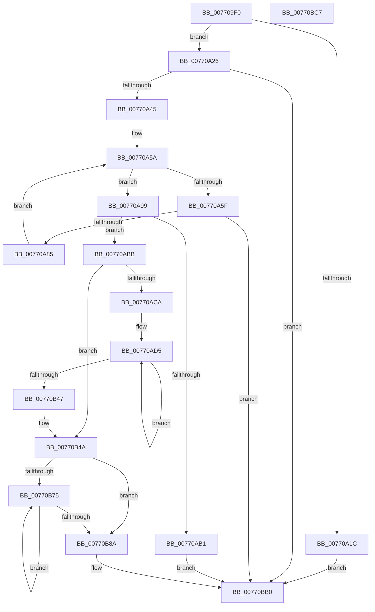

# PpmRegisterProfiles

- RVA: `0x007709F0`–`0x00770BC8` (길이 `472` bytes)
- VA: `0x00000001407709F0`
- 실행 섹션: `PAGE`
- PDB 이름 있음: `예`; PDB Function 태그: `아니요`
- unwind 정보 RVA: `0x000AA2A0`
- 디코드: `122`개 명령, `472/472` bytes 표시
- 미해석 바이트: `0` (있으면 어셈블리에 `.byte`로 보존)

> 이 문서는 커널 이미지의 기계어와 PDB 기호를 분석해 생성했습니다. 4번과 5번은 함수 원형과 자료형을 바이너리 사용 방식에서 추정한 C 해석이며 원본 소스 복구 결과는 아닙니다.

## 1. Dependencies

- 직접 호출 지점: **11**; 고유 호출 대상: **11**
- 직접 호출자로 확인된 함수: **1**
- RIP 상대 이미지 참조: **5**

### Outgoing calls
- `0x00770A36` → [RtlULongLongMult](../../text/43/RtlULongLongMult_function_0043E530.md) (function, `0x0043E530`)
- `0x00770A76` → [RtlStringCbLengthW](../../text/45/RtlStringCbLengthW_function_004575EC.md) (function, `0x004575EC`)
- `0x00770AA4` → [ExAllocatePool2](../../poolcode/B8/ExAllocatePool2_function_00B820F0.md) (function, `0x00B820F0`)
- `0x00770B11` → [RtlStringCchLengthW](../../text/43/RtlStringCchLengthW_function_00435A70.md) (function, `0x00435A70`)
- `0x00770B25` → [RtlStringCchCopyW](../../text/26/RtlStringCchCopyW_function_0026E9A4.md) (function, `0x0026E9A4`)
- `0x00770B51` → [PpmAcquireLock](../../text/2D/PpmAcquireLock_function_002D9AA4.md) (function, `0x002D9AA4`)
- `0x00770B5D` → [PopAcquireRwLockExclusive](../../text/43/PopAcquireRwLockExclusive_function_00430B44.md) (function, `0x00430B44`)
- `0x00770B78` → [PpmResetProfileSettings](../../text/4C/PpmResetProfileSettings_function_004C9960.md) (function, `0x004C9960`)
- `0x00770B8C` → [PpmEventTraceProfiles](../A5/PpmEventTraceProfiles_function_00A528A0.md) (function, `0x00A528A0`)
- `0x00770B98` → [PopReleaseRwLock](../../text/2D/PopReleaseRwLock_function_002DFBBC.md) (function, `0x002DFBBC`)
- `0x00770BA4` → [PpmReleaseLock](../../text/2D/PpmReleaseLock_function_002DA428.md) (function, `0x002DA428`)

### Direct callers
- [PdcPoPpmRegisterProfiles](../76/PdcPoPpmRegisterProfiles_function_00769430.md) at `0x00769434`

### Static image references
- `0x00770B4A` → RVA `0x00F0CC00` (`.data`; read)
- `0x00770B56` → RVA `0x00F0CA70` (`.data`; read)
- `0x00770B62` → RVA `0x00F07BE0` (`.data`; write)
- `0x00770B69` → RVA `0x00F07BE8` (`.data`; write)
- `0x00770BA9` → RVA `0x00F077A8` (`.data`; read/write)

## 2. Other-region calls and transfers

- 다른 실행 섹션으로 향하는 call: **10**
  - `0x00770A36` → [RtlULongLongMult](../../text/43/RtlULongLongMult_function_0043E530.md) (`PAGE` → `.text`)
  - `0x00770A76` → [RtlStringCbLengthW](../../text/45/RtlStringCbLengthW_function_004575EC.md) (`PAGE` → `.text`)
  - `0x00770AA4` → [ExAllocatePool2](../../poolcode/B8/ExAllocatePool2_function_00B820F0.md) (`PAGE` → `POOLCODE`)
  - `0x00770B11` → [RtlStringCchLengthW](../../text/43/RtlStringCchLengthW_function_00435A70.md) (`PAGE` → `.text`)
  - `0x00770B25` → [RtlStringCchCopyW](../../text/26/RtlStringCchCopyW_function_0026E9A4.md) (`PAGE` → `.text`)
  - `0x00770B51` → [PpmAcquireLock](../../text/2D/PpmAcquireLock_function_002D9AA4.md) (`PAGE` → `.text`)
  - `0x00770B5D` → [PopAcquireRwLockExclusive](../../text/43/PopAcquireRwLockExclusive_function_00430B44.md) (`PAGE` → `.text`)
  - `0x00770B78` → [PpmResetProfileSettings](../../text/4C/PpmResetProfileSettings_function_004C9960.md) (`PAGE` → `.text`)
  - `0x00770B98` → [PopReleaseRwLock](../../text/2D/PopReleaseRwLock_function_002DFBBC.md) (`PAGE` → `.text`)
  - `0x00770BA4` → [PpmReleaseLock](../../text/2D/PpmReleaseLock_function_002DA428.md) (`PAGE` → `.text`)
- 별도 외부 분기/꼬리 이동을 확인하지 못했습니다.

## 3. Assembly (complete function range)

```asm
007709F0  48 89 5C 24 08                  mov qword ptr [rsp + 8], rbx
007709F5  55                              push rbp
007709F6  56                              push rsi
007709F7  57                              push rdi
007709F8  41 54                           push r12
007709FA  41 55                           push r13
007709FC  41 56                           push r14
007709FE  41 57                           push r15
00770A00  48 83 EC 20                     sub rsp, 0x20
00770A04  48 83 64 24 70 00               and qword ptr [rsp + 0x70], 0
00770A0A  4C 8B FA                        mov r15, rdx
00770A0D  48 83 64 24 78 00               and qword ptr [rsp + 0x78], 0
00770A13  0F B6 F1                        movzx esi, cl
00770A16  40 80 FE 1F                     cmp sil, 0x1f
00770A1A  76 0A                           jbe 0x140770a26
00770A1C  BD 0D 00 00 C0                  mov ebp, 0xc000000d
00770A21  E9 8A 01 00 00                  jmp 0x140770bb0
00770A26  4C 8D 44 24 78                  lea r8, [rsp + 0x78]
00770A2B  BA 20 04 00 00                  mov edx, 0x420
00770A30  48 8B CE                        mov rcx, rsi
00770A33  4C 8B F6                        mov r14, rsi
00770A36  E8 F5 DA CC FF                  call 0x14043e530
00770A3B  8B E8                           mov ebp, eax
00770A3D  85 C0                           test eax, eax
00770A3F  0F 88 6B 01 00 00               js 0x140770bb0
00770A45  48 8B 5C 24 78                  mov rbx, qword ptr [rsp + 0x78]
00770A4A  48 FF C3                        inc rbx
00770A4D  48 83 E3 FE                     and rbx, 0xfffffffffffffffe
00770A51  48 8B D3                        mov rdx, rbx
00770A54  45 32 DB                        xor r11b, r11b
00770A57  48 8B FB                        mov rdi, rbx
00770A5A  44 3A DE                        cmp r11b, sil
00770A5D  73 3A                           jae 0x140770a99
00770A5F  41 0F B6 CB                     movzx ecx, r11b
00770A63  4C 8D 44 24 70                  lea r8, [rsp + 0x70]
00770A68  48 C1 E1 05                     shl rcx, 5
00770A6C  BA FF FF FF 7F                  mov edx, 0x7fffffff
00770A71  4A 8B 4C 39 08                  mov rcx, qword ptr [rcx + r15 + 8]
00770A76  E8 71 6B CE FF                  call 0x1404575ec
00770A7B  8B E8                           mov ebp, eax
00770A7D  85 C0                           test eax, eax
00770A7F  0F 88 2B 01 00 00               js 0x140770bb0
00770A85  48 8B 54 24 70                  mov rdx, qword ptr [rsp + 0x70]
00770A8A  48 83 C2 02                     add rdx, 2
00770A8E  48 03 D7                        add rdx, rdi
00770A91  41 FE C3                        inc r11b
00770A94  48 8B FA                        mov rdi, rdx
00770A97  EB C1                           jmp 0x140770a5a
00770A99  B9 40 00 00 00                  mov ecx, 0x40
00770A9E  41 B8 50 50 4D 66               mov r8d, 0x664d5050
00770AA4  E8 47 16 41 00                  call 0x140b820f0
00770AA9  48 8B F8                        mov rdi, rax
00770AAC  48 85 C0                        test rax, rax
00770AAF  75 0A                           jne 0x140770abb
00770AB1  BD 9A 00 00 C0                  mov ebp, 0xc000009a
00770AB6  E9 F5 00 00 00                  jmp 0x140770bb0
00770ABB  48 03 C3                        add rax, rbx
00770ABE  45 32 ED                        xor r13b, r13b
00770AC1  40 84 F6                        test sil, sil
00770AC4  0F 84 80 00 00 00               je 0x140770b4a
00770ACA  49 83 C7 08                     add r15, 8
00770ACE  4C 8D 67 20                     lea r12, [rdi + 0x20]
00770AD2  4C 8B F0                        mov r14, rax
00770AD5  49 8B 47 F8                     mov rax, qword ptr [r15 - 8]
00770AD9  49 8D 5C 24 E0                  lea rbx, [r12 - 0x20]
00770ADE  41 FE C5                        inc r13b
00770AE1  4C 8D 44 24 70                  lea r8, [rsp + 0x70]
00770AE6  BA FF FF FF 7F                  mov edx, 0x7fffffff
00770AEB  0F 10 00                        movups xmm0, xmmword ptr [rax]
00770AEE  F3 41 0F 7F 44 24 EC            movdqu xmmword ptr [r12 - 0x14], xmm0
00770AF5  41 8A 47 08                     mov al, byte ptr [r15 + 8]
00770AF9  49 83 8C 24 F0 03 00 00 FF      or qword ptr [r12 + 0x3f0], 0xffffffffffffffff
00770B02  41 88 04 24                     mov byte ptr [r12], al
00770B06  4C 89 33                        mov qword ptr [rbx], r14
00770B09  45 88 6C 24 E8                  mov byte ptr [r12 - 0x18], r13b
00770B0E  49 8B 0F                        mov rcx, qword ptr [r15]
00770B11  E8 5A 4F CC FF                  call 0x140435a70
00770B16  4C 8B 5C 24 70                  mov r11, qword ptr [rsp + 0x70]
00770B1B  4D 8B 07                        mov r8, qword ptr [r15]
00770B1E  48 8B 0B                        mov rcx, qword ptr [rbx]
00770B21  49 8D 53 01                     lea rdx, [r11 + 1]
00770B25  E8 7A DE AF FF                  call 0x14026e9a4
00770B2A  4F 8D 34 5E                     lea r14, [r14 + r11*2]
00770B2E  49 89 5F 10                     mov qword ptr [r15 + 0x10], rbx
00770B32  49 83 C6 02                     add r14, 2
00770B36  4D 8D A4 24 20 04 00 00         lea r12, [r12 + 0x420]
00770B3E  4D 8D 7F 20                     lea r15, [r15 + 0x20]
00770B42  44 3A EE                        cmp r13b, sil
00770B45  72 8E                           jb 0x140770ad5
00770B47  4C 8B F6                        mov r14, rsi
00770B4A  48 8D 0D AF C0 79 00            lea rcx, [rip + 0x79c0af]
00770B51  E8 4E 8F B6 FF                  call 0x1402d9aa4
00770B56  48 8D 0D 13 BF 79 00            lea rcx, [rip + 0x79bf13]
00770B5D  E8 E2 FF CB FF                  call 0x140430b44
00770B62  48 89 3D 77 70 79 00            mov qword ptr [rip + 0x797077], rdi
00770B69  40 88 35 78 70 79 00            mov byte ptr [rip + 0x797078], sil
00770B70  40 84 F6                        test sil, sil
00770B73  74 15                           je 0x140770b8a
00770B75  48 8B CF                        mov rcx, rdi
00770B78  E8 E3 8D D5 FF                  call 0x1404c9960
00770B7D  48 81 C7 20 04 00 00            add rdi, 0x420
00770B84  49 83 EE 01                     sub r14, 1
00770B88  75 EB                           jne 0x140770b75
00770B8A  33 C9                           xor ecx, ecx
00770B8C  E8 0F 1D 2E 00                  call 0x140a528a0
00770B91  48 8D 0D D8 BE 79 00            lea rcx, [rip + 0x79bed8]
00770B98  E8 1F F0 B6 FF                  call 0x1402dfbbc
00770B9D  48 8D 0D 5C C0 79 00            lea rcx, [rip + 0x79c05c]
00770BA4  E8 7F 98 B6 FF                  call 0x1402da428
00770BA9  83 0D F8 6B 79 00 01            or dword ptr [rip + 0x796bf8], 1
00770BB0  48 8B 5C 24 60                  mov rbx, qword ptr [rsp + 0x60]
00770BB5  8B C5                           mov eax, ebp
00770BB7  48 83 C4 20                     add rsp, 0x20
00770BBB  41 5F                           pop r15
00770BBD  41 5E                           pop r14
00770BBF  41 5D                           pop r13
00770BC1  41 5C                           pop r12
00770BC3  5F                              pop rdi
00770BC4  5E                              pop rsi
00770BC5  5D                              pop rbp
00770BC6  C3                              ret
00770BC7  CC                              int3
```

## 4. C-style interpretation (structured pseudocode)

```c
__int64 __fastcall PpmRegisterProfiles(unsigned __int8 a1, __int64 a2)
{
    __int64 result;
    __int64 v_r11;
    __int64 v_r13;
    __int64 v_r14;
    __int64 v_r15;
    __int64 v_rbx;
    __int64 v_rdi;
    __int64 v_rsp;
    unsigned __int64 v_stack_p18;
    unsigned __int64 v_stack_p20;
    unsigned __int64 v_stack_p8;

    v_stack_p8 = v_rbx;
    v_rsp = (v_rsp) - (32);
    if (a1 <= 31) goto loc_00770A26;
    goto loc_00770BB0;
loc_00770A26:
    result = RtlULongLongMult(a1, (unsigned int)(0x420ULL), v_stack_p20, a4);
    if (sign_flag) goto loc_00770BB0;
    v_rbx = (v_stack_p20) + 1;
    v_rbx = (v_rbx) & (-2);
    v_r11 = 0;
loc_00770A5A:
    if (0 >= a1) goto loc_00770A99;
    a1 = (0) << (5);
    result = RtlStringCbLengthW(*(unsigned __int64 *)(a1 + a2 * 1 + 8), (unsigned int)(0x7FFFFFFFULL), v_stack_p18, a4);
    if (sign_flag) goto loc_00770BB0;
    a2 = (v_stack_p18) + (2);
    a2 = (a2) + (v_rbx);
    v_r11 = (unsigned __int8)((v_r11) + 1);
    goto loc_00770A5A;
loc_00770A99:
    result = ExAllocatePool2(64, a2, (unsigned int)(0x664D5050ULL), a4);
    if (result != 0) goto loc_00770ABB;
    goto loc_00770BB0;
loc_00770ABB:
    result = (result) + (v_rbx);
    v_r13 = 0;
    if (a1 == 0) goto loc_00770B4A;
    v_r15 = (a2) + (8);
loc_00770AD5:
    v_r13 = (unsigned __int8)((v_r13) + 1);
    *(unsigned __int64 *)(result + 32 - 20) = v_xmm0;
    *(unsigned __int8 *)(result + 32) = (unsigned __int8)(*(unsigned __int8 *)(v_r15 + 8));
    *(unsigned __int64 *)(result + 32 - 32) = result;
    *(unsigned __int8 *)(result + 32 - 24) = (unsigned __int8)(v_r13);
    result = RtlStringCchLengthW(*(unsigned __int64 *)(v_r15), (unsigned int)(0x7FFFFFFFULL), v_stack_p18, a4);
    result = RtlStringCchCopyW(*(unsigned __int64 *)(result + 32 - 32), v_stack_p18 + 1, *(unsigned __int64 *)(v_r15), a4);
    *(unsigned __int64 *)(v_r15 + 16) = result + 32 - 32;
    v_r14 = (result + v_stack_p18 * 2) + (2);
    if (((unsigned __int8)(v_r13)) < a1) goto loc_00770AD5;
loc_00770B4A:
    result = PpmAcquireLock(v_rip + 7979183, v_stack_p18 + 1, *(unsigned __int64 *)(v_r15), a4);
    result = PopAcquireRwLockExclusive(v_rip + 7978771, v_stack_p18 + 1, *(unsigned __int64 *)(v_r15), a4);
    *(unsigned __int64 *)(v_rip + 7958647) = result;
    *(unsigned __int8 *)(v_rip + 7958648) = a1;
    if (a1 == 0) goto loc_00770B8A;
loc_00770B75:
    result = PpmResetProfileSettings(result, v_stack_p18 + 1, *(unsigned __int64 *)(v_r15), a4);
    v_rdi = (result) + (0x420ULL);
    v_r14 = (a1) - (1);
    if (condition_is_not_equal) goto loc_00770B75;
loc_00770B8A:
    a1 = 0;
    result = PpmEventTraceProfiles(a1, v_stack_p18 + 1, *(unsigned __int64 *)(v_r15), a4);
    result = PopReleaseRwLock(v_rip + 7978712, v_stack_p18 + 1, *(unsigned __int64 *)(v_r15), a4);
    result = PpmReleaseLock(v_rip + 7979100, v_stack_p18 + 1, *(unsigned __int64 *)(v_r15), a4);
loc_00770BB0:
    v_rsp = (v_rsp) + (32);
    return (unsigned int)((unsigned int)((unsigned int)(0xC000009AULL)));
}
```

## 5. (Beta) C Style

```c
int64_t PpmRegisterProfiles(uint8_t Arg1, void *Arg2)
{
    uint8_t *arg2 = (uint8_t *)Arg2;

    int64_t result;
    int64_t local_r11;
    int64_t local_r13;
    int64_t local_r14;
    int64_t local_r15;
    int64_t local_rbx;
    int64_t local_rdi;
    int64_t local_rsp;
    uint64_t v_stack_p18;
    uint64_t v_stack_p20;
    uint64_t v_stack_p8;

    v_stack_p8 = local_rbx;
    local_rsp = (local_rsp) - (32);
    if (Arg1 <= 31) goto loc_00770A26;
    goto loc_00770BB0;
loc_00770A26:
    result = RtlULongLongMult(Arg1, (uint32_t)(0x420ULL), v_stack_p20, a4);
    if (sign_flag) goto loc_00770BB0;
    local_rbx = (v_stack_p20) + 1;
    local_rbx = (local_rbx) & (-2);
    local_r11 = 0;
loc_00770A5A:
    if (0 >= Arg1) goto loc_00770A99;
    Arg1 = (0) << (5);
    result = RtlStringCbLengthW(*(uint64_t *)(Arg1 + arg2 * 1 + 0x8), (uint32_t)(0x7FFFFFFFULL), v_stack_p18, a4);
    if (sign_flag) goto loc_00770BB0;
    Arg2 = (v_stack_p18) + (2);
    Arg2 = (Arg2) + (local_rbx);
    local_r11 = (uint8_t)((local_r11) + 1);
    goto loc_00770A5A;
loc_00770A99:
    result = ExAllocatePool2(64, Arg2, (uint32_t)(0x664D5050ULL), a4);
    if (result != 0) goto loc_00770ABB;
    goto loc_00770BB0;
loc_00770ABB:
    result = (result) + (local_rbx);
    local_r13 = 0;
    if (Arg1 == 0) goto loc_00770B4A;
    local_r15 = (Arg2) + (8);
loc_00770AD5:
    local_r13 = (uint8_t)((local_r13) + 1);
    *(uint64_t *)(result + 0x20 - 0x14) = v_xmm0;
    *(uint8_t *)(result + 0x20) = (uint8_t)(*(uint8_t *)(local_r15 + 0x8));
    *(uint64_t *)(result + 0x20 - 0x20) = result;
    *(uint8_t *)(result + 0x20 - 0x18) = (uint8_t)(local_r13);
    result = RtlStringCchLengthW(*(uint64_t *)(local_r15), (uint32_t)(0x7FFFFFFFULL), v_stack_p18, a4);
    result = RtlStringCchCopyW(*(uint64_t *)(result + 0x20 - 0x20), v_stack_p18 + 1, *(uint64_t *)(local_r15), a4);
    *(uint64_t *)(local_r15 + 0x10) = result + 32 - 32;
    local_r14 = (result + v_stack_p18 * 2) + (2);
    if (((uint8_t)(local_r13)) < Arg1) goto loc_00770AD5;
loc_00770B4A:
    result = PpmAcquireLock(v_rip + 7979183, v_stack_p18 + 1, *(uint64_t *)(local_r15), a4);
    result = PopAcquireRwLockExclusive(v_rip + 7978771, v_stack_p18 + 1, *(uint64_t *)(local_r15), a4);
    *(uint64_t *)(v_rip + 0x797077) = result;
    *(uint8_t *)(v_rip + 0x797078) = Arg1;
    if (Arg1 == 0) goto loc_00770B8A;
loc_00770B75:
    result = PpmResetProfileSettings(result, v_stack_p18 + 1, *(uint64_t *)(local_r15), a4);
    local_rdi = (result) + (0x420ULL);
    local_r14 = (Arg1) - (1);
    if (condition_is_not_equal) goto loc_00770B75;
loc_00770B8A:
    Arg1 = 0;
    result = PpmEventTraceProfiles(Arg1, v_stack_p18 + 1, *(uint64_t *)(local_r15), a4);
    result = PopReleaseRwLock(v_rip + 7978712, v_stack_p18 + 1, *(uint64_t *)(local_r15), a4);
    result = PpmReleaseLock(v_rip + 7979100, v_stack_p18 + 1, *(uint64_t *)(local_r15), a4);
loc_00770BB0:
    local_rsp = (local_rsp) + (32);
    return (uint32_t)((uint32_t)((uint32_t)(0xC000009AULL)));
}
```

### 관측된 메모리 오프셋

구조체 형식이 확인되지 않은 접근은 인자 기준의 오프셋으로만 기록했습니다.

| 기준 인자 | 오프셋 표현 | 폭 (bit) | 접근 |
|---|---:|---:|---|
| `Arg2` | `- 0x8` | `64` | `R` |
| `Arg2` | `+ 0x0` | `64` | `R` |
| `Arg2` | `+ 0x8` | `8` | `R` |
| `Arg2` | `+ 0x10` | `64` | `W` |
| `Arg2` | `+ 0x20` | `64` | `R` |

## 6. Execution-region graph

[열기: 2D/3D 그래프와 함수 탐색 컨트롤 패널](../../../control-panel.html?section=page&rva=0x007709F0&view=graph)

- 2D 그래프는 위에서 아래로 흐르고, 3D 그래프는 빈 공간을 드래그해 회전합니다. Shift+드래그는 이동, 휠은 확대·축소, 함수 노드 선택은 대상 보고서 이동입니다.

### Static fallback


