# PsBootPhaseComplete

- RVA: `0x0077EA18`–`0x0077ED89` (길이 `881` bytes)
- VA: `0x000000014077EA18`
- 실행 섹션: `PAGE`
- PDB 이름 있음: `예`; PDB Function 태그: `아니요`
- unwind 정보 RVA: `0x000CDFD0`
- 디코드: `204`개 명령, `881/881` bytes 표시
- 미해석 바이트: `0` (있으면 어셈블리에 `.byte`로 보존)

> 이 문서는 커널 이미지의 기계어와 PDB 기호를 분석해 생성했습니다. 4번과 5번은 함수 원형과 자료형을 바이너리 사용 방식에서 추정한 C 해석이며 원본 소스 복구 결과는 아닙니다.

## 1. Dependencies

- 직접 호출 지점: **16**; 고유 호출 대상: **10**
- 직접 호출자로 확인된 함수: **2**
- RIP 상대 이미지 참조: **17**

### Outgoing calls
- `0x0077EB14` → [RtlQueryImageFileExecutionOptions](../78/RtlQueryImageFileExecutionOptions_function_0078B090.md) (function, `0x0078B090`)
- `0x0077EB47` → [RtlQueryImageFileExecutionOptions](../78/RtlQueryImageFileExecutionOptions_function_0078B090.md) (function, `0x0078B090`)
- `0x0077EB5A` → [RtlQueryImageFileExecutionOptions](../78/RtlQueryImageFileExecutionOptions_function_0078B090.md) (function, `0x0078B090`)
- `0x0077EB8F` → [ZwOpenKey](../../text/6A/ZwOpenKey_function_006AD310.md) (function, `0x006AD310`)
- `0x0077EBC2` → [ZwQueryValueKey](../../text/6A/ZwQueryValueKey_function_006AD3B0.md) (function, `0x006AD3B0`)
- `0x0077EBE6` → [ObCloseHandle](../8A/ObCloseHandle_function_008A1870.md) (function, `0x008A1870`)
- `0x0077EC1F` → [ZwOpenKey](../../text/6A/ZwOpenKey_function_006AD310.md) (function, `0x006AD310`)
- `0x0077EC6A` → [ZwQueryValueKey](../../text/6A/ZwQueryValueKey_function_006AD3B0.md) (function, `0x006AD3B0`)
- `0x0077ECA4` → [Feature_ShadowAdmin__private_IsEnabledDeviceUsageNoInline](../../text/4C/Feature_ShadowAdmin__private_IsEnabledDeviceUsageNoInline_function_004C78E8.md) (function, `0x004C78E8`)
- `0x0077ECD7` → [ZwQueryValueKey](../../text/6A/ZwQueryValueKey_function_006AD3B0.md) (function, `0x006AD3B0`)
- `0x0077ED22` → [ObCloseHandle](../8A/ObCloseHandle_function_008A1870.md) (function, `0x008A1870`)
- `0x0077ED27` → [PspIsDfssEnabled](PspIsDfssEnabled_function_0077EFF4.md) (function, `0x0077EFF4`)
- `0x0077ED32` → [HalAdjustResourceList](../../text/48/HalAdjustResourceList_function_0048FDC0.md) (function, `0x0048FDC0`)
- `0x0077ED3A` → [PsGetServerSiloGlobals](../../text/22/PsGetServerSiloGlobals_function_002250A0.md) (function, `0x002250A0`)
- `0x0077ED42` → [PspQueryForwardersEnabled](../78/PspQueryForwardersEnabled_function_00781A0C.md) (function, `0x00781A0C`)
- `0x0077ED66` → [_security_check_cookie](../../text/6A/_security_check_cookie_function_006AC640.md) (function, `0x006AC640`)

### Direct callers
- [CmpFinishSystemHivesLoad](../7D/CmpFinishSystemHivesLoad_function_007DA210.md) at `0x007DA715`
- [CmpFinishSystemHivesLoad](../7D/CmpFinishSystemHivesLoad_function_007DA210.md) at `0x007DA813`
- [CmpFinishSystemHivesLoad](../7D/CmpFinishSystemHivesLoad_function_007DA210.md) at `0x007DAB8A`
- [CmCompleteRegistryInitialization](../7D/CmCompleteRegistryInitialization_function_007DF1EC.md) at `0x007DF32B`

### Static image references
- `0x0077EA37` → RVA `0x00E0A740` (`.data`; read)
- `0x0077EA51` → RVA `0x00B04980` (` ?? ::NNGAKEGL::`string'`; read)
- `0x0077EA67` → RVA `0x00B04A10` (` ?? ::NNGAKEGL::`string'`; read)
- `0x0077EA7C` → RVA `0x00B047D0` (` ?? ::NNGAKEGL::`string'`; read)
- `0x0077EA91` → RVA `0x00B04950` (` ?? ::NNGAKEGL::`string'`; read)
- `0x0077EA98` → RVA `0x00B04870` (` ?? ::NNGAKEGL::`string'`; read)
- `0x0077EAAB` → RVA `0x00B04780` (` ?? ::NNGAKEGL::`string'`; read)
- `0x0077EABD` → RVA `0x00B047A0` (` ?? ::NNGAKEGL::`string'`; read)
- `0x0077EAD1` → RVA `0x00B04910` (` ?? ::NNGAKEGL::`string'`; read)
- `0x0077EB25` → RVA `0x00FD9BB4` (`PAGEDATA`; read)
- `0x0077EB33` → RVA `0x00FD9BB4` (`PAGEDATA`; write)
- `0x0077EB39` → RVA `0x00FD9E2C` (`PAGEDATA`; read)
- `0x0077EB40` → RVA `0x00B048A0` (` ?? ::NNGAKEGL::`string'`; read)
- `0x0077EB4C` → RVA `0x00FD9E30` (`PAGEDATA`; read)
- `0x0077EB53` → RVA `0x00B048D0` (` ?? ::NNGAKEGL::`string'`; read)
- `0x0077EC87` → RVA `0x00FC5008` (`ALMOSTRO`; read)
- `0x0077ED2C` → RVA `0x00FC6ABE` (`ALMOSTRO`; write)

## 2. Other-region calls and transfers

- 다른 실행 섹션으로 향하는 call: **9**
  - `0x0077EB8F` → [ZwOpenKey](../../text/6A/ZwOpenKey_function_006AD310.md) (`PAGE` → `.text`)
  - `0x0077EBC2` → [ZwQueryValueKey](../../text/6A/ZwQueryValueKey_function_006AD3B0.md) (`PAGE` → `.text`)
  - `0x0077EC1F` → [ZwOpenKey](../../text/6A/ZwOpenKey_function_006AD310.md) (`PAGE` → `.text`)
  - `0x0077EC6A` → [ZwQueryValueKey](../../text/6A/ZwQueryValueKey_function_006AD3B0.md) (`PAGE` → `.text`)
  - `0x0077ECA4` → [Feature_ShadowAdmin__private_IsEnabledDeviceUsageNoInline](../../text/4C/Feature_ShadowAdmin__private_IsEnabledDeviceUsageNoInline_function_004C78E8.md) (`PAGE` → `.text`)
  - `0x0077ECD7` → [ZwQueryValueKey](../../text/6A/ZwQueryValueKey_function_006AD3B0.md) (`PAGE` → `.text`)
  - `0x0077ED32` → [HalAdjustResourceList](../../text/48/HalAdjustResourceList_function_0048FDC0.md) (`PAGE` → `.text`)
  - `0x0077ED3A` → [PsGetServerSiloGlobals](../../text/22/PsGetServerSiloGlobals_function_002250A0.md) (`PAGE` → `.text`)
  - `0x0077ED66` → [_security_check_cookie](../../text/6A/_security_check_cookie_function_006AC640.md) (`PAGE` → `.text`)
- 별도 외부 분기/꼬리 이동을 확인하지 못했습니다.

## 3. Assembly (complete function range)

```asm
0077EA18  48 8B C4                        mov rax, rsp
0077EA1B  48 89 58 08                     mov qword ptr [rax + 8], rbx
0077EA1F  48 89 70 10                     mov qword ptr [rax + 0x10], rsi
0077EA23  48 89 78 18                     mov qword ptr [rax + 0x18], rdi
0077EA27  55                              push rbp
0077EA28  41 55                           push r13
0077EA2A  41 56                           push r14
0077EA2C  48 8D 68 B8                     lea rbp, [rax - 0x48]
0077EA30  48 81 EC 30 01 00 00            sub rsp, 0x130
0077EA37  48 8B 05 02 BD 68 00            mov rax, qword ptr [rip + 0x68bd02]
0077EA3E  48 33 C4                        xor rax, rsp
0077EA41  48 89 45 20                     mov qword ptr [rbp + 0x20], rax
0077EA45  45 33 F6                        xor r14d, r14d
0077EA48  48 C7 44 24 50 82 00 84 00      mov qword ptr [rsp + 0x50], 0x840082
0077EA51  48 8D 05 28 5F 38 00            lea rax, [rip + 0x385f28]
0077EA58  44 89 74 24 4C                  mov dword ptr [rsp + 0x4c], r14d
0077EA5D  48 89 44 24 58                  mov qword ptr [rsp + 0x58], rax
0077EA62  4C 8D 4C 24 4C                  lea r9, [rsp + 0x4c]
0077EA67  48 8D 05 A2 5F 38 00            lea rax, [rip + 0x385fa2]
0077EA6E  4C 89 74 24 40                  mov qword ptr [rsp + 0x40], r14
0077EA73  48 89 44 24 68                  mov qword ptr [rsp + 0x68], rax
0077EA78  45 8D 6E 01                     lea r13d, [r14 + 1]
0077EA7C  48 8D 05 4D 5D 38 00            lea rax, [rip + 0x385d4d]
0077EA83  48 C7 44 24 60 18 00 1A 00      mov qword ptr [rsp + 0x60], 0x1a0018
0077EA8C  48 89 44 24 78                  mov qword ptr [rsp + 0x78], rax
0077EA91  48 8D 15 B8 5E 38 00            lea rdx, [rip + 0x385eb8]
0077EA98  48 8D 05 D1 5D 38 00            lea rax, [rip + 0x385dd1]
0077EA9F  44 89 75 94                     mov dword ptr [rbp - 0x6c], r14d
0077EAA3  48 89 45 88                     mov qword ptr [rbp - 0x78], rax
0077EAA7  41 8D 76 30                     lea esi, [r14 + 0x30]
0077EAAB  48 8D 05 CE 5C 38 00            lea rax, [rip + 0x385cce]
0077EAB2  44 89 75 AC                     mov dword ptr [rbp - 0x54], r14d
0077EAB6  48 89 45 D8                     mov qword ptr [rbp - 0x28], rax
0077EABA  0F 57 C0                        xorps xmm0, xmm0
0077EABD  48 8D 05 DC 5C 38 00            lea rax, [rip + 0x385cdc]
0077EAC4  48 C7 44 24 70 96 00 98 00      mov qword ptr [rsp + 0x70], 0x980096
0077EACD  48 89 45 F0                     mov qword ptr [rbp - 0x10], rax
0077EAD1  48 8D 05 38 5E 38 00            lea rax, [rip + 0x385e38]
0077EAD8  48 89 45 08                     mov qword ptr [rbp + 8], rax
0077EADC  0F 11 45 C0                     movups xmmword ptr [rbp - 0x40], xmm0
0077EAE0  48 C7 45 80 2E 00 30 00         mov qword ptr [rbp - 0x80], 0x30002e
0077EAE8  C7 45 D0 12 00 14 00            mov dword ptr [rbp - 0x30], 0x140012
0077EAEF  44 89 6D E0                     mov dword ptr [rbp - 0x20], r13d
0077EAF3  C7 45 E8 28 00 2A 00            mov dword ptr [rbp - 0x18], 0x2a0028
0077EAFA  C7 45 F8 02 00 00 00            mov dword ptr [rbp - 8], 2
0077EB01  C7 45 00 30 00 32 00            mov dword ptr [rbp], 0x320030
0077EB08  C7 45 10 03 00 00 00            mov dword ptr [rbp + 0x10], 3
0077EB0F  44 89 74 24 48                  mov dword ptr [rsp + 0x48], r14d
0077EB14  E8 77 C5 00 00                  call 0x14078b090
0077EB19  85 C0                           test eax, eax
0077EB1B  78 1C                           js 0x14077eb39
0077EB1D  44 39 74 24 4C                  cmp dword ptr [rsp + 0x4c], r14d
0077EB22  41 8B CE                        mov ecx, r14d
0077EB25  8B 05 89 B0 85 00               mov eax, dword ptr [rip + 0x85b089]
0077EB2B  0F 95 C1                        setne cl
0077EB2E  83 E0 FE                        and eax, 0xfffffffe
0077EB31  0B C1                           or eax, ecx
0077EB33  89 05 7B B0 85 00               mov dword ptr [rip + 0x85b07b], eax
0077EB39  4C 8D 0D EC B2 85 00            lea r9, [rip + 0x85b2ec]
0077EB40  48 8D 15 59 5D 38 00            lea rdx, [rip + 0x385d59]
0077EB47  E8 44 C5 00 00                  call 0x14078b090
0077EB4C  4C 8D 0D DD B2 85 00            lea r9, [rip + 0x85b2dd]
0077EB53  48 8D 15 76 5D 38 00            lea rdx, [rip + 0x385d76]
0077EB5A  E8 31 C5 00 00                  call 0x14078b090
0077EB5F  48 8D 44 24 50                  lea rax, [rsp + 0x50]
0077EB64  41 0F B6 DE                     movzx ebx, r14b
0077EB68  0F 57 C0                        xorps xmm0, xmm0
0077EB6B  48 89 45 A0                     mov qword ptr [rbp - 0x60], rax
0077EB6F  BF 40 02 00 00                  mov edi, 0x240
0077EB74  89 75 90                        mov dword ptr [rbp - 0x70], esi
0077EB77  4C 8D 45 90                     lea r8, [rbp - 0x70]
0077EB7B  4C 89 75 98                     mov qword ptr [rbp - 0x68], r14
0077EB7F  41 8B D5                        mov edx, r13d
0077EB82  89 7D A8                        mov dword ptr [rbp - 0x58], edi
0077EB85  48 8D 4C 24 40                  lea rcx, [rsp + 0x40]
0077EB8A  F3 0F 7F 45 B0                  movdqu xmmword ptr [rbp - 0x50], xmm0
0077EB8F  E8 7C E7 F2 FF                  call 0x1406ad310
0077EB94  85 C0                           test eax, eax
0077EB96  0F 88 8B 01 00 00               js 0x14077ed27
0077EB9C  48 8B 4C 24 40                  mov rcx, qword ptr [rsp + 0x40]
0077EBA1  48 8D 44 24 48                  lea rax, [rsp + 0x48]
0077EBA6  48 89 44 24 28                  mov qword ptr [rsp + 0x28], rax
0077EBAB  4C 8D 4D C0                     lea r9, [rbp - 0x40]
0077EBAF  41 B8 02 00 00 00               mov r8d, 2
0077EBB5  C7 44 24 20 10 00 00 00         mov dword ptr [rsp + 0x20], 0x10
0077EBBD  48 8D 54 24 60                  lea rdx, [rsp + 0x60]
0077EBC2  E8 E9 E7 F2 FF                  call 0x1406ad3b0
0077EBC7  85 C0                           test eax, eax
0077EBC9  78 14                           js 0x14077ebdf
0077EBCB  83 7D C4 04                     cmp dword ptr [rbp - 0x3c], 4
0077EBCF  75 0E                           jne 0x14077ebdf
0077EBD1  83 7D C8 04                     cmp dword ptr [rbp - 0x38], 4
0077EBD5  75 08                           jne 0x14077ebdf
0077EBD7  44 39 75 CC                     cmp dword ptr [rbp - 0x34], r14d
0077EBDB  41 0F 45 DD                     cmovne ebx, r13d
0077EBDF  48 8B 4C 24 40                  mov rcx, qword ptr [rsp + 0x40]
0077EBE4  33 D2                           xor edx, edx
0077EBE6  E8 85 2C 12 00                  call 0x1408a1870
0077EBEB  4C 89 74 24 40                  mov qword ptr [rsp + 0x40], r14
0077EBF0  84 DB                           test bl, bl
0077EBF2  0F 84 2F 01 00 00               je 0x14077ed27
0077EBF8  48 8D 44 24 70                  lea rax, [rsp + 0x70]
0077EBFD  89 75 90                        mov dword ptr [rbp - 0x70], esi
0077EC00  0F 57 C0                        xorps xmm0, xmm0
0077EC03  48 89 45 A0                     mov qword ptr [rbp - 0x60], rax
0077EC07  4C 8D 45 90                     lea r8, [rbp - 0x70]
0077EC0B  4C 89 75 98                     mov qword ptr [rbp - 0x68], r14
0077EC0F  41 8B D5                        mov edx, r13d
0077EC12  89 7D A8                        mov dword ptr [rbp - 0x58], edi
0077EC15  48 8D 4C 24 40                  lea rcx, [rsp + 0x40]
0077EC1A  F3 0F 7F 45 B0                  movdqu xmmword ptr [rbp - 0x50], xmm0
0077EC1F  E8 EC E6 F2 FF                  call 0x1406ad310
0077EC24  8B D8                           mov ebx, eax
0077EC26  85 C0                           test eax, eax
0077EC28  79 05                           jns 0x14077ec2f
0077EC2A  4C 89 74 24 40                  mov qword ptr [rsp + 0x40], r14
0077EC2F  41 8B FE                        mov edi, r14d
0077EC32  48 8D 75 E0                     lea rsi, [rbp - 0x20]
0077EC36  48 8B 4C 24 40                  mov rcx, qword ptr [rsp + 0x40]
0077EC3B  48 85 C9                        test rcx, rcx
0077EC3E  74 31                           je 0x14077ec71
0077EC40  8B C7                           mov eax, edi
0077EC42  4C 8D 4D C0                     lea r9, [rbp - 0x40]
0077EC46  41 B8 02 00 00 00               mov r8d, 2
0077EC4C  48 8D 14 40                     lea rdx, [rax + rax*2]
0077EC50  48 8D 45 D0                     lea rax, [rbp - 0x30]
0077EC54  48 8D 14 D0                     lea rdx, [rax + rdx*8]
0077EC58  48 8D 44 24 48                  lea rax, [rsp + 0x48]
0077EC5D  48 89 44 24 28                  mov qword ptr [rsp + 0x28], rax
0077EC62  C7 44 24 20 10 00 00 00         mov dword ptr [rsp + 0x20], 0x10
0077EC6A  E8 41 E7 F2 FF                  call 0x1406ad3b0
0077EC6F  8B D8                           mov ebx, eax
0077EC71  85 DB                           test ebx, ebx
0077EC73  78 12                           js 0x14077ec87
0077EC75  83 7D C4 04                     cmp dword ptr [rbp - 0x3c], 4
0077EC79  75 0C                           jne 0x14077ec87
0077EC7B  83 7D C8 04                     cmp dword ptr [rbp - 0x38], 4
0077EC7F  75 06                           jne 0x14077ec87
0077EC81  44 39 75 CC                     cmp dword ptr [rbp - 0x34], r14d
0077EC85  74 11                           je 0x14077ec98
0077EC87  48 8B 0D 7A 63 84 00            mov rcx, qword ptr [rip + 0x84637a]
0077EC8E  8B 06                           mov eax, dword ptr [rsi]
0077EC90  F0 0F AB 81 F0 02 00 00         lock bts dword ptr [rcx + 0x2f0], eax
0077EC98  41 03 FD                        add edi, r13d
0077EC9B  48 83 C6 18                     add rsi, 0x18
0077EC9F  83 FF 03                        cmp edi, 3
0077ECA2  72 92                           jb 0x14077ec36
0077ECA4  E8 3F 8C D4 FF                  call 0x1404c78e8
0077ECA9  85 C0                           test eax, eax
0077ECAB  74 69                           je 0x14077ed16
0077ECAD  48 8B 4C 24 40                  mov rcx, qword ptr [rsp + 0x40]
0077ECB2  48 85 C9                        test rcx, rcx
0077ECB5  74 27                           je 0x14077ecde
0077ECB7  48 8D 44 24 48                  lea rax, [rsp + 0x48]
0077ECBC  41 B8 02 00 00 00               mov r8d, 2
0077ECC2  48 89 44 24 28                  mov qword ptr [rsp + 0x28], rax
0077ECC7  4C 8D 4D C0                     lea r9, [rbp - 0x40]
0077ECCB  48 8D 55 80                     lea rdx, [rbp - 0x80]
0077ECCF  C7 44 24 20 10 00 00 00         mov dword ptr [rsp + 0x20], 0x10
0077ECD7  E8 D4 E6 F2 FF                  call 0x1406ad3b0
0077ECDC  8B D8                           mov ebx, eax
0077ECDE  85 DB                           test ebx, ebx
0077ECE0  78 24                           js 0x14077ed06
0077ECE2  83 7D C4 04                     cmp dword ptr [rbp - 0x3c], 4
0077ECE6  75 1E                           jne 0x14077ed06
0077ECE8  83 7D C8 04                     cmp dword ptr [rbp - 0x38], 4
0077ECEC  75 18                           jne 0x14077ed06
0077ECEE  83 7D CC 02                     cmp dword ptr [rbp - 0x34], 2
0077ECF2  75 12                           jne 0x14077ed06
0077ECF4  48 8B 05 0D 63 84 00            mov rax, qword ptr [rip + 0x84630d]
0077ECFB  F0 0F BA A8 F0 02 00 00 0C      lock bts dword ptr [rax + 0x2f0], 0xc
0077ED04  EB 10                           jmp 0x14077ed16
0077ED06  48 8B 05 FB 62 84 00            mov rax, qword ptr [rip + 0x8462fb]
0077ED0D  F0 0F BA A8 F0 02 00 00 0B      lock bts dword ptr [rax + 0x2f0], 0xb
0077ED16  48 8B 4C 24 40                  mov rcx, qword ptr [rsp + 0x40]
0077ED1B  48 85 C9                        test rcx, rcx
0077ED1E  74 07                           je 0x14077ed27
0077ED20  33 D2                           xor edx, edx
0077ED22  E8 49 2B 12 00                  call 0x1408a1870
0077ED27  E8 C8 02 00 00                  call 0x14077eff4
0077ED2C  88 05 8C 7D 84 00               mov byte ptr [rip + 0x847d8c], al
0077ED32  E8 89 10 D1 FF                  call 0x14048fdc0
0077ED37  48 8B C8                        mov rcx, rax
0077ED3A  E8 61 63 AA FF                  call 0x1402250a0
0077ED3F  48 8B D8                        mov rbx, rax
0077ED42  E8 C5 2C 00 00                  call 0x140781a0c
0077ED47  88 83 F8 03 00 00               mov byte ptr [rbx + 0x3f8], al
0077ED4D  8B 05 61 AE 85 00               mov eax, dword ptr [rip + 0x85ae61]
0077ED53  83 E0 F7                        and eax, 0xfffffff7
0077ED56  83 C8 04                        or eax, 4
0077ED59  89 05 55 AE 85 00               mov dword ptr [rip + 0x85ae55], eax
0077ED5F  48 8B 4D 20                     mov rcx, qword ptr [rbp + 0x20]
0077ED63  48 33 CC                        xor rcx, rsp
0077ED66  E8 D5 D8 F2 FF                  call 0x1406ac640
0077ED6B  4C 8D 9C 24 30 01 00 00         lea r11, [rsp + 0x130]
0077ED73  49 8B 5B 20                     mov rbx, qword ptr [r11 + 0x20]
0077ED77  49 8B 73 28                     mov rsi, qword ptr [r11 + 0x28]
0077ED7B  49 8B 7B 30                     mov rdi, qword ptr [r11 + 0x30]
0077ED7F  49 8B E3                        mov rsp, r11
0077ED82  41 5E                           pop r14
0077ED84  41 5D                           pop r13
0077ED86  5D                              pop rbp
0077ED87  C3                              ret
0077ED88  CC                              int3
```

## 4. C-style interpretation (structured pseudocode)

```c
__int64 __fastcall PsBootPhaseComplete(void)
{
    __int64 result;
    __int64 v_r14;
    __int64 v_rbx;
    __int64 v_rdi;
    __int64 v_rsi;
    __int64 v_rsp;
    unsigned int v_stack_m100;
    unsigned __int64 v_stack_m108;
    unsigned __int64 v_stack_m120;
    unsigned int v_stack_m128;
    unsigned __int64 v_stack_m18;
    unsigned __int64 v_stack_mD0;
    unsigned __int64 v_stack_mD8;
    unsigned __int64 v_stack_mE0;
    unsigned __int64 v_stack_mE8;
    unsigned __int64 v_stack_mF0;
    unsigned __int64 v_stack_mF8;
    unsigned int v_stack_mFC;

    *(unsigned __int64 *)(v_rsp + 8) = v_rbx;
    *(unsigned __int64 *)(v_rsp + 16) = v_rsi;
    *(unsigned __int64 *)(v_rsp + 24) = v_rdi;
    v_rsp = (v_rsp) - (304);
    result = (*(unsigned __int64 *)(v_rip + 6864130)) ^ (v_rsp);
    *(unsigned __int64 *)(v_rsp - 72 + 32) = result;
    v_r14 = 0;
    v_stack_mF8 = 0x840082ULL;
    v_stack_mFC = 0;
    v_stack_mF0 = v_rip + 3694376;
    v_stack_m108 = 0;
    v_stack_mE0 = v_rip + 3694498;
    v_stack_mE8 = 0x1A0018ULL;
    v_stack_mD0 = v_rip + 3693901;
    *(unsigned int *)(v_rsp - 72 - 108) = 0;
    *(unsigned __int64 *)(v_rsp - 72 - 120) = v_rip + 3694033;
    *(unsigned int *)(v_rsp - 72 - 84) = 0;
    *(unsigned __int64 *)(v_rsp - 72 - 40) = v_rip + 3693774;
    v_stack_mD8 = 0x980096ULL;
    *(unsigned __int64 *)(v_rsp - 72 - 16) = v_rip + 3693788;
    *(unsigned __int64 *)(v_rsp - 72 + 8) = v_rip + 3694136;
    *(unsigned __int64 *)(v_rsp - 72 - 64) = v_xmm0;
    *(unsigned __int64 *)(v_rsp - 72 - 128) = 0x30002EULL;
    *(unsigned int *)(v_rsp - 72 - 48) = 0x140012ULL;
    *(unsigned int *)(v_rsp - 72 - 32) = (unsigned int)(v_r14 + 1);
    *(unsigned int *)(v_rsp - 72 - 24) = 0x2A0028ULL;
    *(unsigned int *)(v_rsp - 72 - 8) = 2;
    *(unsigned int *)(v_rsp - 72) = 0x320030ULL;
    *(unsigned int *)(v_rsp - 72 + 16) = 3;
    v_stack_m100 = 0;
    result = RtlQueryImageFileExecutionOptions(a1, v_rip + 3694264, a3, v_stack_mFC);
    if (!(sign_flag)) {
        a1 = 0;
        result = *(unsigned int *)(v_rip + 8761481);
        a1 = (v_stack_mFC != 0) ? 1 : 0;
        result = (unsigned int)((result) & (0xFFFFFFFEULL));
        result = (unsigned int)((result) | ((unsigned int)(a1)));
        *(unsigned int *)(v_rip + 8761467) = (unsigned int)(result);
    }
    result = RtlQueryImageFileExecutionOptions(a1, v_rip + 3693913, a3, v_rip + 8762092);
    result = RtlQueryImageFileExecutionOptions(a1, v_rip + 3693942, a3, v_rip + 8762077);
    *(unsigned __int64 *)(v_rsp - 72 - 96) = v_stack_mF8;
    *(unsigned int *)(v_rsp - 72 - 112) = (unsigned int)(v_r14 + 48);
    *(unsigned __int64 *)(v_rsp - 72 - 104) = 0;
    *(unsigned int *)(v_rsp - 72 - 88) = 576;
    *(unsigned __int64 *)(v_rsp - 72 - 80) = v_xmm0;
    result = ZwOpenKey(v_stack_m108, (unsigned int)((unsigned int)(v_r14 + 1)), v_rsp - 72 - 112, v_rip + 8762077);
    if (sign_flag) goto loc_0077ED27;
    v_stack_m120 = v_stack_m100;
    v_stack_m128 = 16;
    result = ZwQueryValueKey(v_stack_m108, v_stack_mE8, 2, v_rsp - 72 - 64);
    if (sign_flag) goto loc_0077EBDF;
    if ((*(unsigned int *)(v_rsp - 72 - 60)) != 4) goto loc_0077EBDF;
    v_rbx = 0;
    if ((*(unsigned int *)(v_rsp - 72 - 56)) == 4) {
        v_rbx = 0;
        if ((*(unsigned int *)(v_rsp - 72 - 52)) != 0) { v_rbx = (unsigned int)(v_r14 + 1); }
    }
    a2 = 0;
    result = ObCloseHandle(v_stack_m108, a2, 2, v_rsp - 72 - 64);
    v_stack_m108 = 0;
    if ((unsigned __int8)(v_rbx) == 0) goto loc_0077ED27;
    *(unsigned int *)(v_rsp - 72 - 112) = (unsigned int)(v_r14 + 48);
    *(unsigned __int64 *)(v_rsp - 72 - 96) = v_stack_mD8;
    *(unsigned __int64 *)(v_rsp - 72 - 104) = 0;
    *(unsigned int *)(v_rsp - 72 - 88) = 576;
    *(unsigned __int64 *)(v_rsp - 72 - 80) = v_xmm0;
    result = ZwOpenKey(v_stack_m108, (unsigned int)((unsigned int)(v_r14 + 1)), v_rsp - 72 - 112, v_rsp - 72 - 64);
    if (sign_flag) {
        v_stack_m108 = 0;
    }
loc_0077EC36:
    v_rbx = (unsigned int)((unsigned int)(result));
    if (v_stack_m108 != 0) {
        result = 0;
        a4 = v_rsp - 72 - 64;
        a3 = 2;
        a2 = result + result * 2;
        result = v_rsp - 72 - 48;
        a2 = result + a2 * 8;
        result = v_stack_m100;
        v_stack_m120 = result;
        v_stack_m128 = 16;
        result = ZwQueryValueKey(v_stack_m108, a2, a3, a4);
        v_rbx = (unsigned int)(result);
    }
    if (sign_flag) goto loc_0077EC87;
    if ((*(unsigned int *)(v_rsp - 72 - 60)) != 4) goto loc_0077EC87;
    if ((*(unsigned int *)(v_rsp - 72 - 56)) != 4) goto loc_0077EC87;
    if ((*(unsigned int *)(v_rsp - 72 - 52)) != 0) {
        a1 = *(unsigned __int64 *)(v_rip + 8676218);
        result = *(unsigned int *)(v_rsp - 72 - 32);
    }
    v_rdi = (unsigned int)((0) + ((unsigned int)(v_r14 + 1)));
    v_rsi = (v_rsp - 72 - 32) + (24);
    if (((unsigned int)(v_rdi)) < 3) goto loc_0077EC36;
    result = Feature_ShadowAdmin__private_IsEnabledDeviceUsageNoInline(a1, a2, a3, a4);
    if ((unsigned int)(result) == 0) goto loc_0077ED16;
    if (v_stack_m108 != 0) {
        result = v_stack_m100;
        a3 = 2;
        v_stack_m120 = result;
        a4 = v_rsp - 72 - 64;
        a2 = v_rsp - 72 - 128;
        v_stack_m128 = 16;
        result = ZwQueryValueKey(v_stack_m108, a2, a3, a4);
        v_rbx = (unsigned int)(result);
    }
    if (sign_flag) goto loc_0077ED06;
    if ((*(unsigned int *)(v_rsp - 72 - 60)) != 4) goto loc_0077ED06;
    if ((*(unsigned int *)(v_rsp - 72 - 56)) != 4) goto loc_0077ED06;
    if ((*(unsigned int *)(v_rsp - 72 - 52)) != 2) goto loc_0077ED06;
    goto loc_0077ED16;
loc_0077ED06:
loc_0077ED16:
    result = *(unsigned __int64 *)(v_rip + 8676091);
    if (v_stack_m108 != 0) {
        a2 = 0;
        result = ObCloseHandle(v_stack_m108, a2, a3, a4);
    }
    result = PspIsDfssEnabled(v_stack_m108, a2, a3, a4);
    *(unsigned __int8 *)(v_rip + 8682892) = (unsigned __int8)(result);
    result = HalAdjustResourceList(v_stack_m108, a2, a3, a4);
    result = PsGetServerSiloGlobals(result, a2, a3, a4);
    result = PspQueryForwardersEnabled(result, a2, a3, a4);
    *(unsigned __int8 *)(result + 1016) = (unsigned __int8)(result);
    result = (unsigned int)(((unsigned int)(*(unsigned int *)(v_rip + 8760929))) & (0xFFFFFFF7ULL));
    result = (unsigned int)((result) | (4));
    *(unsigned int *)(v_rip + 8760917) = (unsigned int)(result);
    a1 = (*(unsigned __int64 *)(v_rsp - 72 + 32)) ^ (v_rsp);
    result = _security_check_cookie(a1, a2, a3, a4);
    return result;
}
```

## 5. (Beta) C Style

```c
void PsBootPhaseComplete(void)
{
    int64_t result;
    int64_t local_r14;
    int64_t local_rbx;
    int64_t local_rdi;
    int64_t local_rsi;
    int64_t local_rsp;
    uint32_t v_stack_m100;
    uint64_t v_stack_m108;
    uint64_t v_stack_m120;
    uint32_t v_stack_m128;
    uint64_t v_stack_m18;
    uint64_t v_stack_mD0;
    uint64_t v_stack_mD8;
    uint64_t v_stack_mE0;
    uint64_t v_stack_mE8;
    uint64_t v_stack_mF0;
    uint64_t v_stack_mF8;
    uint32_t v_stack_mFC;

    *(uint64_t *)(local_rsp + 0x8) = local_rbx;
    *(uint64_t *)(local_rsp + 0x10) = local_rsi;
    *(uint64_t *)(local_rsp + 0x18) = local_rdi;
    local_rsp = (local_rsp) - (304);
    result = (*(uint64_t *)(v_rip + 0x68BD02)) ^ (local_rsp);
    *(uint64_t *)(local_rsp - 0x48 + 0x20) = result;
    local_r14 = 0;
    v_stack_mF8 = 0x840082ULL;
    v_stack_mFC = 0;
    v_stack_mF0 = v_rip + 3694376;
    v_stack_m108 = 0;
    v_stack_mE0 = v_rip + 3694498;
    v_stack_mE8 = 0x1A0018ULL;
    v_stack_mD0 = v_rip + 3693901;
    *(uint32_t *)(local_rsp - 0x48 - 0x6C) = 0;
    *(uint64_t *)(local_rsp - 0x48 - 0x78) = v_rip + 3694033;
    *(uint32_t *)(local_rsp - 0x48 - 0x54) = 0;
    *(uint64_t *)(local_rsp - 0x48 - 0x28) = v_rip + 3693774;
    v_stack_mD8 = 0x980096ULL;
    *(uint64_t *)(local_rsp - 0x48 - 0x10) = v_rip + 3693788;
    *(uint64_t *)(local_rsp - 0x48 + 0x8) = v_rip + 3694136;
    *(uint64_t *)(local_rsp - 0x48 - 0x40) = v_xmm0;
    *(uint64_t *)(local_rsp - 0x48 - 0x80) = 0x30002EULL;
    *(uint32_t *)(local_rsp - 0x48 - 0x30) = 0x140012ULL;
    *(uint32_t *)(local_rsp - 0x48 - 0x20) = (uint32_t)(local_r14 + 1);
    *(uint32_t *)(local_rsp - 0x48 - 0x18) = 0x2A0028ULL;
    *(uint32_t *)(local_rsp - 0x48 - 0x8) = 2;
    *(uint32_t *)(local_rsp - 0x48) = 0x320030ULL;
    *(uint32_t *)(local_rsp - 0x48 + 0x10) = 3;
    v_stack_m100 = 0;
    result = RtlQueryImageFileExecutionOptions(a1, v_rip + 3694264, a3, v_stack_mFC);
    if (!(sign_flag)) {
        a1 = 0;
        result = *(uint32_t *)(v_rip + 0x85B089);
        a1 = (v_stack_mFC != 0) ? 1 : 0;
        result = (uint32_t)((result) & (0xFFFFFFFEULL));
        result = (uint32_t)((result) | ((uint32_t)(a1)));
        *(uint32_t *)(v_rip + 0x85B07B) = (uint32_t)(result);
    }
    result = RtlQueryImageFileExecutionOptions(a1, v_rip + 3693913, a3, v_rip + 8762092);
    result = RtlQueryImageFileExecutionOptions(a1, v_rip + 3693942, a3, v_rip + 8762077);
    *(uint64_t *)(local_rsp - 0x48 - 0x60) = v_stack_mF8;
    *(uint32_t *)(local_rsp - 0x48 - 0x70) = (uint32_t)(local_r14 + 48);
    *(uint64_t *)(local_rsp - 0x48 - 0x68) = 0;
    *(uint32_t *)(local_rsp - 0x48 - 0x58) = 576;
    *(uint64_t *)(local_rsp - 0x48 - 0x50) = v_xmm0;
    result = ZwOpenKey(v_stack_m108, (uint32_t)((uint32_t)(local_r14 + 1)), local_rsp - 72 - 112, v_rip + 8762077);
    if (sign_flag) goto loc_0077ED27;
    v_stack_m120 = v_stack_m100;
    v_stack_m128 = 16;
    result = ZwQueryValueKey(v_stack_m108, v_stack_mE8, 2, local_rsp - 72 - 64);
    if (sign_flag) goto loc_0077EBDF;
    if ((*(uint32_t *)(local_rsp - 0x48 - 0x3C)) != 4) goto loc_0077EBDF;
    local_rbx = 0;
    if ((*(uint32_t *)(local_rsp - 0x48 - 0x38)) == 4) {
        local_rbx = 0;
        if ((*(uint32_t *)(local_rsp - 0x48 - 0x34)) != 0) { local_rbx = (uint32_t)(local_r14 + 1); }
    }
    a2 = 0;
    result = ObCloseHandle(v_stack_m108, a2, 2, local_rsp - 72 - 64);
    v_stack_m108 = 0;
    if ((uint8_t)(local_rbx) == 0) goto loc_0077ED27;
    *(uint32_t *)(local_rsp - 0x48 - 0x70) = (uint32_t)(local_r14 + 48);
    *(uint64_t *)(local_rsp - 0x48 - 0x60) = v_stack_mD8;
    *(uint64_t *)(local_rsp - 0x48 - 0x68) = 0;
    *(uint32_t *)(local_rsp - 0x48 - 0x58) = 576;
    *(uint64_t *)(local_rsp - 0x48 - 0x50) = v_xmm0;
    result = ZwOpenKey(v_stack_m108, (uint32_t)((uint32_t)(local_r14 + 1)), local_rsp - 72 - 112, local_rsp - 72 - 64);
    if (sign_flag) {
        v_stack_m108 = 0;
    }
loc_0077EC36:
    local_rbx = (uint32_t)((uint32_t)(result));
    if (v_stack_m108 != 0) {
        result = 0;
        a4 = local_rsp - 72 - 64;
        a3 = 2;
        a2 = result + result * 2;
        result = local_rsp - 72 - 48;
        a2 = result + a2 * 8;
        result = v_stack_m100;
        v_stack_m120 = result;
        v_stack_m128 = 16;
        result = ZwQueryValueKey(v_stack_m108, a2, a3, a4);
        local_rbx = (uint32_t)(result);
    }
    if (sign_flag) goto loc_0077EC87;
    if ((*(uint32_t *)(local_rsp - 0x48 - 0x3C)) != 4) goto loc_0077EC87;
    if ((*(uint32_t *)(local_rsp - 0x48 - 0x38)) != 4) goto loc_0077EC87;
    if ((*(uint32_t *)(local_rsp - 0x48 - 0x34)) != 0) {
        a1 = *(uint64_t *)(v_rip + 0x84637A);
        result = *(uint32_t *)(local_rsp - 0x48 - 0x20);
    }
    local_rdi = (uint32_t)((0) + ((uint32_t)(local_r14 + 1)));
    local_rsi = (local_rsp - 72 - 32) + (24);
    if (((uint32_t)(local_rdi)) < 3) goto loc_0077EC36;
    result = Feature_ShadowAdmin__private_IsEnabledDeviceUsageNoInline(a1, a2, a3, a4);
    if ((uint32_t)(result) == 0) goto loc_0077ED16;
    if (v_stack_m108 != 0) {
        result = v_stack_m100;
        a3 = 2;
        v_stack_m120 = result;
        a4 = local_rsp - 72 - 64;
        a2 = local_rsp - 72 - 128;
        v_stack_m128 = 16;
        result = ZwQueryValueKey(v_stack_m108, a2, a3, a4);
        local_rbx = (uint32_t)(result);
    }
    if (sign_flag) goto loc_0077ED06;
    if ((*(uint32_t *)(local_rsp - 0x48 - 0x3C)) != 4) goto loc_0077ED06;
    if ((*(uint32_t *)(local_rsp - 0x48 - 0x38)) != 4) goto loc_0077ED06;
    if ((*(uint32_t *)(local_rsp - 0x48 - 0x34)) != 2) goto loc_0077ED06;
    goto loc_0077ED16;
loc_0077ED06:
loc_0077ED16:
    result = *(uint64_t *)(v_rip + 0x8462FB);
    if (v_stack_m108 != 0) {
        a2 = 0;
        result = ObCloseHandle(v_stack_m108, a2, a3, a4);
    }
    result = PspIsDfssEnabled(v_stack_m108, a2, a3, a4);
    *(uint8_t *)(v_rip + 0x847D8C) = (uint8_t)(result);
    result = HalAdjustResourceList(v_stack_m108, a2, a3, a4);
    result = PsGetServerSiloGlobals(result, a2, a3, a4);
    result = PspQueryForwardersEnabled(result, a2, a3, a4);
    *(uint8_t *)(result + 0x3F8) = (uint8_t)(result);
    result = (uint32_t)(((uint32_t)(*(uint32_t *)(v_rip + 0x85AE61))) & (0xFFFFFFF7ULL));
    result = (uint32_t)((result) | (4));
    *(uint32_t *)(v_rip + 0x85AE55) = (uint32_t)(result);
    a1 = (*(uint64_t *)(local_rsp - 0x48 + 0x20)) ^ (local_rsp);
    result = _security_check_cookie(a1, a2, a3, a4);
    return result;
}
```

## 6. Execution-region graph

[열기: 2D/3D 그래프와 함수 탐색 컨트롤 패널](../../../control-panel.html?section=page&rva=0x0077EA18&view=graph)

- 2D 그래프는 위에서 아래로 흐르고, 3D 그래프는 빈 공간을 드래그해 회전합니다. Shift+드래그는 이동, 휠은 확대·축소, 함수 노드 선택은 대상 보고서 이동입니다.

### Static fallback

```mermaid
flowchart TD
  bb_0077EA18[BB_0077EA18]
  bb_0077EB1D[BB_0077EB1D]
  bb_0077EB39[BB_0077EB39]
  bb_0077EB9C[BB_0077EB9C]
  bb_0077EBCB[BB_0077EBCB]
  bb_0077EBD1[BB_0077EBD1]
  bb_0077EBD7[BB_0077EBD7]
  bb_0077EBDF[BB_0077EBDF]
  bb_0077EBF8[BB_0077EBF8]
  bb_0077EC2A[BB_0077EC2A]
  bb_0077EC2F[BB_0077EC2F]
  bb_0077EC36[BB_0077EC36]
  bb_0077EC40[BB_0077EC40]
  bb_0077EC71[BB_0077EC71]
  bb_0077EC75[BB_0077EC75]
  bb_0077EC7B[BB_0077EC7B]
  bb_0077EC81[BB_0077EC81]
  bb_0077EC87[BB_0077EC87]
  bb_0077EC98[BB_0077EC98]
  bb_0077ECA4[BB_0077ECA4]
  bb_0077ECAD[BB_0077ECAD]
  bb_0077ECB7[BB_0077ECB7]
  bb_0077ECDE[BB_0077ECDE]
  bb_0077ECE2[BB_0077ECE2]
  bb_0077ECE8[BB_0077ECE8]
  bb_0077ECEE[BB_0077ECEE]
  bb_0077ECF4[BB_0077ECF4]
  bb_0077ED06[BB_0077ED06]
  bb_0077ED16[BB_0077ED16]
  bb_0077ED20[BB_0077ED20]
  bb_0077ED27[BB_0077ED27]
  bb_0077ED88[BB_0077ED88]
  bb_0077EA18 -->|branch| bb_0077EB39
  bb_0077EA18 -->|fallthrough| bb_0077EB1D
  bb_0077EB1D -->|flow| bb_0077EB39
  bb_0077EB39 -->|branch| bb_0077ED27
  bb_0077EB39 -->|fallthrough| bb_0077EB9C
  bb_0077EB9C -->|branch| bb_0077EBDF
  bb_0077EB9C -->|fallthrough| bb_0077EBCB
  bb_0077EBCB -->|branch| bb_0077EBDF
  bb_0077EBCB -->|fallthrough| bb_0077EBD1
  bb_0077EBD1 -->|branch| bb_0077EBDF
  bb_0077EBD1 -->|fallthrough| bb_0077EBD7
  bb_0077EBD7 -->|flow| bb_0077EBDF
  bb_0077EBDF -->|branch| bb_0077ED27
  bb_0077EBDF -->|fallthrough| bb_0077EBF8
  bb_0077EBF8 -->|branch| bb_0077EC2F
  bb_0077EBF8 -->|fallthrough| bb_0077EC2A
  bb_0077EC2A -->|flow| bb_0077EC2F
  bb_0077EC2F -->|flow| bb_0077EC36
  bb_0077EC36 -->|branch| bb_0077EC71
  bb_0077EC36 -->|fallthrough| bb_0077EC40
  bb_0077EC40 -->|flow| bb_0077EC71
  bb_0077EC71 -->|branch| bb_0077EC87
  bb_0077EC71 -->|fallthrough| bb_0077EC75
  bb_0077EC75 -->|branch| bb_0077EC87
  bb_0077EC75 -->|fallthrough| bb_0077EC7B
  bb_0077EC7B -->|branch| bb_0077EC87
  bb_0077EC7B -->|fallthrough| bb_0077EC81
  bb_0077EC81 -->|branch| bb_0077EC98
  bb_0077EC81 -->|fallthrough| bb_0077EC87
  bb_0077EC87 -->|flow| bb_0077EC98
  bb_0077EC98 -->|branch| bb_0077EC36
  bb_0077EC98 -->|fallthrough| bb_0077ECA4
  bb_0077ECA4 -->|branch| bb_0077ED16
  bb_0077ECA4 -->|fallthrough| bb_0077ECAD
  bb_0077ECAD -->|branch| bb_0077ECDE
  bb_0077ECAD -->|fallthrough| bb_0077ECB7
  bb_0077ECB7 -->|flow| bb_0077ECDE
  bb_0077ECDE -->|branch| bb_0077ED06
  bb_0077ECDE -->|fallthrough| bb_0077ECE2
  bb_0077ECE2 -->|branch| bb_0077ED06
  bb_0077ECE2 -->|fallthrough| bb_0077ECE8
  bb_0077ECE8 -->|branch| bb_0077ED06
  bb_0077ECE8 -->|fallthrough| bb_0077ECEE
  bb_0077ECEE -->|branch| bb_0077ED06
  bb_0077ECEE -->|fallthrough| bb_0077ECF4
  bb_0077ECF4 -->|branch| bb_0077ED16
  bb_0077ED06 -->|flow| bb_0077ED16
  bb_0077ED16 -->|branch| bb_0077ED27
  bb_0077ED16 -->|fallthrough| bb_0077ED20
  bb_0077ED20 -->|flow| bb_0077ED27
```


