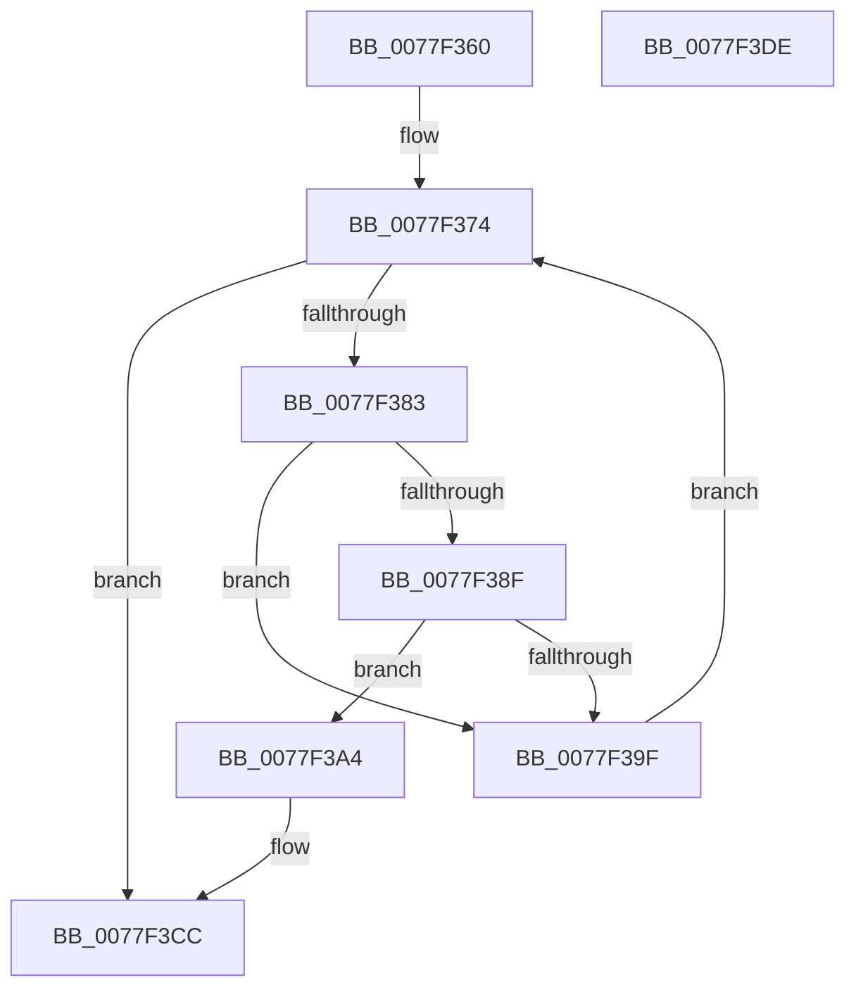

# PsFreeSiloContextSlot

- RVA: `0x0077F360`–`0x0077F3DF` (길이 `127` bytes)
- VA: `0x000000014077F360`
- 실행 섹션: `PAGE`
- PDB 이름 있음: `예`; PDB Function 태그: `아니요`
- unwind 정보 RVA: `0x0006E5F8`
- 디코드: `37`개 명령, `127/127` bytes 표시
- 미해석 바이트: `0` (있으면 어셈블리에 `.byte`로 보존)

> 이 문서는 커널 이미지의 기계어와 PDB 기호를 분석해 생성했습니다. 4번과 5번은 함수 원형과 자료형을 바이너리 사용 방식에서 추정한 C 해석이며 원본 소스 복구 결과는 아닙니다.

## 1. Dependencies

- 직접 호출 지점: **5**; 고유 호출 대상: **5**
- 직접 호출자로 확인된 함수: **1**
- RIP 상대 이미지 참조: **0**

### Outgoing calls
- `0x0077F376` → [PspGetNextSilo](../91/PspGetNextSilo_function_00919F78.md) (function, `0x00919F78`)
- `0x0077F396` → [PspStorageGetObject](../9F/PspStorageGetObject_function_009FC6F4.md) (function, `0x009FC6F4`)
- `0x0077F3A9` → [ObfDereferenceObject](../../text/2F/ObfDereferenceObject_function_002F9350.md) (function, `0x002F9350`)
- `0x0077F3C6` → [KeBugCheckEx](../../text/4F/KeBugCheckEx_function_004FD660.md) (function, `0x004FD660`)
- `0x0077F3CE` → [PspStorageFreeSlot](../78/PspStorageFreeSlot_function_00789C64.md) (function, `0x00789C64`)

### Direct callers
- [VrpRegistryUnload](../83/VrpRegistryUnload_function_0083B0E0.md) at `0x0083B10D`

### Static image references
- 디코드된 RIP-relative 메모리 참조가 없습니다.

## 2. Other-region calls and transfers

- 다른 실행 섹션으로 향하는 call: **2**
  - `0x0077F3A9` → [ObfDereferenceObject](../../text/2F/ObfDereferenceObject_function_002F9350.md) (`PAGE` → `.text`)
  - `0x0077F3C6` → [KeBugCheckEx](../../text/4F/KeBugCheckEx_function_004FD660.md) (`PAGE` → `.text`)
- 별도 외부 분기/꼬리 이동을 확인하지 못했습니다.

## 3. Assembly (complete function range)

```asm
0077F360  48 89 5C 24 08                  mov qword ptr [rsp + 8], rbx
0077F365  57                              push rdi
0077F366  48 83 EC 30                     sub rsp, 0x30
0077F36A  48 83 64 24 48 00               and qword ptr [rsp + 0x48], 0
0077F370  8B F9                           mov edi, ecx
0077F372  33 C9                           xor ecx, ecx
0077F374  33 D2                           xor edx, edx
0077F376  E8 FD AB 19 00                  call 0x140919f78
0077F37B  48 8B D8                        mov rbx, rax
0077F37E  48 85 C0                        test rax, rax
0077F381  74 49                           je 0x14077f3cc
0077F383  48 8B 88 00 06 00 00            mov rcx, qword ptr [rax + 0x600]
0077F38A  48 85 C9                        test rcx, rcx
0077F38D  74 10                           je 0x14077f39f
0077F38F  4C 8D 44 24 48                  lea r8, [rsp + 0x48]
0077F394  8B D7                           mov edx, edi
0077F396  E8 59 D3 27 00                  call 0x1409fc6f4
0077F39B  85 C0                           test eax, eax
0077F39D  79 05                           jns 0x14077f3a4
0077F39F  48 8B CB                        mov rcx, rbx
0077F3A2  EB D0                           jmp 0x14077f374
0077F3A4  48 8B 4C 24 48                  mov rcx, qword ptr [rsp + 0x48]
0077F3A9  E8 A2 9F B7 FF                  call 0x1402f9350
0077F3AE  48 8B 93 00 06 00 00            mov rdx, qword ptr [rbx + 0x600]
0077F3B5  45 33 C9                        xor r9d, r9d
0077F3B8  48 83 64 24 20 00               and qword ptr [rsp + 0x20], 0
0077F3BE  45 33 C0                        xor r8d, r8d
0077F3C1  B9 99 01 00 00                  mov ecx, 0x199
0077F3C6  E8 95 E2 D7 FF                  call 0x1404fd660
0077F3CB  CC                              int3
0077F3CC  8B CF                           mov ecx, edi
0077F3CE  E8 91 A8 00 00                  call 0x140789c64
0077F3D3  48 8B 5C 24 40                  mov rbx, qword ptr [rsp + 0x40]
0077F3D8  48 83 C4 30                     add rsp, 0x30
0077F3DC  5F                              pop rdi
0077F3DD  C3                              ret
0077F3DE  CC                              int3
```

## 4. C-style interpretation (structured pseudocode)

```c
__int64 __fastcall PsFreeSiloContextSlot(int a1, int a2, __int64 a3, int a4)
{
    __int64 result;
    __int64 v_rsp;
    unsigned __int64 v_stack_m18;
    unsigned __int64 v_stack_p10;
    unsigned __int64 v_stack_p8;

    v_stack_p8 = v_rbx;
    v_rsp = (v_rsp) - (48);
    a1 = 0;
loc_0077F374:
    a2 = 0;
    result = PspGetNextSilo(a1, a2, a3, a4);
    if (result == 0) goto loc_0077F3CC;
    if (*(unsigned __int64 *)(result + 1536) == 0) goto loc_0077F39F;
    result = PspStorageGetObject(*(unsigned __int64 *)(result + 1536), (unsigned int)((unsigned int)((unsigned int)(a1))), v_stack_p10, a4);
    if (!sign_flag) goto loc_0077F3A4;
loc_0077F39F:
    goto loc_0077F374;
loc_0077F3A4:
    result = ObfDereferenceObject(v_stack_p10, (unsigned int)((unsigned int)((unsigned int)(a1))), v_stack_p10, a4);
    a4 = 0;
    a3 = 0;
    result = KeBugCheckEx(409, *(unsigned __int64 *)(result + 1536), a3, a4);
loc_0077F3CC:
    result = PspStorageFreeSlot((unsigned int)((unsigned int)((unsigned int)(a1))), *(unsigned __int64 *)(result + 1536), a3, a4);
    v_rsp = (v_rsp) + (48);
    return result;
}
```

## 5. (Beta) C Style

```c
int64_t PsFreeSiloContextSlot(int32_t Arg1, int32_t Arg2, int64_t Arg3, int32_t Arg4)
{
    int64_t result;
    int64_t local_rsp;
    uint64_t v_stack_m18;
    uint64_t v_stack_p10;
    uint64_t v_stack_p8;

    v_stack_p8 = local_rbx;
    local_rsp = (local_rsp) - (48);
    Arg1 = 0;
loc_0077F374:
    Arg2 = 0;
    result = PspGetNextSilo(Arg1, Arg2, Arg3, Arg4);
    if (result == 0) goto loc_0077F3CC;
    if (*(uint64_t *)(result + 0x600) == 0) goto loc_0077F39F;
    result = PspStorageGetObject(*(uint64_t *)(result + 0x600), (uint32_t)((uint32_t)((uint32_t)(Arg1))), v_stack_p10, Arg4);
    if (!sign_flag) goto loc_0077F3A4;
loc_0077F39F:
    goto loc_0077F374;
loc_0077F3A4:
    result = ObfDereferenceObject(v_stack_p10, (uint32_t)((uint32_t)((uint32_t)(Arg1))), v_stack_p10, Arg4);
    Arg4 = 0;
    Arg3 = 0;
    result = KeBugCheckEx(409, *(uint64_t *)(result + 0x600), Arg3, Arg4);
loc_0077F3CC:
    result = PspStorageFreeSlot((uint32_t)((uint32_t)((uint32_t)(Arg1))), *(uint64_t *)(result + 0x600), Arg3, Arg4);
    local_rsp = (local_rsp) + (48);
    return result;
}
```

## 6. Execution-region graph

[열기: 2D/3D 그래프와 함수 탐색 컨트롤 패널](../../../control-panel.html?section=page&rva=0x0077F360&view=graph)

- 2D 그래프는 위에서 아래로 흐르고, 3D 그래프는 빈 공간을 드래그해 회전합니다. Shift+드래그는 이동, 휠은 확대·축소, 함수 노드 선택은 대상 보고서 이동입니다.

### Static fallback


