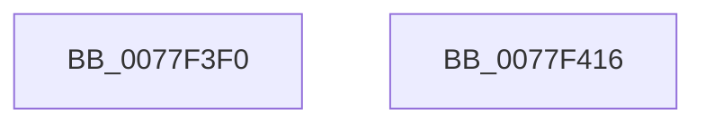

# PsGetCurrentServerSiloName

- RVA: `0x0077F3F0`–`0x0077F417` (길이 `39` bytes)
- VA: `0x000000014077F3F0`
- 실행 섹션: `PAGE`
- PDB 이름 있음: `예`; PDB Function 태그: `아니요`
- unwind 정보 RVA: `0x0005C788`
- 디코드: `10`개 명령, `39/39` bytes 표시
- 미해석 바이트: `0` (있으면 어셈블리에 `.byte`로 보존)

> 이 문서는 커널 이미지의 기계어와 PDB 기호를 분석해 생성했습니다. 4번과 5번은 함수 원형과 자료형을 바이너리 사용 방식에서 추정한 C 해석이며 원본 소스 복구 결과는 아닙니다.

## 1. Dependencies

- 직접 호출 지점: **1**; 고유 호출 대상: **1**
- 직접 호출자로 확인된 함수: **0**
- RIP 상대 이미지 참조: **1**

### Outgoing calls
- `0x0077F3F4` → [PsGetCurrentServerSiloGlobals](../../text/2F/PsGetCurrentServerSiloGlobals_function_002FE1F0.md) (function, `0x002FE1F0`)

### Direct callers
- 이 함수 시작 RVA로 연결되는 직접 call은 확인되지 않았습니다. 간접 호출은 완전히 역산할 수 없습니다.

### Static image references
- `0x0077F3FF` → RVA `0x00B4BEB8` (`PspDefaultSiloName`; read)

## 2. Other-region calls and transfers

- 다른 실행 섹션으로 향하는 call: **1**
  - `0x0077F3F4` → [PsGetCurrentServerSiloGlobals](../../text/2F/PsGetCurrentServerSiloGlobals_function_002FE1F0.md) (`PAGE` → `.text`)
- 별도 외부 분기/꼬리 이동을 확인하지 못했습니다.

## 3. Assembly (complete function range)

```asm
0077F3F0  48 83 EC 28                     sub rsp, 0x28
0077F3F4  E8 F7 ED B7 FF                  call 0x1402fe1f0
0077F3F9  48 05 E0 04 00 00               add rax, 0x4e0
0077F3FF  48 8D 0D B2 CA 3C 00            lea rcx, [rip + 0x3ccab2]
0077F406  66 83 38 00                     cmp word ptr [rax], 0
0077F40A  48 0F 47 C8                     cmova rcx, rax
0077F40E  48 8B C1                        mov rax, rcx
0077F411  48 83 C4 28                     add rsp, 0x28
0077F415  C3                              ret
0077F416  CC                              int3
```

## 4. C-style interpretation (structured pseudocode)

```c
__int64 __fastcall PsGetCurrentServerSiloName(void)
{
    __int64 result;
    __int64 v_rsp;

    v_rsp = (v_rsp) - (40);
    result = PsGetCurrentServerSiloGlobals(a1, a2, a3, a4);
    result = (result) + (0x4E0ULL);
    a1 = v_rip + 3984050;
    if ((*(unsigned __int16 *)(result)) > 0) { a1 = result; }
    v_rsp = (v_rsp) + (40);
    return a1;
}
```

## 5. (Beta) C Style

```c
void PsGetCurrentServerSiloName(void)
{
    int64_t result;
    int64_t local_rsp;

    local_rsp = (local_rsp) - (40);
    result = PsGetCurrentServerSiloGlobals(a1, a2, a3, a4);
    result = (result) + (0x4E0ULL);
    a1 = v_rip + 3984050;
    if ((*(uint16_t *)(result)) > 0) { a1 = result; }
    local_rsp = (local_rsp) + (40);
    return a1;
}
```

## 6. Execution-region graph

[열기: 2D/3D 그래프와 함수 탐색 컨트롤 패널](../../../control-panel.html?section=page&rva=0x0077F3F0&view=graph)

- 2D 그래프는 위에서 아래로 흐르고, 3D 그래프는 빈 공간을 드래그해 회전합니다. Shift+드래그는 이동, 휠은 확대·축소, 함수 노드 선택은 대상 보고서 이동입니다.

### Static fallback


