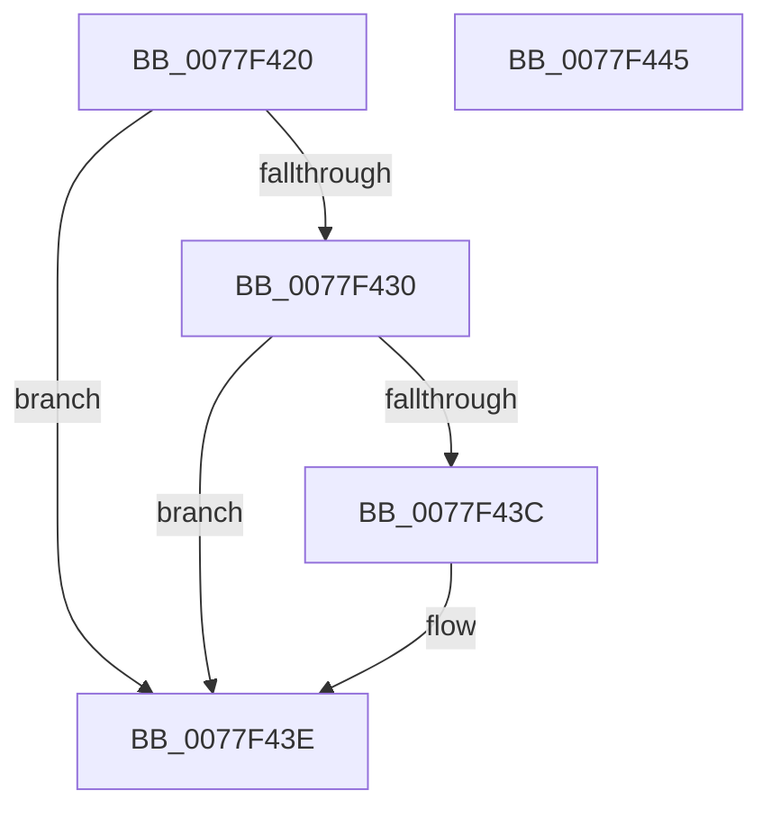

# PsIsProcessInAppSilo

- RVA: `0x0077F420`–`0x0077F446` (길이 `38` bytes)
- VA: `0x000000014077F420`
- 실행 섹션: `PAGE`
- PDB 이름 있음: `예`; PDB Function 태그: `아니요`
- unwind 정보 RVA: `0x0005C788`
- 디코드: `14`개 명령, `38/38` bytes 표시
- 미해석 바이트: `0` (있으면 어셈블리에 `.byte`로 보존)

> 이 문서는 커널 이미지의 기계어와 PDB 기호를 분석해 생성했습니다. 4번과 5번은 함수 원형과 자료형을 바이너리 사용 방식에서 추정한 C 해석이며 원본 소스 복구 결과는 아닙니다.

## 1. Dependencies

- 직접 호출 지점: **2**; 고유 호출 대상: **2**
- 직접 호출자로 확인된 함수: **0**
- RIP 상대 이미지 참조: **0**

### Outgoing calls
- `0x0077F424` → [PsGetProcessSilo](../../text/41/PsGetProcessSilo_function_00418580.md) (function, `0x00418580`)
- `0x0077F433` → [PsIsServerSilo](../../text/22/PsIsServerSilo_function_00225828.md) (function, `0x00225828`)

### Direct callers
- 이 함수 시작 RVA로 연결되는 직접 call은 확인되지 않았습니다. 간접 호출은 완전히 역산할 수 없습니다.

### Static image references
- 디코드된 RIP-relative 메모리 참조가 없습니다.

## 2. Other-region calls and transfers

- 다른 실행 섹션으로 향하는 call: **2**
  - `0x0077F424` → [PsGetProcessSilo](../../text/41/PsGetProcessSilo_function_00418580.md) (`PAGE` → `.text`)
  - `0x0077F433` → [PsIsServerSilo](../../text/22/PsIsServerSilo_function_00225828.md) (`PAGE` → `.text`)
- 별도 외부 분기/꼬리 이동을 확인하지 못했습니다.

## 3. Assembly (complete function range)

```asm
0077F420  48 83 EC 28                     sub rsp, 0x28
0077F424  E8 57 91 C9 FF                  call 0x140418580
0077F429  33 D2                           xor edx, edx
0077F42B  48 85 C0                        test rax, rax
0077F42E  74 0E                           je 0x14077f43e
0077F430  48 8B C8                        mov rcx, rax
0077F433  E8 F0 63 AA FF                  call 0x140225828
0077F438  84 C0                           test al, al
0077F43A  75 02                           jne 0x14077f43e
0077F43C  B2 01                           mov dl, 1
0077F43E  8A C2                           mov al, dl
0077F440  48 83 C4 28                     add rsp, 0x28
0077F444  C3                              ret
0077F445  CC                              int3
```

## 4. C-style interpretation (structured pseudocode)

```c
__int64 __fastcall PsIsProcessInAppSilo(__int64 a1, int a2)
{
    __int64 result;
    __int64 v_rsp;

    v_rsp = (v_rsp) - (40);
    result = PsGetProcessSilo(a1, a2, a3, a4);
    a2 = 0;
    if (result == 0) goto loc_0077F43E;
    result = PsIsServerSilo(result, a2, a3, a4);
    if ((unsigned __int8)(result) == 0) {
        a2 = 1;
    }
    v_rsp = (v_rsp) + (40);
    return (unsigned __int8)(a2);
}
```

## 5. (Beta) C Style

```c
int64_t PsIsProcessInAppSilo(int64_t Arg1, int32_t Arg2)
{
    int64_t result;
    int64_t local_rsp;

    local_rsp = (local_rsp) - (40);
    result = PsGetProcessSilo(Arg1, Arg2, a3, a4);
    Arg2 = 0;
    if (result == 0) goto loc_0077F43E;
    result = PsIsServerSilo(result, Arg2, a3, a4);
    if ((uint8_t)(result) == 0) {
        Arg2 = 1;
    }
    local_rsp = (local_rsp) + (40);
    return (uint8_t)(Arg2);
}
```

## 6. Execution-region graph

[열기: 2D/3D 그래프와 함수 탐색 컨트롤 패널](../../../control-panel.html?section=page&rva=0x0077F420&view=graph)

- 2D 그래프는 위에서 아래로 흐르고, 3D 그래프는 빈 공간을 드래그해 회전합니다. Shift+드래그는 이동, 휠은 확대·축소, 함수 노드 선택은 대상 보고서 이동입니다.

### Static fallback


