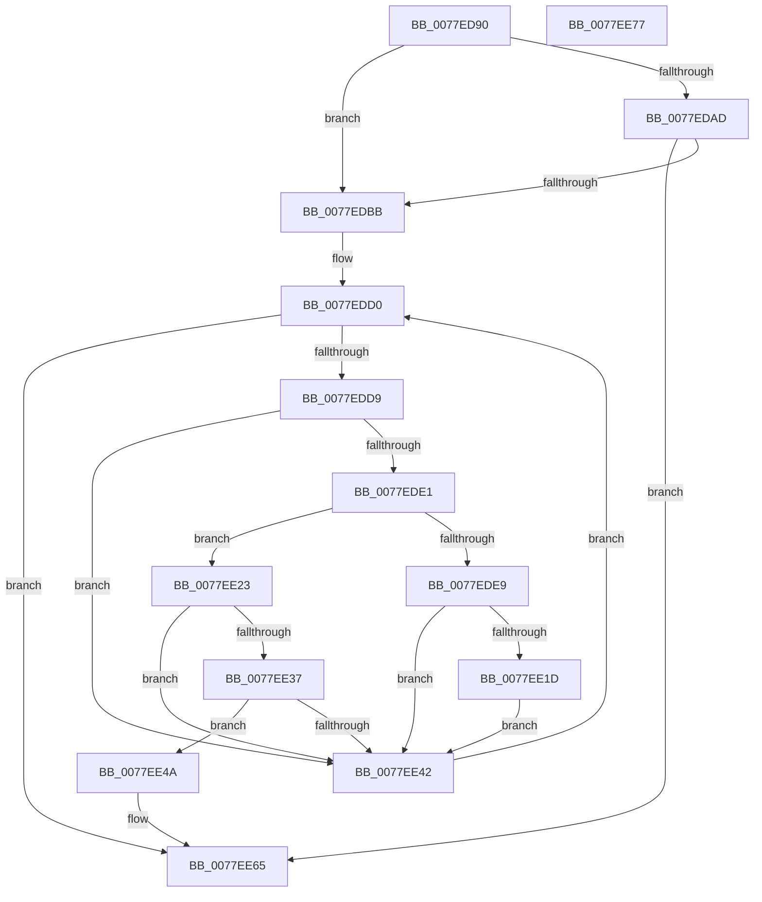

# PsLocateSystemDlls

- RVA: `0x0077ED90`–`0x0077EE78` (길이 `232` bytes)
- VA: `0x000000014077ED90`
- 실행 섹션: `PAGE`
- PDB 이름 있음: `예`; PDB Function 태그: `아니요`
- unwind 정보 RVA: `0x000794E0`
- 디코드: `67`개 명령, `232/232` bytes 표시
- 미해석 바이트: `0` (있으면 어셈블리에 `.byte`로 보존)

> 이 문서는 커널 이미지의 기계어와 PDB 기호를 분석해 생성했습니다. 4번과 5번은 함수 원형과 자료형을 바이너리 사용 방식에서 추정한 C 해석이며 원본 소스 복구 결과는 아닙니다.

## 1. Dependencies

- 직접 호출 지점: **5**; 고유 호출 대상: **5**
- 직접 호출자로 확인된 함수: **1**
- RIP 상대 이미지 참조: **2**

### Outgoing calls
- `0x0077EDA4` → [ExVerifySuite](../../text/4F/ExVerifySuite_function_004F80E0.md) (function, `0x004F80E0`)
- `0x0077EDBD` → [VslGetNestedPageProtectionFlags](../../text/2F/VslGetNestedPageProtectionFlags_function_002F2164.md) (function, `0x002F2164`)
- `0x0077EE14` → [PspMapSystemDll](../8D/PspMapSystemDll_function_008D6908.md) (function, `0x008D6908`)
- `0x0077EE2E` → [PspLocateSystemDll](PspLocateSystemDll_function_0077F0D0.md) (function, `0x0077F0D0`)
- `0x0077EE5F` → [KeBugCheckEx](../../text/4F/KeBugCheckEx_function_004FD660.md) (function, `0x004FD660`)

### Direct callers
- [IoInitSystemPreDrivers](../../init/C2/IoInitSystemPreDrivers_function_00C2AC3C.md) at `0x00C2BD31`

### Static image references
- `0x0077EDAD` → RVA `0x00FD9E28` (`PAGEDATA`; read)
- `0x0077EDC4` → RVA `0x00FD8130` (`PAGEDATA`; read)

## 2. Other-region calls and transfers

- 다른 실행 섹션으로 향하는 call: **3**
  - `0x0077EDA4` → [ExVerifySuite](../../text/4F/ExVerifySuite_function_004F80E0.md) (`PAGE` → `.text`)
  - `0x0077EDBD` → [VslGetNestedPageProtectionFlags](../../text/2F/VslGetNestedPageProtectionFlags_function_002F2164.md) (`PAGE` → `.text`)
  - `0x0077EE5F` → [KeBugCheckEx](../../text/4F/KeBugCheckEx_function_004FD660.md) (`PAGE` → `.text`)
- 별도 외부 분기/꼬리 이동을 확인하지 못했습니다.

## 3. Assembly (complete function range)

```asm
0077ED90  48 89 5C 24 08                  mov qword ptr [rsp + 8], rbx
0077ED95  48 89 74 24 10                  mov qword ptr [rsp + 0x10], rsi
0077ED9A  57                              push rdi
0077ED9B  48 83 EC 30                     sub rsp, 0x30
0077ED9F  B9 06 00 00 00                  mov ecx, 6
0077EDA4  E8 37 93 D7 FF                  call 0x1404f80e0
0077EDA9  84 C0                           test al, al
0077EDAB  74 0E                           je 0x14077edbb
0077EDAD  8B 05 75 B0 85 00               mov eax, dword ptr [rip + 0x85b075]
0077EDB3  A8 01                           test al, 1
0077EDB5  0F 85 AA 00 00 00               jne 0x14077ee65
0077EDBB  33 C9                           xor ecx, ecx
0077EDBD  E8 A2 33 B7 FF                  call 0x1402f2164
0077EDC2  8B F0                           mov esi, eax
0077EDC4  48 8D 1D 65 93 85 00            lea rbx, [rip + 0x859365]
0077EDCB  83 E6 04                        and esi, 4
0077EDCE  33 FF                           xor edi, edi
0077EDD0  83 FF 06                        cmp edi, 6
0077EDD3  0F 8D 8C 00 00 00               jge 0x14077ee65
0077EDD9  4C 8B 13                        mov r10, qword ptr [rbx]
0077EDDC  4D 85 D2                        test r10, r10
0077EDDF  74 61                           je 0x14077ee42
0077EDE1  41 8B 42 08                     mov eax, dword ptr [r10 + 8]
0077EDE5  A8 20                           test al, 0x20
0077EDE7  74 3A                           je 0x14077ee23
0077EDE9  48 8B 05 40 93 85 00            mov rax, qword ptr [rip + 0x859340]
0077EDF0  41 B9 01 00 00 00               mov r9d, 1
0077EDF6  45 33 C0                        xor r8d, r8d
0077EDF9  49 8B D2                        mov rdx, r10
0077EDFC  48 8B 48 38                     mov rcx, qword ptr [rax + 0x38]
0077EE00  49 89 4A 38                     mov qword ptr [r10 + 0x38], rcx
0077EE04  65 48 8B 04 25 88 01 00 00      mov rax, qword ptr gs:[0x188]
0077EE0D  48 8B 88 B8 00 00 00            mov rcx, qword ptr [rax + 0xb8]
0077EE14  E8 EF 7A 15 00                  call 0x1408d6908
0077EE19  85 C0                           test eax, eax
0077EE1B  79 25                           jns 0x14077ee42
0077EE1D  48 83 23 00                     and qword ptr [rbx], 0
0077EE21  EB 1F                           jmp 0x14077ee42
0077EE23  24 10                           and al, 0x10
0077EE25  49 8B CA                        mov rcx, r10
0077EE28  F6 D8                           neg al
0077EE2A  1B D2                           sbb edx, edx
0077EE2C  23 D6                           and edx, esi
0077EE2E  E8 9D 02 00 00                  call 0x14077f0d0
0077EE33  85 C0                           test eax, eax
0077EE35  79 0B                           jns 0x14077ee42
0077EE37  48 8B 0B                        mov rcx, qword ptr [rbx]
0077EE3A  8B 51 08                        mov edx, dword ptr [rcx + 8]
0077EE3D  F6 C2 01                        test dl, 1
0077EE40  75 08                           jne 0x14077ee4a
0077EE42  FF C7                           inc edi
0077EE44  48 83 C3 08                     add rbx, 8
0077EE48  EB 86                           jmp 0x14077edd0
0077EE4A  48 83 64 24 20 00               and qword ptr [rsp + 0x20], 0
0077EE50  B9 6B 00 00 00                  mov ecx, 0x6b
0077EE55  4C 63 CF                        movsxd r9, edi
0077EE58  48 63 D0                        movsxd rdx, eax
0077EE5B  44 8D 41 97                     lea r8d, [rcx - 0x69]
0077EE5F  E8 FC E7 D7 FF                  call 0x1404fd660
0077EE64  CC                              int3
0077EE65  48 8B 5C 24 40                  mov rbx, qword ptr [rsp + 0x40]
0077EE6A  33 C0                           xor eax, eax
0077EE6C  48 8B 74 24 48                  mov rsi, qword ptr [rsp + 0x48]
0077EE71  48 83 C4 30                     add rsp, 0x30
0077EE75  5F                              pop rdi
0077EE76  C3                              ret
0077EE77  CC                              int3
```

## 4. C-style interpretation (structured pseudocode)

```c
__int64 __fastcall PsLocateSystemDlls(__int64 a1, __int64 a2, int a3)
{
    __int64 result;
    __int64 v_rbx;
    __int64 v_rdi;
    __int64 v_rsi;
    __int64 v_rsp;
    unsigned __int64 v_stack_m18;
    unsigned __int64 v_stack_p10;
    unsigned __int64 v_stack_p8;

    v_stack_p8 = v_rbx;
    v_stack_p10 = v_rsi;
    v_rsp = (v_rsp) - (48);
    result = ExVerifySuite(6, a2, a3, a4);
    if ((unsigned __int8)(result) == 0) goto loc_0077EDBB;
    if ((((unsigned __int8)((unsigned int)(*(unsigned int *)(v_rip + 8761461)))) & (1)) != 0) goto loc_0077EE65;
loc_0077EDBB:
    a1 = 0;
    result = VslGetNestedPageProtectionFlags(a1, a2, a3, a4);
    v_rsi = (unsigned int)(((unsigned int)((unsigned int)(result))) & (4));
    v_rdi = 0;
loc_0077EDD0:
    if (0 >= 6) goto loc_0077EE65;
    if (*(unsigned __int64 *)(v_rip + 8754021) == 0) goto loc_0077EE42;
    if ((((unsigned __int8)((unsigned int)(*(unsigned int *)(*(unsigned __int64 *)(v_rip + 8754021) + 8)))) & (32)) == 0) goto loc_0077EE23;
    a3 = 0;
    *(unsigned __int64 *)(*(unsigned __int64 *)(v_rip + 8754021) + 56) = *(unsigned __int64 *)(*(unsigned __int64 *)(v_rip + 8753984) + 56);
    result = PspMapSystemDll(*(unsigned __int64 *)(*(unsigned __int64 *)(gs_base + (0 + 392)) + 184), *(unsigned __int64 *)(v_rip + 8754021), a3, 1);
    if (!sign_flag) goto loc_0077EE42;
    goto loc_0077EE42;
loc_0077EE23:
    result = (unsigned __int8)((result) & (16));
    result = (unsigned __int8)(-(result));
    a2 = (unsigned int)((*(unsigned __int64 *)(v_rip + 8754021)) & ((unsigned int)(v_rsi)));
    result = PspLocateSystemDll(*(unsigned __int64 *)(v_rip + 8754021), a2, a3, 1);
    if (!sign_flag) goto loc_0077EE42;
    if ((((unsigned __int8)((unsigned int)(*(unsigned int *)(*(unsigned __int64 *)(v_rip + 8754021) + 8)))) & (1)) != 0) goto loc_0077EE4A;
loc_0077EE42:
    v_rdi = (unsigned int)((v_rdi) + 1);
    v_rbx = (v_rip + 8754021) + (8);
    goto loc_0077EDD0;
loc_0077EE4A:
    result = KeBugCheckEx(107, (int)((unsigned int)(result)), 107 - 105, (int)((unsigned int)(v_rdi)));
loc_0077EE65:
    result = 0;
    v_rsp = (v_rsp) + (48);
    return result;
}
```

## 5. (Beta) C Style

```c
int64_t PsLocateSystemDlls(int64_t Arg1, int64_t Arg2, int32_t Arg3)
{
    int64_t result;
    int64_t local_rbx;
    int64_t local_rdi;
    int64_t local_rsi;
    int64_t local_rsp;
    uint64_t v_stack_m18;
    uint64_t v_stack_p10;
    uint64_t v_stack_p8;

    v_stack_p8 = local_rbx;
    v_stack_p10 = local_rsi;
    local_rsp = (local_rsp) - (48);
    result = ExVerifySuite(6, Arg2, Arg3, a4);
    if ((uint8_t)(result) == 0) goto loc_0077EDBB;
    if ((((uint8_t)((uint32_t)(*(uint32_t *)(v_rip + 0x85B075)))) & (1)) != 0) goto loc_0077EE65;
loc_0077EDBB:
    Arg1 = 0;
    result = VslGetNestedPageProtectionFlags(Arg1, Arg2, Arg3, a4);
    local_rsi = (uint32_t)(((uint32_t)((uint32_t)(result))) & (4));
    local_rdi = 0;
loc_0077EDD0:
    if (0 >= 6) goto loc_0077EE65;
    if (*(uint64_t *)(v_rip + 0x859365) == 0) goto loc_0077EE42;
    if ((((uint8_t)((uint32_t)(*(uint32_t *)(*(uint64_t *)(v_rip + 0x859365) + 0x8)))) & (32)) == 0) goto loc_0077EE23;
    Arg3 = 0;
    *(uint64_t *)(*(uint64_t *)(v_rip + 0x859365) + 0x38) = *(uint64_t *)(*(uint64_t *)(v_rip + 0x859340) + 0x38);
    result = PspMapSystemDll(*(uint64_t *)(*(uint64_t *)(gs_base + (0 + 0x188)) + 0xB8), *(uint64_t *)(v_rip + 0x859365), Arg3, 1);
    if (!sign_flag) goto loc_0077EE42;
    goto loc_0077EE42;
loc_0077EE23:
    result = (uint8_t)((result) & (16));
    result = (uint8_t)(-(result));
    Arg2 = (uint32_t)((*(uint64_t *)(v_rip + 0x859365)) & ((uint32_t)(local_rsi)));
    result = PspLocateSystemDll(*(uint64_t *)(v_rip + 0x859365), Arg2, Arg3, 1);
    if (!sign_flag) goto loc_0077EE42;
    if ((((uint8_t)((uint32_t)(*(uint32_t *)(*(uint64_t *)(v_rip + 0x859365) + 0x8)))) & (1)) != 0) goto loc_0077EE4A;
loc_0077EE42:
    local_rdi = (uint32_t)((local_rdi) + 1);
    local_rbx = (v_rip + 8754021) + (8);
    goto loc_0077EDD0;
loc_0077EE4A:
    result = KeBugCheckEx(107, (int32_t)((uint32_t)(result)), 107 - 105, (int32_t)((uint32_t)(local_rdi)));
loc_0077EE65:
    result = 0;
    local_rsp = (local_rsp) + (48);
    return result;
}
```

## 6. Execution-region graph

[열기: 2D/3D 그래프와 함수 탐색 컨트롤 패널](../../../control-panel.html?section=page&rva=0x0077ED90&view=graph)

- 2D 그래프는 위에서 아래로 흐르고, 3D 그래프는 빈 공간을 드래그해 회전합니다. Shift+드래그는 이동, 휠은 확대·축소, 함수 노드 선택은 대상 보고서 이동입니다.

### Static fallback


