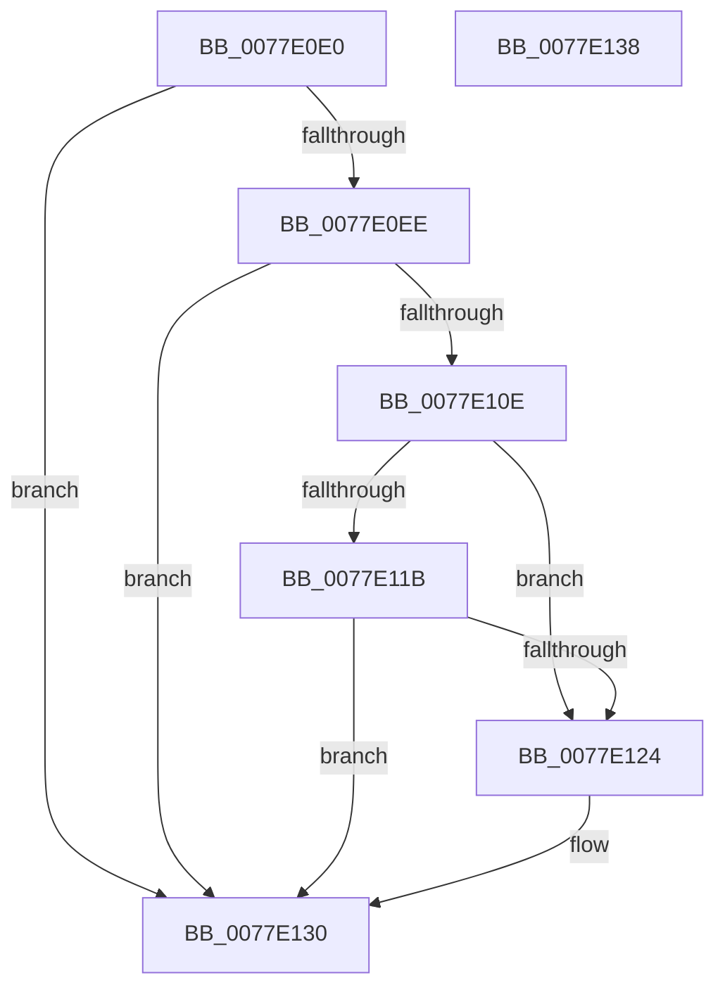

# PsQuerySyscallProviderInformation

- RVA: `0x0077E0E0`–`0x0077E139` (길이 `89` bytes)
- VA: `0x000000014077E0E0`
- 실행 섹션: `PAGE`
- PDB 이름 있음: `예`; PDB Function 태그: `아니요`
- unwind 정보 RVA: `0x0005D2F4`
- 디코드: `25`개 명령, `89/89` bytes 표시
- 미해석 바이트: `0` (있으면 어셈블리에 `.byte`로 보존)

> 이 문서는 커널 이미지의 기계어와 PDB 기호를 분석해 생성했습니다. 4번과 5번은 함수 원형과 자료형을 바이너리 사용 방식에서 추정한 C 해석이며 원본 소스 복구 결과는 아닙니다.

## 1. Dependencies

- 직접 호출 지점: **1**; 고유 호출 대상: **1**
- 직접 호출자로 확인된 함수: **0**
- RIP 상대 이미지 참조: **0**

### Outgoing calls
- `0x0077E0FC` → [PspQuerySyscallProviderProcessList](PspQuerySyscallProviderProcessList_function_0077E710.md) (function, `0x0077E710`)

### Direct callers
- 이 함수 시작 RVA로 연결되는 직접 call은 확인되지 않았습니다. 간접 호출은 완전히 역산할 수 없습니다.

### Static image references
- 디코드된 RIP-relative 메모리 참조가 없습니다.

## 2. Other-region calls and transfers

- 다른 실행 섹션으로 향하는 call: **0**
- 별도 외부 분기/꼬리 이동을 확인하지 못했습니다.

## 3. Assembly (complete function range)

```asm
0077E0E0  48 83 EC 38                     sub rsp, 0x38
0077E0E4  41 BA 03 00 00 C0               mov r10d, 0xc0000003
0077E0EA  85 D2                           test edx, edx
0077E0EC  75 42                           jne 0x14077e130
0077E0EE  49 C1 E9 03                     shr r9, 3
0077E0F2  48 8D 54 24 20                  lea rdx, [rsp + 0x20]
0077E0F7  4C 89 4C 24 20                  mov qword ptr [rsp + 0x20], r9
0077E0FC  E8 0F 06 00 00                  call 0x14077e710
0077E101  48 8B 54 24 60                  mov rdx, qword ptr [rsp + 0x60]
0077E106  44 8B D0                        mov r10d, eax
0077E109  48 85 D2                        test rdx, rdx
0077E10C  74 22                           je 0x14077e130
0077E10E  B8 00 00 00 80                  mov eax, 0x80000000
0077E113  41 8D 0C 02                     lea ecx, [r10 + rax]
0077E117  85 C8                           test eax, ecx
0077E119  75 09                           jne 0x14077e124
0077E11B  41 81 FA 05 00 00 80            cmp r10d, 0x80000005
0077E122  75 0C                           jne 0x14077e130
0077E124  48 8B 44 24 20                  mov rax, qword ptr [rsp + 0x20]
0077E129  48 C1 E0 03                     shl rax, 3
0077E12D  48 89 02                        mov qword ptr [rdx], rax
0077E130  41 8B C2                        mov eax, r10d
0077E133  48 83 C4 38                     add rsp, 0x38
0077E137  C3                              ret
0077E138  CC                              int3
```

## 4. C-style interpretation (structured pseudocode)

```c
__int64 __fastcall PsQuerySyscallProviderInformation(__int64 a1, int a2, __int64 a3, __int64 a4, __int64 a5)
{
    __int64 result;
    __int64 v_rsp;
    unsigned __int64 v_stack_m18;

    v_rsp = (v_rsp) - (56);
    if (a2 != 0) goto loc_0077E130;
    a4 = (a4) >> (3);
    v_stack_m18 = a4;
    result = PspQuerySyscallProviderProcessList(a1, v_stack_m18, a3, a4);
    if (a5 == 0) goto loc_0077E130;
    if ((((unsigned int)((unsigned int)(0x80000000ULL))) & ((unsigned int)((unsigned int)((unsigned int)(result)) + (unsigned int)(0x80000000ULL) * 1))) != 0) goto loc_0077E124;
    result = (unsigned int)(0x80000000ULL);
    if (((unsigned int)((unsigned int)((unsigned int)(result)))) == 0x80000005ULL) {
        result = v_stack_m18;
        result = (result) << (3);
        *(unsigned __int64 *)(a5) = result;
    }
    v_rsp = (v_rsp) + (56);
    return (unsigned int)((unsigned int)((unsigned int)((unsigned int)(result))));
}
```

## 5. (Beta) C Style

```c
int64_t PsQuerySyscallProviderInformation(int64_t Arg1, int32_t Arg2, int64_t Arg3, int64_t Arg4, int64_t Arg5)
{
    int64_t result;
    int64_t local_rsp;
    uint64_t v_stack_m18;

    local_rsp = (local_rsp) - (56);
    if (Arg2 != 0) goto loc_0077E130;
    Arg4 = (Arg4) >> (3);
    v_stack_m18 = Arg4;
    result = PspQuerySyscallProviderProcessList(Arg1, v_stack_m18, Arg3, Arg4);
    if (Arg5 == 0) goto loc_0077E130;
    if ((((uint32_t)((uint32_t)(0x80000000ULL))) & ((uint32_t)((uint32_t)((uint32_t)(result)) + (uint32_t)(0x80000000ULL) * 1))) != 0) goto loc_0077E124;
    result = (uint32_t)(0x80000000ULL);
    if (((uint32_t)((uint32_t)((uint32_t)(result)))) == 0x80000005ULL) {
        result = v_stack_m18;
        result = (result) << (3);
        *(uint64_t *)(Arg5) = result;
    }
    local_rsp = (local_rsp) + (56);
    return (uint32_t)((uint32_t)((uint32_t)((uint32_t)(result))));
}
```

## 6. Execution-region graph

[열기: 2D/3D 그래프와 함수 탐색 컨트롤 패널](../../../control-panel.html?section=page&rva=0x0077E0E0&view=graph)

- 2D 그래프는 위에서 아래로 흐르고, 3D 그래프는 빈 공간을 드래그해 회전합니다. Shift+드래그는 이동, 휠은 확대·축소, 함수 노드 선택은 대상 보고서 이동입니다.

### Static fallback


