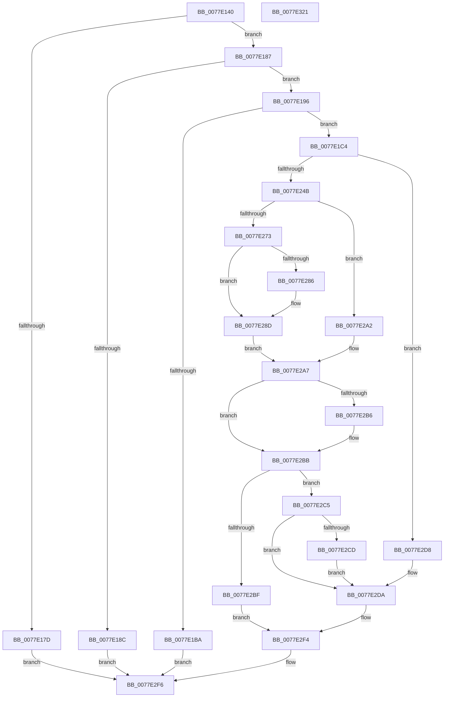

# PsRegisterSyscallProvider

- RVA: `0x0077E140`–`0x0077E322` (길이 `482` bytes)
- VA: `0x000000014077E140`
- 실행 섹션: `PAGE`
- PDB 이름 있음: `예`; PDB Function 태그: `아니요`
- unwind 정보 RVA: `0x000CDEE0`
- 디코드: `128`개 명령, `482/482` bytes 표시
- 미해석 바이트: `0` (있으면 어셈블리에 `.byte`로 보존)

> 이 문서는 커널 이미지의 기계어와 PDB 기호를 분석해 생성했습니다. 4번과 5번은 함수 원형과 자료형을 바이너리 사용 방식에서 추정한 C 해석이며 원본 소스 복구 결과는 아닙니다.

## 1. Dependencies

- 직접 호출 지점: **13**; 고유 호출 대상: **12**
- 직접 호출자로 확인된 함수: **0**
- RIP 상대 이미지 참조: **5**

### Outgoing calls
- `0x0077E1AA` → [ExAllocatePool2](../../poolcode/B8/ExAllocatePool2_function_00B820F0.md) (function, `0x00B820F0`)
- `0x0077E1D0` → [memset](../../text/6C/memset_function_006C6C40.md) (function, `0x006C6C40`)
- `0x0077E1EB` → [ObfReferenceObjectWithTag](../../text/21/ObfReferenceObjectWithTag_function_00210710.md) (function, `0x00210710`)
- `0x0077E221` → [memset](../../text/6C/memset_function_006C6C40.md) (function, `0x006C6C40`)
- `0x0077E23E` → [VslpEnterIumSecureMode](../../text/23/VslpEnterIumSecureMode_function_00235E50.md) (function, `0x00235E50`)
- `0x0077E259` → [PspAcquireSyscallProviderRegistrationLockExclusive](../../text/5E/PspAcquireSyscallProviderRegistrationLockExclusive_function_005E2284.md) (function, `0x005E2284`)
- `0x0077E267` → [PspLookupSyscallProviderByIdNoLock](PspLookupSyscallProviderByIdNoLock_function_0077E69C.md) (function, `0x0077E69C`)
- `0x0077E2A7` → [PspReleaseSyscallProviderRegistrationLockExclusive](../../text/5E/PspReleaseSyscallProviderRegistrationLockExclusive_function_005E2438.md) (function, `0x005E2438`)
- `0x0077E2B6` → [PspDereferenceSyscallProvider](../../text/5E/PspDereferenceSyscallProvider_function_005E22E8.md) (function, `0x005E22E8`)
- `0x0077E2D1` → [VslRevokeSyscallProviderServiceTables](../71/VslRevokeSyscallProviderServiceTables_function_007195B0.md) (function, `0x007195B0`)
- `0x0077E2E5` → [ObfDereferenceObjectWithTag](../../text/2F/ObfDereferenceObjectWithTag_function_002F78E0.md) (function, `0x002F78E0`)
- `0x0077E2EF` → [ExFreePoolWithTag](../../poolcode/B8/ExFreePoolWithTag_function_00B82870.md) (function, `0x00B82870`)
- `0x0077E301` → [_security_check_cookie](../../text/6A/_security_check_cookie_function_006AC640.md) (function, `0x006AC640`)

### Direct callers
- 이 함수 시작 RVA로 연결되는 직접 call은 확인되지 않았습니다. 간접 호출은 완전히 역산할 수 없습니다.

### Static image references
- `0x0077E157` → RVA `0x00E0A740` (`.data`; read)
- `0x0077E16E` → RVA `0x00FD9A64` (`PAGEDATA`; read)
- `0x0077E273` → RVA `0x00FD82D8` (`PAGEDATA`; read)
- `0x0077E27A` → RVA `0x00FD82D0` (`PAGEDATA`; read)
- `0x0077E299` → RVA `0x00FD82D8` (`PAGEDATA`; write)

## 2. Other-region calls and transfers

- 다른 실행 섹션으로 향하는 call: **11**
  - `0x0077E1AA` → [ExAllocatePool2](../../poolcode/B8/ExAllocatePool2_function_00B820F0.md) (`PAGE` → `POOLCODE`)
  - `0x0077E1D0` → [memset](../../text/6C/memset_function_006C6C40.md) (`PAGE` → `.text`)
  - `0x0077E1EB` → [ObfReferenceObjectWithTag](../../text/21/ObfReferenceObjectWithTag_function_00210710.md) (`PAGE` → `.text`)
  - `0x0077E221` → [memset](../../text/6C/memset_function_006C6C40.md) (`PAGE` → `.text`)
  - `0x0077E23E` → [VslpEnterIumSecureMode](../../text/23/VslpEnterIumSecureMode_function_00235E50.md) (`PAGE` → `.text`)
  - `0x0077E259` → [PspAcquireSyscallProviderRegistrationLockExclusive](../../text/5E/PspAcquireSyscallProviderRegistrationLockExclusive_function_005E2284.md) (`PAGE` → `.text`)
  - `0x0077E2A7` → [PspReleaseSyscallProviderRegistrationLockExclusive](../../text/5E/PspReleaseSyscallProviderRegistrationLockExclusive_function_005E2438.md) (`PAGE` → `.text`)
  - `0x0077E2B6` → [PspDereferenceSyscallProvider](../../text/5E/PspDereferenceSyscallProvider_function_005E22E8.md) (`PAGE` → `.text`)
  - `0x0077E2E5` → [ObfDereferenceObjectWithTag](../../text/2F/ObfDereferenceObjectWithTag_function_002F78E0.md) (`PAGE` → `.text`)
  - `0x0077E2EF` → [ExFreePoolWithTag](../../poolcode/B8/ExFreePoolWithTag_function_00B82870.md) (`PAGE` → `POOLCODE`)
  - `0x0077E301` → [_security_check_cookie](../../text/6A/_security_check_cookie_function_006AC640.md) (`PAGE` → `.text`)
- 별도 외부 분기/꼬리 이동을 확인하지 못했습니다.

## 3. Assembly (complete function range)

```asm
0077E140  48 89 5C 24 10                  mov qword ptr [rsp + 0x10], rbx
0077E145  55                              push rbp
0077E146  56                              push rsi
0077E147  57                              push rdi
0077E148  41 54                           push r12
0077E14A  41 55                           push r13
0077E14C  41 56                           push r14
0077E14E  41 57                           push r15
0077E150  48 81 EC B0 00 00 00            sub rsp, 0xb0
0077E157  48 8B 05 E2 C5 68 00            mov rax, qword ptr [rip + 0x68c5e2]
0077E15E  48 33 C4                        xor rax, rsp
0077E161  48 89 84 24 A0 00 00 00         mov qword ptr [rsp + 0xa0], rax
0077E169  33 F6                           xor esi, esi
0077E16B  4D 8B E0                        mov r12, r8
0077E16E  40 38 35 EF B8 85 00            cmp byte ptr [rip + 0x85b8ef], sil
0077E175  4C 8B F2                        mov r14, rdx
0077E178  4C 8B F9                        mov r15, rcx
0077E17B  75 0A                           jne 0x14077e187
0077E17D  B8 9D 00 00 C0                  mov eax, 0xc000009d
0077E182  E9 6F 01 00 00                  jmp 0x14077e2f6
0077E187  80 3A 01                        cmp byte ptr [rdx], 1
0077E18A  74 0A                           je 0x14077e196
0077E18C  B8 59 00 00 C0                  mov eax, 0xc0000059
0077E191  E9 60 01 00 00                  jmp 0x14077e2f6
0077E196  41 BD 60 00 00 00               mov r13d, 0x60
0077E19C  41 B8 50 73 53 63               mov r8d, 0x63537350
0077E1A2  41 8B D5                        mov edx, r13d
0077E1A5  B9 00 01 00 00                  mov ecx, 0x100
0077E1AA  E8 41 3F 40 00                  call 0x140b820f0
0077E1AF  48 8B F8                        mov rdi, rax
0077E1B2  48 8B E8                        mov rbp, rax
0077E1B5  48 85 C0                        test rax, rax
0077E1B8  75 0A                           jne 0x14077e1c4
0077E1BA  B8 9A 00 00 C0                  mov eax, 0xc000009a
0077E1BF  E9 32 01 00 00                  jmp 0x14077e2f6
0077E1C4  49 8B 5E 18                     mov rbx, qword ptr [r14 + 0x18]
0077E1C8  4D 8B C5                        mov r8, r13
0077E1CB  33 D2                           xor edx, edx
0077E1CD  48 8B CF                        mov rcx, rdi
0077E1D0  E8 6B 8A F4 FF                  call 0x1406c6c40
0077E1D5  41 0F 10 46 04                  movups xmm0, xmmword ptr [r14 + 4]
0077E1DA  BA 50 73 53 63                  mov edx, 0x63537350
0077E1DF  4C 89 7F 20                     mov qword ptr [rdi + 0x20], r15
0077E1E3  49 8B CF                        mov rcx, r15
0077E1E6  F3 0F 7F 47 10                  movdqu xmmword ptr [rdi + 0x10], xmm0
0077E1EB  E8 20 25 A9 FF                  call 0x140210710
0077E1F0  48 89 5F 28                     mov qword ptr [rdi + 0x28], rbx
0077E1F4  48 8D 47 48                     lea rax, [rdi + 0x48]
0077E1F8  48 C7 47 30 01 00 00 00         mov qword ptr [rdi + 0x30], 1
0077E200  48 8D 4C 24 30                  lea rcx, [rsp + 0x30]
0077E205  48 89 77 38                     mov qword ptr [rdi + 0x38], rsi
0077E209  33 D2                           xor edx, edx
0077E20B  48 89 77 40                     mov qword ptr [rdi + 0x40], rsi
0077E20F  48 89 40 08                     mov qword ptr [rax + 8], rax
0077E213  48 89 00                        mov qword ptr [rax], rax
0077E216  83 4F 5C FF                     or dword ptr [rdi + 0x5c], 0xffffffff
0077E21A  44 8D 42 68                     lea r8d, [rdx + 0x68]
0077E21E  89 77 58                        mov dword ptr [rdi + 0x58], esi
0077E221  E8 1A 8A F4 FF                  call 0x1406c6c40
0077E226  49 8B 47 18                     mov rax, qword ptr [r15 + 0x18]
0077E22A  4C 8D 4C 24 30                  lea r9, [rsp + 0x30]
0077E22F  BA 5A 00 00 00                  mov edx, 0x5a
0077E234  48 89 44 24 38                  mov qword ptr [rsp + 0x38], rax
0077E239  45 33 C0                        xor r8d, r8d
0077E23C  B1 02                           mov cl, 2
0077E23E  E8 0D 7C AB FF                  call 0x140235e50
0077E243  85 C0                           test eax, eax
0077E245  0F 88 8D 00 00 00               js 0x14077e2d8
0077E24B  44 8B 74 24 40                  mov r14d, dword ptr [rsp + 0x40]
0077E250  44 89 77 5C                     mov dword ptr [rdi + 0x5c], r14d
0077E254  48 89 74 24 20                  mov qword ptr [rsp + 0x20], rsi
0077E259  E8 26 40 E6 FF                  call 0x1405e2284
0077E25E  48 8D 54 24 20                  lea rdx, [rsp + 0x20]
0077E263  48 8D 4F 10                     lea rcx, [rdi + 0x10]
0077E267  E8 30 04 00 00                  call 0x14077e69c
0077E26C  3D 25 02 00 C0                  cmp eax, 0xc0000225
0077E271  75 2F                           jne 0x14077e2a2
0077E273  48 8B 05 5E A0 85 00            mov rax, qword ptr [rip + 0x85a05e]
0077E27A  48 8D 0D 4F A0 85 00            lea rcx, [rip + 0x85a04f]
0077E281  48 39 08                        cmp qword ptr [rax], rcx
0077E284  74 07                           je 0x14077e28d
0077E286  B9 03 00 00 00                  mov ecx, 3
0077E28B  CD 29                           int 0x29
0077E28D  48 89 0F                        mov qword ptr [rdi], rcx
0077E290  8B DE                           mov ebx, esi
0077E292  48 89 47 08                     mov qword ptr [rdi + 8], rax
0077E296  48 89 38                        mov qword ptr [rax], rdi
0077E299  48 89 3D 38 A0 85 00            mov qword ptr [rip + 0x85a038], rdi
0077E2A0  EB 05                           jmp 0x14077e2a7
0077E2A2  BB 35 00 00 C0                  mov ebx, 0xc0000035
0077E2A7  E8 8C 41 E6 FF                  call 0x1405e2438
0077E2AC  48 8B 4C 24 20                  mov rcx, qword ptr [rsp + 0x20]
0077E2B1  48 85 C9                        test rcx, rcx
0077E2B4  74 05                           je 0x14077e2bb
0077E2B6  E8 2D 40 E6 FF                  call 0x1405e22e8
0077E2BB  85 DB                           test ebx, ebx
0077E2BD  78 06                           js 0x14077e2c5
0077E2BF  49 89 3C 24                     mov qword ptr [r12], rdi
0077E2C3  EB 2F                           jmp 0x14077e2f4
0077E2C5  8B F3                           mov esi, ebx
0077E2C7  41 83 FE FF                     cmp r14d, -1
0077E2CB  74 0D                           je 0x14077e2da
0077E2CD  49 8B 4F 18                     mov rcx, qword ptr [r15 + 0x18]
0077E2D1  E8 DA B2 F9 FF                  call 0x1407195b0
0077E2D6  EB 02                           jmp 0x14077e2da
0077E2D8  8B F0                           mov esi, eax
0077E2DA  48 8B 4F 20                     mov rcx, qword ptr [rdi + 0x20]
0077E2DE  BB 50 73 53 63                  mov ebx, 0x63537350
0077E2E3  8B D3                           mov edx, ebx
0077E2E5  E8 F6 95 B7 FF                  call 0x1402f78e0
0077E2EA  8B D3                           mov edx, ebx
0077E2EC  48 8B CF                        mov rcx, rdi
0077E2EF  E8 7C 45 40 00                  call 0x140b82870
0077E2F4  8B C6                           mov eax, esi
0077E2F6  48 8B 8C 24 A0 00 00 00         mov rcx, qword ptr [rsp + 0xa0]
0077E2FE  48 33 CC                        xor rcx, rsp
0077E301  E8 3A E3 F2 FF                  call 0x1406ac640
0077E306  48 8B 9C 24 F8 00 00 00         mov rbx, qword ptr [rsp + 0xf8]
0077E30E  48 81 C4 B0 00 00 00            add rsp, 0xb0
0077E315  41 5F                           pop r15
0077E317  41 5E                           pop r14
0077E319  41 5D                           pop r13
0077E31B  41 5C                           pop r12
0077E31D  5F                              pop rdi
0077E31E  5E                              pop rsi
0077E31F  5D                              pop rbp
0077E320  C3                              ret
0077E321  CC                              int3
```

## 4. C-style interpretation (structured pseudocode)

```c
__int64 __fastcall PsRegisterSyscallProvider(__int64 a1, __int64 a2, __int64 a3)
{
    __int64 result;
    __int64 v_rsi;
    __int64 v_rsp;
    unsigned __int64 v_stack_m48;
    unsigned int v_stack_mA8;
    unsigned __int64 v_stack_mB0;
    unsigned __int64 v_stack_mB8;
    unsigned __int64 v_stack_mC8;
    unsigned __int64 v_stack_p10;

    v_stack_p10 = v_rbx;
    v_rsp = (v_rsp) - (176);
    result = (*(unsigned __int64 *)(v_rip + 6866402)) ^ (v_rsp);
    v_stack_m48 = result;
    v_rsi = 0;
    if ((*(unsigned __int8 *)(v_rip + 8763631)) != 0) goto loc_0077E187;
    goto loc_0077E2F6;
loc_0077E187:
    if ((*(unsigned __int8 *)(a2)) == 1) goto loc_0077E196;
    goto loc_0077E2F6;
loc_0077E196:
    result = ExAllocatePool2(256, 96, (unsigned int)(0x63537350ULL), a4);
    if (result != 0) goto loc_0077E1C4;
    goto loc_0077E2F6;
loc_0077E1C4:
    a2 = 0;
    result = memset(result, a2, 96, a4);
    *(unsigned __int64 *)(result + 32) = a1;
    *(unsigned __int64 *)(result + 16) = v_xmm0;
    result = ObfReferenceObjectWithTag(a1, (unsigned int)(0x63537350ULL), 96, a4);
    *(unsigned __int64 *)(result + 40) = *(unsigned __int64 *)(a2 + 24);
    *(unsigned __int64 *)(result + 48) = 1;
    *(unsigned __int64 *)(result + 56) = 0;
    a2 = 0;
    *(unsigned __int64 *)(result + 64) = 0;
    *(unsigned __int64 *)(result + 72 + 8) = result + 72;
    *(unsigned __int64 *)(result + 72) = result + 72;
    *(unsigned int *)(result + 88) = 0;
    result = memset(v_stack_mB8, a2, a2 + 104, a4);
    v_stack_mB0 = *(unsigned __int64 *)(a1 + 24);
    a3 = 0;
    result = VslpEnterIumSecureMode(2, 90, a3, v_stack_mB8);
    if (sign_flag) goto loc_0077E2D8;
    *(unsigned int *)(result + 92) = (unsigned int)((unsigned int)(v_stack_mA8));
    v_stack_mC8 = 0;
    result = PspAcquireSyscallProviderRegistrationLockExclusive(2, 90, a3, v_stack_mB8);
    result = PspLookupSyscallProviderByIdNoLock(result + 16, v_stack_mC8, a3, v_stack_mB8);
    if (((unsigned int)(result)) != 0xC0000225ULL) goto loc_0077E2A2;
    if ((*(unsigned __int64 *)(*(unsigned __int64 *)(v_rip + 8757342))) != (v_rip + 8757327)) {
        a1 = 3;
    }
    *(unsigned __int64 *)(result) = a1;
    *(unsigned __int64 *)(result + 8) = *(unsigned __int64 *)(v_rip + 8757342);
    *(unsigned __int64 *)(*(unsigned __int64 *)(v_rip + 8757342)) = result;
    *(unsigned __int64 *)(v_rip + 8757304) = result;
    goto loc_0077E2A7;
loc_0077E2A2:
loc_0077E2A7:
    result = PspReleaseSyscallProviderRegistrationLockExclusive(a1, v_stack_mC8, a3, v_stack_mB8);
    if (v_stack_mC8 != 0) {
        result = PspDereferenceSyscallProvider(v_stack_mC8, v_stack_mC8, a3, v_stack_mB8);
    }
    if (sign_flag) goto loc_0077E2C5;
    *(unsigned __int64 *)(a3) = result;
    goto loc_0077E2F4;
loc_0077E2C5:
    if (((unsigned int)((unsigned int)(v_stack_mA8))) == -1) goto loc_0077E2DA;
    result = VslRevokeSyscallProviderServiceTables(*(unsigned __int64 *)(a1 + 24), v_stack_mC8, a3, v_stack_mB8);
    goto loc_0077E2DA;
loc_0077E2D8:
loc_0077E2DA:
    result = ObfDereferenceObjectWithTag(*(unsigned __int64 *)(result + 32), (unsigned int)((unsigned int)((unsigned int)(0x63537350ULL))), a3, v_stack_mB8);
    result = ExFreePoolWithTag(result, (unsigned int)((unsigned int)((unsigned int)(0x63537350ULL))), a3, v_stack_mB8);
loc_0077E2F4:
loc_0077E2F6:
    a1 = (v_stack_m48) ^ (v_rsp);
    result = _security_check_cookie(a1, (unsigned int)((unsigned int)((unsigned int)(0x63537350ULL))), a3, v_stack_mB8);
    v_rsp = (v_rsp) + (176);
    return result;
}
```

## 5. (Beta) C Style

```c
int64_t PsRegisterSyscallProvider(void *Arg1, void *Arg2, void *Arg3)
{
    uint8_t *arg1 = (uint8_t *)Arg1;
    uint8_t *arg2 = (uint8_t *)Arg2;
    uint8_t *arg3 = (uint8_t *)Arg3;

    int64_t result;
    int64_t local_rsi;
    int64_t local_rsp;
    uint64_t v_stack_m48;
    uint32_t v_stack_mA8;
    uint64_t v_stack_mB0;
    uint64_t v_stack_mB8;
    uint64_t v_stack_mC8;
    uint64_t v_stack_p10;

    v_stack_p10 = local_rbx;
    local_rsp = (local_rsp) - (176);
    result = (*(uint64_t *)(v_rip + 0x68C5E2)) ^ (local_rsp);
    v_stack_m48 = result;
    local_rsi = 0;
    if ((*(uint8_t *)(v_rip + 0x85B8EF)) != 0) goto loc_0077E187;
    goto loc_0077E2F6;
loc_0077E187:
    if ((*(uint8_t *)(arg2)) == 1) goto loc_0077E196;
    goto loc_0077E2F6;
loc_0077E196:
    result = ExAllocatePool2(256, 96, (uint32_t)(0x63537350ULL), a4);
    if (result != 0) goto loc_0077E1C4;
    goto loc_0077E2F6;
loc_0077E1C4:
    Arg2 = 0;
    result = memset(result, Arg2, 96, a4);
    *(void **)(result + 0x20) = Arg1;
    *(uint64_t *)(result + 0x10) = v_xmm0;
    result = ObfReferenceObjectWithTag(Arg1, (uint32_t)(0x63537350ULL), 96, a4);
    *(uint64_t *)(result + 0x28) = *(uint64_t *)(arg2 + 0x18);
    *(uint64_t *)(result + 0x30) = 1;
    *(uint64_t *)(result + 0x38) = 0;
    Arg2 = 0;
    *(uint64_t *)(result + 0x40) = 0;
    *(uint64_t *)(result + 0x48 + 0x8) = result + 72;
    *(uint64_t *)(result + 0x48) = result + 72;
    *(uint32_t *)(result + 0x58) = 0;
    result = memset(v_stack_mB8, Arg2, Arg2 + 104, a4);
    v_stack_mB0 = *(uint64_t *)(arg1 + 0x18);
    Arg3 = 0;
    result = VslpEnterIumSecureMode(2, 90, Arg3, v_stack_mB8);
    if (sign_flag) goto loc_0077E2D8;
    *(uint32_t *)(result + 0x5C) = (uint32_t)((uint32_t)(v_stack_mA8));
    v_stack_mC8 = 0;
    result = PspAcquireSyscallProviderRegistrationLockExclusive(2, 90, Arg3, v_stack_mB8);
    result = PspLookupSyscallProviderByIdNoLock(result + 16, v_stack_mC8, Arg3, v_stack_mB8);
    if (((uint32_t)(result)) != 0xC0000225ULL) goto loc_0077E2A2;
    if ((*(uint64_t *)(*(uint64_t *)(v_rip + 0x85A05E))) != (v_rip + 8757327)) {
        Arg1 = 3;
    }
    *(void **)(result) = Arg1;
    *(uint64_t *)(result + 0x8) = *(uint64_t *)(v_rip + 0x85A05E);
    *(uint64_t *)(*(uint64_t *)(v_rip + 0x85A05E)) = result;
    *(uint64_t *)(v_rip + 0x85A038) = result;
    goto loc_0077E2A7;
loc_0077E2A2:
loc_0077E2A7:
    result = PspReleaseSyscallProviderRegistrationLockExclusive(Arg1, v_stack_mC8, Arg3, v_stack_mB8);
    if (v_stack_mC8 != 0) {
        result = PspDereferenceSyscallProvider(v_stack_mC8, v_stack_mC8, Arg3, v_stack_mB8);
    }
    if (sign_flag) goto loc_0077E2C5;
    *(uint64_t *)(arg3) = result;
    goto loc_0077E2F4;
loc_0077E2C5:
    if (((uint32_t)((uint32_t)(v_stack_mA8))) == -1) goto loc_0077E2DA;
    result = VslRevokeSyscallProviderServiceTables(*(uint64_t *)(arg1 + 0x18), v_stack_mC8, Arg3, v_stack_mB8);
    goto loc_0077E2DA;
loc_0077E2D8:
loc_0077E2DA:
    result = ObfDereferenceObjectWithTag(*(uint64_t *)(result + 0x20), (uint32_t)((uint32_t)((uint32_t)(0x63537350ULL))), Arg3, v_stack_mB8);
    result = ExFreePoolWithTag(result, (uint32_t)((uint32_t)((uint32_t)(0x63537350ULL))), Arg3, v_stack_mB8);
loc_0077E2F4:
loc_0077E2F6:
    Arg1 = (v_stack_m48) ^ (local_rsp);
    result = _security_check_cookie(Arg1, (uint32_t)((uint32_t)((uint32_t)(0x63537350ULL))), Arg3, v_stack_mB8);
    local_rsp = (local_rsp) + (176);
    return result;
}
```

### 관측된 메모리 오프셋

구조체 형식이 확인되지 않은 접근은 인자 기준의 오프셋으로만 기록했습니다.

| 기준 인자 | 오프셋 표현 | 폭 (bit) | 접근 |
|---|---:|---:|---|
| `Arg1` | `+ 0x18` | `64` | `R` |
| `Arg2` | `+ 0x0` | `8` | `R` |
| `Arg2` | `+ 0x4` | `128` | `R` |
| `Arg2` | `+ 0x18` | `64` | `R` |
| `Arg3` | `+ 0x0` | `64` | `W` |

## 6. Execution-region graph

[열기: 2D/3D 그래프와 함수 탐색 컨트롤 패널](../../../control-panel.html?section=page&rva=0x0077E140&view=graph)

- 2D 그래프는 위에서 아래로 흐르고, 3D 그래프는 빈 공간을 드래그해 회전합니다. Shift+드래그는 이동, 휠은 확대·축소, 함수 노드 선택은 대상 보고서 이동입니다.

### Static fallback


