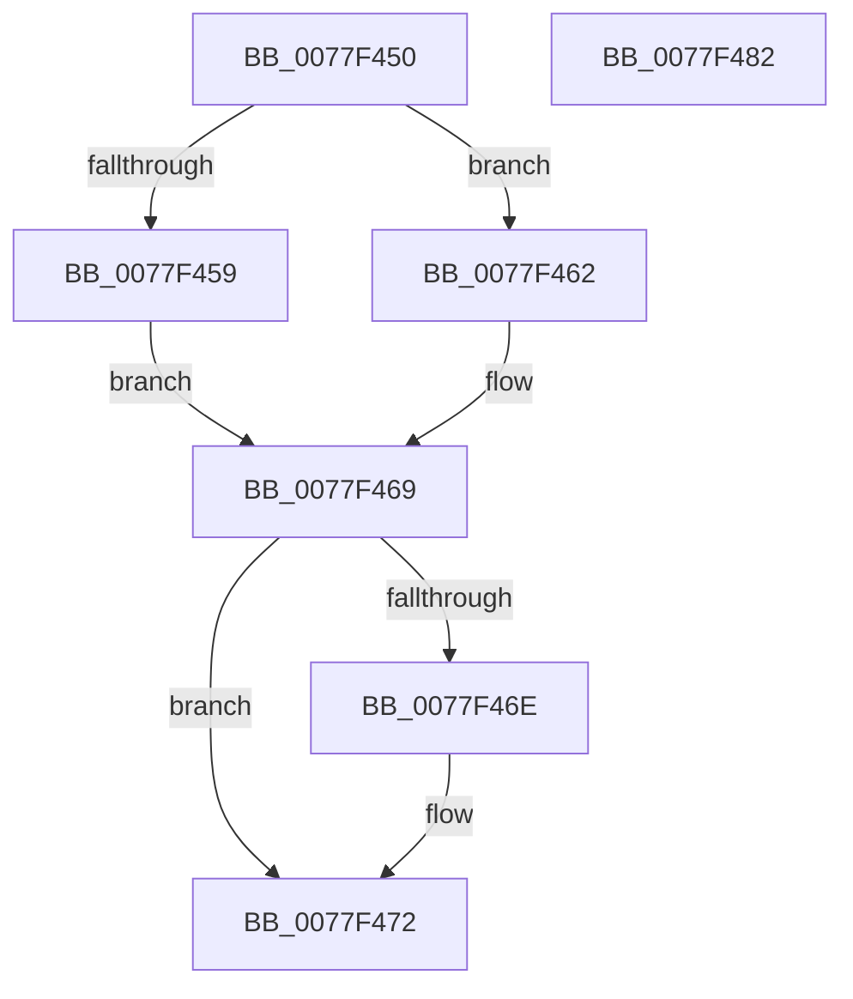

# PsRemoveSiloContext

- RVA: `0x0077F450`–`0x0077F483` (길이 `51` bytes)
- VA: `0x000000014077F450`
- 실행 섹션: `PAGE`
- PDB 이름 있음: `예`; PDB Function 태그: `아니요`
- unwind 정보 RVA: `0x0005C788`
- 디코드: `15`개 명령, `51/51` bytes 표시
- 미해석 바이트: `0` (있으면 어셈블리에 `.byte`로 보존)

> 이 문서는 커널 이미지의 기계어와 PDB 기호를 분석해 생성했습니다. 4번과 5번은 함수 원형과 자료형을 바이너리 사용 방식에서 추정한 C 해석이며 원본 소스 복구 결과는 아닙니다.

## 1. Dependencies

- 직접 호출 지점: **1**; 고유 호출 대상: **1**
- 직접 호출자로 확인된 함수: **2**
- RIP 상대 이미지 참조: **1**

### Outgoing calls
- `0x0077F478` → [PspStorageRemoveObject](../78/PspStorageRemoveObject_function_00789D68.md) (function, `0x00789D68`)

### Direct callers
- [PspSiloInitializeUserSharedData](../78/PspSiloInitializeUserSharedData_function_00780684.md) at `0x00780755`
- [VrpHandleIoctlInitializeJobForVreg](../93/VrpHandleIoctlInitializeJobForVreg_function_00937254.md) at `0x00937546`

### Static image references
- `0x0077F459` → RVA `0x00FCFE30` (`CACHEALI`; read)

## 2. Other-region calls and transfers

- 다른 실행 섹션으로 향하는 call: **0**
- 별도 외부 분기/꼬리 이동을 확인하지 못했습니다.

## 3. Assembly (complete function range)

```asm
0077F450  48 83 EC 28                     sub rsp, 0x28
0077F454  48 85 C9                        test rcx, rcx
0077F457  75 09                           jne 0x14077f462
0077F459  48 8B 0D D0 09 85 00            mov rcx, qword ptr [rip + 0x8509d0]
0077F460  EB 07                           jmp 0x14077f469
0077F462  48 8B 89 00 06 00 00            mov rcx, qword ptr [rcx + 0x600]
0077F469  4D 85 C0                        test r8, r8
0077F46C  74 04                           je 0x14077f472
0077F46E  49 83 20 00                     and qword ptr [r8], 0
0077F472  4D 8B C8                        mov r9, r8
0077F475  45 33 C0                        xor r8d, r8d
0077F478  E8 EB A8 00 00                  call 0x140789d68
0077F47D  48 83 C4 28                     add rsp, 0x28
0077F481  C3                              ret
0077F482  CC                              int3
```

## 4. C-style interpretation (structured pseudocode)

```c
__int64 __fastcall PsRemoveSiloContext(__int64 a1, __int64 a2, __int64 a3)
{
    __int64 result;
    __int64 v_rsp;

    v_rsp = (v_rsp) - (40);
    if (a1 != 0) goto loc_0077F462;
    goto loc_0077F469;
loc_0077F462:
loc_0077F469:
    if (a3 != 0) {
    }
    a3 = 0;
    result = PspStorageRemoveObject(*(unsigned __int64 *)(*(unsigned __int64 *)(v_rip + 8718800) + 1536), a2, a3, a3);
    v_rsp = (v_rsp) + (40);
    return result;
}
```

## 5. (Beta) C Style

```c
int64_t PsRemoveSiloContext(int64_t Arg1, int64_t Arg2, int64_t Arg3)
{
    int64_t result;
    int64_t local_rsp;

    local_rsp = (local_rsp) - (40);
    if (Arg1 != 0) goto loc_0077F462;
    goto loc_0077F469;
loc_0077F462:
loc_0077F469:
    if (Arg3 != 0) {
    }
    Arg3 = 0;
    result = PspStorageRemoveObject(*(uint64_t *)(*(uint64_t *)(v_rip + 0x8509D0) + 0x600), Arg2, Arg3, Arg3);
    local_rsp = (local_rsp) + (40);
    return result;
}
```

## 6. Execution-region graph

[열기: 2D/3D 그래프와 함수 탐색 컨트롤 패널](../../../control-panel.html?section=page&rva=0x0077F450&view=graph)

- 2D 그래프는 위에서 아래로 흐르고, 3D 그래프는 빈 공간을 드래그해 회전합니다. Shift+드래그는 이동, 휠은 확대·축소, 함수 노드 선택은 대상 보고서 이동입니다.

### Static fallback


