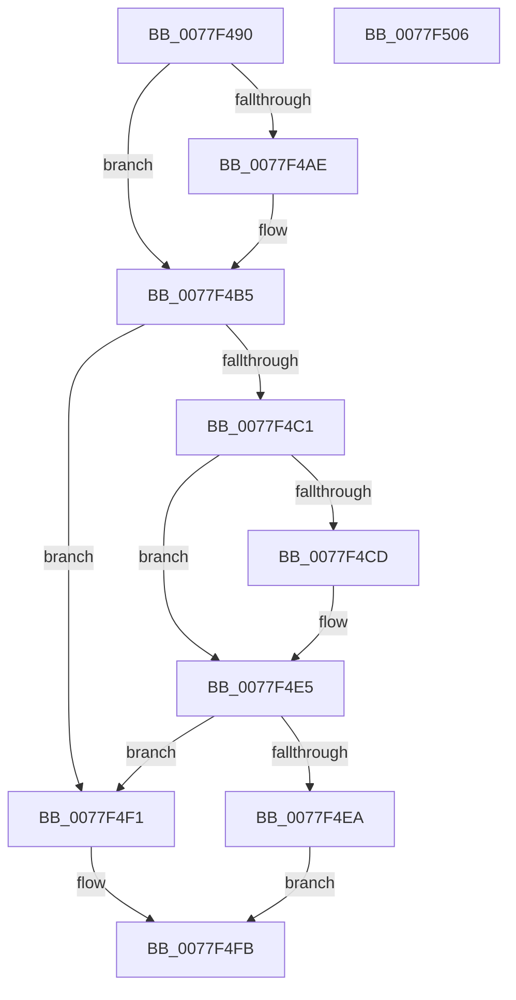

# PsReplaceSiloContext

- RVA: `0x0077F490`–`0x0077F507` (길이 `119` bytes)
- VA: `0x000000014077F490`
- 실행 섹션: `PAGE`
- PDB 이름 있음: `예`; PDB Function 태그: `아니요`
- unwind 정보 RVA: `0x0005CAAC`
- 디코드: `36`개 명령, `119/119` bytes 표시
- 미해석 바이트: `0` (있으면 어셈블리에 `.byte`로 보존)

> 이 문서는 커널 이미지의 기계어와 PDB 기호를 분석해 생성했습니다. 4번과 5번은 함수 원형과 자료형을 바이너리 사용 방식에서 추정한 C 해석이며 원본 소스 복구 결과는 아닙니다.

## 1. Dependencies

- 직접 호출 지점: **2**; 고유 호출 대상: **2**
- 직접 호출자로 확인된 함수: **0**
- RIP 상대 이미지 참조: **2**

### Outgoing calls
- `0x0077F4B8` → [PspIsSiloContext](../9E/PspIsSiloContext_function_009E8308.md) (function, `0x009E8308`)
- `0x0077F4F6` → [PspStorageReplaceObject](../78/PspStorageReplaceObject_function_00789EA0.md) (function, `0x00789EA0`)

### Direct callers
- 이 함수 시작 RVA로 연결되는 직접 call은 확인되지 않았습니다. 간접 호출은 완전히 역산할 수 없습니다.

### Static image references
- `0x0077F49A` → RVA `0x00FCFE30` (`CACHEALI`; read)
- `0x0077F4D0` → RVA `0x00F0FF80` (`.data`; read)

## 2. Other-region calls and transfers

- 다른 실행 섹션으로 향하는 call: **0**
- 별도 외부 분기/꼬리 이동을 확인하지 못했습니다.

## 3. Assembly (complete function range)

```asm
0077F490  48 89 5C 24 08                  mov qword ptr [rsp + 8], rbx
0077F495  57                              push rdi
0077F496  48 83 EC 20                     sub rsp, 0x20
0077F49A  48 8B 1D 8F 09 85 00            mov rbx, qword ptr [rip + 0x85098f]
0077F4A1  45 33 D2                        xor r10d, r10d
0077F4A4  8B FA                           mov edi, edx
0077F4A6  4C 8B D9                        mov r11, rcx
0077F4A9  48 85 C9                        test rcx, rcx
0077F4AC  74 07                           je 0x14077f4b5
0077F4AE  48 8B 99 00 06 00 00            mov rbx, qword ptr [rcx + 0x600]
0077F4B5  49 8B C8                        mov rcx, r8
0077F4B8  E8 4B 8E 26 00                  call 0x1409e8308
0077F4BD  84 C0                           test al, al
0077F4BF  74 30                           je 0x14077f4f1
0077F4C1  49 8D 48 D0                     lea rcx, [r8 - 0x30]
0077F4C5  0F B6 41 1A                     movzx eax, byte ptr [rcx + 0x1a]
0077F4C9  A8 40                           test al, 0x40
0077F4CB  74 18                           je 0x14077f4e5
0077F4CD  83 E0 7F                        and eax, 0x7f
0077F4D0  48 8D 15 A9 0A 79 00            lea rdx, [rip + 0x790aa9]
0077F4D7  0F B6 04 10                     movzx eax, byte ptr [rax + rdx]
0077F4DB  48 2B C8                        sub rcx, rax
0077F4DE  4C 8B 11                        mov r10, qword ptr [rcx]
0077F4E1  49 83 C2 20                     add r10, 0x20
0077F4E5  4D 39 1A                        cmp qword ptr [r10], r11
0077F4E8  74 07                           je 0x14077f4f1
0077F4EA  B8 0D 00 00 C0                  mov eax, 0xc000000d
0077F4EF  EB 0A                           jmp 0x14077f4fb
0077F4F1  8B D7                           mov edx, edi
0077F4F3  48 8B CB                        mov rcx, rbx
0077F4F6  E8 A5 A9 00 00                  call 0x140789ea0
0077F4FB  48 8B 5C 24 30                  mov rbx, qword ptr [rsp + 0x30]
0077F500  48 83 C4 20                     add rsp, 0x20
0077F504  5F                              pop rdi
0077F505  C3                              ret
0077F506  CC                              int3
```

## 4. C-style interpretation (structured pseudocode)

```c
__int64 __fastcall PsReplaceSiloContext(__int64 a1, int a2, __int64 a3)
{
    __int64 result;
    __int64 v_r10;
    __int64 v_rbx;
    __int64 v_rsp;
    unsigned __int64 v_stack_p8;

    v_stack_p8 = v_rbx;
    v_rsp = (v_rsp) - (32);
    v_r10 = 0;
    v_rbx = *(unsigned __int64 *)(v_rip + 8718735);
    if (a1 != 0) {
        v_rbx = *(unsigned __int64 *)(a1 + 1536);
    }
    result = PspIsSiloContext(a3, a2, a3, a4);
    if ((unsigned __int8)(result) == 0) goto loc_0077F4F1;
    result = *(unsigned __int8 *)(a3 - 48 + 26);
    if ((((unsigned __int8)(*(unsigned __int8 *)(a3 - 48 + 26))) & (64)) != 0) {
        result = (unsigned int)((*(unsigned __int8 *)(a3 - 48 + 26)) & (127));
        a2 = v_rip + 7932585;
        result = *(unsigned __int8 *)(result + a2 * 1);
        a1 = (a3 - 48) - (result);
        v_r10 = *(unsigned __int64 *)(a1);
        v_r10 = (v_r10) + (32);
    }
    if ((*(unsigned __int64 *)(v_r10)) == a1) goto loc_0077F4F1;
    goto loc_0077F4FB;
loc_0077F4F1:
    result = PspStorageReplaceObject(v_rbx, (unsigned int)((unsigned int)((unsigned int)(a2))), a3, a4);
loc_0077F4FB:
    v_rsp = (v_rsp) + (32);
    return result;
}
```

## 5. (Beta) C Style

```c
int64_t PsReplaceSiloContext(int64_t Arg1, int32_t Arg2, int64_t Arg3)
{
    int64_t result;
    int64_t local_r10;
    int64_t local_rbx;
    int64_t local_rsp;
    uint64_t v_stack_p8;

    v_stack_p8 = local_rbx;
    local_rsp = (local_rsp) - (32);
    local_r10 = 0;
    local_rbx = *(uint64_t *)(v_rip + 0x85098F);
    if (Arg1 != 0) {
        local_rbx = *(uint64_t *)(Arg1 + 0x600);
    }
    result = PspIsSiloContext(Arg3, Arg2, Arg3, a4);
    if ((uint8_t)(result) == 0) goto loc_0077F4F1;
    result = *(uint8_t *)(Arg3 - 0x30 + 0x1A);
    if ((((uint8_t)(*(uint8_t *)(Arg3 - 0x30 + 0x1A))) & (64)) != 0) {
        result = (uint32_t)((*(uint8_t *)(Arg3 - 0x30 + 0x1A)) & (127));
        Arg2 = v_rip + 7932585;
        result = *(uint8_t *)(result + Arg2 * 1);
        Arg1 = (Arg3 - 48) - (result);
        local_r10 = *(uint64_t *)(Arg1);
        local_r10 = (local_r10) + (32);
    }
    if ((*(uint64_t *)(local_r10)) == Arg1) goto loc_0077F4F1;
    goto loc_0077F4FB;
loc_0077F4F1:
    result = PspStorageReplaceObject(local_rbx, (uint32_t)((uint32_t)((uint32_t)(Arg2))), Arg3, a4);
loc_0077F4FB:
    local_rsp = (local_rsp) + (32);
    return result;
}
```

## 6. Execution-region graph

[열기: 2D/3D 그래프와 함수 탐색 컨트롤 패널](../../../control-panel.html?section=page&rva=0x0077F490&view=graph)

- 2D 그래프는 위에서 아래로 흐르고, 3D 그래프는 빈 공간을 드래그해 회전합니다. Shift+드래그는 이동, 휠은 확대·축소, 함수 노드 선택은 대상 보고서 이동입니다.

### Static fallback


