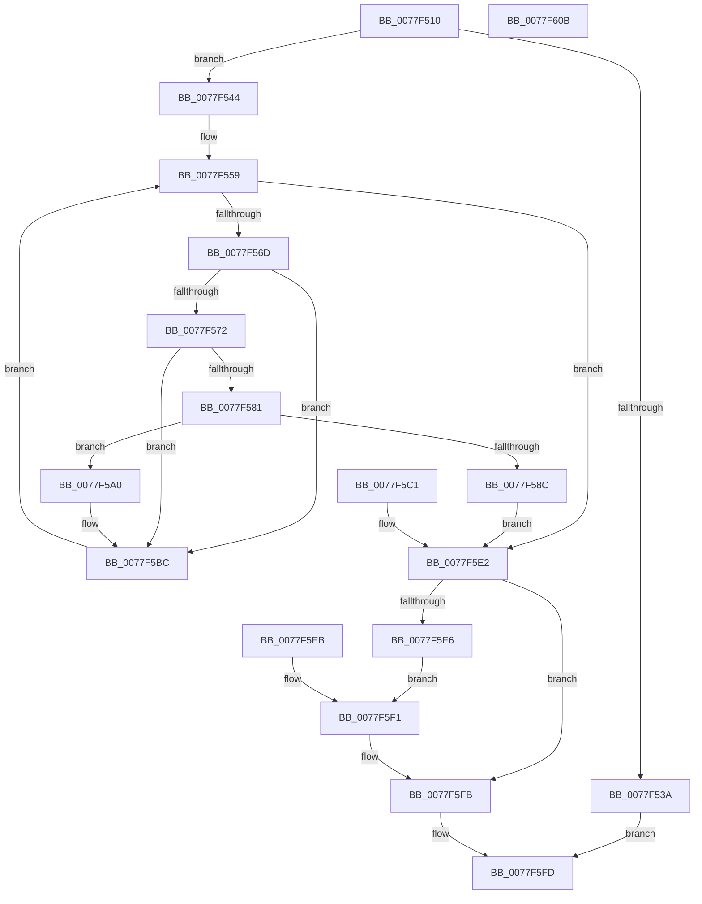

# PsRootSiloInformation

- RVA: `0x0077F510`–`0x0077F60C` (길이 `252` bytes)
- VA: `0x000000014077F510`
- 실행 섹션: `PAGE`
- PDB 이름 있음: `예`; PDB Function 태그: `아니요`
- unwind 정보 RVA: `0x000CE07C`
- 디코드: `78`개 명령, `252/252` bytes 표시
- 미해석 바이트: `0` (있으면 어셈블리에 `.byte`로 보존)

> 이 문서는 커널 이미지의 기계어와 PDB 기호를 분석해 생성했습니다. 4번과 5번은 함수 원형과 자료형을 바이너리 사용 방식에서 추정한 C 해석이며 원본 소스 복구 결과는 아닙니다.

## 1. Dependencies

- 직접 호출 지점: **5**; 고유 호출 대상: **4**
- 직접 호출자로 확인된 함수: **1**
- RIP 상대 이미지 참조: **0**

### Outgoing calls
- `0x0077F544` → [PsGetCurrentSilo](../../text/40/PsGetCurrentSilo_function_004094A0.md) (function, `0x004094A0`)
- `0x0077F55B` → [PspGetNextSilo](../91/PspGetNextSilo_function_00919F78.md) (function, `0x00919F78`)
- `0x0077F578` → [PspIsSiloInSilo](../A6/PspIsSiloInSilo_function_00A6EC8C.md) (function, `0x00A6EC8C`)
- `0x0077F599` → [ObfDereferenceObjectWithTag](../../text/2F/ObfDereferenceObjectWithTag_function_002F78E0.md) (function, `0x002F78E0`)
- `0x0077F5CD` → [ObfDereferenceObjectWithTag](../../text/2F/ObfDereferenceObjectWithTag_function_002F78E0.md) (function, `0x002F78E0`)

### Direct callers
- [ExpQuerySystemInformation](../A5/ExpQuerySystemInformation_function_00A57858.md) at `0x00A5A764`

### Static image references
- 디코드된 RIP-relative 메모리 참조가 없습니다.

## 2. Other-region calls and transfers

- 다른 실행 섹션으로 향하는 call: **3**
  - `0x0077F544` → [PsGetCurrentSilo](../../text/40/PsGetCurrentSilo_function_004094A0.md) (`PAGE` → `.text`)
  - `0x0077F599` → [ObfDereferenceObjectWithTag](../../text/2F/ObfDereferenceObjectWithTag_function_002F78E0.md) (`PAGE` → `.text`)
  - `0x0077F5CD` → [ObfDereferenceObjectWithTag](../../text/2F/ObfDereferenceObjectWithTag_function_002F78E0.md) (`PAGE` → `.text`)
- 별도 외부 분기/꼬리 이동을 확인하지 못했습니다.

## 3. Assembly (complete function range)

```asm
0077F510  4C 89 44 24 18                  mov qword ptr [rsp + 0x18], r8
0077F515  48 89 4C 24 08                  mov qword ptr [rsp + 8], rcx
0077F51A  53                              push rbx
0077F51B  56                              push rsi
0077F51C  57                              push rdi
0077F51D  41 54                           push r12
0077F51F  41 56                           push r14
0077F521  41 57                           push r15
0077F523  48 83 EC 38                     sub rsp, 0x38
0077F527  44 8B FA                        mov r15d, edx
0077F52A  4C 8B F1                        mov r14, rcx
0077F52D  BF 04 00 00 00                  mov edi, 4
0077F532  89 7C 24 78                     mov dword ptr [rsp + 0x78], edi
0077F536  3B D7                           cmp edx, edi
0077F538  73 0A                           jae 0x14077f544
0077F53A  B8 23 00 00 C0                  mov eax, 0xc0000023
0077F53F  E9 B9 00 00 00                  jmp 0x14077f5fd
0077F544  E8 57 9F C8 FF                  call 0x1404094a0
0077F549  4C 8B E0                        mov r12, rax
0077F54C  33 F6                           xor esi, esi
0077F54E  89 B4 24 88 00 00 00            mov dword ptr [rsp + 0x88], esi
0077F555  33 DB                           xor ebx, ebx
0077F557  33 C9                           xor ecx, ecx
0077F559  33 D2                           xor edx, edx
0077F55B  E8 18 AA 19 00                  call 0x140919f78
0077F560  4C 8B C0                        mov r8, rax
0077F563  48 89 44 24 20                  mov qword ptr [rsp + 0x20], rax
0077F568  48 85 C0                        test rax, rax
0077F56B  74 75                           je 0x14077f5e2
0077F56D  49 3B C4                        cmp rax, r12
0077F570  74 4A                           je 0x14077f5bc
0077F572  49 8B D4                        mov rdx, r12
0077F575  48 8B C8                        mov rcx, rax
0077F578  E8 0F F7 2E 00                  call 0x140a6ec8c
0077F57D  84 C0                           test al, al
0077F57F  74 3B                           je 0x14077f5bc
0077F581  8B CF                           mov ecx, edi
0077F583  48 83 C1 04                     add rcx, 4
0077F587  49 3B CF                        cmp rcx, r15
0077F58A  76 14                           jbe 0x14077f5a0
0077F58C  BB 23 00 00 C0                  mov ebx, 0xc0000023
0077F591  BA 50 73 45 6E                  mov edx, 0x6e457350
0077F596  49 8B C8                        mov rcx, r8
0077F599  E8 42 83 B7 FF                  call 0x1402f78e0
0077F59E  EB 42                           jmp 0x14077f5e2
0077F5A0  41 8B 88 BC 05 00 00            mov ecx, dword ptr [r8 + 0x5bc]
0077F5A7  41 89 4C B6 04                  mov dword ptr [r14 + rsi*4 + 4], ecx
0077F5AC  83 C7 04                        add edi, 4
0077F5AF  89 7C 24 78                     mov dword ptr [rsp + 0x78], edi
0077F5B3  FF C6                           inc esi
0077F5B5  89 B4 24 88 00 00 00            mov dword ptr [rsp + 0x88], esi
0077F5BC  49 8B C8                        mov rcx, r8
0077F5BF  EB 98                           jmp 0x14077f559
0077F5C1  8B D8                           mov ebx, eax
0077F5C3  BA 50 73 45 6E                  mov edx, 0x6e457350
0077F5C8  48 8B 4C 24 20                  mov rcx, qword ptr [rsp + 0x20]
0077F5CD  E8 0E 83 B7 FF                  call 0x1402f78e0
0077F5D2  4C 8B 74 24 70                  mov r14, qword ptr [rsp + 0x70]
0077F5D7  8B 7C 24 78                     mov edi, dword ptr [rsp + 0x78]
0077F5DB  8B B4 24 88 00 00 00            mov esi, dword ptr [rsp + 0x88]
0077F5E2  85 DB                           test ebx, ebx
0077F5E4  78 15                           js 0x14077f5fb
0077F5E6  41 89 36                        mov dword ptr [r14], esi
0077F5E9  EB 06                           jmp 0x14077f5f1
0077F5EB  8B D8                           mov ebx, eax
0077F5ED  8B 7C 24 78                     mov edi, dword ptr [rsp + 0x78]
0077F5F1  48 8B 8C 24 80 00 00 00         mov rcx, qword ptr [rsp + 0x80]
0077F5F9  89 39                           mov dword ptr [rcx], edi
0077F5FB  8B C3                           mov eax, ebx
0077F5FD  48 83 C4 38                     add rsp, 0x38
0077F601  41 5F                           pop r15
0077F603  41 5E                           pop r14
0077F605  41 5C                           pop r12
0077F607  5F                              pop rdi
0077F608  5E                              pop rsi
0077F609  5B                              pop rbx
0077F60A  C3                              ret
0077F60B  CC                              int3
```

## 4. C-style interpretation (structured pseudocode)

```c
__int64 __fastcall PsRootSiloInformation(__int64 a1, int a2, __int64 a3)
{
    __int64 result;
    __int64 v_rbx;
    __int64 v_rdi;
    __int64 v_rsi;
    __int64 v_rsp;
    unsigned __int64 v_stack_m48;
    unsigned int v_stack_p10;
    unsigned __int64 v_stack_p18;
    unsigned int v_stack_p20;
    unsigned __int64 v_stack_p8;

    v_stack_p18 = a3;
    v_stack_p8 = a1;
    v_rsp = (v_rsp) - (56);
    v_stack_p10 = 4;
    if (a2 >= 4) goto loc_0077F544;
    goto loc_0077F5FD;
loc_0077F544:
    result = PsGetCurrentSilo(a1, a2, a3, a4);
    v_rsi = 0;
    v_stack_p20 = 0;
    v_rbx = 0;
    a1 = 0;
loc_0077F559:
    a2 = 0;
    result = PspGetNextSilo(a1, a2, a3, a4);
    v_stack_m48 = result;
    if (result == 0) goto loc_0077F5E2;
    if (result == result) goto loc_0077F5BC;
    result = PspIsSiloInSilo(result, result, result, a4);
    if ((unsigned __int8)(result) == 0) goto loc_0077F5BC;
    a1 = (4) + (4);
    if (a1 <= ((unsigned int)(a2))) goto loc_0077F5A0;
    result = ObfDereferenceObjectWithTag(result, (unsigned int)(0x6E457350ULL), result, a4);
    goto loc_0077F5E2;
loc_0077F5A0:
    *(unsigned int *)(a1 + v_rsi * 4 + 4) = (unsigned int)((unsigned int)(*(unsigned int *)(result + 1468)));
    v_rdi = (unsigned int)((4) + (4));
    v_stack_p10 = (unsigned int)(v_rdi);
    v_rsi = (unsigned int)((v_rsi) + 1);
    v_stack_p20 = (unsigned int)(v_rsi);
loc_0077F5BC:
    goto loc_0077F559;
loc_0077F5E2:
    if (sign_flag) goto loc_0077F5FB;
    *(unsigned int *)(a1) = (unsigned int)(v_rsi);
    goto loc_0077F5F1;
loc_0077F5F1:
    *(unsigned int *)(v_stack_p18) = (unsigned int)(v_rdi);
loc_0077F5FB:
loc_0077F5FD:
    v_rsp = (v_rsp) + (56);
    return (unsigned int)((unsigned int)((unsigned int)(0xC0000023ULL)));
}
```

## 5. (Beta) C Style

```c
int64_t PsRootSiloInformation(void *Arg1, int32_t Arg2, int64_t Arg3)
{
    uint8_t *arg1 = (uint8_t *)Arg1;

    int64_t result;
    int64_t local_rbx;
    int64_t local_rdi;
    int64_t local_rsi;
    int64_t local_rsp;
    uint64_t v_stack_m48;
    uint32_t v_stack_p10;
    uint64_t v_stack_p18;
    uint32_t v_stack_p20;
    uint64_t v_stack_p8;

    v_stack_p18 = Arg3;
    v_stack_p8 = Arg1;
    local_rsp = (local_rsp) - (56);
    v_stack_p10 = 4;
    if (Arg2 >= 4) goto loc_0077F544;
    goto loc_0077F5FD;
loc_0077F544:
    result = PsGetCurrentSilo(Arg1, Arg2, Arg3, a4);
    local_rsi = 0;
    v_stack_p20 = 0;
    local_rbx = 0;
    Arg1 = 0;
loc_0077F559:
    Arg2 = 0;
    result = PspGetNextSilo(Arg1, Arg2, Arg3, a4);
    v_stack_m48 = result;
    if (result == 0) goto loc_0077F5E2;
    if (result == result) goto loc_0077F5BC;
    result = PspIsSiloInSilo(result, result, result, a4);
    if ((uint8_t)(result) == 0) goto loc_0077F5BC;
    Arg1 = (4) + (4);
    if (Arg1 <= ((uint32_t)(Arg2))) goto loc_0077F5A0;
    result = ObfDereferenceObjectWithTag(result, (uint32_t)(0x6E457350ULL), result, a4);
    goto loc_0077F5E2;
loc_0077F5A0:
    *(uint32_t *)(arg1 + local_rsi * 4 + 0x4) = (uint32_t)((uint32_t)(*(uint32_t *)(result + 0x5BC)));
    local_rdi = (uint32_t)((4) + (4));
    v_stack_p10 = (uint32_t)(local_rdi);
    local_rsi = (uint32_t)((local_rsi) + 1);
    v_stack_p20 = (uint32_t)(local_rsi);
loc_0077F5BC:
    goto loc_0077F559;
loc_0077F5E2:
    if (sign_flag) goto loc_0077F5FB;
    *(uint32_t *)(arg1) = (uint32_t)(local_rsi);
    goto loc_0077F5F1;
loc_0077F5F1:
    *(uint32_t *)(v_stack_p18) = (uint32_t)(local_rdi);
loc_0077F5FB:
loc_0077F5FD:
    local_rsp = (local_rsp) + (56);
    return (uint32_t)((uint32_t)((uint32_t)(0xC0000023ULL)));
}
```

### 관측된 메모리 오프셋

구조체 형식이 확인되지 않은 접근은 인자 기준의 오프셋으로만 기록했습니다.

| 기준 인자 | 오프셋 표현 | 폭 (bit) | 접근 |
|---|---:|---:|---|
| `Arg1` | `+ 0x0` | `32` | `W` |
| `Arg1` | `+ 0x4 + rsi*4` | `32` | `W` |

## 6. Execution-region graph

[열기: 2D/3D 그래프와 함수 탐색 컨트롤 패널](../../../control-panel.html?section=page&rva=0x0077F510&view=graph)

- 2D 그래프는 위에서 아래로 흐르고, 3D 그래프는 빈 공간을 드래그해 회전합니다. Shift+드래그는 이동, 휠은 확대·축소, 함수 노드 선택은 대상 보고서 이동입니다.

### Static fallback


