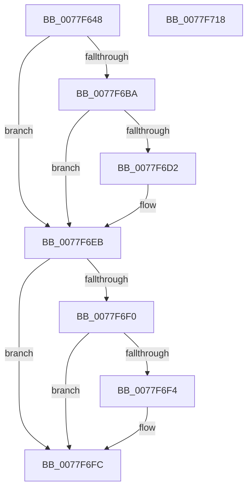

# PspApiSetCopyToSystemSpace

- RVA: `0x0077F648`–`0x0077F719` (길이 `209` bytes)
- VA: `0x000000014077F648`
- 실행 섹션: `PAGE`
- PDB 이름 있음: `예`; PDB Function 태그: `아니요`
- unwind 정보 RVA: `0x000CE0F0`
- 디코드: `60`개 명령, `209/209` bytes 표시
- 미해석 바이트: `0` (있으면 어셈블리에 `.byte`로 보존)

> 이 문서는 커널 이미지의 기계어와 PDB 기호를 분석해 생성했습니다. 4번과 5번은 함수 원형과 자료형을 바이너리 사용 방식에서 추정한 C 해석이며 원본 소스 복구 결과는 아닙니다.

## 1. Dependencies

- 직접 호출 지점: **4**; 고유 호출 대상: **4**
- 직접 호출자로 확인된 함수: **1**
- RIP 상대 이미지 참조: **0**

### Outgoing calls
- `0x0077F6A7` → [MmCreateSection](../98/MmCreateSection_function_009838B0.md) (function, `0x009838B0`)
- `0x0077F6C7` → [MmMapViewInSessionSpace](../98/MmMapViewInSessionSpace_function_00982480.md) (function, `0x00982480`)
- `0x0077F6E0` → [memcpy](../../text/6C/memcpy_function_006C6840.md) (function, `0x006C6840`)
- `0x0077F6F7` → [ObfDereferenceObject](../../text/2F/ObfDereferenceObject_function_002F9350.md) (function, `0x002F9350`)

### Direct callers
- [PspSiloLoadApiSets](../78/PspSiloLoadApiSets_function_00780848.md) at `0x007808B1`

### Static image references
- 디코드된 RIP-relative 메모리 참조가 없습니다.

## 2. Other-region calls and transfers

- 다른 실행 섹션으로 향하는 call: **2**
  - `0x0077F6E0` → [memcpy](../../text/6C/memcpy_function_006C6840.md) (`PAGE` → `.text`)
  - `0x0077F6F7` → [ObfDereferenceObject](../../text/2F/ObfDereferenceObject_function_002F9350.md) (`PAGE` → `.text`)
- 별도 외부 분기/꼬리 이동을 확인하지 못했습니다.

## 3. Assembly (complete function range)

```asm
0077F648  48 8B C4                        mov rax, rsp
0077F64B  48 89 58 08                     mov qword ptr [rax + 8], rbx
0077F64F  48 89 68 18                     mov qword ptr [rax + 0x18], rbp
0077F653  48 89 70 20                     mov qword ptr [rax + 0x20], rsi
0077F657  57                              push rdi
0077F658  41 56                           push r14
0077F65A  41 57                           push r15
0077F65C  48 83 EC 60                     sub rsp, 0x60
0077F660  48 83 60 C0 00                  and qword ptr [rax - 0x40], 0
0077F665  4D 8B F1                        mov r14, r9
0077F668  48 83 60 B8 00                  and qword ptr [rax - 0x48], 0
0077F66D  4C 8D 48 D0                     lea r9, [rax - 0x30]
0077F671  48 83 60 C8 00                  and qword ptr [rax - 0x38], 0
0077F676  4D 8B F8                        mov r15, r8
0077F679  48 83 60 10 00                  and qword ptr [rax + 0x10], 0
0077F67E  48 8B DA                        mov rbx, rdx
0077F681  48 83 60 D8 00                  and qword ptr [rax - 0x28], 0
0077F686  48 8B E9                        mov rbp, rcx
0077F689  48 89 50 D0                     mov qword ptr [rax - 0x30], rdx
0077F68D  48 8D 48 10                     lea rcx, [rax + 0x10]
0077F691  C7 40 B0 00 00 00 08            mov dword ptr [rax - 0x50], 0x8000000
0077F698  45 33 C0                        xor r8d, r8d
0077F69B  BA 1F 00 0F 00                  mov edx, 0xf001f
0077F6A0  C7 40 A8 04 00 00 00            mov dword ptr [rax - 0x58], 4
0077F6A7  E8 04 42 20 00                  call 0x1409838b0
0077F6AC  48 8B B4 24 88 00 00 00         mov rsi, qword ptr [rsp + 0x88]
0077F6B4  8B F8                           mov edi, eax
0077F6B6  85 C0                           test eax, eax
0077F6B8  78 31                           js 0x14077f6eb
0077F6BA  4C 8D 44 24 50                  lea r8, [rsp + 0x50]
0077F6BF  48 8B CE                        mov rcx, rsi
0077F6C2  48 8D 54 24 40                  lea rdx, [rsp + 0x40]
0077F6C7  E8 B4 2D 20 00                  call 0x140982480
0077F6CC  8B F8                           mov edi, eax
0077F6CE  85 C0                           test eax, eax
0077F6D0  78 19                           js 0x14077f6eb
0077F6D2  4C 8B C3                        mov r8, rbx
0077F6D5  48 8B D5                        mov rdx, rbp
0077F6D8  48 8B 5C 24 40                  mov rbx, qword ptr [rsp + 0x40]
0077F6DD  48 8B CB                        mov rcx, rbx
0077F6E0  E8 5B 71 F4 FF                  call 0x1406c6840
0077F6E5  49 89 37                        mov qword ptr [r15], rsi
0077F6E8  49 89 1E                        mov qword ptr [r14], rbx
0077F6EB  48 85 F6                        test rsi, rsi
0077F6EE  74 0C                           je 0x14077f6fc
0077F6F0  85 FF                           test edi, edi
0077F6F2  79 08                           jns 0x14077f6fc
0077F6F4  48 8B CE                        mov rcx, rsi
0077F6F7  E8 54 9C B7 FF                  call 0x1402f9350
0077F6FC  4C 8D 5C 24 60                  lea r11, [rsp + 0x60]
0077F701  8B C7                           mov eax, edi
0077F703  49 8B 5B 20                     mov rbx, qword ptr [r11 + 0x20]
0077F707  49 8B 6B 30                     mov rbp, qword ptr [r11 + 0x30]
0077F70B  49 8B 73 38                     mov rsi, qword ptr [r11 + 0x38]
0077F70F  49 8B E3                        mov rsp, r11
0077F712  41 5F                           pop r15
0077F714  41 5E                           pop r14
0077F716  5F                              pop rdi
0077F717  C3                              ret
0077F718  CC                              int3
```

## 4. C-style interpretation (structured pseudocode)

```c
__int64 __fastcall PspApiSetCopyToSystemSpace(__int64 a1, __int64 a2, __int64 a3, __int64 a4)
{
    __int64 result;
    __int64 v_rbx;
    __int64 v_rsp;
    unsigned __int64 v_stack_m18;
    unsigned __int64 v_stack_m28;
    unsigned __int64 v_stack_m38;
    unsigned __int64 v_stack_p10;

    *(unsigned __int64 *)(v_rsp + 8) = v_rbx;
    *(unsigned __int64 *)(v_rsp + 24) = v_rbp;
    *(unsigned __int64 *)(v_rsp + 32) = v_rsi;
    v_rsp = (v_rsp) - (96);
    *(unsigned __int64 *)(v_rsp - 48) = a2;
    *(unsigned int *)(v_rsp - 80) = 0x8000000ULL;
    a3 = 0;
    *(unsigned int *)(v_rsp - 88) = 4;
    result = MmCreateSection(v_rsp + 16, (unsigned int)(0xF001FULL), a3, v_rsp - 48);
    if (sign_flag) goto loc_0077F6EB;
    result = MmMapViewInSessionSpace(v_stack_p10, v_stack_m38, v_stack_m28, v_rsp - 48);
    v_rbx = a2;
    if (!(sign_flag)) {
        a3 = a2;
        a2 = a1;
        v_rbx = v_stack_m38;
        a1 = v_rbx;
        result = memcpy(a1, a2, a3, v_rsp - 48);
        *(unsigned __int64 *)(a3) = v_stack_p10;
        *(unsigned __int64 *)(a4) = v_rbx;
    }
    if (v_stack_p10 == 0) goto loc_0077F6FC;
    if (sign_flag) {
        a1 = v_stack_p10;
        result = ObfDereferenceObject(a1, a2, a3, v_rsp - 48);
    }
    return (unsigned int)((unsigned int)((unsigned int)((unsigned int)(result))));
}
```

## 5. (Beta) C Style

```c
int64_t PspApiSetCopyToSystemSpace(int64_t Arg1, int64_t Arg2, void *Arg3, void *Arg4)
{
    uint8_t *arg3 = (uint8_t *)Arg3;
    uint8_t *arg4 = (uint8_t *)Arg4;

    int64_t result;
    int64_t local_rbx;
    int64_t local_rsp;
    uint64_t v_stack_m18;
    uint64_t v_stack_m28;
    uint64_t v_stack_m38;
    uint64_t v_stack_p10;

    *(uint64_t *)(local_rsp + 0x8) = local_rbx;
    *(uint64_t *)(local_rsp + 0x18) = local_rbp;
    *(uint64_t *)(local_rsp + 0x20) = local_rsi;
    local_rsp = (local_rsp) - (96);
    *(uint64_t *)(local_rsp - 0x30) = Arg2;
    *(uint32_t *)(local_rsp - 0x50) = 0x8000000ULL;
    Arg3 = 0;
    *(uint32_t *)(local_rsp - 0x58) = 4;
    result = MmCreateSection(local_rsp + 16, (uint32_t)(0xF001FULL), Arg3, local_rsp - 48);
    if (sign_flag) goto loc_0077F6EB;
    result = MmMapViewInSessionSpace(v_stack_p10, v_stack_m38, v_stack_m28, local_rsp - 48);
    local_rbx = Arg2;
    if (!(sign_flag)) {
        Arg3 = Arg2;
        Arg2 = Arg1;
        local_rbx = v_stack_m38;
        Arg1 = local_rbx;
        result = memcpy(Arg1, Arg2, Arg3, local_rsp - 48);
        *(uint64_t *)(arg3) = v_stack_p10;
        *(uint64_t *)(arg4) = local_rbx;
    }
    if (v_stack_p10 == 0) goto loc_0077F6FC;
    if (sign_flag) {
        Arg1 = v_stack_p10;
        result = ObfDereferenceObject(Arg1, Arg2, Arg3, local_rsp - 48);
    }
    return (uint32_t)((uint32_t)((uint32_t)((uint32_t)(result))));
}
```

### 관측된 메모리 오프셋

구조체 형식이 확인되지 않은 접근은 인자 기준의 오프셋으로만 기록했습니다.

| 기준 인자 | 오프셋 표현 | 폭 (bit) | 접근 |
|---|---:|---:|---|
| `Arg3` | `+ 0x0` | `64` | `W` |
| `Arg4` | `+ 0x0` | `64` | `W` |

## 6. Execution-region graph

[열기: 2D/3D 그래프와 함수 탐색 컨트롤 패널](../../../control-panel.html?section=page&rva=0x0077F648&view=graph)

- 2D 그래프는 위에서 아래로 흐르고, 3D 그래프는 빈 공간을 드래그해 회전합니다. Shift+드래그는 이동, 휠은 확대·축소, 함수 노드 선택은 대상 보고서 이동입니다.

### Static fallback


