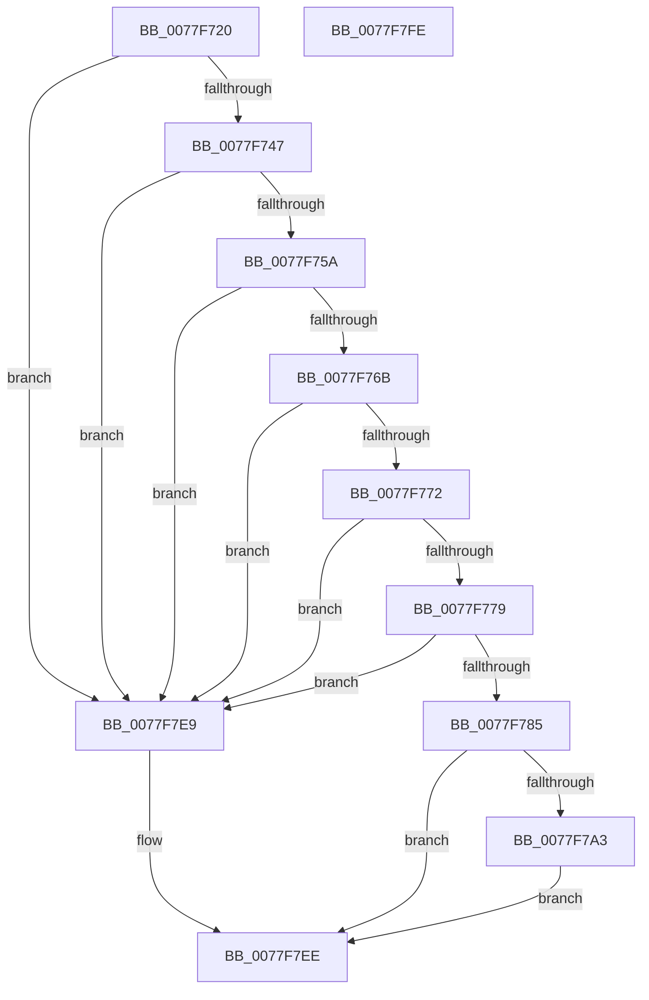

# PspAssignSiloSystemRootPath

- RVA: `0x0077F720`–`0x0077F7FF` (길이 `223` bytes)
- VA: `0x000000014077F720`
- 실행 섹션: `PAGE`
- PDB 이름 있음: `예`; PDB Function 태그: `아니요`
- unwind 정보 RVA: `0x000CE124`
- 디코드: `62`개 명령, `223/223` bytes 표시
- 미해석 바이트: `0` (있으면 어셈블리에 `.byte`로 보존)

> 이 문서는 커널 이미지의 기계어와 PDB 기호를 분석해 생성했습니다. 4번과 5번은 함수 원형과 자료형을 바이너리 사용 방식에서 추정한 C 해석이며 원본 소스 복구 결과는 아닙니다.

## 1. Dependencies

- 직접 호출 지점: **4**; 고유 호출 대상: **4**
- 직접 호출자로 확인된 함수: **1**
- RIP 상대 이미지 참조: **1**

### Outgoing calls
- `0x0077F79A` → [PsCreateSiloContext](../9E/PsCreateSiloContext_function_009E8110.md) (function, `0x009E8110`)
- `0x0077F7C5` → [memcpy](../../text/6C/memcpy_function_006C6840.md) (function, `0x006C6840`)
- `0x0077F7D6` → [PsInsertSiloContext](../9E/PsInsertSiloContext_function_009E7D40.md) (function, `0x009E7D40`)
- `0x0077F7E0` → [HalPutDmaAdapter](../../text/48/HalPutDmaAdapter_function_0048E530.md) (function, `0x0048E530`)

### Direct callers
- [NtSetInformationJobObject](../9F/NtSetInformationJobObject_function_009F84C0.md) at `0x009FAEE8`

### Static image references
- `0x0077F7CA` → RVA `0x00FC5168` (`ALMOSTRO`; read)

## 2. Other-region calls and transfers

- 다른 실행 섹션으로 향하는 call: **2**
  - `0x0077F7C5` → [memcpy](../../text/6C/memcpy_function_006C6840.md) (`PAGE` → `.text`)
  - `0x0077F7E0` → [HalPutDmaAdapter](../../text/48/HalPutDmaAdapter_function_0048E530.md) (`PAGE` → `.text`)
- 별도 외부 분기/꼬리 이동을 확인하지 못했습니다.

## 3. Assembly (complete function range)

```asm
0077F720  4C 8B DC                        mov r11, rsp
0077F723  49 89 5B 08                     mov qword ptr [r11 + 8], rbx
0077F727  49 89 73 18                     mov qword ptr [r11 + 0x18], rsi
0077F72B  57                              push rdi
0077F72C  48 83 EC 30                     sub rsp, 0x30
0077F730  49 83 63 10 00                  and qword ptr [r11 + 0x10], 0
0077F735  48 8B DA                        mov rbx, rdx
0077F738  0F B7 12                        movzx edx, word ptr [rdx]
0077F73B  48 8B F1                        mov rsi, rcx
0077F73E  83 FA 08                        cmp edx, 8
0077F741  0F 82 A2 00 00 00               jb 0x14077f7e9
0077F747  48 8D 42 FE                     lea rax, [rdx - 2]
0077F74B  44 8B C2                        mov r8d, edx
0077F74E  48 3D 08 02 00 00               cmp rax, 0x208
0077F754  0F 87 8F 00 00 00               ja 0x14077f7e9
0077F75A  48 8B 4B 08                     mov rcx, qword ptr [rbx + 8]
0077F75E  0F B7 01                        movzx eax, word ptr [rcx]
0077F761  66 83 E8 41                     sub ax, 0x41
0077F765  66 83 F8 19                     cmp ax, 0x19
0077F769  77 7E                           ja 0x14077f7e9
0077F76B  66 83 79 02 3A                  cmp word ptr [rcx + 2], 0x3a
0077F770  75 77                           jne 0x14077f7e9
0077F772  66 83 79 04 5C                  cmp word ptr [rcx + 4], 0x5c
0077F777  75 70                           jne 0x14077f7e9
0077F779  49 D1 E8                        shr r8, 1
0077F77C  66 42 83 7C 41 FE 5C            cmp word ptr [rcx + r8*2 - 2], 0x5c
0077F783  74 64                           je 0x14077f7e9
0077F785  45 33 C9                        xor r9d, r9d
0077F788  49 8D 43 10                     lea rax, [r11 + 0x10]
0077F78C  83 C2 10                        add edx, 0x10
0077F78F  49 89 43 E8                     mov qword ptr [r11 - 0x18], rax
0077F793  48 8B CE                        mov rcx, rsi
0077F796  45 8D 41 01                     lea r8d, [r9 + 1]
0077F79A  E8 71 89 26 00                  call 0x1409e8110
0077F79F  85 C0                           test eax, eax
0077F7A1  78 4B                           js 0x14077f7ee
0077F7A3  48 8B 7C 24 48                  mov rdi, qword ptr [rsp + 0x48]
0077F7A8  48 8D 4F 10                     lea rcx, [rdi + 0x10]
0077F7AC  48 89 4F 08                     mov qword ptr [rdi + 8], rcx
0077F7B0  0F B7 03                        movzx eax, word ptr [rbx]
0077F7B3  66 89 07                        mov word ptr [rdi], ax
0077F7B6  0F B7 03                        movzx eax, word ptr [rbx]
0077F7B9  66 89 47 02                     mov word ptr [rdi + 2], ax
0077F7BD  44 0F B7 03                     movzx r8d, word ptr [rbx]
0077F7C1  48 8B 53 08                     mov rdx, qword ptr [rbx + 8]
0077F7C5  E8 76 70 F4 FF                  call 0x1406c6840
0077F7CA  8B 15 98 59 84 00               mov edx, dword ptr [rip + 0x845998]
0077F7D0  4C 8B C7                        mov r8, rdi
0077F7D3  48 8B CE                        mov rcx, rsi
0077F7D6  E8 65 85 26 00                  call 0x1409e7d40
0077F7DB  48 8B CF                        mov rcx, rdi
0077F7DE  8B D8                           mov ebx, eax
0077F7E0  E8 4B ED D0 FF                  call 0x14048e530
0077F7E5  8B C3                           mov eax, ebx
0077F7E7  EB 05                           jmp 0x14077f7ee
0077F7E9  B8 0D 00 00 C0                  mov eax, 0xc000000d
0077F7EE  48 8B 5C 24 40                  mov rbx, qword ptr [rsp + 0x40]
0077F7F3  48 8B 74 24 50                  mov rsi, qword ptr [rsp + 0x50]
0077F7F8  48 83 C4 30                     add rsp, 0x30
0077F7FC  5F                              pop rdi
0077F7FD  C3                              ret
0077F7FE  CC                              int3
```

## 4. C-style interpretation (structured pseudocode)

```c
__int64 __fastcall PspAssignSiloSystemRootPath(__int64 a1, __int64 a2, __int64 a3, int a4)
{
    __int64 result;
    __int64 v_rsp;
    unsigned __int64 v_stack_p10;
    unsigned __int64 v_stack_p18;
    unsigned __int64 v_stack_p8;

    *(unsigned __int64 *)(v_rsp + 8) = v_rbx;
    *(unsigned __int64 *)(v_rsp + 24) = v_rsi;
    v_rsp = (v_rsp) - (48);
    if (((unsigned int)(*(unsigned __int16 *)(a2))) < 8) goto loc_0077F7E9;
    if ((*(unsigned __int16 *)(a2) - 2) > 520) goto loc_0077F7E9;
    result = (unsigned __int16)((*(unsigned __int16 *)(*(unsigned __int64 *)(a2 + 8))) - (65));
    if (((unsigned __int16)(result)) > 25) goto loc_0077F7E9;
    if ((*(unsigned __int16 *)(*(unsigned __int64 *)(a2 + 8) + 2)) != 58) goto loc_0077F7E9;
    if ((*(unsigned __int16 *)(*(unsigned __int64 *)(a2 + 8) + 4)) != 92) goto loc_0077F7E9;
    a3 = ((unsigned int)((unsigned int)(*(unsigned __int16 *)(a2)))) >> (1);
    if ((*(unsigned __int16 *)(*(unsigned __int64 *)(a2 + 8) + a3 * 2 - 2)) == 92) goto loc_0077F7E9;
    a4 = 0;
    a2 = (unsigned int)((*(unsigned __int16 *)(a2)) + (16));
    *(unsigned __int64 *)(v_rsp - 24) = v_rsp + 16;
    result = PsCreateSiloContext(a1, a2, a4 + 1, a4);
    if (sign_flag) goto loc_0077F7EE;
    *(unsigned __int64 *)(v_stack_p10 + 8) = v_stack_p10 + 16;
    *(unsigned __int16 *)(v_stack_p10) = (unsigned __int16)(*(unsigned __int16 *)(a2));
    *(unsigned __int16 *)(v_stack_p10 + 2) = (unsigned __int16)(*(unsigned __int16 *)(a2));
    result = memcpy(v_stack_p10 + 16, *(unsigned __int64 *)(a2 + 8), *(unsigned __int16 *)(a2), a4);
    result = PsInsertSiloContext(a1, (unsigned int)(*(unsigned int *)(v_rip + 8673688)), v_stack_p10, a4);
    result = HalPutDmaAdapter(v_stack_p10, (unsigned int)(*(unsigned int *)(v_rip + 8673688)), v_stack_p10, a4);
    goto loc_0077F7EE;
loc_0077F7E9:
loc_0077F7EE:
    v_rsp = (v_rsp) + (48);
    return (unsigned int)(0xC000000DULL);
}
```

## 5. (Beta) C Style

```c
int64_t PspAssignSiloSystemRootPath(int64_t Arg1, void *Arg2, int64_t Arg3, int32_t Arg4)
{
    uint8_t *arg2 = (uint8_t *)Arg2;

    int64_t result;
    int64_t local_rsp;
    uint64_t v_stack_p10;
    uint64_t v_stack_p18;
    uint64_t v_stack_p8;

    *(uint64_t *)(local_rsp + 0x8) = local_rbx;
    *(uint64_t *)(local_rsp + 0x18) = local_rsi;
    local_rsp = (local_rsp) - (48);
    if (((uint32_t)(*(uint16_t *)(arg2))) < 8) goto loc_0077F7E9;
    if ((*(uint16_t *)(arg2) - 2) > 520) goto loc_0077F7E9;
    result = (uint16_t)((*(uint16_t *)(*(uint64_t *)(arg2 + 0x8))) - (65));
    if (((uint16_t)(result)) > 25) goto loc_0077F7E9;
    if ((*(uint16_t *)(*(uint64_t *)(arg2 + 0x8) + 0x2)) != 58) goto loc_0077F7E9;
    if ((*(uint16_t *)(*(uint64_t *)(arg2 + 0x8) + 0x4)) != 92) goto loc_0077F7E9;
    Arg3 = ((uint32_t)((uint32_t)(*(uint16_t *)(arg2)))) >> (1);
    if ((*(uint16_t *)(*(uint64_t *)(arg2 + 0x8) + Arg3 * 2 - 0x2)) == 92) goto loc_0077F7E9;
    Arg4 = 0;
    Arg2 = (uint32_t)((*(uint16_t *)(arg2)) + (16));
    *(uint64_t *)(local_rsp - 0x18) = local_rsp + 16;
    result = PsCreateSiloContext(Arg1, Arg2, Arg4 + 1, Arg4);
    if (sign_flag) goto loc_0077F7EE;
    *(uint64_t *)(v_stack_p10 + 0x8) = v_stack_p10 + 16;
    *(uint16_t *)(v_stack_p10) = (uint16_t)(*(uint16_t *)(arg2));
    *(uint16_t *)(v_stack_p10 + 0x2) = (uint16_t)(*(uint16_t *)(arg2));
    result = memcpy(v_stack_p10 + 16, *(uint64_t *)(arg2 + 0x8), *(uint16_t *)(arg2), Arg4);
    result = PsInsertSiloContext(Arg1, (uint32_t)(*(uint32_t *)(v_rip + 0x845998)), v_stack_p10, Arg4);
    result = HalPutDmaAdapter(v_stack_p10, (uint32_t)(*(uint32_t *)(v_rip + 0x845998)), v_stack_p10, Arg4);
    goto loc_0077F7EE;
loc_0077F7E9:
loc_0077F7EE:
    local_rsp = (local_rsp) + (48);
    return (uint32_t)(0xC000000DULL);
}
```

### 관측된 메모리 오프셋

구조체 형식이 확인되지 않은 접근은 인자 기준의 오프셋으로만 기록했습니다.

| 기준 인자 | 오프셋 표현 | 폭 (bit) | 접근 |
|---|---:|---:|---|
| `Arg2` | `+ 0x0` | `16` | `R` |
| `Arg2` | `+ 0x8` | `64` | `R` |

## 6. Execution-region graph

[열기: 2D/3D 그래프와 함수 탐색 컨트롤 패널](../../../control-panel.html?section=page&rva=0x0077F720&view=graph)

- 2D 그래프는 위에서 아래로 흐르고, 3D 그래프는 빈 공간을 드래그해 회전합니다. Shift+드래그는 이동, 휠은 확대·축소, 함수 노드 선택은 대상 보고서 이동입니다.

### Static fallback


