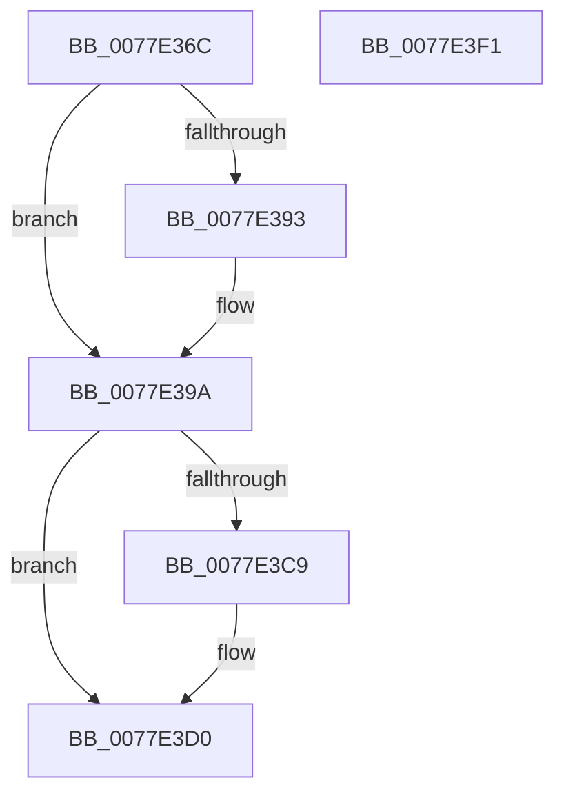

# PspAttachProcessToSyscallProvider

- RVA: `0x0077E36C`–`0x0077E3F2` (길이 `134` bytes)
- VA: `0x000000014077E36C`
- 실행 섹션: `PAGE`
- PDB 이름 있음: `예`; PDB Function 태그: `아니요`
- unwind 정보 RVA: `0x0005CAAC`
- 디코드: `36`개 명령, `134/134` bytes 표시
- 미해석 바이트: `0` (있으면 어셈블리에 `.byte`로 보존)

> 이 문서는 커널 이미지의 기계어와 PDB 기호를 분석해 생성했습니다. 4번과 5번은 함수 원형과 자료형을 바이너리 사용 방식에서 추정한 C 해석이며 원본 소스 복구 결과는 아닙니다.

## 1. Dependencies

- 직접 호출 지점: **2**; 고유 호출 대상: **2**
- 직접 호출자로 확인된 함수: **2**
- RIP 상대 이미지 참조: **0**

### Outgoing calls
- `0x0077E3B0` → [PspLockSyscallProviderExclusive](../../text/5E/PspLockSyscallProviderExclusive_function_005E231C.md) (function, `0x005E231C`)
- `0x0077E3E1` → [PspUnlockSyscallProviderExclusive](../../text/5E/PspUnlockSyscallProviderExclusive_function_005E2478.md) (function, `0x005E2478`)

### Direct callers
- [PspSyscallProviderOptIn](PspSyscallProviderOptIn_function_0077E79C.md) at `0x0077E8A5`
- [sub_00B258BA](../B2/Unknown_function_00B258BA.md) at `0x00B258C3`

### Static image references
- 디코드된 RIP-relative 메모리 참조가 없습니다.

## 2. Other-region calls and transfers

- 다른 실행 섹션으로 향하는 call: **2**
  - `0x0077E3B0` → [PspLockSyscallProviderExclusive](../../text/5E/PspLockSyscallProviderExclusive_function_005E231C.md) (`PAGE` → `.text`)
  - `0x0077E3E1` → [PspUnlockSyscallProviderExclusive](../../text/5E/PspUnlockSyscallProviderExclusive_function_005E2478.md) (`PAGE` → `.text`)
- 별도 외부 분기/꼬리 이동을 확인하지 못했습니다.

## 3. Assembly (complete function range)

```asm
0077E36C  48 89 5C 24 08                  mov qword ptr [rsp + 8], rbx
0077E371  57                              push rdi
0077E372  48 83 EC 20                     sub rsp, 0x20
0077E376  48 8B DA                        mov rbx, rdx
0077E379  48 8B F9                        mov rdi, rcx
0077E37C  41 8B D0                        mov edx, r8d
0077E37F  B8 01 00 00 00                  mov eax, 1
0077E384  F0 48 0F C1 43 30               lock xadd qword ptr [rbx + 0x30], rax
0077E38A  48 FF C0                        inc rax
0077E38D  48 83 F8 01                     cmp rax, 1
0077E391  7F 07                           jg 0x14077e39a
0077E393  B9 0E 00 00 00                  mov ecx, 0xe
0077E398  CD 29                           int 0x29
0077E39A  48 89 9F B8 07 00 00            mov qword ptr [rdi + 0x7b8], rbx
0077E3A1  48 8B CB                        mov rcx, rbx
0077E3A4  48 8B 44 D3 58                  mov rax, qword ptr [rbx + rdx*8 + 0x58]
0077E3A9  48 89 87 D0 07 00 00            mov qword ptr [rdi + 0x7d0], rax
0077E3B0  E8 67 3F E6 FF                  call 0x1405e231c
0077E3B5  48 8D 4B 48                     lea rcx, [rbx + 0x48]
0077E3B9  48 8B 51 08                     mov rdx, qword ptr [rcx + 8]
0077E3BD  48 8D 87 C0 07 00 00            lea rax, [rdi + 0x7c0]
0077E3C4  48 39 0A                        cmp qword ptr [rdx], rcx
0077E3C7  74 07                           je 0x14077e3d0
0077E3C9  B9 03 00 00 00                  mov ecx, 3
0077E3CE  CD 29                           int 0x29
0077E3D0  48 89 08                        mov qword ptr [rax], rcx
0077E3D3  48 89 50 08                     mov qword ptr [rax + 8], rdx
0077E3D7  48 89 02                        mov qword ptr [rdx], rax
0077E3DA  48 89 41 08                     mov qword ptr [rcx + 8], rax
0077E3DE  48 8B CB                        mov rcx, rbx
0077E3E1  E8 92 40 E6 FF                  call 0x1405e2478
0077E3E6  48 8B 5C 24 30                  mov rbx, qword ptr [rsp + 0x30]
0077E3EB  48 83 C4 20                     add rsp, 0x20
0077E3EF  5F                              pop rdi
0077E3F0  C3                              ret
0077E3F1  CC                              int3
```

## 4. C-style interpretation (structured pseudocode)

```c
__int64 __fastcall PspAttachProcessToSyscallProvider(__int64 a1, __int64 a2, int a3)
{
    __int64 result;
    __int64 v_rsp;
    unsigned __int64 v_stack_p8;

    v_stack_p8 = v_rbx;
    v_rsp = (v_rsp) - (32);
    result = (1) + 1;
    if (result <= 1) {
        a1 = 14;
    }
    *(unsigned __int64 *)(a1 + 1976) = a2;
    *(unsigned __int64 *)(a1 + 2000) = *(unsigned __int64 *)(a2 + (unsigned int)(a3) * 8 + 88);
    result = PspLockSyscallProviderExclusive(a2, (unsigned int)(a3), a3, a4);
    if ((*(unsigned __int64 *)(*(unsigned __int64 *)(a2 + 72 + 8))) != (a2 + 72)) {
        a1 = 3;
    }
    *(unsigned __int64 *)(a1 + 1984) = a1;
    *(unsigned __int64 *)(a1 + 1984 + 8) = *(unsigned __int64 *)(a2 + 72 + 8);
    *(unsigned __int64 *)(*(unsigned __int64 *)(a2 + 72 + 8)) = a1 + 1984;
    *(unsigned __int64 *)(a1 + 8) = a1 + 1984;
    result = PspUnlockSyscallProviderExclusive(a2, *(unsigned __int64 *)(a2 + 72 + 8), a3, a4);
    v_rsp = (v_rsp) + (32);
    return result;
}
```

## 5. (Beta) C Style

```c
int64_t PspAttachProcessToSyscallProvider(void *Arg1, void *Arg2, int32_t Arg3)
{
    uint8_t *arg1 = (uint8_t *)Arg1;
    uint8_t *arg2 = (uint8_t *)Arg2;

    int64_t result;
    int64_t local_rsp;
    uint64_t v_stack_p8;

    v_stack_p8 = local_rbx;
    local_rsp = (local_rsp) - (32);
    result = (1) + 1;
    if (result <= 1) {
        Arg1 = 14;
    }
    *(void **)(arg1 + 0x7B8) = Arg2;
    *(uint64_t *)(arg1 + 0x7D0) = *(uint64_t *)(arg2 + (uint32_t)(Arg3) * 8 + 0x58);
    result = PspLockSyscallProviderExclusive(Arg2, (uint32_t)(Arg3), Arg3, a4);
    if ((*(uint64_t *)(*(uint64_t *)(arg2 + 0x48 + 0x8))) != (Arg2 + 72)) {
        Arg1 = 3;
    }
    *(void **)(arg1 + 0x7C0) = Arg1;
    *(uint64_t *)(arg1 + 0x7C0 + 0x8) = *(uint64_t *)(arg2 + 0x48 + 0x8);
    *(void **)(*(uint64_t *)(arg2 + 0x48 + 0x8)) = Arg1 + 1984;
    *(void **)(arg1 + 0x8) = Arg1 + 1984;
    result = PspUnlockSyscallProviderExclusive(Arg2, *(uint64_t *)(arg2 + 0x48 + 0x8), Arg3, a4);
    local_rsp = (local_rsp) + (32);
    return result;
}
```

### 관측된 메모리 오프셋

구조체 형식이 확인되지 않은 접근은 인자 기준의 오프셋으로만 기록했습니다.

| 기준 인자 | 오프셋 표현 | 폭 (bit) | 접근 |
|---|---:|---:|---|
| `Arg1` | `+ 0x0` | `64` | `W` |
| `Arg1` | `+ 0x8` | `64` | `W` |
| `Arg1` | `+ 0x7B8` | `64` | `W` |
| `Arg1` | `+ 0x7C0` | `64` | `R` |
| `Arg1` | `+ 0x7D0` | `64` | `W` |
| `Arg2` | `+ 0x8` | `64` | `R` |
| `Arg2` | `+ 0x30` | `64` | `R/W` |
| `Arg2` | `+ 0x48` | `64` | `R` |
| `Arg2` | `+ 0x58 + rdx*8` | `64` | `R` |

## 6. Execution-region graph

[열기: 2D/3D 그래프와 함수 탐색 컨트롤 패널](../../../control-panel.html?section=page&rva=0x0077E36C&view=graph)

- 2D 그래프는 위에서 아래로 흐르고, 3D 그래프는 빈 공간을 드래그해 회전합니다. Shift+드래그는 이동, 휠은 확대·축소, 함수 노드 선택은 대상 보고서 이동입니다.

### Static fallback


