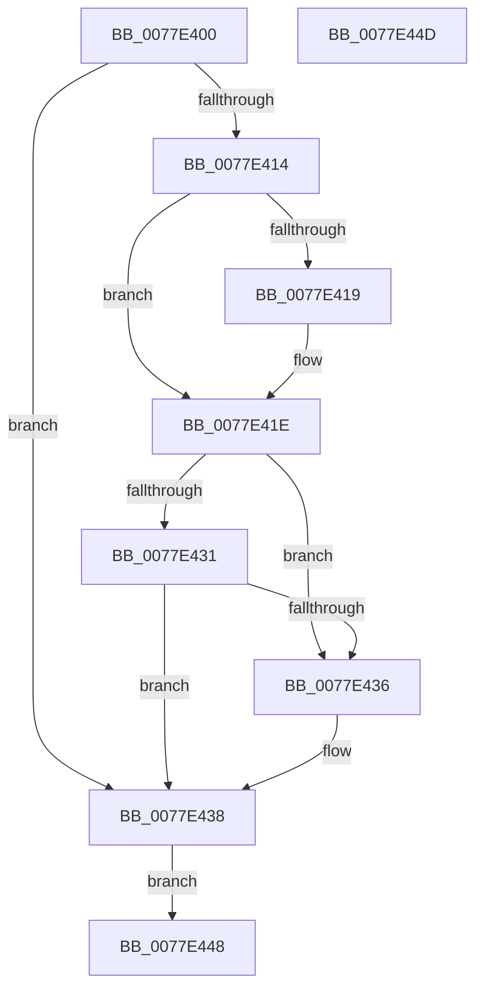

# PspCaptureSystemServiceInMemoryArgs

- RVA: `0x0077E400`–`0x0077E44E` (길이 `78` bytes)
- VA: `0x000000014077E400`
- 실행 섹션: `PAGE`
- PDB 이름 있음: `예`; PDB Function 태그: `아니요`
- unwind 정보 RVA: `0x000CDF44`
- 디코드: `25`개 명령, `78/78` bytes 표시
- 미해석 바이트: `0` (있으면 어셈블리에 `.byte`로 보존)

> 이 문서는 커널 이미지의 기계어와 PDB 기호를 분석해 생성했습니다. 4번과 5번은 함수 원형과 자료형을 바이너리 사용 방식에서 추정한 C 해석이며 원본 소스 복구 결과는 아닙니다.

## 1. Dependencies

- 직접 호출 지점: **2**; 고유 호출 대상: **2**
- 직접 호출자로 확인된 함수: **2**
- RIP 상대 이미지 참조: **0**

### Outgoing calls
- `0x0077E419` → [ExRaiseDatatypeMisalignment](../89/ExRaiseDatatypeMisalignment_function_00899FD0.md) (function, `0x00899FD0`)
- `0x0077E43E` → [memcpy](../../text/6C/memcpy_function_006C6840.md) (function, `0x006C6840`)

### Direct callers
- [PspSyscallProviderServiceDispatch](../../text/6B/PspSyscallProviderServiceDispatch_function_006BA3F0.md) at `0x006BA416`
- [PspSyscallProviderServiceDispatchGeneric](PspSyscallProviderServiceDispatchGeneric_function_0077E914.md) at `0x0077E978`

### Static image references
- 디코드된 RIP-relative 메모리 참조가 없습니다.

## 2. Other-region calls and transfers

- 다른 실행 섹션으로 향하는 call: **1**
  - `0x0077E43E` → [memcpy](../../text/6C/memcpy_function_006C6840.md) (`PAGE` → `.text`)
- 별도 외부 분기/꼬리 이동을 확인하지 못했습니다.

## 3. Assembly (complete function range)

```asm
0077E400  48 83 EC 28                     sub rsp, 0x28
0077E404  4C 8B CA                        mov r9, rdx
0077E407  45 0F B6 C0                     movzx r8d, r8b
0077E40B  49 C1 E0 03                     shl r8, 3
0077E40F  4D 85 C0                        test r8, r8
0077E412  74 24                           je 0x14077e438
0077E414  F6 C1 07                        test cl, 7
0077E417  74 05                           je 0x14077e41e
0077E419  E8 B2 BB 11 00                  call 0x140899fd0
0077E41E  49 8D 04 08                     lea rax, [r8 + rcx]
0077E422  48 BA 00 00 FF FF FF 7F 00 00   movabs rdx, 0x7fffffff0000
0077E42C  48 3B C2                        cmp rax, rdx
0077E42F  77 05                           ja 0x14077e436
0077E431  48 3B C1                        cmp rax, rcx
0077E434  73 02                           jae 0x14077e438
0077E436  8A 02                           mov al, byte ptr [rdx]
0077E438  48 8B D1                        mov rdx, rcx
0077E43B  49 8B C9                        mov rcx, r9
0077E43E  E8 FD 83 F4 FF                  call 0x1406c6840
0077E443  90                              nop
0077E444  33 C0                           xor eax, eax
0077E446  EB 00                           jmp 0x14077e448
0077E448  48 83 C4 28                     add rsp, 0x28
0077E44C  C3                              ret
0077E44D  CC                              int3
```

## 4. C-style interpretation (structured pseudocode)

```c
__int64 __fastcall PspCaptureSystemServiceInMemoryArgs(__int64 a1, __int64 a2, unsigned __int8 a3)
{
    __int64 result;
    __int64 v_rsp;

    v_rsp = (v_rsp) - (40);
    a3 = (a3) << (3);
    if (a3 == 0) goto loc_0077E438;
    if ((((unsigned __int8)(a1)) & (7)) != 0) {
        result = ExRaiseDatatypeMisalignment(a1, a2, a3, a2);
    }
    if ((a3 + a1 * 1) > a2) goto loc_0077E436;
    result = a3 + a1 * 1;
    if ((a3 + a1 * 1) < a1) {
        result = *(unsigned __int8 *)(a2);
    }
    result = memcpy(a2, a1, a3, a2);
    result = 0;
    goto loc_0077E448;
loc_0077E448:
    v_rsp = (v_rsp) + (40);
    return result;
}
```

## 5. (Beta) C Style

```c
int64_t PspCaptureSystemServiceInMemoryArgs(int64_t Arg1, int64_t Arg2, uint8_t Arg3)
{
    int64_t result;
    int64_t local_rsp;

    local_rsp = (local_rsp) - (40);
    Arg3 = (Arg3) << (3);
    if (Arg3 == 0) goto loc_0077E438;
    if ((((uint8_t)(Arg1)) & (7)) != 0) {
        result = ExRaiseDatatypeMisalignment(Arg1, Arg2, Arg3, Arg2);
    }
    if ((Arg3 + Arg1 * 1) > Arg2) goto loc_0077E436;
    result = Arg3 + Arg1 * 1;
    if ((Arg3 + Arg1 * 1) < Arg1) {
        result = *(uint8_t *)(Arg2);
    }
    result = memcpy(Arg2, Arg1, Arg3, Arg2);
    result = 0;
    goto loc_0077E448;
loc_0077E448:
    local_rsp = (local_rsp) + (40);
    return result;
}
```

## 6. Execution-region graph

[열기: 2D/3D 그래프와 함수 탐색 컨트롤 패널](../../../control-panel.html?section=page&rva=0x0077E400&view=graph)

- 2D 그래프는 위에서 아래로 흐르고, 3D 그래프는 빈 공간을 드래그해 회전합니다. Shift+드래그는 이동, 휠은 확대·축소, 함수 노드 선택은 대상 보고서 이동입니다.

### Static fallback


