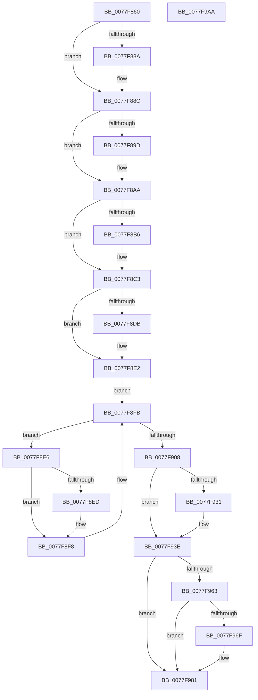

# PspCompleteServerSiloShutdownDeferred

- RVA: `0x0077F860`–`0x0077F9AB` (길이 `331` bytes)
- VA: `0x000000014077F860`
- 실행 섹션: `PAGE`
- PDB 이름 있음: `예`; PDB Function 태그: `아니요`
- unwind 정보 RVA: `0x0006F978`
- 디코드: `82`개 명령, `331/331` bytes 표시
- 미해석 바이트: `0` (있으면 어셈블리에 `.byte`로 보존)

> 이 문서는 커널 이미지의 기계어와 PDB 기호를 분석해 생성했습니다. 4번과 5번은 함수 원형과 자료형을 바이너리 사용 방식에서 추정한 C 해석이며 원본 소스 복구 결과는 아닙니다.

## 1. Dependencies

- 직접 호출 지점: **17**; 고유 호출 대상: **14**
- 직접 호출자로 확인된 함수: **0**
- RIP 상대 이미지 참조: **0**

### Outgoing calls
- `0x0077F878` → [PsGetServerSiloGlobals](../../text/22/PsGetServerSiloGlobals_function_002250A0.md) (function, `0x002250A0`)
- `0x0077F880` → [PsGetServerSiloState](../../text/22/PsGetServerSiloState_function_002259FC.md) (function, `0x002259FC`)
- `0x0077F88C` → [PspTerminateSiloSubsystemProcesses](../78/PspTerminateSiloSubsystemProcesses_function_00780918.md) (function, `0x00780918`)
- `0x0077F89D` → [ObfDereferenceObject](../../text/2F/ObfDereferenceObject_function_002F9350.md) (function, `0x002F9350`)
- `0x0077F8B6` → [ObfDereferenceObject](../../text/2F/ObfDereferenceObject_function_002F9350.md) (function, `0x002F9350`)
- `0x0077F8C6` → [PspGetServerSiloStatePointer](../../text/4F/PspGetServerSiloStatePointer_function_004FCDB8.md) (function, `0x004FCDB8`)
- `0x0077F8CE` → [PspAcquirePushLockShared](../../text/4F/PspAcquirePushLockShared_function_004F6134.md) (function, `0x004F6134`)
- `0x0077F8F3` → [PspInvokeTerminateCallback](../78/PspInvokeTerminateCallback_function_00786BF8.md) (function, `0x00786BF8`)
- `0x0077F8FB` → [PspGetNextMonitor](../78/PspGetNextMonitor_function_00786B6C.md) (function, `0x00786B6C`)
- `0x0077F913` → [EtwTraceJobServerSiloStateChange](../7B/EtwTraceJobServerSiloStateChange_function_007B7EB8.md) (function, `0x007B7EB8`)
- `0x0077F918` → [PspReleasePushLockShared](../../text/4F/PspReleasePushLockShared_function_004F8D00.md) (function, `0x004F8D00`)
- `0x0077F920` → [PspDeleteExternalServerSiloState](PspDeleteExternalServerSiloState_function_0077FB88.md) (function, `0x0077FB88`)
- `0x0077F931` → [ObfDereferenceObject](../../text/2F/ObfDereferenceObject_function_002F9350.md) (function, `0x002F9350`)
- `0x0077F954` → [PspLockJobShared](../91/PspLockJobShared_function_0091A490.md) (function, `0x0091A490`)
- `0x0077F97C` → [PspSendJobNotification](../../text/49/PspSendJobNotification_function_0049EC28.md) (function, `0x0049EC28`)
- `0x0077F987` → [PspUnlockJob](../91/PspUnlockJob_function_00919E00.md) (function, `0x00919E00`)
- `0x0077F98F` → [ObfDereferenceObject](../../text/2F/ObfDereferenceObject_function_002F9350.md) (function, `0x002F9350`)

### Direct callers
- 이 함수 시작 RVA로 연결되는 직접 call은 확인되지 않았습니다. 간접 호출은 완전히 역산할 수 없습니다.

### Static image references
- 디코드된 RIP-relative 메모리 참조가 없습니다.

## 2. Other-region calls and transfers

- 다른 실행 섹션으로 향하는 call: **10**
  - `0x0077F878` → [PsGetServerSiloGlobals](../../text/22/PsGetServerSiloGlobals_function_002250A0.md) (`PAGE` → `.text`)
  - `0x0077F880` → [PsGetServerSiloState](../../text/22/PsGetServerSiloState_function_002259FC.md) (`PAGE` → `.text`)
  - `0x0077F89D` → [ObfDereferenceObject](../../text/2F/ObfDereferenceObject_function_002F9350.md) (`PAGE` → `.text`)
  - `0x0077F8B6` → [ObfDereferenceObject](../../text/2F/ObfDereferenceObject_function_002F9350.md) (`PAGE` → `.text`)
  - `0x0077F8C6` → [PspGetServerSiloStatePointer](../../text/4F/PspGetServerSiloStatePointer_function_004FCDB8.md) (`PAGE` → `.text`)
  - `0x0077F8CE` → [PspAcquirePushLockShared](../../text/4F/PspAcquirePushLockShared_function_004F6134.md) (`PAGE` → `.text`)
  - `0x0077F918` → [PspReleasePushLockShared](../../text/4F/PspReleasePushLockShared_function_004F8D00.md) (`PAGE` → `.text`)
  - `0x0077F931` → [ObfDereferenceObject](../../text/2F/ObfDereferenceObject_function_002F9350.md) (`PAGE` → `.text`)
  - `0x0077F97C` → [PspSendJobNotification](../../text/49/PspSendJobNotification_function_0049EC28.md) (`PAGE` → `.text`)
  - `0x0077F98F` → [ObfDereferenceObject](../../text/2F/ObfDereferenceObject_function_002F9350.md) (`PAGE` → `.text`)
- 별도 외부 분기/꼬리 이동을 확인하지 못했습니다.

## 3. Assembly (complete function range)

```asm
0077F860  48 89 5C 24 08                  mov qword ptr [rsp + 8], rbx
0077F865  48 89 74 24 10                  mov qword ptr [rsp + 0x10], rsi
0077F86A  48 89 7C 24 18                  mov qword ptr [rsp + 0x18], rdi
0077F86F  41 56                           push r14
0077F871  48 83 EC 20                     sub rsp, 0x20
0077F875  48 8B D9                        mov rbx, rcx
0077F878  E8 23 58 AA FF                  call 0x1402250a0
0077F87D  48 8B F0                        mov rsi, rax
0077F880  E8 77 61 AA FF                  call 0x1402259fc
0077F885  83 F8 03                        cmp eax, 3
0077F888  74 02                           je 0x14077f88c
0077F88A  CD 2C                           int 0x2c
0077F88C  E8 87 10 00 00                  call 0x140780918
0077F891  48 8B 8E 50 03 00 00            mov rcx, qword ptr [rsi + 0x350]
0077F898  48 85 C9                        test rcx, rcx
0077F89B  74 0D                           je 0x14077f8aa
0077F89D  E8 AE 9A B7 FF                  call 0x1402f9350
0077F8A2  48 83 A6 50 03 00 00 00         and qword ptr [rsi + 0x350], 0
0077F8AA  48 8B 8E 58 03 00 00            mov rcx, qword ptr [rsi + 0x358]
0077F8B1  48 85 C9                        test rcx, rcx
0077F8B4  74 0D                           je 0x14077f8c3
0077F8B6  E8 95 9A B7 FF                  call 0x1402f9350
0077F8BB  48 83 A6 58 03 00 00 00         and qword ptr [rsi + 0x358], 0
0077F8C3  48 8B CB                        mov rcx, rbx
0077F8C6  E8 ED D4 D7 FF                  call 0x1404fcdb8
0077F8CB  4C 8B F0                        mov r14, rax
0077F8CE  E8 61 68 D7 FF                  call 0x1404f6134
0077F8D3  41 8B 0E                        mov ecx, dword ptr [r14]
0077F8D6  83 F9 03                        cmp ecx, 3
0077F8D9  74 07                           je 0x14077f8e2
0077F8DB  B9 05 00 00 00                  mov ecx, 5
0077F8E0  CD 29                           int 0x29
0077F8E2  33 C9                           xor ecx, ecx
0077F8E4  EB 15                           jmp 0x14077f8fb
0077F8E6  48 83 7F 20 00                  cmp qword ptr [rdi + 0x20], 0
0077F8EB  74 0B                           je 0x14077f8f8
0077F8ED  48 8B D7                        mov rdx, rdi
0077F8F0  48 8B CB                        mov rcx, rbx
0077F8F3  E8 00 73 00 00                  call 0x140786bf8
0077F8F8  48 8B CF                        mov rcx, rdi
0077F8FB  E8 6C 72 00 00                  call 0x140786b6c
0077F900  48 8B F8                        mov rdi, rax
0077F903  48 85 C0                        test rax, rax
0077F906  75 DE                           jne 0x14077f8e6
0077F908  BA 04 00 00 00                  mov edx, 4
0077F90D  48 8B CB                        mov rcx, rbx
0077F910  41 89 16                        mov dword ptr [r14], edx
0077F913  E8 A0 85 03 00                  call 0x1407b7eb8
0077F918  E8 E3 93 D7 FF                  call 0x1404f8d00
0077F91D  48 8B CB                        mov rcx, rbx
0077F920  E8 63 02 00 00                  call 0x14077fb88
0077F925  48 8B 8E 48 03 00 00            mov rcx, qword ptr [rsi + 0x348]
0077F92C  48 85 C9                        test rcx, rcx
0077F92F  74 0D                           je 0x14077f93e
0077F931  E8 1A 9A B7 FF                  call 0x1402f9350
0077F936  48 83 A6 48 03 00 00 00         and qword ptr [rsi + 0x348], 0
0077F93E  65 48 8B 3C 25 88 01 00 00      mov rdi, qword ptr gs:[0x188]
0077F947  48 8B CB                        mov rcx, rbx
0077F94A  48 63 B6 FC 04 00 00            movsxd rsi, dword ptr [rsi + 0x4fc]
0077F951  48 8B D7                        mov rdx, rdi
0077F954  E8 37 AB 19 00                  call 0x14091a490
0077F959  48 83 BB 28 02 00 00 00         cmp qword ptr [rbx + 0x228], 0
0077F961  74 1E                           je 0x14077f981
0077F963  F7 83 50 04 00 00 00 20 00 00   test dword ptr [rbx + 0x450], 0x2000
0077F96D  74 12                           je 0x14077f981
0077F96F  45 33 C9                        xor r9d, r9d
0077F972  4C 8B C6                        mov r8, rsi
0077F975  48 8B CB                        mov rcx, rbx
0077F978  41 8D 51 0D                     lea edx, [r9 + 0xd]
0077F97C  E8 A7 F2 D1 FF                  call 0x14049ec28
0077F981  48 8B D7                        mov rdx, rdi
0077F984  48 8B CB                        mov rcx, rbx
0077F987  E8 74 A4 19 00                  call 0x140919e00
0077F98C  48 8B CB                        mov rcx, rbx
0077F98F  E8 BC 99 B7 FF                  call 0x1402f9350
0077F994  48 8B 5C 24 30                  mov rbx, qword ptr [rsp + 0x30]
0077F999  48 8B 74 24 38                  mov rsi, qword ptr [rsp + 0x38]
0077F99E  48 8B 7C 24 40                  mov rdi, qword ptr [rsp + 0x40]
0077F9A3  48 83 C4 20                     add rsp, 0x20
0077F9A7  41 5E                           pop r14
0077F9A9  C3                              ret
0077F9AA  CC                              int3
```

## 4. C-style interpretation (structured pseudocode)

```c
__int64 __fastcall PspCompleteServerSiloShutdownDeferred(__int64 a1, __int64 a2, __int64 a3, int a4)
{
    __int64 result;
    __int64 v_rsp;
    unsigned __int64 v_stack_p10;
    unsigned __int64 v_stack_p18;
    unsigned __int64 v_stack_p8;

    v_stack_p8 = v_rbx;
    v_stack_p10 = v_rsi;
    v_stack_p18 = v_rdi;
    v_rsp = (v_rsp) - (32);
    result = PsGetServerSiloGlobals(a1, a2, a3, a4);
    result = PsGetServerSiloState(a1, a2, a3, a4);
    if (((unsigned int)(result)) != 3) {
    }
    result = PspTerminateSiloSubsystemProcesses(a1, a2, a3, a4);
    if (*(unsigned __int64 *)(result + 848) != 0) {
        result = ObfDereferenceObject(*(unsigned __int64 *)(result + 848), a2, a3, a4);
    }
    if (*(unsigned __int64 *)(result + 856) != 0) {
        result = ObfDereferenceObject(*(unsigned __int64 *)(result + 856), a2, a3, a4);
    }
    result = PspGetServerSiloStatePointer(a1, a2, a3, a4);
    result = PspAcquirePushLockShared(a1, a2, a3, a4);
    if (((unsigned int)((unsigned int)(*(unsigned int *)(result)))) != 3) {
        a1 = 5;
    }
    a1 = 0;
    goto loc_0077F8FB;
loc_0077F8E6:
    if ((*(unsigned __int64 *)(v_rdi + 32)) != 0) {
        a2 = v_rdi;
        a1 = 0;
        result = PspInvokeTerminateCallback(a1, a2, a3, a4);
    }
loc_0077F8FB:
    result = PspGetNextMonitor(v_rdi, a2, a3, a4);
    if (result != 0) goto loc_0077F8E6;
    *(unsigned int *)(result) = 4;
    result = EtwTraceJobServerSiloStateChange(a1, 4, a3, a4);
    result = PspReleasePushLockShared(a1, 4, a3, a4);
    result = PspDeleteExternalServerSiloState(a1, 4, a3, a4);
    if (*(unsigned __int64 *)(result + 840) != 0) {
        result = ObfDereferenceObject(*(unsigned __int64 *)(result + 840), 4, a3, a4);
    }
    result = PspLockJobShared(a1, *(unsigned __int64 *)(gs_base + (0 + 392)), a3, a4);
    if ((*(unsigned __int64 *)(a1 + 552)) == 0) goto loc_0077F981;
    if (((*(unsigned int *)(a1 + 1104)) & (0x2000ULL)) != 0) {
        a4 = 0;
        a3 = (int)(*(unsigned int *)(result + 1276));
        a1 = a1;
        a2 = a4 + 13;
        result = PspSendJobNotification(a1, a2, a3, a4);
    }
    result = PspUnlockJob(a1, *(unsigned __int64 *)(gs_base + (0 + 392)), a3, a4);
    result = ObfDereferenceObject(a1, *(unsigned __int64 *)(gs_base + (0 + 392)), a3, a4);
    v_rsp = (v_rsp) + (32);
    return result;
}
```

## 5. (Beta) C Style

```c
int64_t PspCompleteServerSiloShutdownDeferred(void *Arg1, int64_t Arg2, int64_t Arg3, int32_t Arg4)
{
    uint8_t *arg1 = (uint8_t *)Arg1;

    int64_t result;
    int64_t local_rsp;
    uint64_t v_stack_p10;
    uint64_t v_stack_p18;
    uint64_t v_stack_p8;

    v_stack_p8 = local_rbx;
    v_stack_p10 = local_rsi;
    v_stack_p18 = local_rdi;
    local_rsp = (local_rsp) - (32);
    result = PsGetServerSiloGlobals(Arg1, Arg2, Arg3, Arg4);
    result = PsGetServerSiloState(Arg1, Arg2, Arg3, Arg4);
    if (((uint32_t)(result)) != 3) {
    }
    result = PspTerminateSiloSubsystemProcesses(Arg1, Arg2, Arg3, Arg4);
    if (*(uint64_t *)(result + 0x350) != 0) {
        result = ObfDereferenceObject(*(uint64_t *)(result + 0x350), Arg2, Arg3, Arg4);
    }
    if (*(uint64_t *)(result + 0x358) != 0) {
        result = ObfDereferenceObject(*(uint64_t *)(result + 0x358), Arg2, Arg3, Arg4);
    }
    result = PspGetServerSiloStatePointer(Arg1, Arg2, Arg3, Arg4);
    result = PspAcquirePushLockShared(Arg1, Arg2, Arg3, Arg4);
    if (((uint32_t)((uint32_t)(*(uint32_t *)(result)))) != 3) {
        Arg1 = 5;
    }
    Arg1 = 0;
    goto loc_0077F8FB;
loc_0077F8E6:
    if ((*(uint64_t *)(local_rdi + 0x20)) != 0) {
        Arg2 = local_rdi;
        Arg1 = 0;
        result = PspInvokeTerminateCallback(Arg1, Arg2, Arg3, Arg4);
    }
loc_0077F8FB:
    result = PspGetNextMonitor(local_rdi, Arg2, Arg3, Arg4);
    if (result != 0) goto loc_0077F8E6;
    *(uint32_t *)(result) = 4;
    result = EtwTraceJobServerSiloStateChange(Arg1, 4, Arg3, Arg4);
    result = PspReleasePushLockShared(Arg1, 4, Arg3, Arg4);
    result = PspDeleteExternalServerSiloState(Arg1, 4, Arg3, Arg4);
    if (*(uint64_t *)(result + 0x348) != 0) {
        result = ObfDereferenceObject(*(uint64_t *)(result + 0x348), 4, Arg3, Arg4);
    }
    result = PspLockJobShared(Arg1, *(uint64_t *)(gs_base + (0 + 0x188)), Arg3, Arg4);
    if ((*(uint64_t *)(arg1 + 0x228)) == 0) goto loc_0077F981;
    if (((*(uint32_t *)(arg1 + 0x450)) & (0x2000ULL)) != 0) {
        Arg4 = 0;
        Arg3 = (int32_t)(*(uint32_t *)(result + 0x4FC));
        Arg1 = Arg1;
        Arg2 = Arg4 + 13;
        result = PspSendJobNotification(Arg1, Arg2, Arg3, Arg4);
    }
    result = PspUnlockJob(Arg1, *(uint64_t *)(gs_base + (0 + 0x188)), Arg3, Arg4);
    result = ObfDereferenceObject(Arg1, *(uint64_t *)(gs_base + (0 + 0x188)), Arg3, Arg4);
    local_rsp = (local_rsp) + (32);
    return result;
}
```

### 관측된 메모리 오프셋

구조체 형식이 확인되지 않은 접근은 인자 기준의 오프셋으로만 기록했습니다.

| 기준 인자 | 오프셋 표현 | 폭 (bit) | 접근 |
|---|---:|---:|---|
| `Arg1` | `+ 0x228` | `64` | `R` |
| `Arg1` | `+ 0x450` | `32` | `R` |

## 6. Execution-region graph

[열기: 2D/3D 그래프와 함수 탐색 컨트롤 패널](../../../control-panel.html?section=page&rva=0x0077F860&view=graph)

- 2D 그래프는 위에서 아래로 흐르고, 3D 그래프는 빈 공간을 드래그해 회전합니다. Shift+드래그는 이동, 휠은 확대·축소, 함수 노드 선택은 대상 보고서 이동입니다.

### Static fallback


