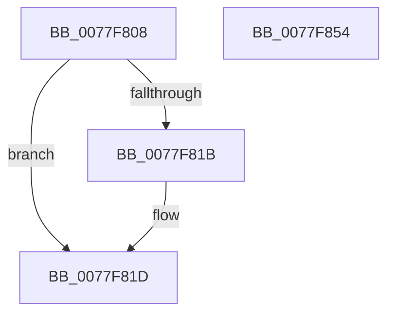

# PspCompleteServerSiloShutdown

- RVA: `0x0077F808`–`0x0077F855` (길이 `77` bytes)
- VA: `0x000000014077F808`
- 실행 섹션: `PAGE`
- PDB 이름 있음: `예`; PDB Function 태그: `아니요`
- unwind 정보 RVA: `0x0005CF00`
- 디코드: `21`개 명령, `77/77` bytes 표시
- 미해석 바이트: `0` (있으면 어셈블리에 `.byte`로 보존)

> 이 문서는 커널 이미지의 기계어와 PDB 기호를 분석해 생성했습니다. 4번과 5번은 함수 원형과 자료형을 바이너리 사용 방식에서 추정한 C 해석이며 원본 소스 복구 결과는 아닙니다.

## 1. Dependencies

- 직접 호출 지점: **4**; 고유 호출 대상: **4**
- 직접 호출자로 확인된 함수: **1**
- RIP 상대 이미지 참조: **1**

### Outgoing calls
- `0x0077F811` → [PsGetServerSiloState](../../text/22/PsGetServerSiloState_function_002259FC.md) (function, `0x002259FC`)
- `0x0077F81D` → [ObfReferenceObject](../../text/20/ObfReferenceObject_function_0020FA20.md) (function, `0x0020FA20`)
- `0x0077F825` → [PsGetServerSiloGlobals](../../text/22/PsGetServerSiloGlobals_function_002250A0.md) (function, `0x002250A0`)
- `0x0077F849` → [ExQueueWorkItem](../../text/2F/ExQueueWorkItem_function_002F9520.md) (function, `0x002F9520`)

### Direct callers
- [PspTerminateProcessesJobCallback](../91/PspTerminateProcessesJobCallback_function_00917430.md) at `0x009174F3`

### Static image references
- `0x0077F83A` → RVA `0x0077F860` (`PspCompleteServerSiloShutdownDeferred`; read)

## 2. Other-region calls and transfers

- 다른 실행 섹션으로 향하는 call: **4**
  - `0x0077F811` → [PsGetServerSiloState](../../text/22/PsGetServerSiloState_function_002259FC.md) (`PAGE` → `.text`)
  - `0x0077F81D` → [ObfReferenceObject](../../text/20/ObfReferenceObject_function_0020FA20.md) (`PAGE` → `.text`)
  - `0x0077F825` → [PsGetServerSiloGlobals](../../text/22/PsGetServerSiloGlobals_function_002250A0.md) (`PAGE` → `.text`)
  - `0x0077F849` → [ExQueueWorkItem](../../text/2F/ExQueueWorkItem_function_002F9520.md) (`PAGE` → `.text`)
- 별도 외부 분기/꼬리 이동을 확인하지 못했습니다.

## 3. Assembly (complete function range)

```asm
0077F808  40 53                           push rbx
0077F80A  48 83 EC 20                     sub rsp, 0x20
0077F80E  48 8B D9                        mov rbx, rcx
0077F811  E8 E6 61 AA FF                  call 0x1402259fc
0077F816  83 F8 03                        cmp eax, 3
0077F819  74 02                           je 0x14077f81d
0077F81B  CD 2C                           int 0x2c
0077F81D  E8 FE 01 A9 FF                  call 0x14020fa20
0077F822  48 8B CB                        mov rcx, rbx
0077F825  E8 76 58 AA FF                  call 0x1402250a0
0077F82A  BA 01 00 00 00                  mov edx, 1
0077F82F  48 8D 88 18 05 00 00            lea rcx, [rax + 0x518]
0077F836  48 83 21 00                     and qword ptr [rcx], 0
0077F83A  48 8D 05 1F 00 00 00            lea rax, [rip + 0x1f]
0077F841  48 89 41 10                     mov qword ptr [rcx + 0x10], rax
0077F845  48 89 59 18                     mov qword ptr [rcx + 0x18], rbx
0077F849  E8 D2 9C B7 FF                  call 0x1402f9520
0077F84E  48 83 C4 20                     add rsp, 0x20
0077F852  5B                              pop rbx
0077F853  C3                              ret
0077F854  CC                              int3
```

## 4. C-style interpretation (structured pseudocode)

```c
__int64 __fastcall PspCompleteServerSiloShutdown(__int64 a1)
{
    __int64 result;
    __int64 v_rsp;

    v_rsp = (v_rsp) - (32);
    result = PsGetServerSiloState(a1, a2, a3, a4);
    if (((unsigned int)(result)) != 3) {
    }
    result = ObfReferenceObject(a1, a2, a3, a4);
    result = PsGetServerSiloGlobals(a1, a2, a3, a4);
    *(unsigned __int64 *)(result + 1304 + 16) = v_rip + 31;
    *(unsigned __int64 *)(result + 1304 + 24) = a1;
    result = ExQueueWorkItem(result + 1304, 1, a3, a4);
    v_rsp = (v_rsp) + (32);
    return result;
}
```

## 5. (Beta) C Style

```c
int64_t PspCompleteServerSiloShutdown(int64_t Arg1)
{
    int64_t result;
    int64_t local_rsp;

    local_rsp = (local_rsp) - (32);
    result = PsGetServerSiloState(Arg1, a2, a3, a4);
    if (((uint32_t)(result)) != 3) {
    }
    result = ObfReferenceObject(Arg1, a2, a3, a4);
    result = PsGetServerSiloGlobals(Arg1, a2, a3, a4);
    *(uint64_t *)(result + 0x518 + 0x10) = v_rip + 31;
    *(uint64_t *)(result + 0x518 + 0x18) = Arg1;
    result = ExQueueWorkItem(result + 1304, 1, a3, a4);
    local_rsp = (local_rsp) + (32);
    return result;
}
```

## 6. Execution-region graph

[열기: 2D/3D 그래프와 함수 탐색 컨트롤 패널](../../../control-panel.html?section=page&rva=0x0077F808&view=graph)

- 2D 그래프는 위에서 아래로 흐르고, 3D 그래프는 빈 공간을 드래그해 회전합니다. Shift+드래그는 이동, 휠은 확대·축소, 함수 노드 선택은 대상 보고서 이동입니다.

### Static fallback


