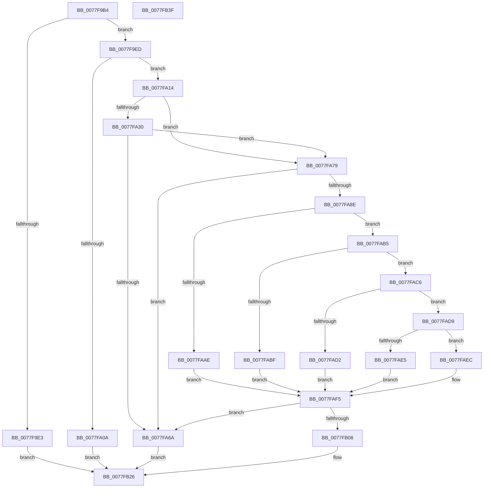

# PspConvertSiloToServerSilo

- RVA: `0x0077F9B4`–`0x0077FB40` (길이 `396` bytes)
- VA: `0x000000014077F9B4`
- 실행 섹션: `PAGE`
- PDB 이름 있음: `예`; PDB Function 태그: `아니요`
- unwind 정보 RVA: `0x00093E28`
- 디코드: `104`개 명령, `396/396` bytes 표시
- 미해석 바이트: `0` (있으면 어셈블리에 `.byte`로 보존)

> 이 문서는 커널 이미지의 기계어와 PDB 기호를 분석해 생성했습니다. 4번과 5번은 함수 원형과 자료형을 바이너리 사용 방식에서 추정한 C 해석이며 원본 소스 복구 결과는 아닙니다.

## 1. Dependencies

- 직접 호출 지점: **12**; 고유 호출 대상: **12**
- 직접 호출자로 확인된 함수: **1**
- RIP 상대 이미지 참조: **1**

### Outgoing calls
- `0x0077F9D8` → [PsIsCurrentThreadInServerSilo](../../text/43/PsIsCurrentThreadInServerSilo_function_004362E0.md) (function, `0x004362E0`)
- `0x0077F9FD` → [ExAllocatePool2](../../poolcode/B8/ExAllocatePool2_function_00B820F0.md) (function, `0x00B820F0`)
- `0x0077FA5F` → [ObpReferenceObjectByHandleWithTag](../86/ObpReferenceObjectByHandleWithTag_function_00869650.md) (function, `0x00869650`)
- `0x0077FA6D` → [PspDeleteServerSiloGlobals](PspDeleteServerSiloGlobals_function_0077FC54.md) (function, `0x0077FC54`)
- `0x0077FA83` → [ObGetSiloRootDirectoryPath](../83/ObGetSiloRootDirectoryPath_function_0083CD74.md) (function, `0x0083CD74`)
- `0x0077FA9D` → [PspLockJobExclusive](../91/PspLockJobExclusive_function_0091A4B8.md) (function, `0x0091A4B8`)
- `0x0077FAA5` → [PsIsServerSilo](../../text/22/PsIsServerSilo_function_00225828.md) (function, `0x00225828`)
- `0x0077FAB5` → [PsGetParentSilo](../A7/PsGetParentSilo_function_00A70760.md) (function, `0x00A70760`)
- `0x0077FAC9` → [PspJobHasChildren](../70/PspJobHasChildren_function_007051E4.md) (function, `0x007051E4`)
- `0x0077FAFB` → [PspUnlockJob](../91/PspUnlockJob_function_00919E00.md) (function, `0x00919E00`)
- `0x0077FB0D` → [EtwTraceJobServerSiloStateChange](../7B/EtwTraceJobServerSiloStateChange_function_007B7EB8.md) (function, `0x007B7EB8`)
- `0x0077FB15` → [PspQueueDeferredWorkAndWait](../78/PspQueueDeferredWorkAndWait_function_00780148.md) (function, `0x00780148`)

### Direct callers
- [NtSetInformationJobObject](../9F/NtSetInformationJobObject_function_009F84C0.md) at `0x009FA2A3`

### Static image references
- `0x0077FA30` → RVA `0x00FC6B80` (`ALMOSTRO`; read)

## 2. Other-region calls and transfers

- 다른 실행 섹션으로 향하는 call: **3**
  - `0x0077F9D8` → [PsIsCurrentThreadInServerSilo](../../text/43/PsIsCurrentThreadInServerSilo_function_004362E0.md) (`PAGE` → `.text`)
  - `0x0077F9FD` → [ExAllocatePool2](../../poolcode/B8/ExAllocatePool2_function_00B820F0.md) (`PAGE` → `POOLCODE`)
  - `0x0077FAA5` → [PsIsServerSilo](../../text/22/PsIsServerSilo_function_00225828.md) (`PAGE` → `.text`)
- 별도 외부 분기/꼬리 이동을 확인하지 못했습니다.

## 3. Assembly (complete function range)

```asm
0077F9B4  48 89 5C 24 08                  mov qword ptr [rsp + 8], rbx
0077F9B9  48 89 6C 24 10                  mov qword ptr [rsp + 0x10], rbp
0077F9BE  48 89 74 24 18                  mov qword ptr [rsp + 0x18], rsi
0077F9C3  57                              push rdi
0077F9C4  41 56                           push r14
0077F9C6  41 57                           push r15
0077F9C8  48 83 EC 40                     sub rsp, 0x40
0077F9CC  45 8B F1                        mov r14d, r9d
0077F9CF  49 8B E8                        mov rbp, r8
0077F9D2  44 8A FA                        mov r15b, dl
0077F9D5  48 8B F1                        mov rsi, rcx
0077F9D8  E8 03 69 CB FF                  call 0x1404362e0
0077F9DD  33 DB                           xor ebx, ebx
0077F9DF  84 C0                           test al, al
0077F9E1  74 0A                           je 0x14077f9ed
0077F9E3  B8 61 00 00 C0                  mov eax, 0xc0000061
0077F9E8  E9 39 01 00 00                  jmp 0x14077fb26
0077F9ED  BA 98 05 00 00                  mov edx, 0x598
0077F9F2  B9 48 00 00 00                  mov ecx, 0x48
0077F9F7  41 B8 53 69 6C 47               mov r8d, 0x476c6953
0077F9FD  E8 EE 26 40 00                  call 0x140b820f0
0077FA02  48 8B F8                        mov rdi, rax
0077FA05  48 85 C0                        test rax, rax
0077FA08  75 0A                           jne 0x14077fa14
0077FA0A  B8 9A 00 00 C0                  mov eax, 0xc000009a
0077FA0F  E9 12 01 00 00                  jmp 0x14077fb26
0077FA14  89 98 F8 04 00 00               mov dword ptr [rax + 0x4f8], ebx
0077FA1A  C7 80 FC 04 00 00 03 01 00 00   mov dword ptr [rax + 0x4fc], 0x103
0077FA24  44 89 B0 38 05 00 00            mov dword ptr [rax + 0x538], r14d
0077FA2B  48 85 ED                        test rbp, rbp
0077FA2E  74 49                           je 0x14077fa79
0077FA30  4C 8B 05 49 71 84 00            mov r8, qword ptr [rip + 0x847149]
0077FA37  48 05 00 05 00 00               add rax, 0x500
0077FA3D  48 89 5C 24 38                  mov qword ptr [rsp + 0x38], rbx
0077FA42  45 8A CF                        mov r9b, r15b
0077FA45  48 89 5C 24 30                  mov qword ptr [rsp + 0x30], rbx
0077FA4A  BA 02 00 00 00                  mov edx, 2
0077FA4F  48 89 44 24 28                  mov qword ptr [rsp + 0x28], rax
0077FA54  48 8B CD                        mov rcx, rbp
0077FA57  C7 44 24 20 53 69 44 65         mov dword ptr [rsp + 0x20], 0x65446953
0077FA5F  E8 EC 9B 0E 00                  call 0x140869650
0077FA64  8B E8                           mov ebp, eax
0077FA66  85 C0                           test eax, eax
0077FA68  79 0F                           jns 0x14077fa79
0077FA6A  48 8B CF                        mov rcx, rdi
0077FA6D  E8 E2 01 00 00                  call 0x14077fc54
0077FA72  8B C5                           mov eax, ebp
0077FA74  E9 AD 00 00 00                  jmp 0x14077fb26
0077FA79  48 8D 97 E0 04 00 00            lea rdx, [rdi + 0x4e0]
0077FA80  48 8B CE                        mov rcx, rsi
0077FA83  E8 EC D2 0B 00                  call 0x14083cd74
0077FA88  8B E8                           mov ebp, eax
0077FA8A  85 C0                           test eax, eax
0077FA8C  78 DC                           js 0x14077fa6a
0077FA8E  65 4C 8B 34 25 88 01 00 00      mov r14, qword ptr gs:[0x188]
0077FA97  48 8B CE                        mov rcx, rsi
0077FA9A  49 8B D6                        mov rdx, r14
0077FA9D  E8 16 AA 19 00                  call 0x14091a4b8
0077FAA2  48 8B CE                        mov rcx, rsi
0077FAA5  E8 7E 5D AA FF                  call 0x140225828
0077FAAA  84 C0                           test al, al
0077FAAC  74 07                           je 0x14077fab5
0077FAAE  BD 08 05 00 C0                  mov ebp, 0xc0000508
0077FAB3  EB 40                           jmp 0x14077faf5
0077FAB5  E8 A6 0C 2F 00                  call 0x140a70760
0077FABA  48 85 C0                        test rax, rax
0077FABD  74 07                           je 0x14077fac6
0077FABF  BD 21 00 00 C0                  mov ebp, 0xc0000021
0077FAC4  EB 2F                           jmp 0x14077faf5
0077FAC6  48 8B CE                        mov rcx, rsi
0077FAC9  E8 16 57 F8 FF                  call 0x1407051e4
0077FACE  84 C0                           test al, al
0077FAD0  74 07                           je 0x14077fad9
0077FAD2  BD 0F 05 00 C0                  mov ebp, 0xc000050f
0077FAD7  EB 1C                           jmp 0x14077faf5
0077FAD9  F7 86 00 01 00 00 00 00 40 00   test dword ptr [rsi + 0x100], 0x400000
0077FAE3  75 07                           jne 0x14077faec
0077FAE5  BD 0D 00 00 C0                  mov ebp, 0xc000000d
0077FAEA  EB 09                           jmp 0x14077faf5
0077FAEC  48 89 BE E0 05 00 00            mov qword ptr [rsi + 0x5e0], rdi
0077FAF3  8B EB                           mov ebp, ebx
0077FAF5  49 8B D6                        mov rdx, r14
0077FAF8  48 8B CE                        mov rcx, rsi
0077FAFB  E8 00 A3 19 00                  call 0x140919e00
0077FB00  85 ED                           test ebp, ebp
0077FB02  0F 88 62 FF FF FF               js 0x14077fa6a
0077FB08  33 D2                           xor edx, edx
0077FB0A  48 8B CE                        mov rcx, rsi
0077FB0D  E8 A6 83 03 00                  call 0x1407b7eb8
0077FB12  48 8B D6                        mov rdx, rsi
0077FB15  E8 2E 06 00 00                  call 0x140780148
0077FB1A  85 C0                           test eax, eax
0077FB1C  B9 65 03 00 C0                  mov ecx, 0xc0000365
0077FB21  0F 48 D9                        cmovs ebx, ecx
0077FB24  8B C3                           mov eax, ebx
0077FB26  48 8B 5C 24 60                  mov rbx, qword ptr [rsp + 0x60]
0077FB2B  48 8B 6C 24 68                  mov rbp, qword ptr [rsp + 0x68]
0077FB30  48 8B 74 24 70                  mov rsi, qword ptr [rsp + 0x70]
0077FB35  48 83 C4 40                     add rsp, 0x40
0077FB39  41 5F                           pop r15
0077FB3B  41 5E                           pop r14
0077FB3D  5F                              pop rdi
0077FB3E  C3                              ret
0077FB3F  CC                              int3
```

## 4. C-style interpretation (structured pseudocode)

```c
__int64 __fastcall PspConvertSiloToServerSilo(__int64 a1, unsigned __int8 a2, __int64 a3, int a4)
{
    __int64 result;
    __int64 v_rbx;
    __int64 v_rsp;
    unsigned __int64 v_stack_m20;
    unsigned __int64 v_stack_m28;
    unsigned __int64 v_stack_m30;
    unsigned int v_stack_m38;
    unsigned __int64 v_stack_p10;
    unsigned __int64 v_stack_p18;
    unsigned __int64 v_stack_p8;

    v_stack_p8 = v_rbx;
    v_stack_p10 = v_rbp;
    v_stack_p18 = v_rsi;
    v_rsp = (v_rsp) - (64);
    result = PsIsCurrentThreadInServerSilo(a1, a2, a3, a4);
    v_rbx = 0;
    if ((unsigned __int8)(result) == 0) goto loc_0077F9ED;
    goto loc_0077FB26;
loc_0077F9ED:
    result = ExAllocatePool2(72, (unsigned int)(0x598ULL), (unsigned int)(0x476C6953ULL), a4);
    if (result != 0) goto loc_0077FA14;
    goto loc_0077FB26;
loc_0077FA14:
    *(unsigned int *)((unsigned int)(0xC000009AULL) + 1272) = 0;
    *(unsigned int *)((unsigned int)(0xC000009AULL) + 1276) = 259;
    *(unsigned int *)((unsigned int)(0xC000009AULL) + 1336) = (unsigned int)((unsigned int)(a4));
    if (a3 == 0) goto loc_0077FA79;
    result = ((unsigned int)(0xC000009AULL)) + (0x500ULL);
    v_stack_m20 = 0;
    v_stack_m28 = 0;
    v_stack_m30 = result;
    v_stack_m38 = 0x65446953ULL;
    result = ObpReferenceObjectByHandleWithTag(a3, 2, *(unsigned __int64 *)(v_rip + 8679753), a2);
    if (!sign_flag) goto loc_0077FA79;
loc_0077FA6A:
    result = PspDeleteServerSiloGlobals(result, 2, *(unsigned __int64 *)(v_rip + 8679753), a2);
    goto loc_0077FB26;
loc_0077FA79:
    result = ObGetSiloRootDirectoryPath(a1, result + 1248, *(unsigned __int64 *)(v_rip + 8679753), a2);
    if (sign_flag) goto loc_0077FA6A;
    result = PspLockJobExclusive(a1, *(unsigned __int64 *)(gs_base + (0 + 392)), *(unsigned __int64 *)(v_rip + 8679753), a2);
    result = PsIsServerSilo(a1, *(unsigned __int64 *)(gs_base + (0 + 392)), *(unsigned __int64 *)(v_rip + 8679753), a2);
    if ((unsigned __int8)(result) == 0) goto loc_0077FAB5;
    goto loc_0077FAF5;
loc_0077FAB5:
    result = PsGetParentSilo(a1, *(unsigned __int64 *)(gs_base + (0 + 392)), *(unsigned __int64 *)(v_rip + 8679753), a2);
    if (result == 0) goto loc_0077FAC6;
    goto loc_0077FAF5;
loc_0077FAC6:
    result = PspJobHasChildren(a1, *(unsigned __int64 *)(gs_base + (0 + 392)), *(unsigned __int64 *)(v_rip + 8679753), a2);
    if ((unsigned __int8)(result) == 0) goto loc_0077FAD9;
    goto loc_0077FAF5;
loc_0077FAD9:
    if (((*(unsigned int *)(a1 + 256)) & (0x400000ULL)) != 0) goto loc_0077FAEC;
    goto loc_0077FAF5;
loc_0077FAEC:
    *(unsigned __int64 *)(a1 + 1504) = result;
loc_0077FAF5:
    result = PspUnlockJob(a1, *(unsigned __int64 *)(gs_base + (0 + 392)), *(unsigned __int64 *)(v_rip + 8679753), a2);
    if (sign_flag) goto loc_0077FA6A;
    a2 = 0;
    result = EtwTraceJobServerSiloStateChange(a1, a2, *(unsigned __int64 *)(v_rip + 8679753), a2);
    result = PspQueueDeferredWorkAndWait(a1, a1, *(unsigned __int64 *)(v_rip + 8679753), a2);
    if (sign_flag) { v_rbx = (unsigned int)((unsigned int)(0xC0000365ULL)); }
loc_0077FB26:
    v_rsp = (v_rsp) + (64);
    return (unsigned int)((unsigned int)(v_rbx));
}
```

## 5. (Beta) C Style

```c
int64_t PspConvertSiloToServerSilo(void *Arg1, uint8_t Arg2, int64_t Arg3, int32_t Arg4)
{
    uint8_t *arg1 = (uint8_t *)Arg1;

    int64_t result;
    int64_t local_rbx;
    int64_t local_rsp;
    uint64_t v_stack_m20;
    uint64_t v_stack_m28;
    uint64_t v_stack_m30;
    uint32_t v_stack_m38;
    uint64_t v_stack_p10;
    uint64_t v_stack_p18;
    uint64_t v_stack_p8;

    v_stack_p8 = local_rbx;
    v_stack_p10 = local_rbp;
    v_stack_p18 = local_rsi;
    local_rsp = (local_rsp) - (64);
    result = PsIsCurrentThreadInServerSilo(Arg1, Arg2, Arg3, Arg4);
    local_rbx = 0;
    if ((uint8_t)(result) == 0) goto loc_0077F9ED;
    goto loc_0077FB26;
loc_0077F9ED:
    result = ExAllocatePool2(72, (uint32_t)(0x598ULL), (uint32_t)(0x476C6953ULL), Arg4);
    if (result != 0) goto loc_0077FA14;
    goto loc_0077FB26;
loc_0077FA14:
    *(uint32_t *)((uint32_t)(0xC000009AULL) + 0x4F8) = 0;
    *(uint32_t *)((uint32_t)(0xC000009AULL) + 0x4FC) = 259;
    *(uint32_t *)((uint32_t)(0xC000009AULL) + 0x538) = (uint32_t)((uint32_t)(Arg4));
    if (Arg3 == 0) goto loc_0077FA79;
    result = ((uint32_t)(0xC000009AULL)) + (0x500ULL);
    v_stack_m20 = 0;
    v_stack_m28 = 0;
    v_stack_m30 = result;
    v_stack_m38 = 0x65446953ULL;
    result = ObpReferenceObjectByHandleWithTag(Arg3, 2, *(uint64_t *)(v_rip + 0x847149), Arg2);
    if (!sign_flag) goto loc_0077FA79;
loc_0077FA6A:
    result = PspDeleteServerSiloGlobals(result, 2, *(uint64_t *)(v_rip + 0x847149), Arg2);
    goto loc_0077FB26;
loc_0077FA79:
    result = ObGetSiloRootDirectoryPath(Arg1, result + 1248, *(uint64_t *)(v_rip + 0x847149), Arg2);
    if (sign_flag) goto loc_0077FA6A;
    result = PspLockJobExclusive(Arg1, *(uint64_t *)(gs_base + (0 + 0x188)), *(uint64_t *)(v_rip + 0x847149), Arg2);
    result = PsIsServerSilo(Arg1, *(uint64_t *)(gs_base + (0 + 0x188)), *(uint64_t *)(v_rip + 0x847149), Arg2);
    if ((uint8_t)(result) == 0) goto loc_0077FAB5;
    goto loc_0077FAF5;
loc_0077FAB5:
    result = PsGetParentSilo(Arg1, *(uint64_t *)(gs_base + (0 + 0x188)), *(uint64_t *)(v_rip + 0x847149), Arg2);
    if (result == 0) goto loc_0077FAC6;
    goto loc_0077FAF5;
loc_0077FAC6:
    result = PspJobHasChildren(Arg1, *(uint64_t *)(gs_base + (0 + 0x188)), *(uint64_t *)(v_rip + 0x847149), Arg2);
    if ((uint8_t)(result) == 0) goto loc_0077FAD9;
    goto loc_0077FAF5;
loc_0077FAD9:
    if (((*(uint32_t *)(arg1 + 0x100)) & (0x400000ULL)) != 0) goto loc_0077FAEC;
    goto loc_0077FAF5;
loc_0077FAEC:
    *(uint64_t *)(arg1 + 0x5E0) = result;
loc_0077FAF5:
    result = PspUnlockJob(Arg1, *(uint64_t *)(gs_base + (0 + 0x188)), *(uint64_t *)(v_rip + 0x847149), Arg2);
    if (sign_flag) goto loc_0077FA6A;
    Arg2 = 0;
    result = EtwTraceJobServerSiloStateChange(Arg1, Arg2, *(uint64_t *)(v_rip + 0x847149), Arg2);
    result = PspQueueDeferredWorkAndWait(Arg1, Arg1, *(uint64_t *)(v_rip + 0x847149), Arg2);
    if (sign_flag) { local_rbx = (uint32_t)((uint32_t)(0xC0000365ULL)); }
loc_0077FB26:
    local_rsp = (local_rsp) + (64);
    return (uint32_t)((uint32_t)(local_rbx));
}
```

### 관측된 메모리 오프셋

구조체 형식이 확인되지 않은 접근은 인자 기준의 오프셋으로만 기록했습니다.

| 기준 인자 | 오프셋 표현 | 폭 (bit) | 접근 |
|---|---:|---:|---|
| `Arg1` | `+ 0x100` | `32` | `R` |
| `Arg1` | `+ 0x5E0` | `64` | `W` |

## 6. Execution-region graph

[열기: 2D/3D 그래프와 함수 탐색 컨트롤 패널](../../../control-panel.html?section=page&rva=0x0077F9B4&view=graph)

- 2D 그래프는 위에서 아래로 흐르고, 3D 그래프는 빈 공간을 드래그해 회전합니다. Shift+드래그는 이동, 휠은 확대·축소, 함수 노드 선택은 대상 보고서 이동입니다.

### Static fallback


