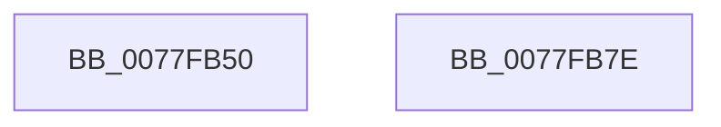

# PspDeferredWorkerRoutine

- RVA: `0x0077FB50`–`0x0077FB7F` (길이 `47` bytes)
- VA: `0x000000014077FB50`
- 실행 섹션: `PAGE`
- PDB 이름 있음: `예`; PDB Function 태그: `아니요`
- unwind 정보 RVA: `0x0005CF00`
- 디코드: `15`개 명령, `47/47` bytes 표시
- 미해석 바이트: `0` (있으면 어셈블리에 `.byte`로 보존)

> 이 문서는 커널 이미지의 기계어와 PDB 기호를 분석해 생성했습니다. 4번과 5번은 함수 원형과 자료형을 바이너리 사용 방식에서 추정한 C 해석이며 원본 소스 복구 결과는 아닙니다.

## 1. Dependencies

- 직접 호출 지점: **2**; 고유 호출 대상: **2**
- 직접 호출자로 확인된 함수: **0**
- RIP 상대 이미지 참조: **0**

### Outgoing calls
- `0x0077FB61` → [guard_dispatch_icall](../../text/6B/guard_dispatch_icall_function_006BAAD0.md) (function, `0x006BAAD0`)
- `0x0077FB73` → [KeSetEvent](../../text/33/KeSetEvent_function_0033F310.md) (function, `0x0033F310`)

### Direct callers
- 이 함수 시작 RVA로 연결되는 직접 call은 확인되지 않았습니다. 간접 호출은 완전히 역산할 수 없습니다.

### Static image references
- 디코드된 RIP-relative 메모리 참조가 없습니다.

## 2. Other-region calls and transfers

- 다른 실행 섹션으로 향하는 call: **2**
  - `0x0077FB61` → [guard_dispatch_icall](../../text/6B/guard_dispatch_icall_function_006BAAD0.md) (`PAGE` → `.text`)
  - `0x0077FB73` → [KeSetEvent](../../text/33/KeSetEvent_function_0033F310.md) (`PAGE` → `.text`)
- 별도 외부 분기/꼬리 이동을 확인하지 못했습니다.

## 3. Assembly (complete function range)

```asm
0077FB50  40 53                           push rbx
0077FB52  48 83 EC 20                     sub rsp, 0x20
0077FB56  48 8B 41 18                     mov rax, qword ptr [rcx + 0x18]
0077FB5A  48 8B D9                        mov rbx, rcx
0077FB5D  48 8B 49 20                     mov rcx, qword ptr [rcx + 0x20]
0077FB61  E8 6A AF F3 FF                  call 0x1406baad0
0077FB66  45 33 C0                        xor r8d, r8d
0077FB69  89 43 28                        mov dword ptr [rbx + 0x28], eax
0077FB6C  48 8B CB                        mov rcx, rbx
0077FB6F  41 8D 50 01                     lea edx, [r8 + 1]
0077FB73  E8 98 F7 BB FF                  call 0x14033f310
0077FB78  48 83 C4 20                     add rsp, 0x20
0077FB7C  5B                              pop rbx
0077FB7D  C3                              ret
0077FB7E  CC                              int3
```

## 4. C-style interpretation (structured pseudocode)

```c
__int64 __fastcall PspDeferredWorkerRoutine(__int64 a1, __int64 a2, int a3)
{
    __int64 result;
    __int64 v_rsp;

    v_rsp = (v_rsp) - (32);
    result = guard_dispatch_icall(*(unsigned __int64 *)(a1 + 32), a2, a3, a4);
    a3 = 0;
    *(unsigned int *)(a1 + 40) = (unsigned int)(result);
    result = KeSetEvent(a1, a3 + 1, a3, a4);
    v_rsp = (v_rsp) + (32);
    return result;
}
```

## 5. (Beta) C Style

```c
int64_t PspDeferredWorkerRoutine(void *Arg1, int64_t Arg2, int32_t Arg3)
{
    uint8_t *arg1 = (uint8_t *)Arg1;

    int64_t result;
    int64_t local_rsp;

    local_rsp = (local_rsp) - (32);
    result = guard_dispatch_icall(*(uint64_t *)(arg1 + 0x20), Arg2, Arg3, a4);
    Arg3 = 0;
    *(uint32_t *)(arg1 + 0x28) = (uint32_t)(result);
    result = KeSetEvent(Arg1, Arg3 + 1, Arg3, a4);
    local_rsp = (local_rsp) + (32);
    return result;
}
```

### 관측된 메모리 오프셋

구조체 형식이 확인되지 않은 접근은 인자 기준의 오프셋으로만 기록했습니다.

| 기준 인자 | 오프셋 표현 | 폭 (bit) | 접근 |
|---|---:|---:|---|
| `Arg1` | `+ 0x18` | `64` | `R` |
| `Arg1` | `+ 0x20` | `64` | `R` |
| `Arg1` | `+ 0x28` | `32` | `W` |

## 6. Execution-region graph

[열기: 2D/3D 그래프와 함수 탐색 컨트롤 패널](../../../control-panel.html?section=page&rva=0x0077FB50&view=graph)

- 2D 그래프는 위에서 아래로 흐르고, 3D 그래프는 빈 공간을 드래그해 회전합니다. Shift+드래그는 이동, 휠은 확대·축소, 함수 노드 선택은 대상 보고서 이동입니다.

### Static fallback


