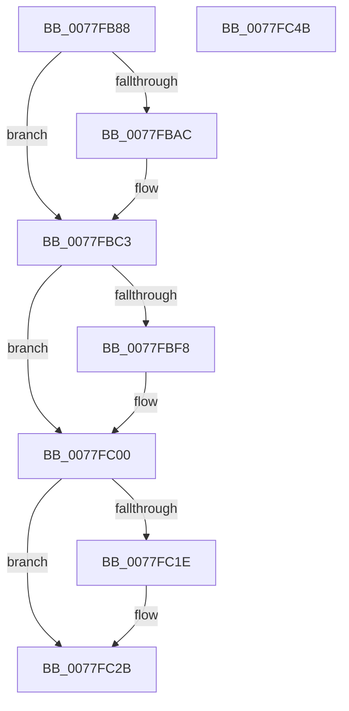

# PspDeleteExternalServerSiloState

- RVA: `0x0077FB88`–`0x0077FC4C` (길이 `196` bytes)
- VA: `0x000000014077FB88`
- 실행 섹션: `PAGE`
- PDB 이름 있음: `예`; PDB Function 태그: `아니요`
- unwind 정보 RVA: `0x00086C28`
- 디코드: `49`개 명령, `196/196` bytes 표시
- 미해석 바이트: `0` (있으면 어셈블리에 `.byte`로 보존)

> 이 문서는 커널 이미지의 기계어와 PDB 기호를 분석해 생성했습니다. 4번과 5번은 함수 원형과 자료형을 바이너리 사용 방식에서 추정한 C 해석이며 원본 소스 복구 결과는 아닙니다.

## 1. Dependencies

- 직접 호출 지점: **13**; 고유 호출 대상: **13**
- 직접 호출자로 확인된 함수: **2**
- RIP 상대 이미지 참조: **0**

### Outgoing calls
- `0x0077FB9A` → [PsGetServerSiloGlobals](../../text/22/PsGetServerSiloGlobals_function_002250A0.md) (function, `0x002250A0`)
- `0x0077FBAC` → [PsAttachSiloToCurrentThread](../../text/44/PsAttachSiloToCurrentThread_function_004428C0.md) (function, `0x004428C0`)
- `0x0077FBB6` → [EtwShutdown](../7B/EtwShutdown_function_007B50B0.md) (function, `0x007B50B0`)
- `0x0077FBBE` → [PsDetachSiloFromCurrentThread](../../text/44/PsDetachSiloFromCurrentThread_function_00449AC0.md) (function, `0x00449AC0`)
- `0x0077FBCD` → [SeShutdownServerSilo](../79/SeShutdownServerSilo_function_0079C4DC.md) (function, `0x0079C4DC`)
- `0x0077FBE6` → [CmpInitializeThreadInfo](../../text/3F/CmpInitializeThreadInfo_function_003FBE70.md) (function, `0x003FBE70`)
- `0x0077FBEE` → [CmpGetContextForSiloNoRef](../9E/CmpGetContextForSiloNoRef_function_009E8020.md) (function, `0x009E8020`)
- `0x0077FBFB` → [CmpStopSiloKeyLockTracker](../9E/CmpStopSiloKeyLockTracker_function_009E7BF0.md) (function, `0x009E7BF0`)
- `0x0077FC05` → [CmCleanupThreadInfo](../../text/41/CmCleanupThreadInfo_function_0041FD50.md) (function, `0x0041FD50`)
- `0x0077FC0D` → [ObCleanupSiloState](../74/ObCleanupSiloState_function_0074D778.md) (function, `0x0074D778`)
- `0x0077FC1E` → [ExpNlsDeleteSiloState](../../text/65/ExpNlsDeleteSiloState_function_00657E74.md) (function, `0x00657E74`)
- `0x0077FC2E` → [RtlNlsDeleteState](../78/RtlNlsDeleteState_function_0078BE30.md) (function, `0x0078BE30`)
- `0x0077FC36` → [ExpTimeZoneCleanupSiloState](../7C/ExpTimeZoneCleanupSiloState_function_007C638C.md) (function, `0x007C638C`)

### Direct callers
- [PspCompleteServerSiloShutdownDeferred](PspCompleteServerSiloShutdownDeferred_function_0077F860.md) at `0x0077F920`
- [PspInitializeServerSiloDeferred](PspInitializeServerSiloDeferred_function_0077FEE0.md) at `0x00780125`

### Static image references
- 디코드된 RIP-relative 메모리 참조가 없습니다.

## 2. Other-region calls and transfers

- 다른 실행 섹션으로 향하는 call: **6**
  - `0x0077FB9A` → [PsGetServerSiloGlobals](../../text/22/PsGetServerSiloGlobals_function_002250A0.md) (`PAGE` → `.text`)
  - `0x0077FBAC` → [PsAttachSiloToCurrentThread](../../text/44/PsAttachSiloToCurrentThread_function_004428C0.md) (`PAGE` → `.text`)
  - `0x0077FBBE` → [PsDetachSiloFromCurrentThread](../../text/44/PsDetachSiloFromCurrentThread_function_00449AC0.md) (`PAGE` → `.text`)
  - `0x0077FBE6` → [CmpInitializeThreadInfo](../../text/3F/CmpInitializeThreadInfo_function_003FBE70.md) (`PAGE` → `.text`)
  - `0x0077FC05` → [CmCleanupThreadInfo](../../text/41/CmCleanupThreadInfo_function_0041FD50.md) (`PAGE` → `.text`)
  - `0x0077FC1E` → [ExpNlsDeleteSiloState](../../text/65/ExpNlsDeleteSiloState_function_00657E74.md) (`PAGE` → `.text`)
- 별도 외부 분기/꼬리 이동을 확인하지 못했습니다.

## 3. Assembly (complete function range)

```asm
0077FB88  48 89 5C 24 08                  mov qword ptr [rsp + 8], rbx
0077FB8D  48 89 74 24 10                  mov qword ptr [rsp + 0x10], rsi
0077FB92  57                              push rdi
0077FB93  48 83 EC 40                     sub rsp, 0x40
0077FB97  48 8B F1                        mov rsi, rcx
0077FB9A  E8 01 55 AA FF                  call 0x1402250a0
0077FB9F  48 8B F8                        mov rdi, rax
0077FBA2  48 83 B8 40 03 00 00 00         cmp qword ptr [rax + 0x340], 0
0077FBAA  74 17                           je 0x14077fbc3
0077FBAC  E8 0F 2D CC FF                  call 0x1404428c0
0077FBB1  33 C9                           xor ecx, ecx
0077FBB3  48 8B D8                        mov rbx, rax
0077FBB6  E8 F5 54 03 00                  call 0x1407b50b0
0077FBBB  48 8B CB                        mov rcx, rbx
0077FBBE  E8 FD 9E CC FF                  call 0x140449ac0
0077FBC3  48 8D 97 E0 02 00 00            lea rdx, [rdi + 0x2e0]
0077FBCA  48 8B CE                        mov rcx, rsi
0077FBCD  E8 0A C9 01 00                  call 0x14079c4dc
0077FBD2  0F 57 C0                        xorps xmm0, xmm0
0077FBD5  48 8D 4C 24 20                  lea rcx, [rsp + 0x20]
0077FBDA  33 C0                           xor eax, eax
0077FBDC  0F 11 44 24 20                  movups xmmword ptr [rsp + 0x20], xmm0
0077FBE1  48 89 44 24 30                  mov qword ptr [rsp + 0x30], rax
0077FBE6  E8 85 C2 C7 FF                  call 0x1403fbe70
0077FBEB  48 8B CE                        mov rcx, rsi
0077FBEE  E8 2D 84 26 00                  call 0x1409e8020
0077FBF3  48 85 C0                        test rax, rax
0077FBF6  74 08                           je 0x14077fc00
0077FBF8  48 8B C8                        mov rcx, rax
0077FBFB  E8 F0 7F 26 00                  call 0x1409e7bf0
0077FC00  48 8D 4C 24 20                  lea rcx, [rsp + 0x20]
0077FC05  E8 46 01 CA FF                  call 0x14041fd50
0077FC0A  48 8B CF                        mov rcx, rdi
0077FC0D  E8 66 DB FC FF                  call 0x14074d778
0077FC12  48 8B 8F 00 04 00 00            mov rcx, qword ptr [rdi + 0x400]
0077FC19  48 85 C9                        test rcx, rcx
0077FC1C  74 0D                           je 0x14077fc2b
0077FC1E  E8 51 82 ED FF                  call 0x140657e74
0077FC23  48 83 A7 00 04 00 00 00         and qword ptr [rdi + 0x400], 0
0077FC2B  48 8B CF                        mov rcx, rdi
0077FC2E  E8 FD C1 00 00                  call 0x14078be30
0077FC33  48 8B CE                        mov rcx, rsi
0077FC36  E8 51 67 04 00                  call 0x1407c638c
0077FC3B  48 8B 5C 24 50                  mov rbx, qword ptr [rsp + 0x50]
0077FC40  48 8B 74 24 58                  mov rsi, qword ptr [rsp + 0x58]
0077FC45  48 83 C4 40                     add rsp, 0x40
0077FC49  5F                              pop rdi
0077FC4A  C3                              ret
0077FC4B  CC                              int3
```

## 4. C-style interpretation (structured pseudocode)

```c
__int64 __fastcall PspDeleteExternalServerSiloState(__int64 a1)
{
    __int64 result;
    __int64 v_rbx;
    __int64 v_rsp;
    unsigned __int64 v_stack_m18;
    unsigned __int64 v_stack_m28;
    unsigned __int64 v_stack_p10;
    unsigned __int64 v_stack_p8;

    v_stack_p8 = v_rbx;
    v_stack_p10 = v_rsi;
    v_rsp = (v_rsp) - (64);
    result = PsGetServerSiloGlobals(a1, a2, a3, a4);
    if ((*(unsigned __int64 *)(result + 832)) != 0) {
        result = PsAttachSiloToCurrentThread(a1, a2, a3, a4);
        a1 = 0;
        v_rbx = result;
        result = EtwShutdown(a1, a2, a3, a4);
        a1 = v_rbx;
        result = PsDetachSiloFromCurrentThread(a1, a2, a3, a4);
    }
    result = SeShutdownServerSilo(a1, result + 736, a3, a4);
    result = 0;
    v_stack_m28 = v_xmm0;
    v_stack_m18 = 0;
    result = CmpInitializeThreadInfo(v_stack_m28, result + 736, a3, a4);
    result = CmpGetContextForSiloNoRef(a1, result + 736, a3, a4);
    if (result != 0) {
        a1 = result;
        result = CmpStopSiloKeyLockTracker(a1, result + 736, a3, a4);
    }
    result = CmCleanupThreadInfo(v_stack_m28, result + 736, a3, a4);
    result = ObCleanupSiloState(result, result + 736, a3, a4);
    if (*(unsigned __int64 *)(result + 1024) != 0) {
        result = ExpNlsDeleteSiloState(*(unsigned __int64 *)(result + 1024), result + 736, a3, a4);
    }
    result = RtlNlsDeleteState(result, result + 736, a3, a4);
    result = ExpTimeZoneCleanupSiloState(a1, result + 736, a3, a4);
    v_rsp = (v_rsp) + (64);
    return result;
}
```

## 5. (Beta) C Style

```c
int64_t PspDeleteExternalServerSiloState(int64_t Arg1)
{
    int64_t result;
    int64_t local_rbx;
    int64_t local_rsp;
    uint64_t v_stack_m18;
    uint64_t v_stack_m28;
    uint64_t v_stack_p10;
    uint64_t v_stack_p8;

    v_stack_p8 = local_rbx;
    v_stack_p10 = local_rsi;
    local_rsp = (local_rsp) - (64);
    result = PsGetServerSiloGlobals(Arg1, a2, a3, a4);
    if ((*(uint64_t *)(result + 0x340)) != 0) {
        result = PsAttachSiloToCurrentThread(Arg1, a2, a3, a4);
        Arg1 = 0;
        local_rbx = result;
        result = EtwShutdown(Arg1, a2, a3, a4);
        Arg1 = local_rbx;
        result = PsDetachSiloFromCurrentThread(Arg1, a2, a3, a4);
    }
    result = SeShutdownServerSilo(Arg1, result + 736, a3, a4);
    result = 0;
    v_stack_m28 = v_xmm0;
    v_stack_m18 = 0;
    result = CmpInitializeThreadInfo(v_stack_m28, result + 736, a3, a4);
    result = CmpGetContextForSiloNoRef(Arg1, result + 736, a3, a4);
    if (result != 0) {
        Arg1 = result;
        result = CmpStopSiloKeyLockTracker(Arg1, result + 736, a3, a4);
    }
    result = CmCleanupThreadInfo(v_stack_m28, result + 736, a3, a4);
    result = ObCleanupSiloState(result, result + 736, a3, a4);
    if (*(uint64_t *)(result + 0x400) != 0) {
        result = ExpNlsDeleteSiloState(*(uint64_t *)(result + 0x400), result + 736, a3, a4);
    }
    result = RtlNlsDeleteState(result, result + 736, a3, a4);
    result = ExpTimeZoneCleanupSiloState(Arg1, result + 736, a3, a4);
    local_rsp = (local_rsp) + (64);
    return result;
}
```

## 6. Execution-region graph

[열기: 2D/3D 그래프와 함수 탐색 컨트롤 패널](../../../control-panel.html?section=page&rva=0x0077FB88&view=graph)

- 2D 그래프는 위에서 아래로 흐르고, 3D 그래프는 빈 공간을 드래그해 회전합니다. Shift+드래그는 이동, 휠은 확대·축소, 함수 노드 선택은 대상 보고서 이동입니다.

### Static fallback


