# PspDeleteServerSiloGlobals

- RVA: `0x0077FC54`–`0x0077FE8C` (길이 `568` bytes)
- VA: `0x000000014077FC54`
- 실행 섹션: `PAGE`
- PDB 이름 있음: `예`; PDB Function 태그: `아니요`
- unwind 정보 RVA: `0x000BB438`
- 디코드: `120`개 명령, `568/568` bytes 표시
- 미해석 바이트: `0` (있으면 어셈블리에 `.byte`로 보존)

> 이 문서는 커널 이미지의 기계어와 PDB 기호를 분석해 생성했습니다. 4번과 5번은 함수 원형과 자료형을 바이너리 사용 방식에서 추정한 C 해석이며 원본 소스 복구 결과는 아닙니다.

## 1. Dependencies

- 직접 호출 지점: **22**; 고유 호출 대상: **13**
- 직접 호출자로 확인된 함수: **2**
- RIP 상대 이미지 참조: **1**

### Outgoing calls
- `0x0077FC74` → [ObfDereferenceObjectWithTag](../../text/2F/ObfDereferenceObjectWithTag_function_002F78E0.md) (function, `0x002F78E0`)
- `0x0077FC83` → [ObCleanupSiloState](../74/ObCleanupSiloState_function_0074D778.md) (function, `0x0074D778`)
- `0x0077FCD2` → [ExpWnfDeleteScopeInstances](../7D/ExpWnfDeleteScopeInstances_function_007D63A0.md) (function, `0x007D63A0`)
- `0x0077FCE0` → [ExpWnfDeleteScopeInstances](../7D/ExpWnfDeleteScopeInstances_function_007D63A0.md) (function, `0x007D63A0`)
- `0x0077FCF1` → [ExFreePoolWithTag](../../poolcode/B8/ExFreePoolWithTag_function_00B82870.md) (function, `0x00B82870`)
- `0x0077FCF6` → [KeLeaveCriticalRegion](../../text/25/KeLeaveCriticalRegion_function_0025D8B0.md) (function, `0x0025D8B0`)
- `0x0077FD0E` → [ZwClose](../../text/6A/ZwClose_function_006AD2B0.md) (function, `0x006AD2B0`)
- `0x0077FD26` → [ZwClose](../../text/6A/ZwClose_function_006AD2B0.md) (function, `0x006AD2B0`)
- `0x0077FD37` → [EtwCleanupSiloState](../7B/EtwCleanupSiloState_function_007B4B9C.md) (function, `0x007B4B9C`)
- `0x0077FD53` → [RtlFreeAnsiString](../9C/RtlFreeAnsiString_function_009C0800.md) (function, `0x009C0800`)
- `0x0077FD6B` → [ObfDereferenceObject](../../text/2F/ObfDereferenceObject_function_002F9350.md) (function, `0x002F9350`)
- `0x0077FD88` → [MiRemoveFromSystemSpace](../../text/29/MiRemoveFromSystemSpace_function_002962FC.md) (function, `0x002962FC`)
- `0x0077FDA5` → [ExFreePoolWithTag](../../poolcode/B8/ExFreePoolWithTag_function_00B82870.md) (function, `0x00B82870`)
- `0x0077FDC6` → [MiRemoveFromSystemSpace](../../text/29/MiRemoveFromSystemSpace_function_002962FC.md) (function, `0x002962FC`)
- `0x0077FDD9` → [ObfDereferenceObject](../../text/2F/ObfDereferenceObject_function_002F9350.md) (function, `0x002F9350`)
- `0x0077FDF1` → [ExpDeleteSiloState](../../text/65/ExpDeleteSiloState_function_00657664.md) (function, `0x00657664`)
- `0x0077FE09` → [ZwClose](../../text/6A/ZwClose_function_006AD2B0.md) (function, `0x006AD2B0`)
- `0x0077FE26` → [KeSetEvent](../../text/33/KeSetEvent_function_0033F310.md) (function, `0x0033F310`)
- `0x0077FE37` → [ObfDereferenceObjectWithTag](../../text/2F/ObfDereferenceObjectWithTag_function_002F78E0.md) (function, `0x002F78E0`)
- `0x0077FE51` → [ExFreePoolWithTag](../../poolcode/B8/ExFreePoolWithTag_function_00B82870.md) (function, `0x00B82870`)
- `0x0077FE5E` → [ExFreePoolWithTag](../../poolcode/B8/ExFreePoolWithTag_function_00B82870.md) (function, `0x00B82870`)
- `0x0077FE86` → [KeBugCheckEx](../../text/4F/KeBugCheckEx_function_004FD660.md) (function, `0x004FD660`)

### Direct callers
- [PspConvertSiloToServerSilo](PspConvertSiloToServerSilo_function_0077F9B4.md) at `0x0077FA6D`
- [PspDeleteSilo](PspDeleteSilo_function_0077FE94.md) at `0x0077FEB8`

### Static image references
- `0x0077FE7A` → RVA `0x00B05D20` (` ?? ::NNGAKEGL::`string'`; read)

## 2. Other-region calls and transfers

- 다른 실행 섹션으로 향하는 call: **17**
  - `0x0077FC74` → [ObfDereferenceObjectWithTag](../../text/2F/ObfDereferenceObjectWithTag_function_002F78E0.md) (`PAGE` → `.text`)
  - `0x0077FCF1` → [ExFreePoolWithTag](../../poolcode/B8/ExFreePoolWithTag_function_00B82870.md) (`PAGE` → `POOLCODE`)
  - `0x0077FCF6` → [KeLeaveCriticalRegion](../../text/25/KeLeaveCriticalRegion_function_0025D8B0.md) (`PAGE` → `.text`)
  - `0x0077FD0E` → [ZwClose](../../text/6A/ZwClose_function_006AD2B0.md) (`PAGE` → `.text`)
  - `0x0077FD26` → [ZwClose](../../text/6A/ZwClose_function_006AD2B0.md) (`PAGE` → `.text`)
  - `0x0077FD6B` → [ObfDereferenceObject](../../text/2F/ObfDereferenceObject_function_002F9350.md) (`PAGE` → `.text`)
  - `0x0077FD88` → [MiRemoveFromSystemSpace](../../text/29/MiRemoveFromSystemSpace_function_002962FC.md) (`PAGE` → `.text`)
  - `0x0077FDA5` → [ExFreePoolWithTag](../../poolcode/B8/ExFreePoolWithTag_function_00B82870.md) (`PAGE` → `POOLCODE`)
  - `0x0077FDC6` → [MiRemoveFromSystemSpace](../../text/29/MiRemoveFromSystemSpace_function_002962FC.md) (`PAGE` → `.text`)
  - `0x0077FDD9` → [ObfDereferenceObject](../../text/2F/ObfDereferenceObject_function_002F9350.md) (`PAGE` → `.text`)
  - `0x0077FDF1` → [ExpDeleteSiloState](../../text/65/ExpDeleteSiloState_function_00657664.md) (`PAGE` → `.text`)
  - `0x0077FE09` → [ZwClose](../../text/6A/ZwClose_function_006AD2B0.md) (`PAGE` → `.text`)
  - `0x0077FE26` → [KeSetEvent](../../text/33/KeSetEvent_function_0033F310.md) (`PAGE` → `.text`)
  - `0x0077FE37` → [ObfDereferenceObjectWithTag](../../text/2F/ObfDereferenceObjectWithTag_function_002F78E0.md) (`PAGE` → `.text`)
  - `0x0077FE51` → [ExFreePoolWithTag](../../poolcode/B8/ExFreePoolWithTag_function_00B82870.md) (`PAGE` → `POOLCODE`)
  - `0x0077FE5E` → [ExFreePoolWithTag](../../poolcode/B8/ExFreePoolWithTag_function_00B82870.md) (`PAGE` → `POOLCODE`)
  - `0x0077FE86` → [KeBugCheckEx](../../text/4F/KeBugCheckEx_function_004FD660.md) (`PAGE` → `.text`)
- 별도 외부 분기/꼬리 이동을 확인하지 못했습니다.

## 3. Assembly (complete function range)

```asm
0077FC54  48 89 5C 24 08                  mov qword ptr [rsp + 8], rbx
0077FC59  57                              push rdi
0077FC5A  48 83 EC 30                     sub rsp, 0x30
0077FC5E  48 8B D9                        mov rbx, rcx
0077FC61  33 FF                           xor edi, edi
0077FC63  48 8B 89 C0 03 00 00            mov rcx, qword ptr [rcx + 0x3c0]
0077FC6A  48 85 C9                        test rcx, rcx
0077FC6D  74 11                           je 0x14077fc80
0077FC6F  BA 44 62 67 6B                  mov edx, 0x6b676244
0077FC74  E8 67 7C B7 FF                  call 0x1402f78e0
0077FC79  48 89 BB C0 03 00 00            mov qword ptr [rbx + 0x3c0], rdi
0077FC80  48 8B CB                        mov rcx, rbx
0077FC83  E8 F0 DA FC FF                  call 0x14074d778
0077FC88  48 8D 93 10 03 00 00            lea rdx, [rbx + 0x310]
0077FC8F  48 39 7A 08                     cmp qword ptr [rdx + 8], rdi
0077FC93  0F 85 D6 01 00 00               jne 0x14077fe6f
0077FC99  48 39 7A 18                     cmp qword ptr [rdx + 0x18], rdi
0077FC9D  0F 85 CC 01 00 00               jne 0x14077fe6f
0077FCA3  48 39 3A                        cmp qword ptr [rdx], rdi
0077FCA6  0F 85 C3 01 00 00               jne 0x14077fe6f
0077FCAC  48 39 BB 70 03 00 00            cmp qword ptr [rbx + 0x370], rdi
0077FCB3  74 46                           je 0x14077fcfb
0077FCB5  65 48 8B 04 25 88 01 00 00      mov rax, qword ptr gs:[0x188]
0077FCBE  BA 02 00 00 00                  mov edx, 2
0077FCC3  66 FF 88 E4 01 00 00            dec word ptr [rax + 0x1e4]
0077FCCA  90                              nop
0077FCCB  48 8B 8B 70 03 00 00            mov rcx, qword ptr [rbx + 0x370]
0077FCD2  E8 C9 66 05 00                  call 0x1407d63a0
0077FCD7  48 8B 8B 70 03 00 00            mov rcx, qword ptr [rbx + 0x370]
0077FCDE  33 D2                           xor edx, edx
0077FCE0  E8 BB 66 05 00                  call 0x1407d63a0
0077FCE5  48 8B 8B 70 03 00 00            mov rcx, qword ptr [rbx + 0x370]
0077FCEC  BA 57 6E 66 20                  mov edx, 0x20666e57
0077FCF1  E8 7A 2B 40 00                  call 0x140b82870
0077FCF6  E8 B5 DB AD FF                  call 0x14025d8b0
0077FCFB  48 8B 83 78 03 00 00            mov rax, qword ptr [rbx + 0x378]
0077FD02  48 85 C0                        test rax, rax
0077FD05  74 0C                           je 0x14077fd13
0077FD07  48 8B 8B 78 03 00 00            mov rcx, qword ptr [rbx + 0x378]
0077FD0E  E8 9D D5 F2 FF                  call 0x1406ad2b0
0077FD13  48 8B 83 80 03 00 00            mov rax, qword ptr [rbx + 0x380]
0077FD1A  48 85 C0                        test rax, rax
0077FD1D  74 0C                           je 0x14077fd2b
0077FD1F  48 8B 8B 80 03 00 00            mov rcx, qword ptr [rbx + 0x380]
0077FD26  E8 85 D5 F2 FF                  call 0x1406ad2b0
0077FD2B  48 8B 8B 40 03 00 00            mov rcx, qword ptr [rbx + 0x340]
0077FD32  48 85 C9                        test rcx, rcx
0077FD35  74 0C                           je 0x14077fd43
0077FD37  E8 60 4E 03 00                  call 0x1407b4b9c
0077FD3C  48 89 BB 40 03 00 00            mov qword ptr [rbx + 0x340], rdi
0077FD43  48 39 BB E8 04 00 00            cmp qword ptr [rbx + 0x4e8], rdi
0077FD4A  74 13                           je 0x14077fd5f
0077FD4C  48 8D 8B E0 04 00 00            lea rcx, [rbx + 0x4e0]
0077FD53  E8 A8 0A 24 00                  call 0x1409c0800
0077FD58  48 89 BB E8 04 00 00            mov qword ptr [rbx + 0x4e8], rdi
0077FD5F  48 8B 8B E8 03 00 00            mov rcx, qword ptr [rbx + 0x3e8]
0077FD66  48 85 C9                        test rcx, rcx
0077FD69  74 0C                           je 0x14077fd77
0077FD6B  E8 E0 95 B7 FF                  call 0x1402f9350
0077FD70  48 89 BB E8 03 00 00            mov qword ptr [rbx + 0x3e8], rdi
0077FD77  48 8B 8B F0 03 00 00            mov rcx, qword ptr [rbx + 0x3f0]
0077FD7E  48 85 C9                        test rcx, rcx
0077FD81  74 11                           je 0x14077fd94
0077FD83  BA 01 00 00 00                  mov edx, 1
0077FD88  E8 6F 65 B1 FF                  call 0x1402962fc
0077FD8D  48 89 BB F0 03 00 00            mov qword ptr [rbx + 0x3f0], rdi
0077FD94  48 8B 8B E0 03 00 00            mov rcx, qword ptr [rbx + 0x3e0]
0077FD9B  48 85 C9                        test rcx, rcx
0077FD9E  74 11                           je 0x14077fdb1
0077FDA0  BA 50 73 53 6C                  mov edx, 0x6c537350
0077FDA5  E8 C6 2A 40 00                  call 0x140b82870
0077FDAA  48 89 BB E0 03 00 00            mov qword ptr [rbx + 0x3e0], rdi
0077FDB1  48 39 BB 10 05 00 00            cmp qword ptr [rbx + 0x510], rdi
0077FDB8  74 2B                           je 0x14077fde5
0077FDBA  48 8B 8B 08 05 00 00            mov rcx, qword ptr [rbx + 0x508]
0077FDC1  BA 01 00 00 00                  mov edx, 1
0077FDC6  E8 31 65 B1 FF                  call 0x1402962fc
0077FDCB  48 8B 8B 10 05 00 00            mov rcx, qword ptr [rbx + 0x510]
0077FDD2  48 89 BB 08 05 00 00            mov qword ptr [rbx + 0x508], rdi
0077FDD9  E8 72 95 B7 FF                  call 0x1402f9350
0077FDDE  48 89 BB 10 05 00 00            mov qword ptr [rbx + 0x510], rdi
0077FDE5  48 8B 8B 68 03 00 00            mov rcx, qword ptr [rbx + 0x368]
0077FDEC  48 85 C9                        test rcx, rcx
0077FDEF  74 0C                           je 0x14077fdfd
0077FDF1  E8 6E 78 ED FF                  call 0x140657664
0077FDF6  48 89 BB 68 03 00 00            mov qword ptr [rbx + 0x368], rdi
0077FDFD  48 8B 8B C0 04 00 00            mov rcx, qword ptr [rbx + 0x4c0]
0077FE04  48 85 C9                        test rcx, rcx
0077FE07  74 0C                           je 0x14077fe15
0077FE09  E8 A2 D4 F2 FF                  call 0x1406ad2b0
0077FE0E  48 89 BB C0 04 00 00            mov qword ptr [rbx + 0x4c0], rdi
0077FE15  48 8B 8B 00 05 00 00            mov rcx, qword ptr [rbx + 0x500]
0077FE1C  48 85 C9                        test rcx, rcx
0077FE1F  74 22                           je 0x14077fe43
0077FE21  45 33 C0                        xor r8d, r8d
0077FE24  33 D2                           xor edx, edx
0077FE26  E8 E5 F4 BB FF                  call 0x14033f310
0077FE2B  48 8B 8B 00 05 00 00            mov rcx, qword ptr [rbx + 0x500]
0077FE32  BA 53 69 44 65                  mov edx, 0x65446953
0077FE37  E8 A4 7A B7 FF                  call 0x1402f78e0
0077FE3C  48 89 BB 00 05 00 00            mov qword ptr [rbx + 0x500], rdi
0077FE43  48 8B 8B C8 04 00 00            mov rcx, qword ptr [rbx + 0x4c8]
0077FE4A  48 85 C9                        test rcx, rcx
0077FE4D  74 07                           je 0x14077fe56
0077FE4F  33 D2                           xor edx, edx
0077FE51  E8 1A 2A 40 00                  call 0x140b82870
0077FE56  BA 53 69 6C 47                  mov edx, 0x476c6953
0077FE5B  48 8B CB                        mov rcx, rbx
0077FE5E  E8 0D 2A 40 00                  call 0x140b82870
0077FE63  48 8B 5C 24 40                  mov rbx, qword ptr [rsp + 0x40]
0077FE68  48 83 C4 30                     add rsp, 0x30
0077FE6C  5F                              pop rdi
0077FE6D  C3                              ret
0077FE6E  CC                              int3
0077FE6F  41 B9 6C 06 00 00               mov r9d, 0x66c
0077FE75  48 89 7C 24 20                  mov qword ptr [rsp + 0x20], rdi
0077FE7A  4C 8D 05 9F 5E 38 00            lea r8, [rip + 0x385e9f]
0077FE81  B9 29 00 00 00                  mov ecx, 0x29
0077FE86  E8 D5 D7 D7 FF                  call 0x1404fd660
0077FE8B  CC                              int3
```

## 4. C-style interpretation (structured pseudocode)

```c
__int64 __fastcall PspDeleteServerSiloGlobals(__int64 a1, __int64 a2, int a3)
{
    __int64 result;
    __int64 v_rdi;
    __int64 v_rsp;
    unsigned __int64 v_stack_p20;
    unsigned __int64 v_stack_p8;

    v_stack_p8 = v_rbx;
    v_rsp = (v_rsp) - (48);
    v_rdi = 0;
    if (*(unsigned __int64 *)(a1 + 960) != 0) {
        a2 = 0x6B676244ULL;
        result = ObfDereferenceObjectWithTag(*(unsigned __int64 *)(a1 + 960), a2, a3, a4);
        *(unsigned __int64 *)(a1 + 960) = 0;
    }
    result = ObCleanupSiloState(a1, a2, a3, a4);
    if ((*(unsigned __int64 *)(a1 + 784 + 8)) != 0) goto loc_0077FE6F;
    if ((*(unsigned __int64 *)(a1 + 784 + 24)) != 0) goto loc_0077FE6F;
    if ((*(unsigned __int64 *)(a1 + 784)) != 0) goto loc_0077FE6F;
    if ((*(unsigned __int64 *)(a1 + 880)) != 0) {
        result = *(unsigned __int64 *)(gs_base + (0 + 392));
        a2 = 2;
        a1 = *(unsigned __int64 *)(a1 + 880);
        result = ExpWnfDeleteScopeInstances(a1, a2, a3, a4);
        a1 = *(unsigned __int64 *)(a1 + 880);
        a2 = 0;
        result = ExpWnfDeleteScopeInstances(a1, a2, a3, a4);
        a1 = *(unsigned __int64 *)(a1 + 880);
        a2 = 0x20666E57ULL;
        result = ExFreePoolWithTag(a1, a2, a3, a4);
        result = KeLeaveCriticalRegion(a1, a2, a3, a4);
    }
    result = *(unsigned __int64 *)(a1 + 888);
    if (*(unsigned __int64 *)(a1 + 888) != 0) {
        a1 = *(unsigned __int64 *)(a1 + 888);
        result = ZwClose(a1, a2, a3, a4);
    }
    result = *(unsigned __int64 *)(a1 + 896);
    if (*(unsigned __int64 *)(a1 + 896) != 0) {
        a1 = *(unsigned __int64 *)(a1 + 896);
        result = ZwClose(a1, a2, a3, a4);
    }
    if (*(unsigned __int64 *)(a1 + 832) != 0) {
        result = EtwCleanupSiloState(*(unsigned __int64 *)(a1 + 832), a2, a3, a4);
        *(unsigned __int64 *)(a1 + 832) = 0;
    }
    if ((*(unsigned __int64 *)(a1 + 1256)) != 0) {
        a1 = a1 + 1248;
        result = RtlFreeAnsiString(a1, a2, a3, a4);
        *(unsigned __int64 *)(a1 + 1256) = 0;
    }
    if (*(unsigned __int64 *)(a1 + 1000) != 0) {
        result = ObfDereferenceObject(*(unsigned __int64 *)(a1 + 1000), a2, a3, a4);
        *(unsigned __int64 *)(a1 + 1000) = 0;
    }
    if (*(unsigned __int64 *)(a1 + 1008) != 0) {
        a2 = 1;
        result = MiRemoveFromSystemSpace(*(unsigned __int64 *)(a1 + 1008), a2, a3, a4);
        *(unsigned __int64 *)(a1 + 1008) = 0;
    }
    if (*(unsigned __int64 *)(a1 + 992) != 0) {
        a2 = 0x6C537350ULL;
        result = ExFreePoolWithTag(*(unsigned __int64 *)(a1 + 992), a2, a3, a4);
        *(unsigned __int64 *)(a1 + 992) = 0;
    }
    if ((*(unsigned __int64 *)(a1 + 1296)) != 0) {
        a1 = *(unsigned __int64 *)(a1 + 1288);
        a2 = 1;
        result = MiRemoveFromSystemSpace(a1, a2, a3, a4);
        a1 = *(unsigned __int64 *)(a1 + 1296);
        *(unsigned __int64 *)(a1 + 1288) = 0;
        result = ObfDereferenceObject(a1, a2, a3, a4);
        *(unsigned __int64 *)(a1 + 1296) = 0;
    }
    if (*(unsigned __int64 *)(a1 + 872) != 0) {
        result = ExpDeleteSiloState(*(unsigned __int64 *)(a1 + 872), a2, a3, a4);
        *(unsigned __int64 *)(a1 + 872) = 0;
    }
    if (*(unsigned __int64 *)(a1 + 1216) != 0) {
        result = ZwClose(*(unsigned __int64 *)(a1 + 1216), a2, a3, a4);
        *(unsigned __int64 *)(a1 + 1216) = 0;
    }
    if (*(unsigned __int64 *)(a1 + 1280) != 0) {
        a3 = 0;
        a2 = 0;
        result = KeSetEvent(*(unsigned __int64 *)(a1 + 1280), a2, a3, a4);
        a1 = *(unsigned __int64 *)(a1 + 1280);
        a2 = 0x65446953ULL;
        result = ObfDereferenceObjectWithTag(a1, a2, a3, a4);
        *(unsigned __int64 *)(a1 + 1280) = 0;
    }
    if (*(unsigned __int64 *)(a1 + 1224) != 0) {
        a2 = 0;
        result = ExFreePoolWithTag(*(unsigned __int64 *)(a1 + 1224), a2, a3, a4);
    }
    result = ExFreePoolWithTag(a1, (unsigned int)(0x476C6953ULL), a3, a4);
    v_rsp = (v_rsp) + (48);
    return result;
loc_0077FE6F:
    v_stack_p20 = 0;
    result = KeBugCheckEx(41, (unsigned int)(0x476C6953ULL), v_rip + 3694239, (unsigned int)(0x66CULL));
    return result;
}
```

## 5. (Beta) C Style

```c
int64_t PspDeleteServerSiloGlobals(void *Arg1, int64_t Arg2, int32_t Arg3)
{
    uint8_t *arg1 = (uint8_t *)Arg1;

    int64_t result;
    int64_t local_rdi;
    int64_t local_rsp;
    uint64_t v_stack_p20;
    uint64_t v_stack_p8;

    v_stack_p8 = local_rbx;
    local_rsp = (local_rsp) - (48);
    local_rdi = 0;
    if (*(uint64_t *)(arg1 + 0x3C0) != 0) {
        Arg2 = 0x6B676244ULL;
        result = ObfDereferenceObjectWithTag(*(uint64_t *)(arg1 + 0x3C0), Arg2, Arg3, a4);
        *(uint64_t *)(arg1 + 0x3C0) = 0;
    }
    result = ObCleanupSiloState(Arg1, Arg2, Arg3, a4);
    if ((*(uint64_t *)(arg1 + 0x310 + 0x8)) != 0) goto loc_0077FE6F;
    if ((*(uint64_t *)(arg1 + 0x310 + 0x18)) != 0) goto loc_0077FE6F;
    if ((*(uint64_t *)(arg1 + 0x310)) != 0) goto loc_0077FE6F;
    if ((*(uint64_t *)(arg1 + 0x370)) != 0) {
        result = *(uint64_t *)(gs_base + (0 + 0x188));
        Arg2 = 2;
        Arg1 = *(uint64_t *)(arg1 + 0x370);
        result = ExpWnfDeleteScopeInstances(Arg1, Arg2, Arg3, a4);
        Arg1 = *(uint64_t *)(arg1 + 0x370);
        Arg2 = 0;
        result = ExpWnfDeleteScopeInstances(Arg1, Arg2, Arg3, a4);
        Arg1 = *(uint64_t *)(arg1 + 0x370);
        Arg2 = 0x20666E57ULL;
        result = ExFreePoolWithTag(Arg1, Arg2, Arg3, a4);
        result = KeLeaveCriticalRegion(Arg1, Arg2, Arg3, a4);
    }
    result = *(uint64_t *)(arg1 + 0x378);
    if (*(uint64_t *)(arg1 + 0x378) != 0) {
        Arg1 = *(uint64_t *)(arg1 + 0x378);
        result = ZwClose(Arg1, Arg2, Arg3, a4);
    }
    result = *(uint64_t *)(arg1 + 0x380);
    if (*(uint64_t *)(arg1 + 0x380) != 0) {
        Arg1 = *(uint64_t *)(arg1 + 0x380);
        result = ZwClose(Arg1, Arg2, Arg3, a4);
    }
    if (*(uint64_t *)(arg1 + 0x340) != 0) {
        result = EtwCleanupSiloState(*(uint64_t *)(arg1 + 0x340), Arg2, Arg3, a4);
        *(uint64_t *)(arg1 + 0x340) = 0;
    }
    if ((*(uint64_t *)(arg1 + 0x4E8)) != 0) {
        Arg1 = Arg1 + 1248;
        result = RtlFreeAnsiString(Arg1, Arg2, Arg3, a4);
        *(uint64_t *)(arg1 + 0x4E8) = 0;
    }
    if (*(uint64_t *)(arg1 + 0x3E8) != 0) {
        result = ObfDereferenceObject(*(uint64_t *)(arg1 + 0x3E8), Arg2, Arg3, a4);
        *(uint64_t *)(arg1 + 0x3E8) = 0;
    }
    if (*(uint64_t *)(arg1 + 0x3F0) != 0) {
        Arg2 = 1;
        result = MiRemoveFromSystemSpace(*(uint64_t *)(arg1 + 0x3F0), Arg2, Arg3, a4);
        *(uint64_t *)(arg1 + 0x3F0) = 0;
    }
    if (*(uint64_t *)(arg1 + 0x3E0) != 0) {
        Arg2 = 0x6C537350ULL;
        result = ExFreePoolWithTag(*(uint64_t *)(arg1 + 0x3E0), Arg2, Arg3, a4);
        *(uint64_t *)(arg1 + 0x3E0) = 0;
    }
    if ((*(uint64_t *)(arg1 + 0x510)) != 0) {
        Arg1 = *(uint64_t *)(arg1 + 0x508);
        Arg2 = 1;
        result = MiRemoveFromSystemSpace(Arg1, Arg2, Arg3, a4);
        Arg1 = *(uint64_t *)(arg1 + 0x510);
        *(uint64_t *)(arg1 + 0x508) = 0;
        result = ObfDereferenceObject(Arg1, Arg2, Arg3, a4);
        *(uint64_t *)(arg1 + 0x510) = 0;
    }
    if (*(uint64_t *)(arg1 + 0x368) != 0) {
        result = ExpDeleteSiloState(*(uint64_t *)(arg1 + 0x368), Arg2, Arg3, a4);
        *(uint64_t *)(arg1 + 0x368) = 0;
    }
    if (*(uint64_t *)(arg1 + 0x4C0) != 0) {
        result = ZwClose(*(uint64_t *)(arg1 + 0x4C0), Arg2, Arg3, a4);
        *(uint64_t *)(arg1 + 0x4C0) = 0;
    }
    if (*(uint64_t *)(arg1 + 0x500) != 0) {
        Arg3 = 0;
        Arg2 = 0;
        result = KeSetEvent(*(uint64_t *)(arg1 + 0x500), Arg2, Arg3, a4);
        Arg1 = *(uint64_t *)(arg1 + 0x500);
        Arg2 = 0x65446953ULL;
        result = ObfDereferenceObjectWithTag(Arg1, Arg2, Arg3, a4);
        *(uint64_t *)(arg1 + 0x500) = 0;
    }
    if (*(uint64_t *)(arg1 + 0x4C8) != 0) {
        Arg2 = 0;
        result = ExFreePoolWithTag(*(uint64_t *)(arg1 + 0x4C8), Arg2, Arg3, a4);
    }
    result = ExFreePoolWithTag(Arg1, (uint32_t)(0x476C6953ULL), Arg3, a4);
    local_rsp = (local_rsp) + (48);
    return result;
loc_0077FE6F:
    v_stack_p20 = 0;
    result = KeBugCheckEx(41, (uint32_t)(0x476C6953ULL), v_rip + 3694239, (uint32_t)(0x66CULL));
    return result;
}
```

### 관측된 메모리 오프셋

구조체 형식이 확인되지 않은 접근은 인자 기준의 오프셋으로만 기록했습니다.

| 기준 인자 | 오프셋 표현 | 폭 (bit) | 접근 |
|---|---:|---:|---|
| `Arg1` | `+ 0x0` | `64` | `R` |
| `Arg1` | `+ 0x8` | `64` | `R` |
| `Arg1` | `+ 0x18` | `64` | `R` |
| `Arg1` | `+ 0x310` | `64` | `R` |
| `Arg1` | `+ 0x340` | `64` | `R` |
| `Arg1` | `+ 0x340` | `64` | `W` |
| `Arg1` | `+ 0x368` | `64` | `R` |
| `Arg1` | `+ 0x368` | `64` | `W` |
| `Arg1` | `+ 0x370` | `64` | `R` |
| `Arg1` | `+ 0x378` | `64` | `R` |
| `Arg1` | `+ 0x380` | `64` | `R` |
| `Arg1` | `+ 0x3C0` | `64` | `R` |
| `Arg1` | `+ 0x3C0` | `64` | `W` |
| `Arg1` | `+ 0x3E0` | `64` | `R` |
| `Arg1` | `+ 0x3E0` | `64` | `W` |
| `Arg1` | `+ 0x3E8` | `64` | `R` |
| `Arg1` | `+ 0x3E8` | `64` | `W` |
| `Arg1` | `+ 0x3F0` | `64` | `R` |
| `Arg1` | `+ 0x3F0` | `64` | `W` |
| `Arg1` | `+ 0x4C0` | `64` | `R` |
| `Arg1` | `+ 0x4C0` | `64` | `W` |
| `Arg1` | `+ 0x4C8` | `64` | `R` |
| `Arg1` | `+ 0x4E0` | `64` | `R` |
| `Arg1` | `+ 0x4E8` | `64` | `R` |
| `Arg1` | `+ 0x4E8` | `64` | `W` |
| `Arg1` | `+ 0x500` | `64` | `R` |
| `Arg1` | `+ 0x500` | `64` | `W` |
| `Arg1` | `+ 0x508` | `64` | `R` |
| `Arg1` | `+ 0x508` | `64` | `W` |
| `Arg1` | `+ 0x510` | `64` | `R` |
| `Arg1` | `+ 0x510` | `64` | `W` |

## 6. Execution-region graph

[열기: 2D/3D 그래프와 함수 탐색 컨트롤 패널](../../../control-panel.html?section=page&rva=0x0077FC54&view=graph)

- 2D 그래프는 위에서 아래로 흐르고, 3D 그래프는 빈 공간을 드래그해 회전합니다. Shift+드래그는 이동, 휠은 확대·축소, 함수 노드 선택은 대상 보고서 이동입니다.

### Static fallback

```mermaid
flowchart TD
  bb_0077FC54[BB_0077FC54]
  bb_0077FC6F[BB_0077FC6F]
  bb_0077FC80[BB_0077FC80]
  bb_0077FC99[BB_0077FC99]
  bb_0077FCA3[BB_0077FCA3]
  bb_0077FCAC[BB_0077FCAC]
  bb_0077FCB5[BB_0077FCB5]
  bb_0077FCFB[BB_0077FCFB]
  bb_0077FD07[BB_0077FD07]
  bb_0077FD13[BB_0077FD13]
  bb_0077FD1F[BB_0077FD1F]
  bb_0077FD2B[BB_0077FD2B]
  bb_0077FD37[BB_0077FD37]
  bb_0077FD43[BB_0077FD43]
  bb_0077FD4C[BB_0077FD4C]
  bb_0077FD5F[BB_0077FD5F]
  bb_0077FD6B[BB_0077FD6B]
  bb_0077FD77[BB_0077FD77]
  bb_0077FD83[BB_0077FD83]
  bb_0077FD94[BB_0077FD94]
  bb_0077FDA0[BB_0077FDA0]
  bb_0077FDB1[BB_0077FDB1]
  bb_0077FDBA[BB_0077FDBA]
  bb_0077FDE5[BB_0077FDE5]
  bb_0077FDF1[BB_0077FDF1]
  bb_0077FDFD[BB_0077FDFD]
  bb_0077FE09[BB_0077FE09]
  bb_0077FE15[BB_0077FE15]
  bb_0077FE21[BB_0077FE21]
  bb_0077FE43[BB_0077FE43]
  bb_0077FE4F[BB_0077FE4F]
  bb_0077FE56[BB_0077FE56]
  bb_0077FE6E[BB_0077FE6E]
  bb_0077FE6F[BB_0077FE6F]
  bb_0077FC54 -->|branch| bb_0077FC80
  bb_0077FC54 -->|fallthrough| bb_0077FC6F
  bb_0077FC6F -->|flow| bb_0077FC80
  bb_0077FC80 -->|branch| bb_0077FE6F
  bb_0077FC80 -->|fallthrough| bb_0077FC99
  bb_0077FC99 -->|branch| bb_0077FE6F
  bb_0077FC99 -->|fallthrough| bb_0077FCA3
  bb_0077FCA3 -->|branch| bb_0077FE6F
  bb_0077FCA3 -->|fallthrough| bb_0077FCAC
  bb_0077FCAC -->|branch| bb_0077FCFB
  bb_0077FCAC -->|fallthrough| bb_0077FCB5
  bb_0077FCB5 -->|flow| bb_0077FCFB
  bb_0077FCFB -->|branch| bb_0077FD13
  bb_0077FCFB -->|fallthrough| bb_0077FD07
  bb_0077FD07 -->|flow| bb_0077FD13
  bb_0077FD13 -->|branch| bb_0077FD2B
  bb_0077FD13 -->|fallthrough| bb_0077FD1F
  bb_0077FD1F -->|flow| bb_0077FD2B
  bb_0077FD2B -->|branch| bb_0077FD43
  bb_0077FD2B -->|fallthrough| bb_0077FD37
  bb_0077FD37 -->|flow| bb_0077FD43
  bb_0077FD43 -->|branch| bb_0077FD5F
  bb_0077FD43 -->|fallthrough| bb_0077FD4C
  bb_0077FD4C -->|flow| bb_0077FD5F
  bb_0077FD5F -->|branch| bb_0077FD77
  bb_0077FD5F -->|fallthrough| bb_0077FD6B
  bb_0077FD6B -->|flow| bb_0077FD77
  bb_0077FD77 -->|branch| bb_0077FD94
  bb_0077FD77 -->|fallthrough| bb_0077FD83
  bb_0077FD83 -->|flow| bb_0077FD94
  bb_0077FD94 -->|branch| bb_0077FDB1
  bb_0077FD94 -->|fallthrough| bb_0077FDA0
  bb_0077FDA0 -->|flow| bb_0077FDB1
  bb_0077FDB1 -->|branch| bb_0077FDE5
  bb_0077FDB1 -->|fallthrough| bb_0077FDBA
  bb_0077FDBA -->|flow| bb_0077FDE5
  bb_0077FDE5 -->|branch| bb_0077FDFD
  bb_0077FDE5 -->|fallthrough| bb_0077FDF1
  bb_0077FDF1 -->|flow| bb_0077FDFD
  bb_0077FDFD -->|branch| bb_0077FE15
  bb_0077FDFD -->|fallthrough| bb_0077FE09
  bb_0077FE09 -->|flow| bb_0077FE15
  bb_0077FE15 -->|branch| bb_0077FE43
  bb_0077FE15 -->|fallthrough| bb_0077FE21
  bb_0077FE21 -->|flow| bb_0077FE43
  bb_0077FE43 -->|branch| bb_0077FE56
  bb_0077FE43 -->|fallthrough| bb_0077FE4F
  bb_0077FE4F -->|flow| bb_0077FE56
  bb_0077FE6E -->|flow| bb_0077FE6F
```


